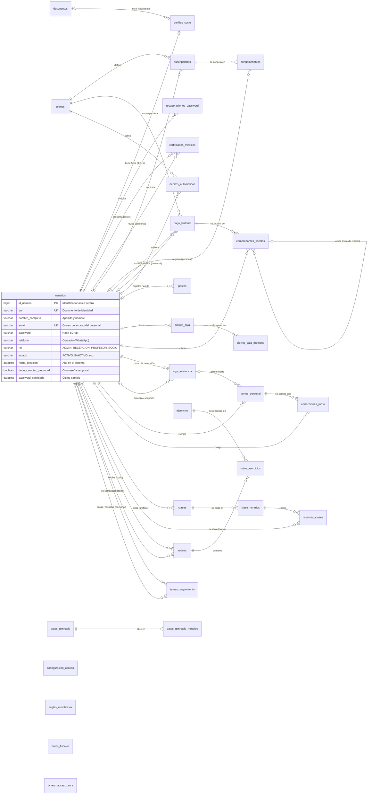
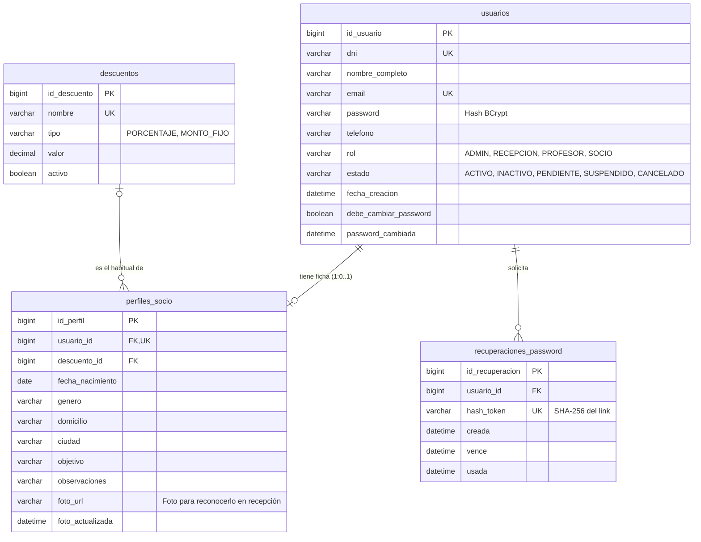
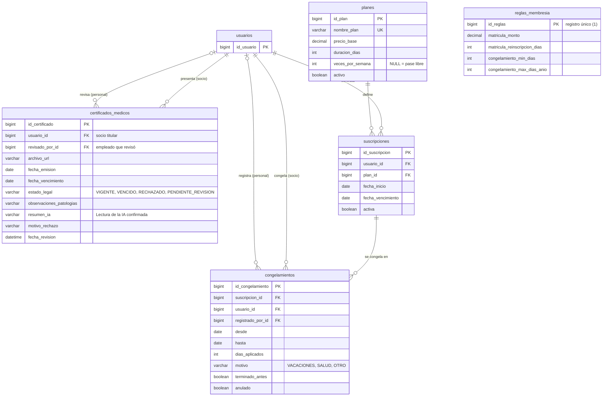
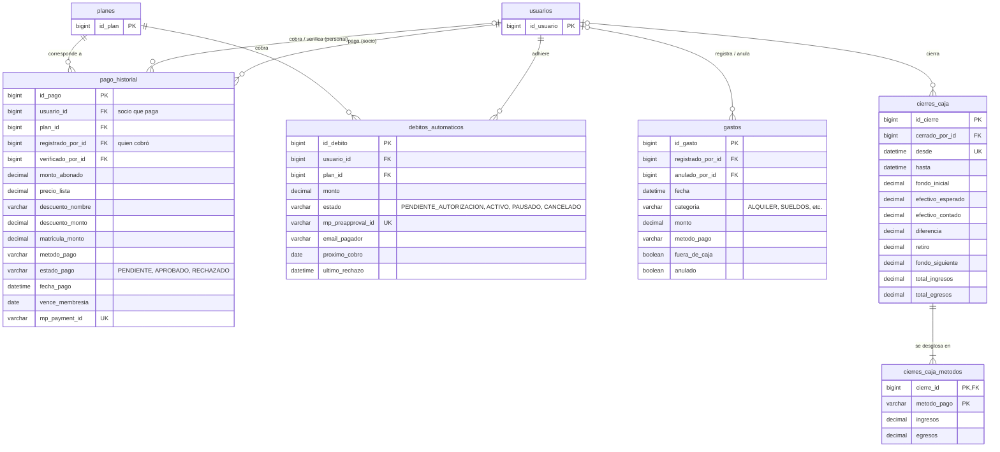
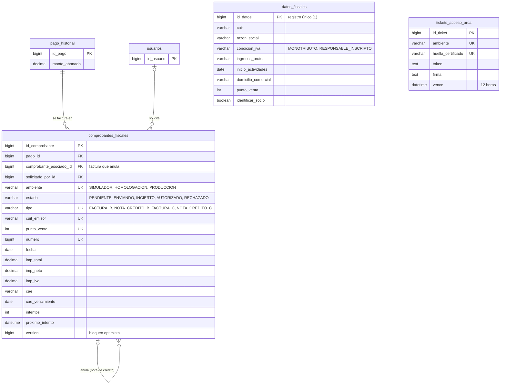
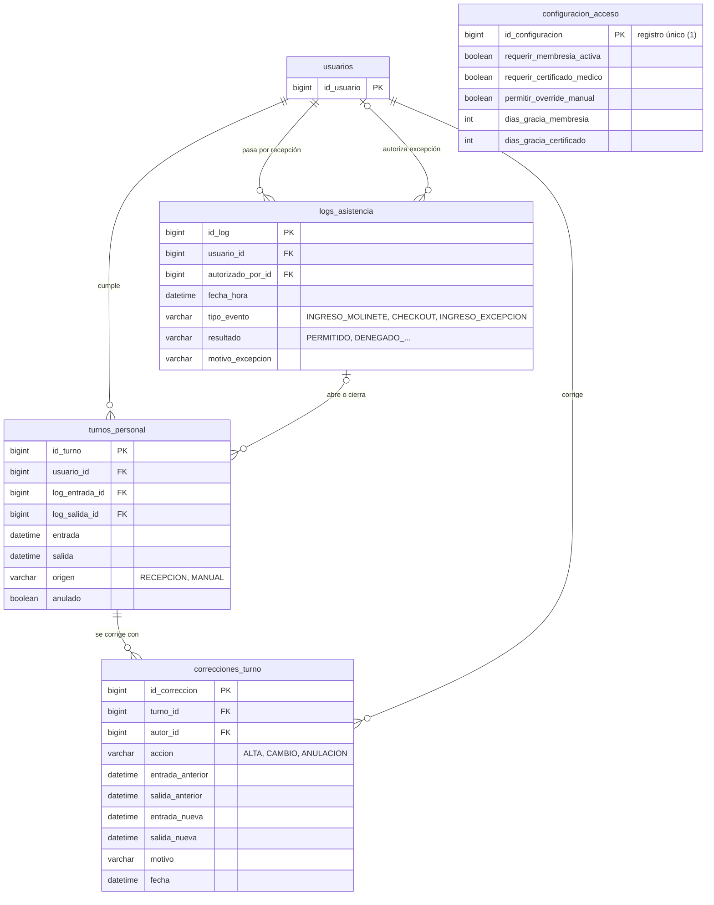
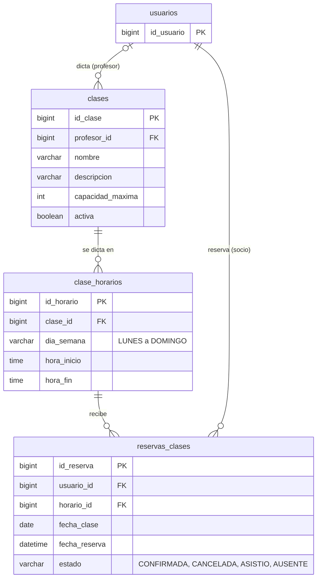
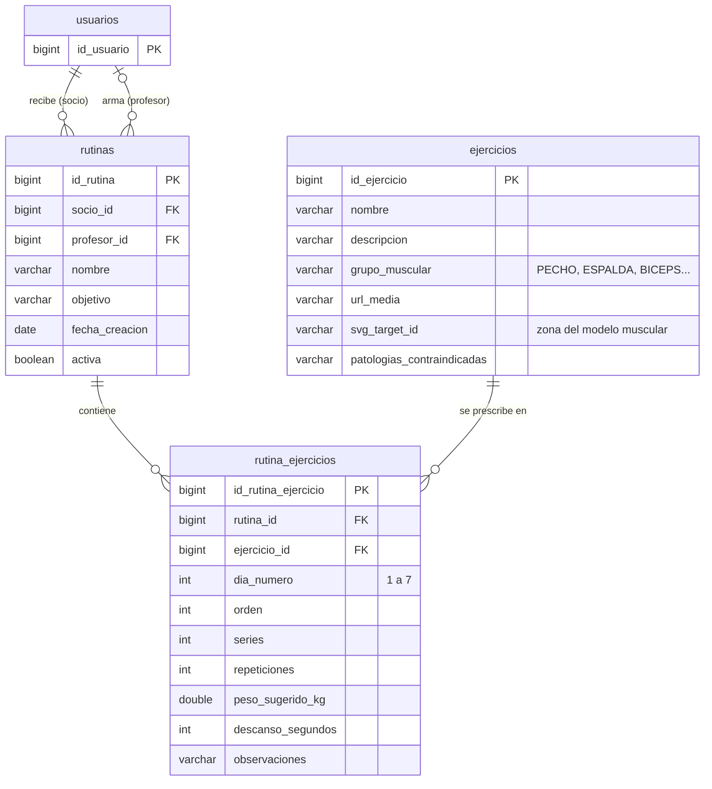
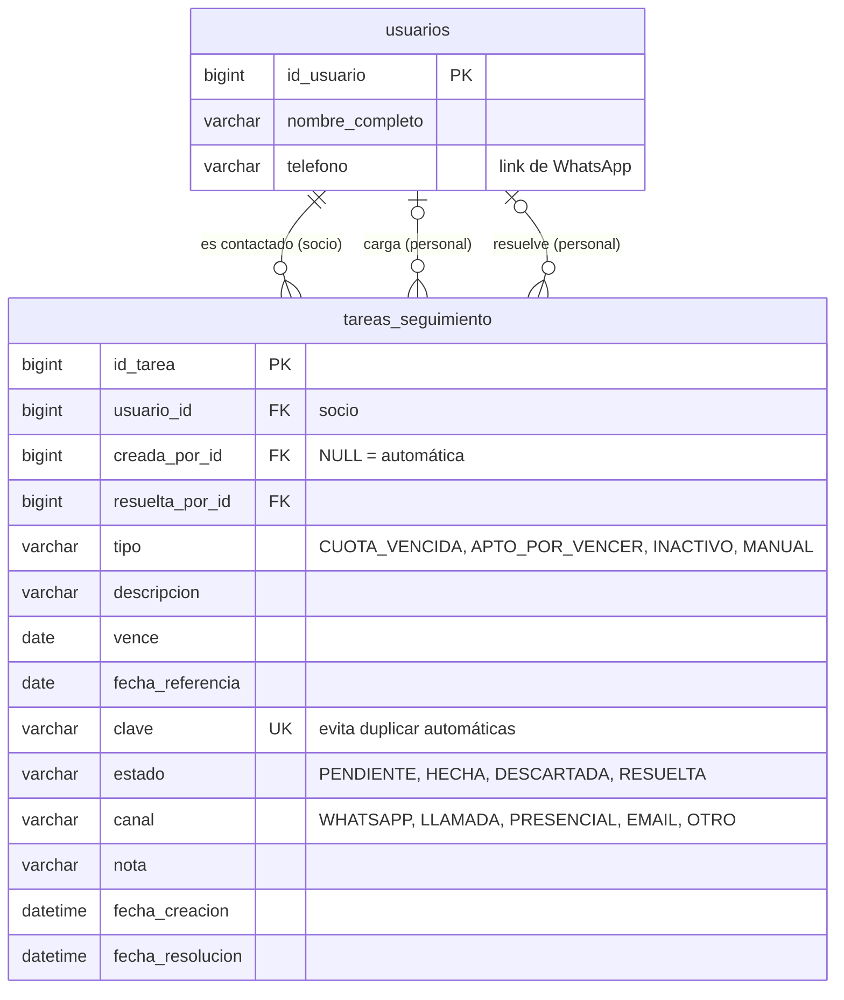
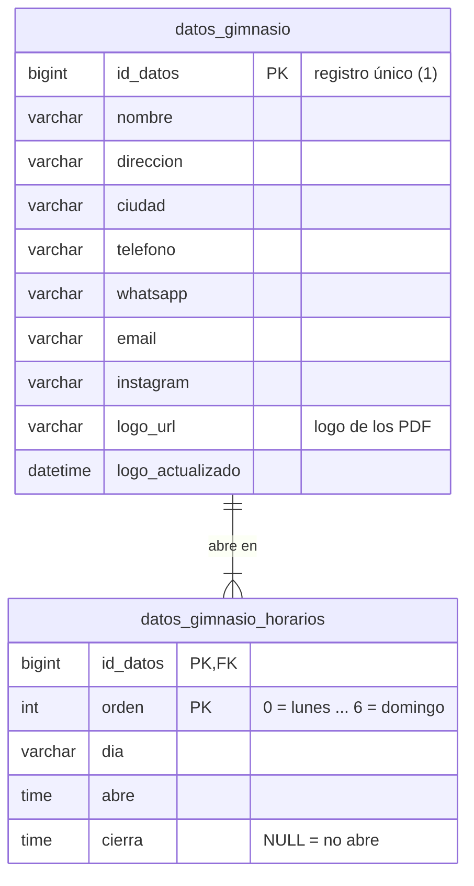

# SUMMIT · Modelo Entidad-Relación (DER)

Sistema de gestión de gimnasio (Panel Administrativo y Operativo) · base de datos MySQL `summit_fitness_db` · **30 entidades relacionales** (28 entidades JPA y 2 colecciones dependientes).

> **Alcance:**
> El modelo corresponde al **sistema de gestión del gimnasio**, que usa solo el personal (dueño/administración, recepción y profesores). Los socios están en `usuarios` con rol `SOCIO`, pero no inician sesión: son fichas que maneja el personal. La app móvil de socios, el chat, las notificaciones push, las novedades, la lista de espera y el registro de entrenamientos se retiraron del sistema. Se incorporaron la facturación electrónica de ARCA y el seguimiento de socios.

---

## Notación

Notación de **pata de gallo** (*crow's foot*), estándar de modelado relacional (compatible con Lucidchart, Draw.io y Mermaid):

| Símbolo | Significado |
|---|---|
| `\|\|` | exactamente uno (1) |
| `\|o` | cero o uno (0..1) |
| `o{` | cero o muchos (0..N) |
| `\|{` | uno o muchos (1..N) |

`PK` clave primaria · `FK` clave foránea · `UK` valor único / clave candidata.

Cada diagrama está también como archivo en [`diagramas/`](diagramas/): el fuente Mermaid (`.mmd`) y la imagen (`.svg` y `.png`).

## Organización de los Módulos del Sistema

La entidad troncal es **`usuarios`**: el personal (administración, recepción, profesores) y los socios se registran en una sola tabla y se distinguen por el atributo `rol`. El sistema se compone de 10 módulos:

| Módulo | Entidades |
|---|---|
| 1. Personas y seguridad | `usuarios`, `perfiles_socio`, `recuperaciones_password` |
| 2. Control médico y membresías | `certificados_medicos`, `planes`, `descuentos`, `suscripciones`, `congelamientos`, `reglas_membresia` |
| 3. Cobros, pagos y caja | `pago_historial`, `debitos_automaticos`, `gastos`, `cierres_caja`, `cierres_caja_metodos` |
| 4. Facturación electrónica (ARCA) | `datos_fiscales`, `comprobantes_fiscales`, `tickets_acceso_arca` |
| 5. Control de acceso y asistencia del personal | `configuracion_acceso`, `logs_asistencia`, `turnos_personal`, `correcciones_turno` |
| 6. Clases y reservas | `clases`, `clase_horarios`, `reservas_clases` |
| 7. Entrenamiento | `ejercicios`, `rutinas`, `rutina_ejercicios` |
| 8. Seguimiento de socios (CRM) | `tareas_seguimiento` |
| 9. Configuración institucional | `datos_gimnasio`, `datos_gimnasio_horarios` |

---

## 1. DER General (Vista de Conjunto)

Visión global de las 30 entidades y sus relaciones (diagrama [`01-der-general`](diagramas/01-der-general.svg)):

> **Nota de diseño:** `configuracion_acceso`, `reglas_membresia`, `datos_gimnasio` y `datos_fiscales` son tablas de **registro único** (id `1`) para la configuración del gimnasio: no dependen de datos transaccionales. Las tres primeras las crea el backend al arrancar con valores por defecto; `datos_fiscales` se crea al guardar por primera vez *Ajustes > Facturación*. `tickets_acceso_arca` guarda el permiso vigente para los web services de ARCA y no se relaciona con otras tablas.

---

## 2. Personas y Seguridad

Una sola tabla de personas con autenticación centralizada. La ficha del socio (`perfiles_socio`) es 1:1 y opcional: el personal no la tiene. El descuento habitual del socio se le propone en cada cobro. Los pedidos de "¿Olvidaste tu contraseña?" guardan solo la huella del link.

---

## 3. Control Médico y Membresías

El **certificado médico** es el control legal del sistema: al pasar por recepción se toma el certificado que rige (el de vencimiento más lejano que no fue rechazado) y se verifica que no esté vencido, con los días de gracia configurados. La **suscripción** es la vigencia de la membresía: cada cobro aprobado la extiende y cada congelamiento corre su vencimiento.

---

## 4. Cobros, Pagos y Caja

Cada cobro guarda la foto de lo que se cobró (precio de lista, descuento, matrícula y hasta cuándo quedó paga la membresía). El débito automático registra cada cobro de Mercado Pago como un `pago_historial` más. La caja se cierra por turnos: cada cierre guarda el arqueo y su desglose por medio de pago.

---

## 5. Facturación Electrónica (ARCA)

Cada cobro aprobado genera un comprobante `PENDIENTE` en la misma transacción; una cola le pide el CAE a ARCA y lo numera. Una factura autorizada no se borra: se anula con una nota de crédito que apunta a ella (`comprobante_asociado_id`). El comprobante copia los datos fiscales del momento en que se emitió.

---

## 6. Control de Acceso Presencial y Asistencia del Personal

Todo paso por el control de acceso de recepción queda en `logs_asistencia`: los ingresos de los socios (permitidos o denegados, y las excepciones con quién las autorizó y por qué) y las marcas del personal. Para el personal, la entrada y la salida además abren y cierran un `turno_personal`, que el admin corrige dejando el motivo.

---

## 7. Clases y Reservas de Cupos

---

## 8. Entrenamiento

`rutina_ejercicios` resuelve la relación N:M entre `rutinas` y `ejercicios`, con la dosis de cada ejercicio por día (series, repeticiones, peso y descanso). Las contraindicaciones de cada ejercicio se cruzan con las patologías del certificado médico del socio al armar la rutina.

---

## 9. Seguimiento de Socios (CRM)

Las tareas automáticas las genera el backend cada hora (cuota vencida hace pocos días, apto médico por vencer, socio al día que hace días que no viene); las manuales las carga el equipo. La `clave` identifica la situación de una tarea automática, así la misma situación no genera dos tareas.

---

## 10. Configuración Institucional del Gimnasio

Los datos públicos del gimnasio (nombre, contacto y logo) salen en los comprobantes y las rutinas en PDF. El horario de cada día define qué días cuentan en las métricas de asistencia.

---

## Cardinalidades y Reglas de Negocio

| Relación | Cardinalidad | Regla de Negocio |
|---|---|---|
| `usuarios` — `perfiles_socio` | 1 : 0..1 | Solo los socios tienen ficha personal. |
| `descuentos` — `perfiles_socio` | 0..1 : N | Un descuento puede ser el habitual de muchos socios; borrarlo deja a esos socios sin descuento habitual. |
| `usuarios` — `certificados_medicos` | 1 : N | Un socio presenta varios aptos a lo largo del tiempo; rige el de vencimiento más lejano que no fue rechazado. |
| `usuarios` — `suscripciones` | 1 : N | Un socio renueva o cambia de plan; tiene una sola suscripción activa a la vez. |
| `planes` — `suscripciones` | 1 : N | Un plan lo contratan muchos socios. |
| `suscripciones` — `congelamientos` | 1 : N | Una membresía puede congelarse varias veces, dentro del tope anual de días. |
| `usuarios` — `pago_historial` | 1 : N | Solo los cobros `APROBADO` extienden la membresía y suman en la caja. |
| `usuarios` — `debitos_automaticos` | 1 : N | Un socio puede adherir al débito automático, darse de baja y volver a adherir. |
| `cierres_caja` — `cierres_caja_metodos` | 1 : 1..N | Cada arqueo se desglosa por medio de pago. |
| `pago_historial` — `comprobantes_fiscales` | 1 : N | Un cobro tiene su factura y, si se anula, la nota de crédito. |
| `comprobantes_fiscales` — `comprobantes_fiscales` | 0..1 : N | Una nota de crédito apunta a la factura que anula. |
| `usuarios` — `logs_asistencia` | 1 : N | Todo paso por recepción queda registrado. |
| `usuarios` — `turnos_personal` | 1 : N | Cada persona del equipo marca su entrada y su salida. |
| `logs_asistencia` — `turnos_personal` | 0..1 : N | El paso por recepción que abrió o cerró el turno; vacío si el turno lo cargó el admin. |
| `turnos_personal` — `correcciones_turno` | 1 : N | Cada corrección deja autor, motivo y las horas de antes y después. |
| `usuarios` — `clases` | 0..1 : N | Un profesor puede dar varias clases. |
| `clases` — `clase_horarios` | 1 : N | Una clase tiene varios horarios semanales. |
| `clase_horarios` — `reservas_clases` | 1 : N | Las reservas de una fecha no superan la capacidad máxima de la clase. |
| `rutinas` — `ejercicios` | **N : M** | Resuelta con la entidad asociativa `rutina_ejercicios`. |
| `usuarios` — `rutinas` | 1 : N | Un socio tiene una sola rutina activa: asignar una nueva desactiva la anterior. |
| `usuarios` — `tareas_seguimiento` | 1 : N | Un socio puede tener varias tareas de contacto, automáticas o manuales. |
| `datos_gimnasio` — `datos_gimnasio_horarios` | 1 : 7 | Un horario por cada día de la semana (los días sin horas no abre). |
