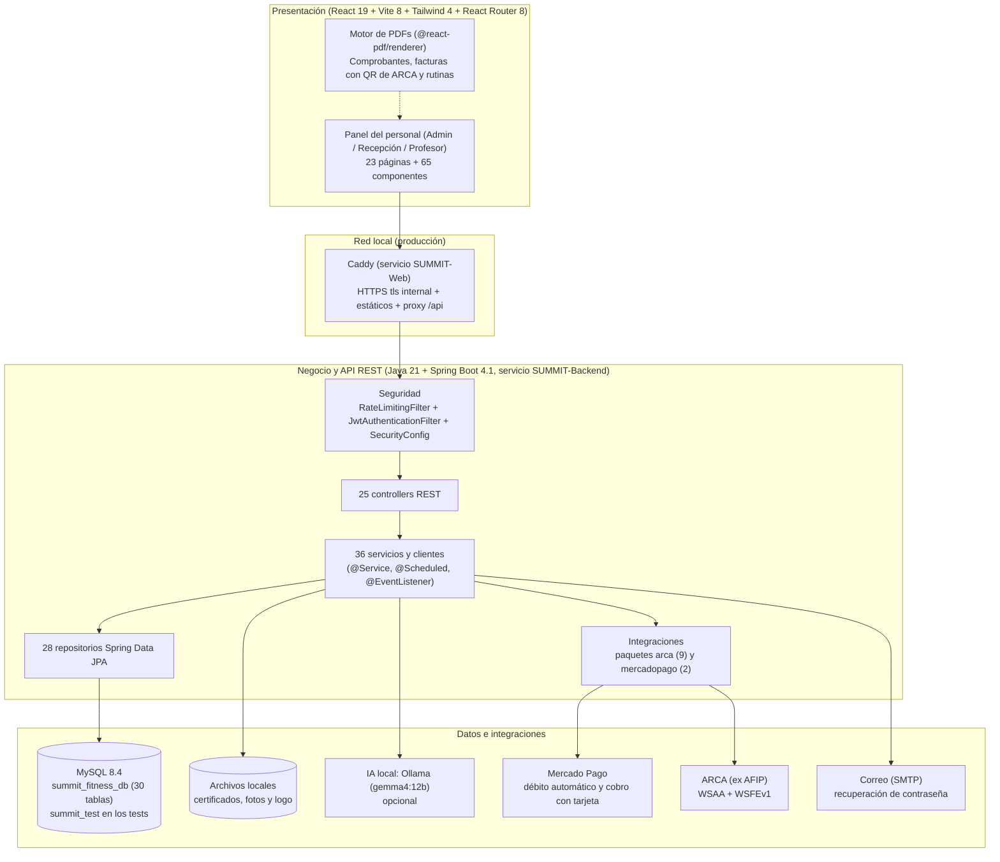

# Informe Técnico Detallado del Sistema SUMMIT — Índice Maestro y Arquitectura General

Este directorio contiene la documentación técnica del sistema **SUMMIT (gestión integral de gimnasio)**, organizada por áreas funcionales (backend, frontend, base de datos y operación) y detallando **archivo por archivo** sus clases, funciones, variables y estructuras de control (`if`, `for`, `switch`, `try/catch`, `.map()`, `.filter()`) con su propósito técnico y de negocio. Los enlaces apuntan al código de [`SUMMIT-Fitness`](../..).

> [!NOTE]
> **Alcance.** SUMMIT es un sistema **solo para el personal del gimnasio** (administración, recepción y profesores): los socios no tienen usuario ni aplicación propia (un usuario con rol `SOCIO` no puede iniciar sesión). Las funciones de versiones anteriores que ya no existen (portal y app del socio, notificaciones push, chat, registro de entrenamientos y progreso, lista de espera de clases y novedades) **no forman parte de este informe**. La **factura electrónica de ARCA** está documentada completa en los capítulos 13A y 13B.

---

## 1. Arquitectura Global del Sistema SUMMIT

SUMMIT es una aplicación cliente-servidor que corre en una PC del gimnasio: el panel web se abre desde cualquier PC de recepción de la red local, siempre con HTTPS.

### Flujo Transversal entre Áreas Funcionales

1. **Sesión y permisos (01 y 02)**:
   - Cada pedido pasa por `RateLimitingFilter` (limita por IP y por minuto los intentos de inicio de sesión, los de cambio y recuperación de contraseña, la descarga de fotos y el resto de los pedidos, cada grupo con su tope) y `JwtAuthenticationFilter` (valida el JWT firmado con `JWT_SECRET` y, en cada pedido, que la cuenta siga activa y que el token sea posterior al último cambio de contraseña). `SecurityConfig` decide por ruta y rol: `401` sin sesión, `403` sin permiso, `403 CAMBIAR_PASSWORD` con una contraseña temporal.
   - En el panel, `services/api.js` agrega el token, vuelve al login ante un `401` y lleva a cambiar la contraseña ante `CAMBIAR_PASSWORD`. El menú (`Sidebar.jsx`) y las rutas (`App.jsx`) muestran a cada rol solo lo suyo; las funciones opcionales (factura electrónica, cobro con tarjeta, recuperación por correo) aparecen según lo que informa el backend (`/api/auth/funciones`).

2. **Socios, membresías, cobros y caja (03, 04, 05 y 06)**:
   - Un socio se da de alta individualmente (con foto y certificado, `NuevoSocio.jsx` → `SocioService`) o por planilla (`ImportarSocios.jsx` → `ImportacionSociosService`, fila por fila).
   - Al cobrar (`CobroModal.jsx` / `CobroRapido.jsx` → `PagoService`), el backend calcula el **presupuesto** (precio vigente del plan − descuento + matrícula según las `ReglasMembresia`) y no cobra si el total que vio recepción cambió. Se cobra en efectivo, transferencia, Mercado Pago, **tarjeta en recepción** (`CobroConTarjetaService`, con clave de idempotencia) o por **débito automático** (`DebitoAutomaticoService`).
   - Un cobro **aprobado** extiende la `Suscripcion`, suma en el turno de caja abierto (`CajaService`) y deja su **factura electrónica** en la cola (`FacturacionService`). El comprobante del cobro es un PDF que pasa a ser la factura con CAE y QR apenas ARCA la autoriza.

3. **Control de acceso, personal, certificados e IA (07 y 08)**:
   - En `ControlAcceso.jsx` se ingresa el DNI (`AsistenciaService.registrarIngreso`). Si es del **personal**, se registra su entrada o salida de turno (`AsistenciaPersonalService`). Si es un **socio**, se controlan la cuenta, el congelamiento, la cuota con sus días de gracia, los días del plan en la semana (volver el mismo día no descuenta otro) y el apto médico, con ingreso por excepción si las reglas lo permiten.
   - El apto médico vale 365 días (Ley 5397). El **asistente de IA local** (`OllamaClient` + `AsistenteIaService`) lee el certificado (texto o imagen), y el backend calcula las advertencias exactas (otra persona, no apto, vencido, fecha imposible, sin matrícula); nada se guarda sin que una persona lo confirme. También sugiere ejercicios a evitar.

4. **Entrenamiento, clases y seguimiento (09, 10 y 11)**:
   - El profesor arma la rutina del socio por días en el constructor (`ConstructorRutinas.jsx` → `RutinaService`), eligiendo los ejercicios por buscador o tocando el **modelo muscular 2D** (`ModeloHumano.jsx`), viendo el **GIF demostrativo** de cada ejercicio al pasar el puntero (10 GIF en `public/gym-exercises/`, vinculados por `DataSeeder` al catálogo base de 29 ejercicios), con el **cruce preventivo** contra las patologías del certificado y las sugerencias de la IA, o partiendo de una rutina predeterminada. La rutina se imprime o se manda en PDF.
   - Las clases grupales (`ClaseService`, `ReservaService`) tienen horarios sin superposiciones, cupo por fecha, control de apto y asistencia.
   - Cada hora, `SeguimientoService` resuelve las tareas cuya situación cambió y crea las nuevas (cuota vencida, apto por vencer, socio que no viene), que recepción atiende con mensajes de WhatsApp ya armados.

5. **Tablero, métricas y facturación (12 y 13)**:
   - El tablero reúne el control de acceso, la actividad del día y las **métricas** comparadas con el período anterior, considerando el horario del gimnasio.
   - La **factura electrónica** emite Factura B o C con un solo hilo, reintentos espaciados y conciliación ante cortes, sin duplicar ni saltear números; se anula con notas de crédito.

6. **Calidad y operación (14)**: 83 tests automáticos contra MySQL real con simuladores de Mercado Pago y ARCA; scripts de instalación con HTTPS, copias de seguridad cifradas y verificadas, restauración con simulacro, diagnóstico y datos de demostración.

---

## 2. Índice de Documentos del Informe Detallado

| # | Documento | Área funcional | Archivos enlazados |
|---|---|---|---|
| **01A** | [01A-Nucleo-Arranque-y-Base-Backend.md](01A-Nucleo-Arranque-y-Base-Backend.md) | Núcleo del backend: Maven, Spring Boot, propiedades, `DataSeeder`, manejo global de errores, `RateLimitingFilter`, `ArchivoService`, formateadores y tareas programadas | 12 |
| **01B** | [01B-Nucleo-Layout-Servicios-y-Utilidades-Frontend.md](01B-Nucleo-Layout-Servicios-y-Utilidades-Frontend.md) | Núcleo del frontend: Vite, Tailwind, `App.jsx`, `Layout`, `Sidebar`, `Navbar`, `Pestanas`, componentes base, `api.js`, `useCarga`, `funciones.js` y `utils/` | 25 |
| **02A** | [02A-Seguridad-Autenticacion-y-Personal-Backend.md](02A-Seguridad-Autenticacion-y-Personal-Backend.md) | Seguridad del backend: JWT, `SecurityConfig`, contraseñas temporales y recuperación por correo, usuarios del personal | 19 |
| **02B** | [02B-Seguridad-Autenticacion-y-Personal-Frontend.md](02B-Seguridad-Autenticacion-y-Personal-Frontend.md) | Seguridad del frontend: `Login.jsx`, `src/cuenta/*`, `GestionPersonal.jsx`, `AjustesEquipo.jsx`, `auth.js` y `cuenta.js` | 11 |
| **03A** | [03A-Socios-Fotos-e-Importacion-Backend.md](03A-Socios-Fotos-e-Importacion-Backend.md) | Socios en el backend: `PerfilSocio`, `SocioService`, `ImportacionSociosService`, `FotoSocioService` y `Fotos` | 12 |
| **03B** | [03B-Socios-Fotos-e-Importacion-Frontend.md](03B-Socios-Fotos-e-Importacion-Frontend.md) | Socios en el frontend: `Socios.jsx`, `NuevoSocio.jsx`, `ImportarSocios.jsx`, `FichaSocioModal.jsx`, `EditarSocioModal.jsx`, fotos y `planilla.js` | 10 |
| **04** | [04-Planes-Membresias-Descuentos-y-Congelamientos.md](04-Planes-Membresias-Descuentos-y-Congelamientos.md) | Planes, membresías, descuentos, reglas de membresía y congelamientos (backend y frontend) | 31 |
| **05A** | [05A-Cobros-Caja-Gastos-Debito-y-Tarjeta-Backend.md](05A-Cobros-Caja-Gastos-Debito-y-Tarjeta-Backend.md) | Cobros, presupuesto, caja (turnos, gastos y cierres), débito automático y cobro con tarjeta con Mercado Pago | 34 |
| **05B** | [05B-Cobros-Caja-Gastos-Debito-y-Tarjeta-Frontend.md](05B-Cobros-Caja-Gastos-Debito-y-Tarjeta-Frontend.md) | `Caja.jsx`, cobros, comprobante del cobro, débitos, gastos, cierres y cobro con tarjeta | 16 |
| **06** | [06-Motor-PDF-Comprobantes-Facturas-y-Rutinas.md](06-Motor-PDF-Comprobantes-Facturas-y-Rutinas.md) | Motor de PDFs: comprobantes, **facturas con QR de ARCA** y rutinas, membrete, botones y fuentes | 11 |
| **07A** | [07A-Control-Acceso-y-Asistencia-Personal-Backend.md](07A-Control-Acceso-y-Asistencia-Personal-Backend.md) | Control de acceso de socios y personal, reglas de acceso, turnos y correcciones del personal | 22 |
| **07B** | [07B-Control-Acceso-y-Asistencia-Personal-Frontend.md](07B-Control-Acceso-y-Asistencia-Personal-Frontend.md) | `ControlAcceso.jsx`, `FichaIngreso.jsx`, reglas de acceso y asistencia del personal | 7 |
| **08** | [08-Certificados-Medicos-y-Asistente-IA.md](08-Certificados-Medicos-y-Asistente-IA.md) | Certificados médicos (Ley 5397), revisión manual y asistente de IA local (lectura de certificados y ejercicios a evitar) | 14 |
| **09A** | [09A-Entrenamiento-Ejercicios-y-Rutinas-Backend.md](09A-Entrenamiento-Ejercicios-y-Rutinas-Backend.md) | Catálogo de ejercicios (29 base, 10 con GIF), rutinas por días y cruce preventivo de patologías (RF-09) | 17 |
| **09B** | [09B-Entrenamiento-Modelo-Muscular-y-Rutinas-Frontend.md](09B-Entrenamiento-Modelo-Muscular-y-Rutinas-Frontend.md) | Modelo muscular 2D, catálogo con GIF demostrativos, lista de rutinas, rutinas predeterminadas y constructor | 15 |
| **10** | [10-Clases-Horarios-y-Reservas.md](10-Clases-Horarios-y-Reservas.md) | Clases grupales, horarios sin superposiciones, reservas con cupo y apto, y asistencia | 15 |
| **11** | [11-CRM-Seguimiento-Inactividad-y-Tareas.md](11-CRM-Seguimiento-Inactividad-y-Tareas.md) | Inactividad por niveles, tareas automáticas y manuales, contacto por WhatsApp | 16 |
| **12** | [12-Dashboard-Metricas-y-Datos-del-Gimnasio.md](12-Dashboard-Metricas-y-Datos-del-Gimnasio.md) | Tablero, métricas (socios, membresías y ganancias), gráficos en SVG propio y datos del gimnasio | 21 |
| **13A** | [13A-Facturacion-Electronica-ARCA-Backend.md](13A-Facturacion-Electronica-ARCA-Backend.md) | Factura electrónica: WSAA, WSFEv1, cola de emisión, conciliación, notas de crédito, simulador de ARCA y datos fiscales | 28 |
| **13B** | [13B-Facturacion-Electronica-ARCA-Frontend.md](13B-Facturacion-Electronica-ARCA-Frontend.md) | Datos fiscales, prueba de conexión, pestaña Facturas, detalle del comprobante y avisos | 11 |
| **14A** | [14A-Suite-Tests-Automaticos-Backend.md](14A-Suite-Tests-Automaticos-Backend.md) | 83 tests automáticos en 11 clases (integración contra MySQL y unitarios) | 13 |
| **14B** | [14B-Scripts-Instalacion-Backups-y-Base-de-Datos.md](14B-Scripts-Instalacion-Backups-y-Base-de-Datos.md) | Instalación con HTTPS, servicios de Windows, copias cifradas, restauración, diagnóstico, datos de demostración y documentación de la base | 24 |

### Documentación de la Base de Datos

| Documento | Contenido |
| :--- | :--- |
| [01-modelo-entidad-relacion.md](../base-de-datos/01-modelo-entidad-relacion.md) | Diagrama entidad-relación general y de los 10 módulos. |
| [02-modelo-logico.md](../base-de-datos/02-modelo-logico.md) | Modelo lógico de las 30 tablas, diccionario de datos y normalización. |
| [03-creacion-summit.sql](../base-de-datos/03-creacion-summit.sql) | Script de creación con 44 claves foráneas y 54 restricciones `CHECK`. |
