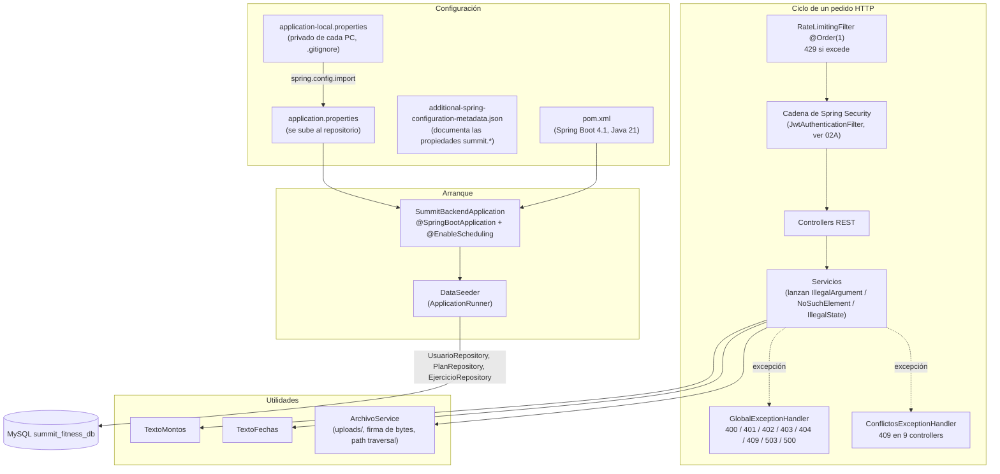

# 01A - Núcleo: Arranque, Configuración y Base del Backend

Este documento detalla los archivos que hacen arrancar el backend de **SUMMIT** y que usan todos los módulos: el proyecto Maven, la clase principal, la configuración (`application.properties` y la configuración privada de cada PC), el manejo unificado de errores, el limitador de pedidos por IP, la carga de datos iniciales y las utilidades de archivos, fechas y montos.

> Los datos de demostración (`DatosDemo`) se documentan en el capítulo [14B](14B-Scripts-Instalacion-Backups-y-Base-de-Datos.md) junto con el script que los regenera, y la seguridad (`SecurityConfig`, JWT) en el capítulo [02A](02A-Seguridad-Autenticacion-y-Personal-Backend.md).

---

## 1. Explicación de Relaciones del Área (Arquitectura Punta a Punta)

El backend es una aplicación **Spring Boot 4.1** (Spring Framework 7, Spring Security 7, Hibernate 7, Jackson 3) sobre **Java 21**, que expone una API REST bajo `/api/**` en el puerto `8080` y persiste en **MySQL 8** (`summit_fitness_db`). El núcleo resuelve cuatro cosas que comparten todas las áreas funcionales:

1. **Arranque y configuración**:
   - [`SummitBackendApplication`](../../summit-backend/src/main/java/com/summit/backend/SummitBackendApplication.java) levanta el contexto de Spring y habilita las tareas programadas (`@EnableScheduling`), que usan el seguimiento de socios, el débito automático, la revisión de cobros con tarjeta, la cola de facturación y la limpieza del limitador.
   - [`application.properties`](../../summit-backend/src/main/resources/application.properties) tiene la configuración que se sube al repositorio (sin secretos) y al principio importa `application-local.properties` (`spring.config.import=optional:...`), el archivo privado de cada PC con las contraseñas. Todo valor privado se lee como `${VARIABLE}`, así se puede dar también como variable de entorno.
   - El [`pom.xml`](../../summit-backend/pom.xml) excluye `application-local.properties` del `.jar`: el archivo compilado nunca lleva contraseñas.

2. **Errores en un solo lugar**:
   - Los servicios no devuelven códigos HTTP: avisan con el **tipo de excepción** (`IllegalArgumentException` = datos inválidos, `NoSuchElementException` = no existe, `IllegalStateException` = choca con el estado actual) y un mensaje escrito para el usuario.
   - [`GlobalExceptionHandler`](../../summit-backend/src/main/java/com/summit/backend/config/GlobalExceptionHandler.java) traduce cada tipo a su código HTTP y arma siempre el mismo cuerpo JSON (`timestamp`, `status`, `error` y datos extra). Los controllers no tienen `try/catch`.
   - [`ConflictosExceptionHandler`](../../summit-backend/src/main/java/com/summit/backend/config/ConflictosExceptionHandler.java) tiene más prioridad y, solo para 9 controllers, convierte `IllegalStateException` en `409 Conflict` (una caja que otra persona acaba de cerrar, un congelamiento superpuesto).
   - En el frontend, `services/api.js` lee el campo `error` de ese JSON y lo muestra tal cual.

3. **Protección contra abuso**:
   - [`RateLimitingFilter`](../../summit-backend/src/main/java/com/summit/backend/config/RateLimitingFilter.java) corre antes que la seguridad (`@Order(1)`) y limita los pedidos por IP y por categoría en una ventana de 1 minuto (login 5, contraseñas 5, fotos 600, resto 120). Excedido, responde `429`.

4. **Datos iniciales y utilidades**:
   - [`DataSeeder`](../../summit-backend/src/main/java/com/summit/backend/config/DataSeeder.java) deja usable una base vacía: el admin inicial, 3 planes y un catálogo de 29 ejercicios (10 con su GIF demostrativo). Es idempotente: crea lo que falta y, de lo que ya existe, solo completa el GIF y la zona del modelo si estaban vacíos.
   - [`ArchivoService`](../../summit-backend/src/main/java/com/summit/backend/service/ArchivoService.java) guarda y entrega los archivos subidos (certificados, fotos, logo) en `summit.uploads.dir`, valida el tipo real por su firma de bytes y bloquea rutas con `../`.
   - [`TextoFechas`](../../summit-backend/src/main/java/com/summit/backend/service/TextoFechas.java) y [`TextoMontos`](../../summit-backend/src/main/java/com/summit/backend/service/TextoMontos.java) formatean fechas (`30/10/2026`) y pesos (`$ 23.500`) para los mensajes que arman los servicios.

### Diagrama de Arquitectura y Relaciones del Módulo

---

## 2. Análisis Detallado Archivo por Archivo

---

### 2.1. [`pom.xml`](../../summit-backend/pom.xml)

- **Ruta**: `summit-backend/pom.xml`
- **Propósito del archivo**: Descriptor Maven del backend. Hereda de `spring-boot-starter-parent` **4.1.2** (que fija las versiones compatibles de Spring, Hibernate, Jackson, Tomcat y el driver de MySQL) y declara Java **21**.
- **Relaciones**: Lo usan `mvnw.cmd` (desarrollo), `instalacion/compilar.ps1` (genera el `.jar` de la PC del gimnasio) y los tests (`mvnw.cmd test`).

#### Dependencias
| Dependencia | Versión | Para qué se usa |
| :--- | :--- | :--- |
| `spring-boot-starter-webmvc` | (parent) | API REST con Spring MVC y Tomcat embebido. En Boot 4 el antiguo `starter-web` se llama `starter-webmvc`. |
| `spring-boot-starter-data-jpa` | (parent) | Persistencia con JPA/Hibernate 7 y repositorios Spring Data. |
| `spring-boot-starter-security` | (parent) | Autenticación y permisos por rol (ver 02A). |
| `spring-boot-starter-validation` | (parent) | Anotaciones `@Valid`, `@NotBlank`, `@Size` en los DTOs de entrada. |
| `spring-boot-starter-mail` | (parent) | Mail de "¿Olvidaste tu contraseña?" (`spring.mail.*`). |
| `mysql-connector-j` | (parent), `runtime` | Driver JDBC de MySQL 8. |
| `lombok` | (parent), `optional` | `@Getter`, `@Setter`, `@Builder`, `@RequiredArgsConstructor`, `@Slf4j` en entidades y servicios. Se excluye del `.jar` final. |
| `jjwt-api` / `jjwt-impl` / `jjwt-jackson` | `0.13.0` | Firma y verificación de los tokens JWT de sesión. |
| `com.mercadopago:sdk-java` | `3.7.0` | SDK oficial de Mercado Pago para el cobro con tarjeta en recepción (Checkout API). |
| `org.apache.pdfbox:pdfbox` | `3.0.8` | Lee certificados en PDF para la IA: extrae el texto y dibuja las páginas escaneadas como imagen. |
| `org.bouncycastle:bcpkix-jdk18on` | `1.86` | Firma CMS del pedido de acceso a ARCA (WSAA), que Java no trae. |
| `spring-boot-starter-webmvc-test` | (parent), `test` | JUnit 5, MockMvc y AssertJ para los tests de integración. |

#### Plugins de construcción
1. **`maven-jar-plugin`** con `<exclude>application-local.properties</exclude>`: la configuración privada de la PC donde se compila no entra al `.jar`. En desarrollo no cambia nada porque `spring-boot:run` la lee de `target/classes`.
2. **`spring-boot-maven-plugin`** con Lombok excluido: arma el `.jar` ejecutable sin la librería de Lombok, que solo sirve al compilar.

---

### 2.2. [`SummitBackendApplication.java`](../../summit-backend/src/main/java/com/summit/backend/SummitBackendApplication.java)

- **Ruta**: `summit-backend/src/main/java/com/summit/backend/SummitBackendApplication.java`
- **Propósito del archivo**: Punto de entrada del backend.
- **Anotaciones**:
  - `@SpringBootApplication`: activa la configuración automática y el escaneo de componentes del paquete `com.summit.backend` (controllers, servicios, repositorios, filtros).
  - `@EnableScheduling`: habilita los métodos `@Scheduled` de todo el sistema: `SeguimientoService.generarTareas` (minuto 5 de cada hora), `CertificadoMedicoService.procesarCertificadosVencidos` (medianoche), `PasswordService` (limpieza de links de recuperación viejos, 3:45), `DebitoAutomaticoService.sincronizarProgramado` (cada hora con Mercado Pago), `CobroConTarjetaService.revisarEnProceso` (cobros con tarjeta en proceso, cada 5 minutos), `FacturacionService.reintentarPendientes` (cola de ARCA, cada 60 segundos) y `RateLimitingFilter.cleanupStaleEntries` (cada 5 minutos). `spring.task.scheduling.pool.size=3` permite que corran varias a la vez.

#### Métodos
1. **`main(String[] args)`**:
   - **Parámetros**: `args` (`String[]`), argumentos de la línea de comandos (por ejemplo `--spring.profiles.active=...`).
   - **Retorno**: `void`.
   - **Lógica**: `SpringApplication.run(SummitBackendApplication.class, args)` crea el contexto, conecta a MySQL, actualiza el esquema (`ddl-auto=update`), ejecuta los `@PostConstruct` (registros únicos de configuración) y los `ApplicationRunner` (`DataSeeder`, `DatosDemo`) y deja escuchando Tomcat en el puerto 8080.

---

### 2.3. [`application.properties`](../../summit-backend/src/main/resources/application.properties)

- **Ruta**: `summit-backend/src/main/resources/application.properties`
- **Propósito del archivo**: Configuración del backend que se sube al repositorio. No contiene contraseñas: cada valor privado se lee de `application-local.properties` o de una variable de entorno con el mismo nombre (que tiene prioridad).

#### Propiedades por grupo
| Grupo | Propiedades | Valor / Propósito |
| :--- | :--- | :--- |
| Servidor | `server.port` | `8080`. |
| Configuración privada | `spring.config.import` | `optional:classpath:application-local.properties`: si el archivo no está, el backend arranca igual y falla recién al resolver `${DB_USERNAME}`, con un mensaje claro. |
| Base de datos | `spring.datasource.url`, `username`, `password`, `driver-class-name` | `jdbc:mysql://localhost:3306/summit_fitness_db?createDatabaseIfNotExist=true&useSSL=false&serverTimezone=UTC&allowPublicKeyRetrieval=true`: crea la base sola la primera vez. Usuario y clave de `${DB_USERNAME}` y `${DB_PASSWORD}`. |
| JPA | `spring.jpa.hibernate.ddl-auto=update` | Hibernate crea y amplía las tablas a partir de las entidades (nunca borra columnas). |
| JPA | `spring.jpa.show-sql=false`, `hibernate.format_sql=true` | SQL apagado; si se prende, sale formateado. |
| JPA | `spring.jpa.open-in-view=true` | Explícito para que no avise al arrancar: algunas respuestas leen datos LAZY (el plan de una membresía) mientras se arman. |
| JSON | `spring.jackson.use-jackson2-defaults=true` | Jackson 3 con los valores por defecto de Jackson 2, que es como lee y arma el JSON el panel (un dato que falta queda en `false` o `null` en vez de rechazar el pedido). |
| JWT | `jwt.secret=${JWT_SECRET}`, `jwt.expiration=86400000` | Clave de firma (mínimo 48 caracteres) y duración del token: 24 h. |
| Recuperación de contraseña | `summit.app.url=${APP_URL:}`, `summit.recuperacion.minutos=30` | Dirección del panel para el link del mail y validez del link. |
| Correo | `spring.mail.host/port/username/password`, `summit.mail.remitente` | Opcional. STARTTLS obligatorio (`starttls.enable` y `starttls.required`) y 10 s de espera máxima en conexión, lectura y escritura. |
| Tareas programadas | `spring.task.scheduling.pool.size=3` | Tres hilos, así una tarea lenta (esperando a Mercado Pago) no frena a las demás. |
| Proxy | `server.forward-headers-strategy=native` | Detrás de Caddy, Tomcat toma la IP real de `X-Forwarded-For` solo si el pedido llega desde una IP interna (lo usa el limitador). |
| CORS | `summit.cors.origins` | `http://localhost:5173,http://localhost:3000`. |
| Archivos | `summit.uploads.dir=uploads` | Carpeta de certificados, fotos y logo (excluida del repositorio: datos de salud). |
| IA local | `summit.ia.habilitada`, `url`, `modelo`, `timeout-segundos` | `true`, `http://localhost:11434`, `gemma4:12b` (texto e imágenes) y 180 s. |
| Admin inicial | `summit.seed.admin.email/password/dni` | `admin@summit.com`, `${ADMIN_PASSWORD:}`, `00000000`. |
| Demo | `summit.demo.habilitada/password/semilla` | `${DEMO:false}`, `${DEMO_PASSWORD:}`, `${DEMO_SEMILLA:2026}` (ver 14B). |
| Pool de conexiones | `spring.datasource.hikari.*` | Máximo 15 conexiones, mínimo 5 ociosas, 20 s de espera y 30 min de vida. |
| Tamaño de pedidos | `spring.servlet.multipart.max-file-size/max-request-size=5MB`, `server.tomcat.max-swallow-size=2MB` | Evita subidas enormes ("payload bombing"). |
| Paginación | `spring.data.web.pageable.default-page-size=20`, `max-page-size=50` | Tamaño de página por defecto y máximo. |
| Beans | `spring.main.allow-bean-definition-overriding=true` | Permite que los tests reemplacen beans (simuladores). |
| Mercado Pago | `summit.pagos.mp.access-token`, `url`, `back-url`, `sincronizar-ms`, `public-key` | Débito automático y cobro con tarjeta; sincronización cada 3.600.000 ms (1 h). |
| Tarjeta en recepción | `summit.pagos.tarjeta.modo=${MP_TARJETA:APAGADO}`, `revisar-ms=300000` | `APAGADO`, `SIMULADOR` o `MERCADO_PAGO`; revisión de cobros en proceso cada 5 min. |
| ARCA | `summit.arca.habilitada`, `ambiente`, `certificado`, `certificado-password`, `reintentos-ms` | Factura electrónica apagada por defecto, ambiente `SIMULADOR`, reintentos cada 60 s (ver 13A). |

---

### 2.4. [`application-local.properties.example`](../../summit-backend/src/main/resources/application-local.properties.example)

- **Ruta**: `summit-backend/src/main/resources/application-local.properties.example`
- **Propósito del archivo**: Plantilla del archivo privado de cada PC. Se copia como `application-local.properties` (que está en `.gitignore`) y se completan los valores. Cada línea está explicada para quien instala.

#### Variables
| Variable | Obligatoria | Propósito |
| :--- | :--- | :--- |
| `DB_USERNAME`, `DB_PASSWORD` | Sí | Usuario y contraseña de MySQL. |
| `JWT_SECRET` | Sí | Clave de firma de las sesiones, al azar y de 48 caracteres o más. Incluye el comando de PowerShell que la genera con `RandomNumberGenerator`. Cambiarla invalida las sesiones abiertas. |
| `ADMIN_PASSWORD` | La primera vez | Contraseña del admin inicial; solo se usa con la base sin administradores. Vacía = no se crea. |
| `MAIL_HOST`, `MAIL_PORT`, `MAIL_USERNAME`, `MAIL_PASSWORD`, `APP_URL` | No | Correo de recuperación de contraseña. Explica cómo usar una "contraseña de aplicación" de Gmail. Sin ellos, el login no ofrece la opción. |
| `MP_ACCESS_TOKEN` | No | Credencial privada de Mercado Pago (débito automático y tarjeta). |
| `MP_TARJETA`, `MP_PUBLIC_KEY` | No | Modo del cobro con tarjeta (`APAGADO`, `SIMULADOR`, `MERCADO_PAGO`) y clave pública de la cuenta. |
| `ARCA_HABILITADA`, `ARCA_AMBIENTE`, `ARCA_CERTIFICADO`, `ARCA_CERTIFICADO_PASSWORD` | No | Factura electrónica: interruptor, ambiente (`SIMULADOR`, `HOMOLOGACION`, `PRODUCCION`) y certificado `.p12` (la ruta con barras `/`). |
| `DEMO`, `DEMO_PASSWORD` | No | Carga de 6 meses de datos simulados con la base sin socios. |

---

### 2.5. [`additional-spring-configuration-metadata.json`](../../summit-backend/src/main/resources/META-INF/additional-spring-configuration-metadata.json)

- **Ruta**: `summit-backend/src/main/resources/META-INF/additional-spring-configuration-metadata.json`
- **Propósito del archivo**: Describe las propiedades propias del proyecto (`jwt.*`, `summit.cors.origins`, `summit.uploads.dir`, `summit.ia.*`, `summit.seed.admin.*`, `summit.pagos.mp.*`) con su tipo Java y una descripción. El editor las reconoce (autocompletado y documentación al pasar el mouse) en lugar de marcarlas como desconocidas. No cambia el comportamiento del backend.

---

### 2.6. [`GlobalExceptionHandler.java`](../../summit-backend/src/main/java/com/summit/backend/config/GlobalExceptionHandler.java)

- **Ruta**: `summit-backend/src/main/java/com/summit/backend/config/GlobalExceptionHandler.java`
- **Propósito del archivo**: Único lugar que traduce los errores a códigos HTTP (`@RestControllerAdvice`). Los controllers no repiten `try/catch` y todas las respuestas de error tienen la misma forma.
- **Relaciones**: Atiende las excepciones de todos los controllers. Conoce las excepciones propias de `PagoService`, `CobroConTarjetaService`, `RutinaService`, `PasswordService`, `MercadoPagoClient` y `OllamaClient`. Lo complementa `ConflictosExceptionHandler`.

#### Manejadores (`@ExceptionHandler`)
| Excepción | Código HTTP | Mensaje / cuerpo |
| :--- | :--- | :--- |
| `IllegalArgumentException` | 400 | El mensaje del servicio. Dos casos se reescriben porque hablan de clases de Java: `NumberFormatException` → "Algún número tiene un formato inválido"; un mensaje que empieza con `No enum constant` → "El valor X no es válido" (toma lo que sigue al último punto). |
| `NoSuchElementException` | 404 | El mensaje del servicio. |
| `IllegalStateException` | 400 | El mensaje (409 en los controllers de `ConflictosExceptionHandler`). |
| `DateTimeException` | 400 | "Alguna fecha tiene un formato inválido". |
| `BadCredentialsException` | 401 | El mensaje que arma `AuthService` (credenciales inválidas o cuenta inactiva). |
| `AccessDeniedException` | 403 | "No tienes permisos para acceder a este recurso". |
| `PagoService.TotalCambiadoException` | 409 | Cambió un precio mientras recepción cobraba: el panel recalcula y muestra el total nuevo. |
| `CobroConTarjetaService.TarjetaRechazadaException` | 402 | Mensaje + `codigo: "TARJETA_RECHAZADA"`: el panel pide otra clave de idempotencia para reintentar con otra tarjeta. |
| `RutinaService.RiesgoLesionException` | 400 | Mensaje + `riesgos` (lista): el constructor de rutinas ofrece forzar el ejercicio contraindicado. |
| `PasswordService.LinkInvalidoException` | 400 | Mensaje + `codigo: "LINK_INVALIDO"`. |
| `MercadoPagoNoDisponibleException`, `IaNoDisponibleException`, `RecuperacionNoDisponibleException` | 503 | Servicio externo u opcional que no está: el resto del sistema sigue funcionando. |
| `MaxUploadSizeExceededException` | 400 | "El archivo supera el tamaño máximo de 5 MB". |
| `MethodArgumentTypeMismatchException` | 400 | "El parámetro X tiene un formato inválido" (ej. `?fecha=hola`). |
| `MissingServletRequestParameterException` | 400 | "Falta el parámetro 'X'". |
| `HttpMessageNotReadableException` | 400 | Si la causa es un `DatabindException` con ruta, nombra el campo ("El campo monto tiene un formato inválido"); si no, "Faltan los datos o no tienen formato JSON". |
| `NoResourceFoundException` | 404 | "No existe el recurso pedido". |
| `HttpRequestMethodNotSupportedException` | 405 | "La operación X no está permitida en esta ruta". |
| `MethodArgumentNotValidException` | 400 | "Error de validación de datos" + `detalles` (mapa campo → mensaje de la anotación de validación). |
| `Exception` (cualquier otra) | 500 | "Ocurrió un error interno en el servidor". El detalle va solo al registro (`log.error`), para no exponer SQL, clases o rutas. |

#### Métodos auxiliares
1. **`error(HttpStatus status, String mensaje, Object... extra)`** (`private static`):
   - **Retorno**: `ResponseEntity<Map<String, Object>>`.
   - **Variables locales**: `body` (`HashMap`), con `timestamp` (`LocalDateTime.now()`), `status` (número) y `error` (`String.valueOf(mensaje)`, así un mensaje `null` no rompe).
   - **Estructuras de control**: `for (int i = 0; i < extra.length; i += 2)` recorre los datos extra de a pares clave/valor y los agrega al cuerpo (`codigo`, `riesgos`, `detalles`).
2. **`validacion(...)`**: recorre con `forEach` los errores del `BindingResult`, castea cada uno a `FieldError` y arma el mapa `campo → mensaje`.

---

### 2.7. [`ConflictosExceptionHandler.java`](../../summit-backend/src/main/java/com/summit/backend/config/ConflictosExceptionHandler.java)

- **Ruta**: `summit-backend/src/main/java/com/summit/backend/config/ConflictosExceptionHandler.java`
- **Propósito del archivo**: En los controllers donde una operación puede chocar con lo que hizo otra persona, una `IllegalStateException` significa "conflicto con el estado actual" y responde `409` en lugar de `400`.
- **Anotaciones**:
  - `@RestControllerAdvice(assignableTypes = {...})`: se limita a `MembresiaConfigController`, `CongelamientoController`, `CajaController`, `SeguimientoController`, `FacturacionController`, `AsistenciaController`, `AsistenciaPersonalController`, `CertificadoMedicoController` y `DebitoAutomaticoController`.
  - `@Order(Ordered.HIGHEST_PRECEDENCE)`: se evalúa antes que `GlobalExceptionHandler`, que atiende el resto.

#### Métodos
1. **`conflicto(IllegalStateException e)`**: devuelve `ResponseEntity.status(HttpStatus.CONFLICT).body(Map.of("error", String.valueOf(e.getMessage())))`.

---

### 2.8. [`RateLimitingFilter.java`](../../summit-backend/src/main/java/com/summit/backend/config/RateLimitingFilter.java)

- **Ruta**: `summit-backend/src/main/java/com/summit/backend/config/RateLimitingFilter.java`
- **Propósito del archivo**: Filtro servlet que limita los pedidos por IP para frenar la fuerza bruta sobre el login y la saturación del servidor.
- **Anotaciones**: `@Component` (Spring lo registra en la cadena de filtros) y `@Order(1)` (corre antes que la seguridad: un pedido bloqueado no llega a validar el token).

#### Constantes y atributos
| Nombre | Tipo | Valor | Propósito |
| :--- | :--- | :--- | :--- |
| `requestTimestamps` | `ConcurrentHashMap<String, Deque<Long>>` | — | Por cada clave `"ip|categoria"`, los instantes de los pedidos del último minuto, del más viejo al más nuevo. |
| `MAX_REQUESTS_PER_MINUTE` | `int` | `120` | Límite general. |
| `LOGIN_MAX_REQUESTS_PER_MINUTE` | `int` | `5` | Intentos de login. |
| `PASSWORD_MAX_REQUESTS_PER_MINUTE` | `int` | `5` | Cambiar la contraseña, pedir el mail de recuperación o usar su link. |
| `FOTOS_MAX_REQUESTS_PER_MINUTE` | `int` | `600` | Fotos de socios: el tablero y la lista piden una por fila visible. |
| `WINDOW_MS` | `long` | `60_000` | Ventana deslizante de 1 minuto. |

#### Métodos
1. **`doFilter(ServletRequest, ServletResponse, FilterChain)`**:
   - **Estructuras de control**:
     - `if ("OPTIONS".equalsIgnoreCase(request.getMethod()))`: las consultas previas de CORS las manda el navegador solo; pasan sin contar.
     - Cadena `if / else if / else` sobre la URI para elegir `maxRequests` y `categoria`: `/api/auth/login` → `login`; `/api/auth/password`, `/api/auth/olvide-password` o `/api/auth/restablecer-password` → `password`; un `GET` que termina en `/foto` → `fotos`; el resto → `general`. Cada categoría cuenta por separado: navegar el panel no bloquea el login.
     - `computeIfAbsent(clientIp + "|" + categoria, k -> new ArrayDeque<>())` obtiene o crea la cola.
     - Bloque `synchronized (timestamps)`: limpia los vencidos, compara `timestamps.size() >= maxRequests` y, si no se excede, agrega `now`, **todo en un solo paso**. El panel manda varios pedidos a la vez y, hecho por separado, dos hilos podían duplicar la lista y bloquear antes del límite (la carrera que producía errores 429 al abrir el panel).
     - `if (excedido)`: responde `429` con `{"error": "Demasiadas solicitudes. Intente de nuevo en un momento.", "codigo": 429}` y corta la cadena.
2. **`descartarVencidos(Deque<Long> timestamps, long now)`** (`private static`): `while` que saca del frente los instantes con `now - peekFirst() >= WINDOW_MS`. Se llama con la cola sincronizada.
3. **`getClientIp(HttpServletRequest)`**: devuelve `request.getRemoteAddr()`. No lee `X-Forwarded-For` a mano porque cualquiera podría mandar una IP distinta en cada pedido y esquivar el límite; detrás de un proxy interno, Tomcat ya reemplaza la IP (`server.forward-headers-strategy=native`).
4. **`cleanupStaleEntries()`**: `@Scheduled(fixedRate = 300_000)`. Cada 5 minutos recorre el mapa con `removeIf` y borra las claves cuya cola quedó vacía, para que el mapa no crezca sin límite.

---

### 2.9. [`DataSeeder.java`](../../summit-backend/src/main/java/com/summit/backend/config/DataSeeder.java)

- **Ruta**: `summit-backend/src/main/java/com/summit/backend/config/DataSeeder.java`
- **Propósito del archivo**: Carga los datos mínimos para que una instalación nueva sea usable. Es **idempotente**: solo crea lo que falta y no pisa datos cargados (del catálogo de ejercicios existente solo completa el GIF y la zona del modelo cuando estaban vacíos).
- **Relaciones**: Implementa `ApplicationRunner` (corre al terminar de arrancar). Usa `UsuarioRepository`, `PlanRepository`, `EjercicioRepository` y `PasswordEncoder` (BCrypt, definido en `SecurityConfig`).

#### Atributos de clase
| Nombre | Tipo | Anotaciones | Propósito |
| :--- | :--- | :--- | :--- |
| `adminEmail` | `String` | `@Value("${summit.seed.admin.email}")` | Email del admin inicial (`admin@summit.com`). |
| `adminPassword` | `String` | `@Value("${summit.seed.admin.password}")` | Contraseña (`ADMIN_PASSWORD`). |
| `adminDni` | `String` | `@Value("${summit.seed.admin.dni}")` | DNI del admin (`00000000`). |

#### Métodos
1. **`run(ApplicationArguments args)`**: llama en orden a `crearAdminInicial()`, `crearPlanesBase()` y `crearEjerciciosBase()`.
2. **`crearAdminInicial()`**:
   - **Estructuras de control**:
     - `if (usuarioRepository.existsByRol(Rol.ADMIN)) return;`: si ya hay un administrador, no hace nada.
     - `if (adminPassword.isBlank())`: sin contraseña no se crea, porque el login la exige y, una vez creado, cargar la contraseña después no lo arreglaría. Lo avisa con `log.warn`.
     - `if (existsByEmail(adminEmail) || existsByDni(adminDni))`: evita chocar con otro usuario que ya use ese email o DNI.
   - **Lógica**: guarda un `Usuario` con rol `ADMIN`, estado `ACTIVO`, la contraseña codificada con BCrypt y `debeCambiarPassword(true)`: como `ADMIN_PASSWORD` quedó escrita en un archivo, el sistema obliga a cambiarla al entrar por primera vez.
3. **`crearPlanesBase()`**: crea los tres planes de la tesis con `crearPlanSiNoExiste`: "Pase Libre" ($ 25.000, `vecesPorSemana = null`), "3 veces por semana" ($ 20.000, 3) y "2 veces por semana" ($ 16.000, 2). Los precios son de referencia.
4. **`crearPlanSiNoExiste(nombre, descripcion, precio, vecesPorSemana)`**: `if (planRepository.existsByNombrePlan(nombre)) return;` y, si no existe, lo guarda con 30 días de duración y activo.
5. **`crearEjerciciosBase()`**:
   - Arma con `List.of(...)` un catálogo de **29 ejercicios** que cubre los 11 grupos musculares, cada uno con la zona del modelo muscular (`svgTargetId`, ej. `pecho-medio`, `dorsales-anchos`, `cuadriceps`, `triceps-larga`, `aductores`), las contraindicaciones (`"HERNIA,LUMBAR"`, `"RODILLA"`, `"HOMBRO,CERVICAL,LUMBAR"`) que se cruzan con las patologías del certificado médico, una descripción de la técnica y, en 10 de ellos, el **GIF demostrativo** (`urlMedia`, por ejemplo `/gym-exercises/peso_muerto_con_barra.gif`, servido desde `summit-frontend/public/gym-exercises/`).
   - Los ejercicios con GIF son: Press francés con barra, Fondos en banco para tríceps, Sentadilla con mancuernas, Extensión de cuádriceps en máquina, Aducción en máquina, Air Bike (Bicicleta de aire), Peso muerto con barra, Abducción de cadera en polea, Extensión de gemelos en prensa y Abdominales en V con mancuerna.
   - **Idempotente por ejercicio** (ya no se saltea todo el catálogo cuando la tabla tiene datos): `for` sobre el catálogo con `ejercicioRepository.findByNombreIgnoreCase(nombre)`.
     - `if (existenteOpt.isEmpty())`: lo guarda con `save` y suma a `creados`.
     - Si ya existe: `if` el `urlMedia` guardado es `null` o está en blanco y el base tiene uno, lo completa; lo mismo con `svgTargetId`. Solo si cambió algo (`cambio`) lo guarda y suma a `actualizados`. Nunca pisa un dato que el gimnasio ya cargó (nombre, descripción, contraindicaciones o un GIF propio).
   - `if (creados > 0 || actualizados > 0)`: registra "Catálogo base de ejercicios sincronizado: N nuevos, M actualizados con media". Así, un gimnasio que ya tenía el catálogo de 20 ejercicios de versiones anteriores recibe los nuevos y los GIF al reiniciar el backend.
6. **`ejercicio(nombre, grupo, svgTargetId, contraindicaciones, descripcion, urlMedia)`** (`private static`): fábrica con el `builder()` de `Ejercicio` (`urlMedia` es `null` en los que no tienen GIF).

---

### 2.10. [`ArchivoService.java`](../../summit-backend/src/main/java/com/summit/backend/service/ArchivoService.java)

- **Ruta**: `summit-backend/src/main/java/com/summit/backend/service/ArchivoService.java`
- **Propósito del archivo**: Guarda y entrega los archivos subidos (certificados médicos, fotos de socios, logo del gimnasio) dentro de `summit.uploads.dir`, fuera del repositorio.
- **Relaciones**: Lo usan `CertificadoMedicoService`, `FotoSocioService`, `DatosGimnasioService` y `AsistenteIaService` (que lee los bytes de un certificado guardado).

#### Constantes y atributos
| Nombre | Tipo | Propósito |
| :--- | :--- | :--- |
| `EXTENSIONES` | `Map<String, String>` | Tipos permitidos y su extensión: `application/pdf` → `.pdf`, `image/jpeg` → `.jpg`, `image/png` → `.png`, `image/webp` → `.webp`. |
| `directorioBase` | `Path` | Carpeta base absoluta y normalizada. El constructor la crea si no existe (`Files.createDirectories`). |
| `Archivo` | `record (Resource recurso, String tipo, String nombre)` | Lo que devuelve `cargar`: el recurso para la respuesta HTTP, su tipo MIME y el nombre. |

#### Métodos
1. **`guardar(MultipartFile archivo, String carpeta, String prefijo)`**:
   - **Retorno**: `String`, la ruta relativa (ej. `certificados/socio-4-<uuid>.pdf`).
   - **Estructuras de control**: `if (archivo == null || archivo.isEmpty())` → `IllegalArgumentException("Adjuntá el archivo (PDF o imagen)")`. `try-with-resources` sobre el `InputStream`; un `IOException` se convierte en `RuntimeException` (error del sistema → 500).
   - **Lógica**: detecta el tipo real con `detectarTipo`, arma el nombre con un `UUID` aleatorio (nadie puede adivinar la ruta de otro archivo) y copia el contenido.
2. **`guardarContenido(byte[] contenido, String carpeta, String prefijo, String extension)`**: guarda contenido ya validado y armado en el servidor (por ejemplo, la foto del socio vuelta a codificar por `Fotos`).
3. **`cargar(String rutaRelativa)`**: `if (!Files.isRegularFile(ruta))` → `NoSuchElementException("El archivo no está disponible")`. Deduce el tipo MIME por la extensión con un `stream().filter(...).findFirst()` y, si no la reconoce, usa `application/octet-stream`.
4. **`eliminar(String rutaRelativa)`**: `Files.deleteIfExists`; si falla, solo lo registra con `log.warn` (borrar un archivo viejo no debe romper la operación principal).
5. **`resolver(String rutaRelativa)`** (`private`): protege contra *path traversal*: resuelve y normaliza la ruta y, `if (!ruta.startsWith(directorioBase))`, lanza `IllegalArgumentException("Ruta de archivo inválida")`.
6. **`leer(String rutaRelativa)`**: devuelve todos los bytes del archivo (lo usa la IA para analizar un certificado ya guardado), también a través de `resolver`.
7. **`detectarTipo(MultipartFile archivo)`** (`private`): lee hasta 12 bytes con `readNBytes` y llama a `tipoDe`. Si devuelve `null`, `IllegalArgumentException("Formato no permitido: subí un PDF, JPG, PNG o WEBP")`.
8. **`tipoDe(byte[] c)`** (`public static`): reconoce el formato por su **firma de bytes** (*magic bytes*), no por la extensión ni por lo que declara el navegador:
   - `%PDF` → `application/pdf`.
   - `FF D8 FF` → `image/jpeg`.
   - `89 'P' 'N' 'G'` → `image/png`.
   - `RIFF....WEBP` (bytes 0-3 y 8-11) → `image/webp`.
   - Cualquier otro → `null`. Es público y estático porque también lo usa el asistente de IA.

---

### 2.11. [`TextoFechas.java`](../../summit-backend/src/main/java/com/summit/backend/service/TextoFechas.java)

- **Ruta**: `summit-backend/src/main/java/com/summit/backend/service/TextoFechas.java`
- **Propósito del archivo**: Clase utilitaria (`final`, constructor privado, visibilidad de paquete) que formatea fechas completas para los mensajes que los servicios le muestran al usuario.

#### Constantes y métodos
- `COMPLETA` (`DateTimeFormatter`): patrón `dd/MM/yyyy`. `DateTimeFormatter` es inmutable y seguro entre hilos, así que se comparte.
- **`completa(LocalDate fecha)`** (`static`): devuelve, por ejemplo, `"30/10/2026"`.

---

### 2.12. [`TextoMontos.java`](../../summit-backend/src/main/java/com/summit/backend/service/TextoMontos.java)

- **Ruta**: `summit-backend/src/main/java/com/summit/backend/service/TextoMontos.java`
- **Propósito del archivo**: Formatea montos en pesos para los mensajes del backend igual que `formatMoneda` en el frontend.

#### Constantes y métodos
- `SIMBOLOS` (`DecimalFormatSymbols`): símbolos de `es-AR` (punto de miles y coma decimal).
- **`pesos(BigDecimal monto)`** (`static`):
  - **Variables locales**: `conCentavos` (`boolean`) = `monto.stripTrailingZeros().scale() > 0`: si el monto tiene centavos distintos de cero.
  - **Lógica**: ternario que elige el patrón `#,##0.00` (con centavos) o `#,##0` (sin) y devuelve `"$ 23.500"` o `"$ 23.500,50"`. Crea un `DecimalFormat` nuevo en cada llamada porque no es seguro entre hilos.
