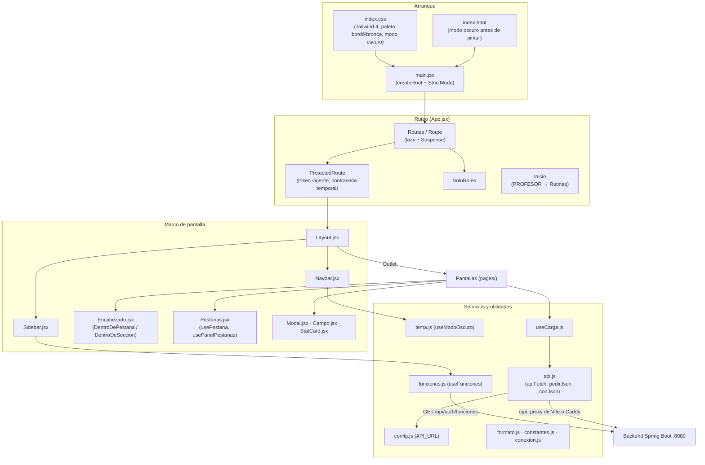

# 01B - Núcleo: Layout, Servicios y Utilidades del Frontend

Este documento detalla la base del frontend de **SUMMIT**: la configuración del proyecto (Vite, Tailwind CSS, ESLint), el arranque de React, el ruteo con sus protecciones, el marco de pantalla (barra superior, menú lateral, encabezados y pestañas), los componentes base (`Modal`, `Campo`, `StatCard`), el cliente HTTP hacia el backend, el modo oscuro, las funciones opcionales y las utilidades de formato que usan todas las pantallas.

---

## 1. Explicación de Relaciones del Área (Arquitectura Punta a Punta)

El frontend es una aplicación de página única (SPA) en **React 19** construida con **Vite 8**, estilada con **Tailwind CSS 4** y ruteada con **React Router 8**. La usa solo el personal del gimnasio (administración, recepción y profesores).

### Flujo Integral

1. **Arranque**: [`index.html`](../../summit-frontend/index.html) aplica el modo oscuro antes de pintar (lee `summit.tema` de `localStorage`) y carga [`main.jsx`](../../summit-frontend/src/main.jsx), que monta `<App />` dentro de `StrictMode` e importa los estilos globales de [`index.css`](../../summit-frontend/src/index.css).

2. **Ruteo y protección**: [`App.jsx`](../../summit-frontend/src/App.jsx) define las rutas. Todas las pantallas del panel cuelgan de `/` envueltas en `ProtectedRoute`, que exige un token vigente (`sesionVigente()` de `services/auth.js`) y, si el usuario tiene una contraseña temporal, lo manda a `/cambiar-password`. `SoloRoles` impide entrar escribiendo la dirección a una pantalla que el rol no ve (el backend igual la protege). Cada pantalla se descarga recién cuando se abre (`lazy` + `Suspense`).

3. **Marco de pantalla**: [`Layout.jsx`](../../summit-frontend/src/components/Layout.jsx) arma la barra de arriba ([`Navbar.jsx`](../../summit-frontend/src/components/Navbar.jsx): marca, campanita de tareas, modo oscuro, cuenta) y el menú lateral ([`Sidebar.jsx`](../../summit-frontend/src/components/Sidebar.jsx): opciones filtradas por rol con contadores). Dentro, cada pantalla usa [`Encabezado.jsx`](../../summit-frontend/src/components/Encabezado.jsx) y, si tiene varias vistas, [`Pestanas.jsx`](../../summit-frontend/src/components/Pestanas.jsx) (la pestaña abierta queda en `?vista=` de la dirección).

4. **Comunicación con el backend**: [`api.js`](../../summit-frontend/src/services/api.js) envuelve `fetch`: agrega el token JWT, pone el `Content-Type` JSON, vuelve al login ante un `401` y lleva a cambiar la contraseña ante un `403 CAMBIAR_PASSWORD`. `pedirJson` lanza un `Error` con el mensaje del backend. La URL base es `/api` ([`config.js`](../../summit-frontend/src/services/config.js)): en desarrollo el proxy de Vite la deriva al puerto 8080 y en la PC del gimnasio lo hace Caddy.

5. **Estado compartido liviano**: no hay una librería de estado global. [`funciones.js`](../../summit-frontend/src/services/funciones.js) pide una vez qué funciones opcionales están activas (recuperación por email, factura electrónica, cobro con tarjeta) y las comparte con `useSyncExternalStore`; [`tema.js`](../../summit-frontend/src/services/tema.js) maneja el modo oscuro y [`useCarga.js`](../../summit-frontend/src/hooks/useCarga.js) unifica la carga de datos de las pantallas (datos, cargando, error).

6. **Identidad visual**: `index.css` redefine la paleta de Tailwind con los colores del logo (bordó y bronce): el acento se escribe `blue-*` en todas las pantallas pero vale bordó, así se cambia en un solo lugar. En modo oscuro se reemplazan las variables de color sin tocar las pantallas.

### Diagrama de Arquitectura y Relaciones del Módulo

---

## 2. Análisis Detallado Archivo por Archivo

---

### 2.1. [`package.json`](../../summit-frontend/package.json)

- **Ruta**: `summit-frontend/package.json`
- **Propósito del archivo**: Dependencias y scripts del frontend. Es un módulo ES (`"type": "module"`).

#### Scripts
| Script | Comando | Uso |
| :--- | :--- | :--- |
| `dev` | `vite` | Servidor de desarrollo en el puerto 5173 con recarga en caliente. |
| `build` | `vite build` | Genera `dist/`, que en la PC del gimnasio sirve Caddy. |
| `lint` | `eslint . --max-warnings 0` | Revisa el código; cualquier aviso cuenta como error. |
| `preview` | `vite preview` | Sirve `dist/` para probar la versión compilada. |

#### Dependencias de ejecución
| Paquete | Para qué se usa |
| :--- | :--- |
| `react`, `react-dom` (19) | Interfaz. |
| `react-router` (8) | Ruteo (`BrowserRouter`, `Routes`, `NavLink`, `useSearchParams`). |
| `@react-pdf/renderer` (4.9.0, versión fija) | Comprobantes, facturas y rutinas en PDF (capítulo 06). |
| `@mercadopago/sdk-react` | Formulario de tarjeta de Mercado Pago (Card Payment Brick) para el cobro con tarjeta. |
| `qrcode.react` | QR para autorizar el débito automático desde el celular. |
| `read-excel-file` (9.3.13, versión fija) | Importar socios desde una planilla de Excel. |
| `lucide-react` | Íconos (se importan uno por uno para no cargar toda la librería). |
| `clsx`, `tailwind-merge` | Armado de clases CSS condicionales. |

#### Dependencias de desarrollo
`vite` 8, `@vitejs/plugin-react` 6, `tailwindcss` 4 y `@tailwindcss/vite` (Tailwind como plugin de Vite, sin `postcss.config.js` ni `tailwind.config.js`), `eslint` 10, `@eslint/js`, `eslint-plugin-react-hooks` 7 y `globals`.

---

### 2.2. [`vite.config.js`](../../summit-frontend/vite.config.js)

- **Ruta**: `summit-frontend/vite.config.js`
- **Propósito del archivo**: Configuración de Vite: plugins de React y Tailwind y el proxy de desarrollo.

#### Configuración
- `plugins: [react(), tailwindcss()]`.
- `server.proxy['/api']`: el frontend le habla al backend por `/api` en su misma dirección y Vite lo deriva:
  - `target`: `process.env.SUMMIT_BACKEND_URL || 'http://localhost:8080'` (se puede apuntar a otro backend, por ejemplo uno de prueba).
  - `xfwd: true`: le pasa al backend la IP real de quien pide (la usa el limitador de pedidos).
  - `configure`: en cada `proxyReq` quita el encabezado `origin`. Para el navegador el pedido es del mismo sitio; sin `Origin`, el backend no lo trata como CORS y no lo rechaza cuando se entra desde otra PC de la red.

---

### 2.3. [`index.html`](../../summit-frontend/index.html)

- **Ruta**: `summit-frontend/index.html`
- **Propósito del archivo**: Página base de la SPA.
- **Contenido**:
  - `lang="es-AR"`, ícono `favicon.png` y `apple-touch-icon.png`, `theme-color` bordó (`#4A0B1B`), descripción y título "SUMMIT".
  - Script en línea que, dentro de un `try/catch` (si el almacenamiento está bloqueado no hace nada), agrega la clase `dark` al `<html>` cuando `summit.tema` vale `'oscuro'` o, si nadie eligió, cuando el sistema prefiere oscuro. Corre antes de pintar para que la página no destelle en blanco.
  - `
` y el módulo `/src/main.jsx`.

---

### 2.4. [`eslint.config.js`](../../summit-frontend/eslint.config.js) y [`.oxlintrc.json`](../../summit-frontend/.oxlintrc.json)

- **Propósito**: Reglas de calidad del código.
- **`eslint.config.js`** (formato plano de ESLint 10, `defineConfig`):
  - Ignora `dist`.
  - Para `**/*.{js,jsx}`: reglas recomendadas de JavaScript, globales del navegador, JSX habilitado, `react-hooks/rules-of-hooks` como error, `react-hooks/exhaustive-deps` como aviso y `no-unused-vars` con `ignoreRestSiblings` (permite `const { a, ...resto } = x` para sacar campos de un objeto).
  - Para `*.config.js`: globales de Node.
- **`.oxlintrc.json`**: configuración equivalente para el linter Oxlint (reglas de hooks y `only-export-components`). Oxlint no está entre las dependencias ni en los scripts: el linter que corre `npm run lint` es ESLint.

---

### 2.5. [`.env.example`](../../summit-frontend/.env.example)

- **Propósito**: Explica `VITE_API_URL`. Por defecto el frontend usa `/api` en su misma dirección; solo si el backend está en otra dirección se copia como `.env` con, por ejemplo, `VITE_API_URL=https://api.ejemplo.com/api`.

---

### 2.6. [`main.jsx`](../../summit-frontend/src/main.jsx)

- **Propósito**: Punto de entrada de React. Importa `index.css` y monta `<App />` en `#root` con `createRoot(...).render(<StrictMode><App /></StrictMode>)`. `StrictMode` ejecuta dos veces los efectos en desarrollo para detectar efectos sin limpieza.

---

### 2.7. [`App.jsx`](../../summit-frontend/src/App.jsx)

- **Ruta**: `summit-frontend/src/App.jsx`
- **Propósito del archivo**: Árbol de rutas del panel y sus protecciones.
- **Relaciones**: Usa `sesionVigente` y `limpiarSesion` de `services/auth.js` y `usuarioActual` de `utils/formato.js`.

#### Importaciones diferidas (`lazy`)
`Login` se importa directo (es lo primero que se ve). El resto se descarga al abrirse: `CambiarPassword`, `OlvidePassword`, `RestablecerPassword` (cuenta), `Layout`, `Dashboard`, `Socios`, `NuevoSocio`, `ImportarSocios`, `TareasCRM`, `EstadoSocios`, `Caja`, `Planes`, `EntrenamientoPlanes`, `Entrenamiento`, `Clases`, `DatosGimnasio`, `ConfiguracionReglas` y `GestionPersonal`.

#### Componentes internos
1. **`Diferida({ children })`**: `Suspense` con el aviso "Cargando…" mientras se descarga una pantalla.
2. **`DeLaCuenta({ children })`**: `Suspense` cuyo respaldo es el fondo bordó del login, para que las pantallas de la cuenta no destellen.
3. **`ProtectedRoute({ children })`**:
   - `if (!sesionVigente())`: guarda en `habiaSesion` si había token, limpia la sesión y redirige a `/login?sesion=expirada` (si había) o a `/login`.
   - `if (usuarioActual()?.debeCambiarPassword)`: con una contraseña temporal no se entra a nada; redirige a `/cambiar-password` (el backend tampoco responde otra cosa).
   - Si no, renderiza `children`.
4. **`SoloRoles({ roles, children })`**: ternario `roles.includes(usuarioActual()?.rol) ? children : <Navigate to="/" />`.
5. **`STAFF`**: `['ADMIN', 'RECEPCION']`.
6. **`Inicio`**: el profesor arranca en `/entrenamiento/rutinas` (el tablero de recepción no le sirve); el resto ve el `Dashboard`.
7. **`AlConstructor`**: el constructor de rutinas ya no es una pantalla propia. Los links viejos `/rutinas/constructor?socio=...` o `?rutina=...` se redirigen a `/entrenamiento/rutinas` con los mismos parámetros; si no traen `rutina`, agrega `nueva=1`.

#### Rutas
| Ruta | Pantalla | Protección |
| :--- | :--- | :--- |
| `/login` | `Login` | Pública |
| `/cambiar-password`, `/olvide-password`, `/restablecer` | Pantallas de la cuenta | Públicas (la primera exige token en el backend) |
| `/` (índice) | `Inicio` → `Dashboard` | `ProtectedRoute` |
| `/socios`, `/socios/nuevo`, `/socios/importar`, `/socios/tareas`, `/socios/estado` | Socios, alta, importación, tareas de seguimiento, estado de socios | `ProtectedRoute` |
| `/caja` | Caja (cobros, gastos, cierres y facturas en pestañas) | `ProtectedRoute` |
| `/planes` | Membresías | `ProtectedRoute` |
| `/entrenamiento/rutinas`, `/entrenamiento/ejercicios` | Rutinas (con el constructor) y catálogo de ejercicios | `ProtectedRoute` |
| `/clases/*` | Clases | `ProtectedRoute` |
| `/ajustes/reglas` | Configuración y reglas (acceso, membresías, facturación) | `SoloRoles ADMIN, RECEPCION` |
| `/ajustes/personal` | Gestión de personal (equipo y asistencia) | `SoloRoles ADMIN` |
| `/ajustes/gimnasio` | Datos del gimnasio | `ProtectedRoute` |
| Redirecciones | `socios/metricas` → `/?metricas=socios`, `socios/inactividad` → `/socios/estado?vista=inactividad`, `membresias/estado` → `/socios/estado`, `membresias/metricas` → `/?metricas=ganancias`, `membresias/debitos` → `/?metricas=planes`, `membresias/reglas` y `ajustes/acceso` → `/ajustes/reglas`, `caja/facturas` → `/caja?vista=facturas`, `ajustes/facturacion` → `/ajustes/reglas?vista=facturacion`, `ajustes/equipo` → `/ajustes/personal`, `ajustes/asistencia` → `/ajustes/personal?vista=asistencia`, `rutinas/constructor` → `AlConstructor` | Pantallas que pasaron a ser pestañas: las direcciones viejas siguen funcionando |
| `*` | `Navigate to="/"` | Cualquier otra dirección vuelve al inicio |

---

### 2.8. [`index.css`](../../summit-frontend/src/index.css)

- **Ruta**: `summit-frontend/src/index.css`
- **Propósito del archivo**: Estilos globales con Tailwind 4 (`@import 'tailwindcss'`), la paleta de la marca, el modo oscuro y animaciones.

#### Bloques
| Bloque | Contenido |
| :--- | :--- |
| `@custom-variant tactil` | `@media (pointer: coarse)`: celulares y tablets. Las clases `tactil:` agrandan botones a 44 px y campos a letra de 16 px (con menos, el iPhone agranda la pantalla al escribir). |
| `@theme` | Colores `bordo-50` a `bordo-950` y `bronce-50` a `bronce-950` (con su contraste documentado), `exito`, `alerta` e `info` (botones con texto blanco que cumplen el contraste mínimo en los dos modos). Redefine `blue-*` como el bordó del logo (el acento del panel) y `slate-*`/`gray-*` como grises cálidos. |
| `:root` | Variables de los gráficos (`--grafico-tinta`, `--grafico-grilla`, etc.). |
| `.barra-marca`, `.fondo-marca` | Degradé bordó con filete de cobre de la barra superior y fondo del login. |
| `@layer base` | Mantiene el aspecto de Tailwind 3 (color de bordes y de placeholders, cursor de mano en botones) y el cuerpo con `antialiased text-slate-800 bg-slate-50`. |
| `.aparece-tarde` | Los avisos "Cargando…" aparecen recién a los 300 ms: una carga rápida no parpadea. |
| Animaciones de gráficos | `.entra-suave`, `.grafico-crece-y`, `.grafico-crece-x`, `.grafico-traza`, `.grafico-funde`, `.grafico-tramo` dentro de `@media (prefers-reduced-motion: no-preference)`: quien pidió menos movimiento los ve quietos. |
| `.hide-scrollbar` | Oculta la barra de desplazamiento de las pestañas. |
| `.dark` | Modo oscuro: invierte los grises, pasa los tonos claros de cada color a tintes oscuros y los oscuros a claros, y deja iguales los medios. El bordó del login no cambia. |
| `@layer utilities` (`.dark ...`) | Excepciones que deben quedar iguales en modo oscuro: texto blanco sobre color, botones al pasar el mouse, fondos oscuros y el velo de las ventanas. `text-blue-600` pasa a `blue-700` porque sobre el carbón no se leía. |

---

### 2.9. [`Layout.jsx`](../../summit-frontend/src/components/Layout.jsx)

- **Propósito**: Marco de todas las pantallas protegidas.
- **Estados**: `isSidebarOpen` (`boolean`): menú lateral abierto en el celular.
- **JSX**: `Navbar` (con `onMenuClick` que abre el menú), un velo `fixed inset-0` que cierra el menú al tocarlo (solo si está abierto y en pantallas chicas, `md:hidden`), `Sidebar` y el `<main>` con margen izquierdo de 16 rem en escritorio (`md:ml-64`) y relleno superior para quedar debajo de la barra de 3 rem. Las pantallas se dibujan en el `<Outlet />`.

---

### 2.10. [`Sidebar.jsx`](../../summit-frontend/src/components/Sidebar.jsx)

- **Propósito**: Menú lateral con las opciones que ve cada rol.
- **Relaciones**: `usuarioActual`, `cerrarSesion`, `useTareasPendientes` (`services/seguimiento.js`), `useAvisoFacturacion` (`services/facturacion.js`) y `useFunciones`.

#### Constantes
| Nombre | Contenido |
| :--- | :--- |
| `STAFF`, `TODOS` | `['ADMIN', 'RECEPCION']` y `['ADMIN', 'RECEPCION', 'PROFESOR']`. |
| `BLOQUES` | Cuatro bloques separados por una línea fina: (1) Socios (todos), Tareas de seguimiento (staff, `contador: 'tareas'`), Estado de socios (staff); (2) Caja & Pagos (staff, `contador: 'facturas'`), Membresías (staff); (3) Rutinas (ADMIN y PROFESOR), Ejercicios (todos), Clases (todos); (4) Configuración y reglas (staff), Gestión de personal (ADMIN). Los roles son los mismos permisos que exige el backend. |
| `DATOS_GIMNASIO` | Opción "Datos del gimnasio" (ADMIN), abajo de todo junto a Cerrar sesión. |

#### Funciones y componentes internos
1. **`opcionActiva(opciones, activePath)`**: filtra las opciones cuya ruta es la actual o la contiene (`startsWith(path + '/')`), ordena por largo de ruta descendente y toma la primera: "Nuevo socio" marca "Socios", y "Estado de socios" se marca a sí misma.
2. **`Globito({ cantidad })`**: número en un círculo; muestra `99+` si pasa de 99.
3. **`Opcion({ opcion, activa, contadores, onNavigate })`**: `NavLink` con el ícono, el texto y, si la opción tiene contador mayor a 0, el globito. La activa lleva fondo bordó claro y un filete de cobre a la izquierda (`shadow-[inset_3px_0_0_#cd7f32]`).
4. **Componente `Sidebar({ isOpen, setIsOpen })`**:
   - `contadores.tareas` = tareas de seguimiento pendientes (solo se piden para el staff); `contadores.facturas` = comprobantes rechazados + inciertos (solo con la factura electrónica prendida).
   - `bloques` = cada bloque filtrado por el rol, sin los que quedan vacíos.
   - Si el rol es staff, arriba aparece el acceso al **Dashboard**.
   - En el celular el menú se desliza (`-translate-x-full` / `translate-x-0`); `alNavegar` lo cierra al elegir una opción.

---

### 2.11. [`Navbar.jsx`](../../summit-frontend/src/components/Navbar.jsx)

- **Propósito**: Barra superior con la marca, la campanita de tareas, el botón de modo oscuro y el menú de la cuenta.

#### Subcomponente `CambiarPasswordModal({ email, onClose })`
- **Estado**: `listo` (`boolean`).
- Muestra `FormCambiarPassword` (variante `panel`); al enviar llama a `cambiarPassword(actual, nueva)` de `services/cuenta.js` y pasa a `listo`, que muestra "Listo: tu contraseña cambió". El subtítulo avisa que en otras computadoras habrá que volver a entrar (el backend invalida los tokens anteriores).

#### Componente `Navbar({ onMenuClick })`
- **Variables**: `usuario` (`usuarioActual()`), `avisaTareas` (solo ADMIN y RECEPCION), `[oscuro, alternarTema]` (`useModoOscuro`), `tareas` (`useTareasPendientes(avisaTareas)`), `tituloTareas` (texto con la cantidad pendiente y atrasada).
- **Estados**: `menuAbierto`, `cambiandoPassword`; `menu` (`useRef`) apunta al menú de la cuenta.
- **`useEffect([menuAbierto])`**: mientras el menú está abierto, escucha `mousedown` (cierra si se toca afuera) y `keydown` (cierra con Escape); la limpieza quita los dos oyentes.
- **JSX**:
  - Botón de menú (solo en el celular), logo y nombre "SUMMIT FITNESS" que llevan al inicio.
  - Campanita con globito: rojo (`bg-rose-600`) si hay tareas atrasadas, bronce si no; `9+` si pasan de 9.
  - Botón sol/luna (`aria-pressed`).
  - Botón de cerrar sesión (oculto en el celular).
  - Menú de la cuenta con las iniciales (`nombreCompleto.substring(0, 2).toUpperCase()`), el nombre y el email, y las opciones "Cambiar contraseña" y "Cerrar sesión".

---

### 2.12. [`Encabezado.jsx`](../../summit-frontend/src/components/Encabezado.jsx)

- **Propósito**: Encabezado compacto de las pantallas (título con ícono, una línea de ayuda y acciones a la derecha), que se adapta según dónde se muestre la pantalla.
- **Contexto**: `Contexto` (`createContext(false)`) indica si la pantalla está sola (`false`), dentro de una pestaña (`'pestana'`) o como sección de una vista (`'seccion'`).

#### Exportaciones
1. **`DentroDePestana({ children })`**: provee `'pestana'`. Se usa cuando una pantalla completa se muestra como pestaña de otra (por ejemplo, Inactividad dentro de Estado de socios).
2. **`DentroDeSeccion({ children })`**: provee `'seccion'`.
3. **`Encabezado({ titulo, subtitulo, icono, colorIcono, acciones })`** (por defecto):
   - `if (lugar === 'pestana')`: no repite el título (ya lo dice la pestaña); muestra solo la ayuda y las acciones en una fila, o nada si no hay ninguna.
   - Si no: `Titulo` es `h2` en una sección y `h1` sola; el tamaño de letra y del ícono también se achican en una sección.

---

### 2.13. [`Pestanas.jsx`](../../summit-frontend/src/components/Pestanas.jsx)

- **Propósito**: Pestañas reutilizables (el estilo de Caja y Pagos) y dos hooks para manejarlas.

#### Componente `Pestanas({ pestanas, activa, onCambiar, children, className })`
- `pestanas`: `[{ id, texto, icon?, contador?, alerta? }]`. Cada pestaña es un `button role="tab"` con `aria-selected`; la elegida lleva borde inferior bronce. El contador va en un globito (rojo si `alerta`). `children` se muestra a la derecha en la misma fila (un filtro o un botón) y baja a otra fila si no entra.

#### Hook `usePestana(ids, parametro = 'vista')`
- Lee la pestaña pedida de la dirección (`?vista=...`). `activa` es la pedida si existe en `ids` (las que el rol ve) o la primera.
- `cambiar(id)`: actualiza los parámetros con `replace: true` (cambiar de pestaña no suma pasos al "Atrás"); si se elige la primera, borra el parámetro.
- Así un link a una pestaña se puede compartir, recargar o abrir desde otra pantalla.

#### Hook `usePanelPestanas(activa, alCambiar)`
- **Objetivo**: cambiar de pestaña sin saltos ni recargas.
- **Estados**: `reserva` (`{ alto, fase }`, con fase `'cargando'` o `'ajustando'`) y `visitadas` (pestañas ya abiertas). `panel` es una `ref` al contenedor.
- **`altoParaNoMoverse()`**: si la página está arriba de todo devuelve 0; si no, calcula el alto natural del panel (la suma de sus hijos más el relleno) y el alto necesario para que la parte visible no se mueva (`scrollY + innerHeight - resto de la página`). Devuelve el necesario solo si supera al natural.
- **Primer `useEffect([reserva.fase])`**: en la fase `'cargando'`, un `MutationObserver` revisa con 150 ms de espera si queda algún elemento visible con `data-cargando`; cuando no queda ninguno, pasa a `'ajustando'` con el alto que hace falta (o suelta la reserva). Un tope de 4 s pasa a ajustar aunque algo no termine de cargar.
- **Segundo `useEffect([reserva.fase])`**: en `'ajustando'`, en cada `scroll` y `resize` achica la reserva (nunca la agranda) y la suelta cuando ya no hace falta.
- **`cambiar(id)`**: guarda el alto actual del panel como reserva, marca la pestaña anterior como visitada y llama a `alCambiar`.
- **`abierta(id)`**: verdadera para la activa y las visitadas: quedan armadas pero ocultas (`hidden`), así volver a una es instantáneo y no se pierde lo escrito.
- **Retorno**: `{ panel, estilo, abierta, cambiar }`, donde `estilo` es `{ minHeight }` mientras hay reserva.

---

### 2.14. [`Modal.jsx`](../../summit-frontend/src/components/Modal.jsx)

- **Propósito**: Ventana modal reutilizable.
- **Props**: `titulo`, `subtitulo`, `onClose`, `children`, `pie` (botones de acción), `extra` (algo a la derecha del título, como los botones del PDF), `ancho` (por defecto `max-w-lg`) y `alto` (clase de alto fijo para ventanas grandes que no deben cambiar de tamaño mientras cargan).
- **Lógica**: el velo cierra la ventana solo si el `mousedown` ocurre sobre el velo mismo (`e.target === e.currentTarget`), no al soltar un arrastre que empezó adentro. El alto máximo usa `92dvh` donde se soporta (en el celular, `vh` incluye lo que tapan las barras del navegador). `role="dialog"` y `aria-modal="true"`. El botón de cerrar crece a 44 px en pantallas táctiles.

---

### 2.15. [`Campo.jsx`](../../summit-frontend/src/components/Campo.jsx)

- **Propósito**: Estilos y componentes de formulario compartidos.

#### Exportaciones
| Nombre | Tipo | Propósito |
| :--- | :--- | :--- |
| `inputClass` | `string` | Clases de los campos de texto (con letra de 16 px en táctiles). |
| `botonPrimario`, `botonSecundario` | `string` | Botón principal bordó y botón con borde. |
| `botonHerramienta`, `selectorHerramienta` | `string` | Botones y desplegables más chicos de las barras de herramientas de tablas y pestañas. |
| `Buscador` | componente | Campo de búsqueda con la lupa adentro; `aria-label` toma `etiqueta` o el `placeholder`. |
| `Campo` (por defecto) | componente | Etiqueta en mayúsculas (con `*` si es obligatorio), el control y, debajo, el error en rojo o la ayuda. |

---

### 2.16. [`StatCard.jsx`](../../summit-frontend/src/components/StatCard.jsx)

- **Propósito**: Tarjeta de indicador (título, valor grande, subtítulo y un ícono en un círculo de color).
- **Props**: `title`, `value`, `subtitle`, `icon` (el componente de `lucide-react`, no su nombre, para no incluir todos los íconos en el paquete), `iconColor`, `iconBg`.

---

### 2.17. [`api.js`](../../summit-frontend/src/services/api.js)

- **Ruta**: `summit-frontend/src/services/api.js`
- **Propósito del archivo**: Cliente HTTP de todo el panel.
- **Comentario inicial sobre el JWT**: antes de `apiFetch`, un bloque de comentarios explica qué es el token: el estándar JWT transporta información de forma segura entre el cliente y el servidor y es la llave de la sesión del personal, sin guardar estado en el servidor. Se crea cuando el email y la contraseña son correctos, lleva el email y el rol, dura como máximo 24 h, está firmado con **HS512** y una clave secreta de al menos 48 caracteres (02A), se guarda en el `localStorage` del navegador y viaja en el encabezado `Authorization: Bearer` de cada pedido.

#### Funciones exportadas
1. **`apiFetch(path, options = {})`** (`async`):
   - **Variables locales**: `esAuth` (`boolean`): la ruta empieza con `/auth/` y no es `/auth/password` (cambiar la propia contraseña es el único `/auth` que viaja con token). `headers`: copia de los encabezados recibidos. `token`: `localStorage.getItem('token')`.
   - **Estructuras de control**:
     - `if (token && !esAuth)`: agrega `Authorization: Bearer <token>`.
     - `if (options.body && !(options.body instanceof FormData) && !headers['Content-Type'])`: pone `application/json`; con `FormData` (subida de archivos) el navegador arma el `multipart`.
     - `if (response.status === 401 && !esAuth)`: sesión vencida o inválida → `cerrarSesion('expirada')`. En `/auth/login` un 401 significa "credenciales inválidas" y no se toca.
     - `if (response.status === 403 && ...)`: lee una copia del cuerpo; si `codigo === 'CAMBIAR_PASSWORD'`, marca el cambio pendiente y navega a `/cambiar-password`.
   - **Retorno**: la `Response` igual que `fetch`.
2. **`pedirJson(ruta, opciones = {}, mensajeError)`** (`async`):
   - `if (res.status === 204) return null;`.
   - Si `!res.ok`: arma un `Error` con los `detalles` de validación unidos por " · ", o el `error` del backend, o "No tenés permiso para hacer esto" si es 403, o el `mensajeError` recibido. Le agrega `status` y lo lanza.
   - **Retorno**: los datos JSON.
3. **`conJson(metodo, cuerpo)`**: devuelve `{ method, body: JSON.stringify(cuerpo) }`.

---

### 2.18. [`config.js`](../../summit-frontend/src/services/config.js)

- **Propósito**: `API_URL = import.meta.env.VITE_API_URL || '/api'`. Se cambia con `.env` sin tocar el código.

---

### 2.19. [`tema.js`](../../summit-frontend/src/services/tema.js)

- **Propósito**: Modo oscuro. Cada persona lo elige en su navegador con el botón sol/luna; mientras nadie elija, sigue al sistema.

#### Variables del módulo y funciones
- `CLAVE` = `'summit.tema'`; `sistema` = `matchMedia('(prefers-color-scheme: dark)')`.
- `elegido`: lo guardado (`'oscuro'`, `'claro'` o `null`), leído dentro de un `try/catch`.
- `esOscuro()`: si hay elección, `elegido === 'oscuro'`; si no, lo que diga el sistema.
- `aplicar()`: `classList.toggle('dark', esOscuro())` en `<html>`.
- **`useModoOscuro()`**: devuelve `[oscuro, alternar]`. Un `useEffect` escucha los cambios del sistema (por ejemplo, el modo nocturno automático) y vuelve a aplicar. `alternar` invierte la elección, la guarda (si el almacenamiento falla, vale hasta recargar) y aplica.

---

### 2.20. [`funciones.js`](../../summit-frontend/src/services/funciones.js)

- **Propósito**: Funciones opcionales que decide el backend (`GET /api/auth/funciones`): `recuperacionPorEmail`, `facturacion` y `cobroConTarjeta`.

#### Lógica
- `PREDETERMINADAS`: las tres en `false`.
- `leerGuardadas()`: lo último que se supo, de `localStorage` (`summit.funciones`), así la pantalla arranca sin esperar.
- `pedir()`: pide una sola vez por carga de página (`pedidas`). Si la respuesta difiere de lo guardado, actualiza, guarda y avisa a todos los `oyentes`. Si falla la red, `pedidas` vuelve a `false` para reintentar.
- `suscribir(oyente)`: lo agrega al conjunto, dispara `pedir()` y devuelve la función que lo quita.
- **`useFunciones()`**: `useSyncExternalStore(suscribir, () => funciones)`: todos los componentes ven el mismo objeto y se vuelven a dibujar cuando cambia.

---

### 2.21. [`useCarga.js`](../../summit-frontend/src/hooks/useCarga.js)

- **Propósito**: Hook que unifica la carga de datos de las pantallas.
- **Parámetros**: `pedir` (función `async` que devuelve los datos), `dependencias` (cuándo volver a pedir) e `inicial` (valor inicial de `datos`).
- **Estados**: `datos`, `version` (cuántas respuestas llegaron; sirve de `key` para volver a animar), `cargando`, `error`. `ultimo` (`useRef`) numera los pedidos.
- **`cargar`** (`useCallback` con las dependencias de la pantalla): incrementa `ultimo`, marca `cargando` y espera `pedir()`. Solo aplica la respuesta si su número sigue siendo el último: si se piden datos nuevos antes de que lleguen los anteriores (por ejemplo, al cambiar rápido de período), las respuestas viejas se descartan. En `catch` guarda `e.message`.
- **`useEffect([cargar])`**: carga al abrir y cada vez que cambian las dependencias.
- **Retorno**: `{ datos, setDatos, cargando, error, setError, cargar, version }`.

---

### 2.22. [`conexion.js`](../../summit-frontend/src/utils/conexion.js)

- **`useEnLinea()`**: estado `navigator.onLine` que se actualiza con los eventos `online` y `offline` (lo usa el login para avisar que no hay conexión).
- **`esErrorDeConexion(error)`**: `error instanceof TypeError`: `fetch` rechaza con `TypeError` cuando no llega al servidor (sin conexión o servidor caído), que no es un error de datos.

---

### 2.23. [`constantes.js`](../../summit-frontend/src/utils/constantes.js)

- **Propósito**: Valores fijos del dominio compartidos entre pantallas.

#### Exportaciones
| Nombre | Contenido |
| :--- | :--- |
| `GENEROS`, `OBJETIVOS` | Opciones de la ficha del socio. |
| `DIAS_SEMANA` | `{ enum, nombre }` de lunes a domingo, como el enum `DiaSemana` del backend. |
| `METODOS_PAGO` | Los que recepción puede elegir al cobrar (`EFECTIVO`, `TRANSFERENCIA`, `MERCADO_PAGO` → "QR / billetera", `TARJETA_DEBITO`, `TARJETA_CREDITO`). El débito automático lo registra el sistema solo. |
| `textoMetodoPago(valor)` | Texto de un método, incluido "Débito automático". |
| `METODOS_VERIFICABLES` | `TRANSFERENCIA` y `MERCADO_PAGO`: pueden quedar "a verificar". |
| `ESTADOS_DEBITO`, `ESTADOS_PAGO`, `ESTADOS_USUARIO` | Texto y clases de color de cada estado. |
| `textoMedioPago(codigo)` | Traduce el código de Mercado Pago (`account_money`, `debvisa`, `master`...) o devuelve "Se elige al autorizar". |
| `planAptoDebito(plan)` | Activo y de 30 días o múltiplo (Mercado Pago cobra cada N meses). |
| `RESULTADOS_INGRESO`, `resultadoIngreso(codigo)` | Texto y color de cada resultado del control de acceso; un código desconocido se muestra tal cual en gris. |

---

### 2.24. [`formato.js`](../../summit-frontend/src/utils/formato.js)

- **Propósito**: Formatos para mostrar los datos del backend.

#### Funciones exportadas
1. **`formatFecha(fechaIso)`**: `'YYYY-MM-DD'` → `'dd/mm/aaaa'`. Separa el texto a mano porque `new Date('2026-10-31')` se interpreta en UTC y en Argentina mostraría el día anterior. Sin fecha, `'—'`.
2. **`formatHora(fechaHoraIso)`**: `'21:43'` con `hourCycle: 'h23'` (algunas versiones de Chrome mostraban "09:00 a. m." con `es-AR`).
3. **`formatFechaHora(fechaHoraIso)`**: `'01/10/2026 21:43'`.
4. **`formatMoneda(monto)`**: `'$ 23.500'` con hasta 2 decimales en `es-AR`.
5. **`textoVencimiento(dias)`**: `'vence hoy'`, `'vence en N días'` o `'vencida hace N días'`, con singular para 1.
6. **`diasHasta(fechaIso)`**: días entre el comienzo de hoy (hora local) y la fecha; negativo si ya pasó.
7. **`edad(fechaNacimientoIso)`**: años cumplidos; resta uno si todavía no pasó el cumpleaños este año.
8. **`descargarCsv(nombreArchivo, columnas, filas)`**: CSV con `;` como separador y BOM UTF-8 (`''`), así Excel en español lo abre bien. Escapa las comillas duplicándolas y descarga con un `Blob` y un link temporal.
9. **`hoyIso()`**: fecha local de hoy como `'YYYY-MM-DD'` (para los `input type="date"` y la API).
10. **`usuarioActual()`**: el usuario guardado al iniciar sesión (`localStorage.user`), o `null` si no hay o no se puede leer.
