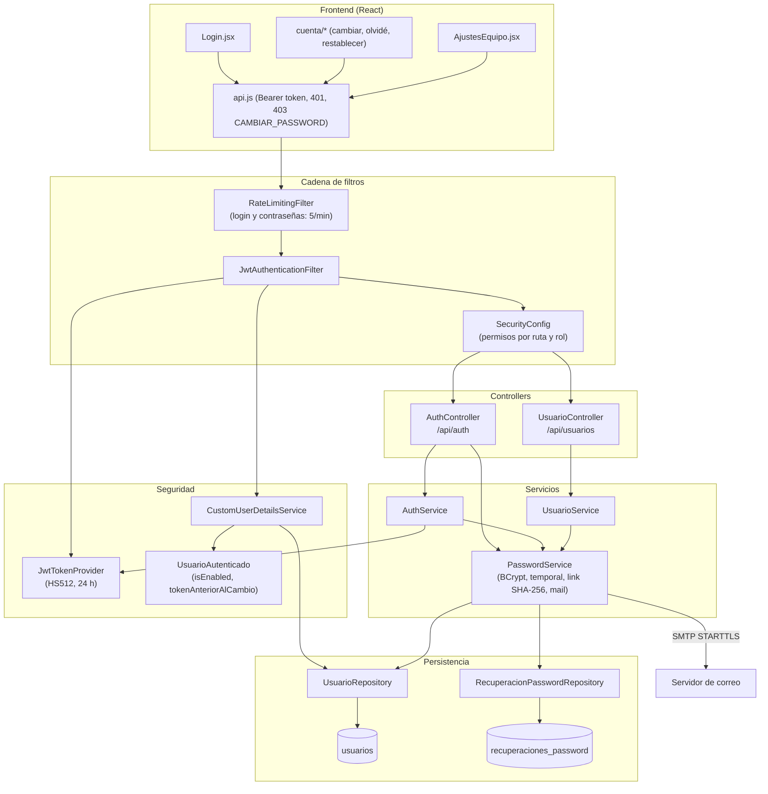

# 02A - Seguridad, Autenticación y Personal (Backend)

Este documento detalla cómo el backend de **SUMMIT** autentica al personal y protege la API: la configuración de Spring Security, los tokens JWT, la invalidación de sesiones al cambiar la contraseña o desactivar una cuenta, la recuperación de contraseña por email y la gestión de las cuentas del personal.

---

## 1. Explicación de Relaciones del Área (Arquitectura Punta a Punta)

SUMMIT es un sistema **de uso exclusivo del personal**: solo los roles `ADMIN`, `RECEPCION` y `PROFESOR` inician sesión. Los socios existen como usuarios con rol `SOCIO` (fichas que maneja el personal) pero el login los rechaza. No hay registro público: las cuentas del personal las crea un administrador.

### Flujo Integral Backend + Frontend

1. **Login**:
   - El frontend (`Login.jsx`) envía email y contraseña a `POST /api/auth/login` ([`AuthController`](../../summit-backend/src/main/java/com/summit/backend/controller/AuthController.java)).
   - [`AuthService.login`](../../summit-backend/src/main/java/com/summit/backend/service/AuthService.java) busca el usuario por email descartando a los socios, compara la contraseña con **BCrypt**, exige estado `ACTIVO` y genera un **JWT HS512** con [`JwtTokenProvider`](../../summit-backend/src/main/java/com/summit/backend/security/JwtTokenProvider.java) (email en el *subject*, rol en un *claim*, 24 h de validez).
   - La respuesta [`AuthResponse`](../../summit-backend/src/main/java/com/summit/backend/dto/AuthResponse.java) incluye `debeCambiarPassword`: si la contraseña es temporal, el frontend lleva a la pantalla para cambiarla.

2. **Cada pedido autenticado**:
   - [`JwtAuthenticationFilter`](../../summit-backend/src/main/java/com/summit/backend/security/JwtAuthenticationFilter.java) lee el token del encabezado `Authorization: Bearer`, lo verifica y **vuelve a cargar el usuario de la base** con [`CustomUserDetailsService`](../../summit-backend/src/main/java/com/summit/backend/security/CustomUserDetailsService.java). Así un token deja de servir apenas la cuenta se desactiva o la contraseña cambia, aunque todavía no haya vencido.
   - Con una contraseña temporal, cualquier pedido fuera de `/api/auth/**` recibe `403` con `codigo: CAMBIAR_PASSWORD`.
   - [`SecurityConfig`](../../summit-backend/src/main/java/com/summit/backend/config/SecurityConfig.java) decide por ruta y método HTTP qué roles pueden pasar. Sin token o con token inválido responde `401`; con token pero sin permiso, `403`.

3. **Contraseñas** ([`PasswordService`](../../summit-backend/src/main/java/com/summit/backend/service/PasswordService.java)):
   - **Cambiar la propia** (`PUT /api/auth/password`): pide la actual, valida la nueva (8 caracteres, letras y números) y devuelve un token nuevo.
   - **Restablecer con una temporal** (`POST /api/usuarios/{id}/restablecer-password`, solo ADMIN): genera una contraseña de 10 caracteres sin letras confundibles que el admin le da en persona.
   - **Recuperar por email** (`POST /api/auth/olvide-password` y `POST /api/auth/restablecer-password`): un link de un solo uso que vence a los 30 minutos; en la base se guarda solo la huella SHA-256 del token ([`RecuperacionPassword`](../../summit-backend/src/main/java/com/summit/backend/model/RecuperacionPassword.java)).
   - Todo cambio guarda `passwordCambiada` y anula los links pendientes: los tokens emitidos antes dejan de valer.

4. **Gestión del personal** ([`UsuarioController`](../../summit-backend/src/main/java/com/summit/backend/controller/UsuarioController.java) y [`UsuarioService`](../../summit-backend/src/main/java/com/summit/backend/service/UsuarioService.java)): alta (con contraseña inicial que hay que cambiar al entrar), edición, baja lógica (`INACTIVO`), reactivación y restablecimiento de contraseña. En el frontend lo usa *Gestión de personal* (capítulo 02B).

5. **Funciones opcionales**: `GET /api/auth/funciones` (público) informa si están activas la recuperación por email, la factura electrónica y el cobro con tarjeta, para que el frontend muestre solo esas opciones.

### Diagrama de Arquitectura y Relaciones del Módulo

---

## 2. Análisis Detallado Archivo por Archivo

---

### 2.1. [`Usuario.java`](../../summit-backend/src/main/java/com/summit/backend/model/Usuario.java)

- **Ruta**: `summit-backend/src/main/java/com/summit/backend/model/Usuario.java`
- **Propósito del archivo**: Entidad JPA de la tabla `usuarios`: la tabla única de personas del sistema (personal y socios), distinguidos por `rol`.
- **Anotaciones de clase**: `@Entity`, `@Table(name = "usuarios")`, `@JsonIgnoreProperties({"hibernateLazyInitializer", "handler"})` (los proxies LAZY de Hibernate no rompen la serialización) y Lombok (`@Getter`, `@Setter`, `@Builder`, constructores).
- **Relaciones**: La referencian casi todas las entidades (perfil del socio, suscripciones, pagos, certificados, asistencia, rutinas, tareas...).

#### Atributos de Clase / Entidad
| Nombre | Tipo | Anotaciones / Configuración | Propósito |
| :--- | :--- | :--- | :--- |
| `idUsuario` | `Long` | `@Id`, `@GeneratedValue(IDENTITY)`, `@Column(name = "id_usuario")` | Clave primaria autoincremental. |
| `dni` | `String` | `@Column(unique = true, nullable = false, length = 15)` | Documento; recepción busca por DNI. |
| `nombreCompleto` | `String` | `@Column(nullable = false, length = 100)` | Apellido y nombre. |
| `email` | `String` | `@Column(unique = true, nullable = false, length = 100)` | Correo; el personal lo usa para iniciar sesión. |
| `password` | `String` | `@JsonIgnore`, `@Column(nullable = false, length = 255)` | Hash BCrypt. Nunca sale en las respuestas de la API. |
| `telefono` | `String` | `@Column(length = 25)` | Contacto (link de WhatsApp). |
| `rol` | `Rol` | `@Enumerated(STRING)`, `@JdbcTypeCode(SqlTypes.VARCHAR)`, `length = 20` | Rol; se guarda como texto y no como `ENUM` de MySQL, así agregar valores no rompe la base. |
| `estado` | `EstadoUsuario` | Igual que `rol` | Solo `ACTIVO` puede entrar al panel o al gimnasio. |
| `fechaCreacion` | `LocalDateTime` | `@Column(name = "fecha_creacion")` | Alta. |
| `debeCambiarPassword` | `boolean` | `@Column(nullable = false)` | Contraseña temporal: hasta cambiarla, el backend solo deja usar `/api/auth`. |
| `passwordCambiada` | `LocalDateTime` | `@JsonIgnore` | Último cambio de contraseña: los tokens emitidos antes dejan de servir. |

#### Métodos
1. **`prePersist()`** (`@PrePersist`): pone `fechaCreacion = now()` y, `if (this.estado == null)`, `estado = ACTIVO`.

---

### 2.2. [`Rol.java`](../../summit-backend/src/main/java/com/summit/backend/model/Rol.java) y [`EstadoUsuario.java`](../../summit-backend/src/main/java/com/summit/backend/model/EstadoUsuario.java)

#### Constantes de `Rol`
| Constante | Significado |
| :--- | :--- |
| `ADMIN` | Dueño o administración: acceso total (planes, personal, métricas de ingresos, configuración). |
| `RECEPCION` | Recepción: socios, cobros, caja, control de acceso, seguimiento. |
| `PROFESOR` | Rutinas, ejercicios, clases; consulta socios y certificados. |
| `SOCIO` | Ficha de un cliente. No inicia sesión. |

#### Constantes de `EstadoUsuario`
`ACTIVO`, `INACTIVO` (baja lógica), `PENDIENTE`, `SUSPENDIDO`, `CANCELADO` (socio dado de baja). Solo `ACTIVO` habilita la cuenta.

---

### 2.3. [`RecuperacionPassword.java`](../../summit-backend/src/main/java/com/summit/backend/model/RecuperacionPassword.java)

- **Propósito del archivo**: Entidad de la tabla `recuperaciones_password`: cada pedido de "¿Olvidaste tu contraseña?". El link sirve una sola vez y por poco tiempo, y se guarda solo la huella SHA-256 del token: quien lea la base no puede usar los links.

#### Atributos
| Nombre | Tipo | Configuración | Propósito |
| :--- | :--- | :--- | :--- |
| `idRecuperacion` | `Long` | PK autoincremental | Identificador. |
| `usuario` | `Usuario` | `@ManyToOne(LAZY, optional = false)`, `usuario_id` | Quién lo pidió. |
| `hashToken` | `String` | `unique`, `length = 64` | SHA-256 del token en hexadecimal. |
| `creada` | `LocalDateTime` | `nullable = false` | Momento del pedido. |
| `vence` | `LocalDateTime` | `nullable = false` | Vencimiento del link. |
| `usada` | `LocalDateTime` | nullable | Cuándo se usó o se anuló (por un pedido nuevo o un cambio de contraseña); `null` mientras sirve. |

---

### 2.4. [`UsuarioRepository.java`](../../summit-backend/src/main/java/com/summit/backend/repository/UsuarioRepository.java)

- **Propósito del archivo**: Repositorio Spring Data de `Usuario`.

#### Métodos y consultas
| Método | Uso |
| :--- | :--- |
| `findByEmail`, `findByDni` | Login, filtro JWT, búsqueda en recepción. |
| `existsByEmail`, `existsByDni` | Validar duplicados en las altas. |
| `findByRol`, `existsByRol`, `countByRol` | Listas por rol; `DataSeeder` verifica si hay un ADMIN. |
| `countByRolAndEstado` | Métricas del tablero (socios activos). |
| `countConMembresiaAlDia(rol, estado, venceDesde)` | `@Query` JPQL con `EXISTS` sobre `Suscripcion`: cuenta los socios activos con una membresía activa que vence desde `venceDesde` (al día, contando la gracia). |
| `countByRolAndFechaCreacionGreaterThanEqual` y `...AndFechaCreacionLessThan` | Altas nuevas en un período (métricas). |

---

### 2.5. [`RecuperacionPasswordRepository.java`](../../summit-backend/src/main/java/com/summit/backend/repository/RecuperacionPasswordRepository.java)

#### Métodos y consultas
| Método | Uso |
| :--- | :--- |
| `findByHashToken(hash)` | `@EntityGraph(attributePaths = "usuario")`: trae el pedido con su usuario en una sola consulta al usar el link. |
| `findFirstByUsuarioIdUsuarioOrderByCreadaDesc(id)` | El último pedido del usuario, para no mandar mails seguidos. |
| `anularPendientes(idUsuario, ahora)` | `@Modifying` `UPDATE ... SET usada = :ahora WHERE ... usada IS NULL`: un pedido nuevo o un cambio de contraseña anula los links anteriores. |
| `borrarAnterioresA(limite)` | `@Modifying` `DELETE` de los pedidos creados antes del límite. |

---

### 2.6. [`LoginRequest.java`](../../summit-backend/src/main/java/com/summit/backend/dto/LoginRequest.java), [`AuthResponse.java`](../../summit-backend/src/main/java/com/summit/backend/dto/AuthResponse.java) y [`StaffRequestDTO.java`](../../summit-backend/src/main/java/com/summit/backend/dto/StaffRequestDTO.java)

#### `LoginRequest` (`record`)
| Campo | Validaciones |
| :--- | :--- |
| `email` | `@NotBlank`, `@Email`. |
| `password` | `@NotBlank`, `@Size(min = 6, max = 100)`. |

#### `AuthResponse` (clase con `@Builder`)
| Campo | Tipo | Propósito |
| :--- | :--- | :--- |
| `token` | `String` | JWT firmado. |
| `tipo` | `String` | `"Bearer"` (`@Builder.Default`). |
| `idUsuario`, `email`, `nombreCompleto`, `rol` | — | Datos que el frontend guarda en `localStorage.user`. |
| `debeCambiarPassword` | `boolean` | Si hay que elegir una contraseña propia antes de seguir. |

#### `StaffRequestDTO` (`record`)
| Campo | Validaciones |
| :--- | :--- |
| `dni` | `@NotBlank`, `@Size(7..15)`, `@Pattern("^[0-9]+$")`. |
| `nombreCompleto` | `@NotBlank`, `@Size(3..100)`. |
| `email` | `@NotBlank`, `@Email`. |
| `password` | `@NotBlank`, `@Size(6..100)` (contraseña inicial). |
| `telefono` | `@Size(max = 25)`. |
| `rol` | `@NotBlank` (`ADMIN`, `RECEPCION` o `PROFESOR`). |

---

### 2.7. [`SecurityConfig.java`](../../summit-backend/src/main/java/com/summit/backend/config/SecurityConfig.java)

- **Ruta**: `summit-backend/src/main/java/com/summit/backend/config/SecurityConfig.java`
- **Propósito del archivo**: Configuración central de Spring Security 7: sesión sin estado, CORS, filtro JWT y permisos por ruta.
- **Anotaciones**: `@Configuration`, `@EnableWebSecurity`, `@RequiredArgsConstructor`.

#### Atributos
| Nombre | Tipo | Propósito |
| :--- | :--- | :--- |
| `jwtAuthenticationFilter` | `JwtAuthenticationFilter` | Se inserta antes de `UsernamePasswordAuthenticationFilter`. |
| `origenesPermitidos` | `List<String>` | `@Value("${summit.cors.origins}")`: orígenes que pueden llamar a la API desde el navegador. |

#### Beans
1. **`passwordEncoder()`**: `BCryptPasswordEncoder` (hash con sal y costo).
2. **`securityFilterChain(HttpSecurity http)`**:
   - `cors(...)` con `corsConfigurationSource()`; `csrf` deshabilitado (la API no usa cookies de sesión: el token viaja en un encabezado, que un sitio ajeno no puede agregar).
   - `SessionCreationPolicy.STATELESS`: no hay sesión en el servidor.
   - `authenticationEntryPoint(new HttpStatusEntryPoint(UNAUTHORIZED))`: sin token o con token vencido, `401` (el `403` queda para "logueado pero sin permiso").
   - **Reglas de autorización** (se evalúan en orden; gana la primera que coincide):

| Ruta y método | Roles |
| :--- | :--- |
| `PUT /api/auth/password` | Autenticado (también con contraseña temporal) |
| `/api/auth/**`, `/api/test/**`, `/error` | Público |
| `GET /api/usuarios/**` | ADMIN, RECEPCION |
| `/api/usuarios/**` (resto) | ADMIN |
| `POST /api/socios/importar` | ADMIN |
| `GET /api/socios/**` | ADMIN, RECEPCION, PROFESOR |
| `/api/socios/**` (resto) | ADMIN, RECEPCION |
| `GET /api/configuracion/gimnasio/**` | ADMIN, RECEPCION, PROFESOR (van en el PDF de las rutinas) |
| `GET /api/configuracion/**` | ADMIN, RECEPCION |
| `/api/configuracion/**` (resto) | ADMIN |
| `POST/PUT/DELETE /api/planes/**` | ADMIN |
| `GET /api/planes/**` | Autenticado |
| `/api/suscripciones/**` | ADMIN, RECEPCION |
| `POST /api/pagos/*/verificar` | ADMIN (no quien cobró) |
| `/api/pagos/**`, `/api/caja/**`, `/api/seguimiento/**`, `/api/debitos/**` | ADMIN, RECEPCION |
| `GET /api/facturacion/**`, `POST /api/facturacion/procesar` | ADMIN, RECEPCION |
| `/api/facturacion/**` (resto) | ADMIN |
| `/api/asistencia/personal/**` | ADMIN |
| `/api/asistencia/**` | ADMIN, RECEPCION |
| `/api/ia/**` | ADMIN, RECEPCION, PROFESOR (datos de salud y GPU del gimnasio) |
| `/api/dashboard/**` | ADMIN, RECEPCION |
| `/api/metricas/ingresos` | ADMIN |
| `/api/metricas/**` | ADMIN, RECEPCION |
| `GET /api/rutinas/validar-ejercicio` | ADMIN, PROFESOR (cruce con patologías) |
| `GET /api/rutinas/**` | Autenticado |
| `/api/rutinas/**` (resto) | ADMIN, PROFESOR |
| `POST/PUT /api/ejercicios/**` | ADMIN, PROFESOR |
| `POST/PUT/DELETE /api/clases/**` | ADMIN |
| `PATCH /api/reservas/**`, `GET /api/reservas/horario/**` | ADMIN, RECEPCION, PROFESOR |
| `/api/ejercicios/**`, `/api/clases/**`, `/api/reservas/**` | Autenticado |
| Cualquier otra | Autenticado |

3. **`corsConfigurationSource()`**: orígenes de `summit.cors.origins`, métodos `GET, POST, PUT, DELETE, PATCH, OPTIONS`, todos los encabezados, credenciales permitidas y caché de la consulta previa de 1 hora (`setMaxAge(3600L)`). Se registra para `/api/**`.

---

### 2.8. [`JwtTokenProvider.java`](../../summit-backend/src/main/java/com/summit/backend/security/JwtTokenProvider.java)

- **Propósito del archivo**: Genera y lee los tokens JWT con la librería jjwt 0.13.

#### Atributos
| Nombre | Tipo | Configuración | Propósito |
| :--- | :--- | :--- | :--- |
| `jwtSecret` | `String` | `@Value("${jwt.secret}")` | Clave de firma (`JWT_SECRET`). |
| `jwtExpiration` | `long` | `@Value("${jwt.expiration}")` | Duración en ms (86.400.000 = 24 h). |
| `signingKey` | `SecretKey` | — | Clave HMAC derivada al arrancar. |

#### Métodos
1. **`init()`** (`@PostConstruct`):
   - `if (jwtSecret.strip().length() < 48)` → `IllegalStateException("JWT_SECRET falta o es muy corta (mínimo 48 caracteres)...")`. La clave viene de afuera del repositorio: si falta, el backend no arranca y lo dice, en vez de fallar en el primer login. HS512 exige 512 bits.
   - Codifica la clave en Base64 y crea la `SecretKey` con `Keys.hmacShaKeyFor`.
2. **`generateToken(String email, String rol)`**: `Jwts.builder()` con `subject(email)`, `claim("rol", rol)`, `issuedAt(now)`, `expiration(now + jwtExpiration)` y `signWith(signingKey, Jwts.SIG.HS512)`.
3. **`leer(String token)`**: verifica la firma y devuelve los `Claims`; si el token está vencido, mal formado o con firma inválida (`JwtException | IllegalArgumentException`), devuelve `null`.

---

### 2.9. [`JwtAuthenticationFilter.java`](../../summit-backend/src/main/java/com/summit/backend/security/JwtAuthenticationFilter.java)

- **Propósito del archivo**: Filtro (`OncePerRequestFilter`) que autentica cada pedido con su token.

#### Constantes
- `DEBE_CAMBIAR_PASSWORD`: JSON `{"error":"Antes de seguir tenés que cambiar tu contraseña","codigo":"CAMBIAR_PASSWORD"}`.

#### Métodos
1. **`doFilterInternal(request, response, filterChain)`**:
   - **Variables locales**: `token` (del encabezado), `datos` (`Claims` o `null`), `email` (subject), `usuario` (`UsuarioAutenticado` recién cargado de la base).
   - **Estructuras de control**:
     - `if (datos != null)`: el token es válido y no venció.
     - `if (usuario != null && usuario.isEnabled() && !usuario.tokenAnteriorAlCambio(datos.getIssuedAt()))`: la cuenta existe, está `ACTIVO` y el token es posterior al último cambio de contraseña. Si no se cumple, el pedido sigue **sin autenticar** y termina en `401`: el frontend vuelve al login.
     - `if (usuario.isDebeCambiarPassword() && !uri.startsWith("/api/auth/"))`: responde `403` con `DEBE_CAMBIAR_PASSWORD` y corta.
     - Si pasa todo, crea un `UsernamePasswordAuthenticationToken` con el usuario y sus autoridades y lo pone en el `SecurityContextHolder`.
   - Siempre continúa la cadena con `filterChain.doFilter`.
2. **`cargarUsuario(String email)`**: `loadUserByUsername` dentro de `try/catch (UsernameNotFoundException)`; si la cuenta se borró, devuelve `null`.
3. **`getTokenFromRequest(request)`**: si el encabezado `Authorization` empieza con `"Bearer "`, devuelve lo que sigue (`substring(7)`); si no, `null`.

---

### 2.10. [`CustomUserDetailsService.java`](../../summit-backend/src/main/java/com/summit/backend/security/CustomUserDetailsService.java)

- **Propósito del archivo**: Implementa `UserDetailsService`: busca el usuario por email y mapea su rol a la autoridad de Spring (`ROLE_ADMIN`, `ROLE_RECEPCION`, ...).

#### Métodos
1. **`loadUserByUsername(String email)`**: `findByEmail(email).orElseThrow(UsernameNotFoundException)`; arma `SimpleGrantedAuthority("ROLE_" + rol.name())` en una lista de un elemento y devuelve `new UsuarioAutenticado(usuario, authorities)`.

---

### 2.11. [`UsuarioAutenticado.java`](../../summit-backend/src/main/java/com/summit/backend/security/UsuarioAutenticado.java)

- **Propósito del archivo**: Usuario del pedido en curso. Extiende `User` de Spring y agrega lo de su contraseña que mira el filtro JWT.

#### Atributos
| Nombre | Tipo | Propósito |
| :--- | :--- | :--- |
| `debeCambiarPassword` | `boolean` | Contraseña temporal pendiente de cambio. |
| `passwordCambiada` | `LocalDateTime` | Último cambio de contraseña (`null` si nunca la cambió). |

#### Métodos
1. **Constructor `UsuarioAutenticado(Usuario usuario, Collection<GrantedAuthority> autoridades)`**: llama a `super(email, password, estado == ACTIVO, true, true, true, autoridades)`. El tercer parámetro es `enabled`: una cuenta que no está `ACTIVO` queda deshabilitada y el filtro deja de aceptar sus tokens aunque no hayan vencido.
2. **`tokenAnteriorAlCambio(Date emitido)`**: `if (passwordCambiada == null) return false;`. Si no, convierte el cambio a segundos (`toEpochSecond()`) y devuelve `true` si el token no tiene fecha de emisión o se emitió antes (`emitido.getTime() / 1000 < cambio`). Se compara en segundos porque es la precisión que guarda el token (y `passwordCambiada` se guarda truncada a segundos).

---

### 2.12. [`AuthController.java`](../../summit-backend/src/main/java/com/summit/backend/controller/AuthController.java)

- **Propósito del archivo**: Endpoints de autenticación del personal bajo `/api/auth`. Todos públicos salvo cambiar la propia contraseña.
- **Atributos**: `authService`, `passwordService`, `configuracionArca` (para saber si la factura electrónica está habilitada) y `pasarelaTarjeta` (si el cobro con tarjeta está habilitado).

#### Endpoints
| Método y ruta | Cuerpo | Respuesta | Lógica |
| :--- | :--- | :--- | :--- |
| `POST /login` | `@Valid LoginRequest` | `AuthResponse` | `authService.login(request)`. |
| `PUT /password` | `{ actual, nueva }` | `AuthResponse` (token nuevo) | `authService.cambiarPassword(auth.getName(), actual, nueva)`. Requiere token. |
| `GET /funciones` | — | `{ recuperacionPorEmail, facturacion, cobroConTarjeta }` | Lo consulta `funciones.js` del frontend. |
| `POST /olvide-password` | `{ email }` | `{ mensaje }` | Llama a `solicitarRecuperacion` y responde **siempre lo mismo**, para no revelar qué emails están registrados. |
| `POST /restablecer-password` | `{ token, password }` | `{ email }` | Elige la contraseña nueva con el link; devuelve el email para entrar. |

---

### 2.13. [`AuthService.java`](../../summit-backend/src/main/java/com/summit/backend/service/AuthService.java)

- **Propósito del archivo**: Login del personal y armado de la respuesta con el token.

#### Métodos
1. **`login(LoginRequest request)`**:
   - `findByEmail(...).filter(u -> u.getRol() != Rol.SOCIO && u.getPassword() != null).orElseThrow(BadCredentialsException("Credenciales inválidas"))`: los socios no entran al sistema.
   - `if (!passwordEncoder.matches(...))` → `BadCredentialsException("Credenciales inválidas")` (mismo mensaje que un email inexistente).
   - `if (usuario.getEstado() != ACTIVO)` → `BadCredentialsException("La cuenta está <estado>: comunicate con el administrador")`. Se verifica después de la contraseña, para no revelar el estado de una cuenta a quien no sabe la clave.
   - Devuelve `respuesta(usuario)`.
2. **`cambiarPassword(email, actual, nueva)`**: delega en `passwordService.cambiar` y devuelve una respuesta con token nuevo (los anteriores dejaron de servir).
3. **`respuesta(Usuario usuario)`** (`private`): arma el `AuthResponse` con `generateToken(email, rol)` y los datos del usuario.
4. **`textoEstado(EstadoUsuario estado)`** (`private static`): `switch` que concuerda en femenino con "cuenta": `INACTIVO` → "inactiva", `PENDIENTE` → "pendiente de activación", `SUSPENDIDO` → "suspendida", `CANCELADO` → "dada de baja".

---

### 2.14. [`PasswordService.java`](../../summit-backend/src/main/java/com/summit/backend/service/PasswordService.java)

- **Ruta**: `summit-backend/src/main/java/com/summit/backend/service/PasswordService.java`
- **Propósito del archivo**: Todo lo de contraseñas: cambiar la propia, restablecer con una temporal, recuperar por email y generar contraseñas al azar para las fichas de los socios. Cada cambio deja sin efecto los tokens anteriores.

#### Constantes y atributos
| Nombre | Tipo | Valor / Propósito |
| :--- | :--- | :--- |
| `LARGO_MINIMO`, `LARGO_MAXIMO` | `int` | 8 y 100 caracteres. |
| `LARGO_TEMPORAL` | `int` | 10 caracteres. |
| `LETRAS`, `NUMEROS` | `String` | Alfabeto de la temporal **sin caracteres que se confunden** al dictarla (0/O, 1/l/I). |
| `ESPERA_ENTRE_MAILS` | `Duration` | 2 minutos entre mails: nadie puede usar la recuperación para llenarle la casilla a otro. |
| `correo` | `ObjectProvider<JavaMailSender>` | El enviador que arma Spring con `spring.mail.*`. |
| `azar` | `SecureRandom` | Generador criptográfico. |
| `urlApp` | `String` | `summit.app.url`: la dirección del link sale de la configuración y nunca del pedido (si no, alguien podría pedir el link para otro con una dirección suya y quedarse con el token). |
| `minutosRecuperacion` | `long` | `summit.recuperacion.minutos` (30). |
| `remitente`, `usuarioCorreo` | `String` | Dirección de salida del mail. |

#### Excepciones internas
- **`LinkInvalidoException`** (extiende `IllegalArgumentException`): "El link ya no sirve: pedí uno nuevo desde ¿Olvidaste tu contraseña?" (400 con `codigo: LINK_INVALIDO`).
- **`RecuperacionNoDisponibleException`**: no hay correo configurado (503).

#### Métodos
1. **`validarNueva(String nueva)`** (`public static`): exige al menos 8 caracteres, una letra (`\p{L}`, incluye acentos) y un número; y como máximo 100.
2. **`cambiar(email, actual, nueva)`** (`@Transactional`):
   - `if (actual == null || !matches(actual, hash))` → "La contraseña actual no es correcta".
   - `validarNueva(nueva)`.
   - `if (matches(nueva, hash))` → "La contraseña nueva tiene que ser distinta de la actual".
   - `guardar(usuario, nueva, false)`.
3. **`restablecerConTemporal(Usuario usuario)`** (`@Transactional`): genera una temporal, la guarda con `temporal = true` y la devuelve (solo queda su hash).
4. **`alAzar()`**: una contraseña al azar para la ficha de un socio, que nadie conoce (los socios no entran).
5. **`recuperacionDisponible()`**: `enviador() != null`.
6. **`solicitarRecuperacion(String email)`** (`@Transactional`):
   - Sin enviador → `RecuperacionNoDisponibleException`. Email vacío → "Escribí tu email".
   - Busca la cuenta filtrando `ACTIVO` y rol distinto de `SOCIO`; `if (cuenta.isEmpty()) return;` sin avisar nada (la respuesta es igual exista o no).
   - `pidioRecien`: el último pedido es de hace menos de 2 minutos → `return`.
   - Anula los pendientes, genera 32 bytes al azar codificados en Base64 URL (el token del link) y guarda solo su `huella`, con vencimiento a los 30 minutos.
   - Arma el mail y lo envía **después del commit** (`TransactionSynchronization.afterCommit`) y en otro hilo (`CompletableFuture.runAsync`): el pedido queda guardado antes de mandar el link y la respuesta tarda lo mismo exista o no la cuenta. Un error al enviar solo se registra.
7. **`restablecerConToken(String token, String nueva)`** (`@Transactional`):
   - Busca el pedido por la huella del token. `if (pedido == null || usada != null || vence < ahora || usuario no ACTIVO)` → `LinkInvalidoException`.
   - Valida la nueva, marca el pedido como usado y guarda la contraseña. Devuelve el email.
8. **`limpiar()`** (`@Scheduled(cron = "0 45 3 * * ?")`, `@Transactional`): todas las madrugadas a las 3:45 borra los pedidos de hace más de 7 días.
9. **`guardar(usuario, password, temporal)`** (`private`): `ahora` truncado a segundos (como la fecha de emisión de los tokens, para que el token que se da enseguida no quede "viejo"); guarda el hash, `debeCambiarPassword = temporal`, `passwordCambiada = ahora`, y anula los links pendientes.
10. **`temporalNueva()`** (`private`): `while (true)` que arma 10 caracteres al azar y repite hasta que haya al menos una letra y un número.
11. **`enviador()`** (`private`): `null` si no hay enviador, si falta `urlApp` o si el enviador no tiene host (Spring lo arma aunque `MAIL_HOST` esté vacío).
12. **`armarMail(enviador, usuario, token)`** (`private`): arma el link (`urlApp` sin barras finales + `/restablecer?token=...`), un texto plano y una versión HTML con un botón bordó, saludo con el primer nombre y el nombre del gimnasio (`DatosGimnasioService`). Asunto: "Elegí una contraseña nueva para <gimnasio>". Escapa el HTML de los datos (`escapar`).
13. **`remitente()`** (`private`): `MAIL_REMITENTE` o la cuenta con la que se entra al correo (Gmail no deja mandar con otra), o `no-responder@summit.local`.
14. **`huella(String token)`** (`private static`): SHA-256 en hexadecimal (`HexFormat`).

---

### 2.15. [`UsuarioController.java`](../../summit-backend/src/main/java/com/summit/backend/controller/UsuarioController.java)

- **Propósito del archivo**: Gestión de las cuentas bajo `/api/usuarios`. Las consultas las puede hacer RECEPCION; todo lo demás, solo ADMIN (`SecurityConfig`).

#### Endpoints
| Método y ruta | Respuesta | Lógica |
| :--- | :--- | :--- |
| `GET /` | `Page<Usuario>` | Lista paginada. |
| `POST /` | `201` + `Usuario` | Alta de personal (`@Valid StaffRequestDTO`). |
| `GET /rol/{rol}` | `List<Usuario>` | `Rol.valueOf(rol.toUpperCase())`; un rol inexistente da 400 ("El valor X no es válido"). |
| `GET /{id}`, `GET /dni/{dni}` | `Usuario` | Búsqueda; 404 si no existe. |
| `PUT /{id}` | `Usuario` | Actualiza nombre, teléfono y email. |
| `DELETE /{id}` | `{ mensaje }` | Baja lógica (`INACTIVO`). |
| `POST /{id}/restablecer-password` | `{ passwordTemporal }` | Contraseña temporal para mostrársela una sola vez al admin. |
| `PATCH /{id}/activar` | `{ mensaje }` | Reactiva la cuenta. |

---

### 2.16. [`UsuarioService.java`](../../summit-backend/src/main/java/com/summit/backend/service/UsuarioService.java)

- **Propósito del archivo**: Lógica de las cuentas del personal.

#### Métodos
1. **`crearStaff(StaffRequestDTO request)`**:
   - `try { Rol.valueOf(rol.toUpperCase()) } catch (IllegalArgumentException)` → "Rol inválido: X".
   - `if (rol == Rol.SOCIO)` → "Los socios se dan de alta desde /api/socios".
   - Email o DNI repetidos → 400.
   - Guarda con estado `ACTIVO` y `debeCambiarPassword(true)`: la contraseña inicial la eligió el admin, así que al entrar por primera vez hay que cambiarla.
2. **`restablecerPassword(Long id, String emailAdmin)`**: `if (usuario.getEmail().equalsIgnoreCase(emailAdmin))` → "Tu propia contraseña la cambiás desde tu perfil, con la actual"; si no, `passwordService.restablecerConTemporal(usuario)`.
3. **`listarTodos(Pageable)`**, **`listarPorRol(Rol)`**, **`buscarPorId(Long)`**, **`buscarPorDni(String)`**: consultas; las búsquedas lanzan `NoSuchElementException` (404).
4. **`actualizar(Long id, Usuario datos)`**: actualiza solo los campos que vienen (`if (... != null)`) de nombre, teléfono y email.
5. **`desactivar(Long id)`** (`@Transactional`): `estado = INACTIVO` (baja lógica: el registro y su historial quedan). Desde ese momento sus tokens dejan de servir.
6. **`activar(Long id)`**: `estado = ACTIVO`.
