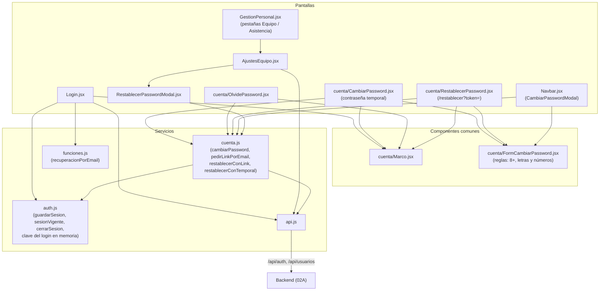

# 02B - Seguridad, Autenticación y Personal (Frontend)

Este documento detalla las pantallas y servicios del frontend de **SUMMIT** que manejan la sesión del personal: el login, el guardado y la validez del token, las pantallas de contraseñas (temporal, olvidada, link del mail), el cambio de la propia contraseña desde el panel y la gestión del equipo.

---

## 1. Explicación de Relaciones del Área (Arquitectura Punta a Punta)

### Flujo Integral Backend + Frontend

1. **Ingreso**: [`Login.jsx`](../../summit-frontend/src/pages/Login.jsx) envía las credenciales a `POST /api/auth/login`. Con la respuesta, [`auth.js`](../../summit-frontend/src/services/auth.js) guarda el token en `localStorage.token` y los datos del usuario en `localStorage.user`. Si la contraseña es temporal, recuerda en memoria la que se acaba de escribir y lleva a `/cambiar-password`.

2. **Sesión**: `ProtectedRoute` (`App.jsx`) usa `sesionVigente()`, que decodifica el token y mira su campo `exp`. `api.js` cierra la sesión ante un `401` y lleva a cambiar la contraseña ante un `403 CAMBIAR_PASSWORD`. El backend invalida el token si la cuenta se desactiva o la contraseña cambia.

3. **Contraseñas** (todas usan [`FormCambiarPassword.jsx`](../../summit-frontend/src/cuenta/FormCambiarPassword.jsx), que revisa las mismas reglas que el backend, y [`cuenta.js`](../../summit-frontend/src/services/cuenta.js)):
   - **Temporal** → [`CambiarPassword.jsx`](../../summit-frontend/src/cuenta/CambiarPassword.jsx): elige una propia sin volver a escribir la temporal.
   - **Olvidada** → [`OlvidePassword.jsx`](../../summit-frontend/src/cuenta/OlvidePassword.jsx): pide el link por email (solo si el gimnasio configuró el correo, según `useFunciones()`).
   - **Link del mail** → [`RestablecerPassword.jsx`](../../summit-frontend/src/cuenta/RestablecerPassword.jsx): saca el token de la barra de direcciones y elige la nueva.
   - **Desde el panel** → el menú de la cuenta de `Navbar.jsx` abre un modal con el mismo formulario.
   - Las pantallas de la cuenta comparten el marco bordó de [`Marco.jsx`](../../summit-frontend/src/cuenta/Marco.jsx).

4. **Equipo** (solo ADMIN): [`GestionPersonal.jsx`](../../summit-frontend/src/pages/GestionPersonal.jsx) reúne en pestañas [`AjustesEquipo.jsx`](../../summit-frontend/src/pages/AjustesEquipo.jsx) (alta, baja, reactivación y contraseña temporal con [`RestablecerPasswordModal.jsx`](../../summit-frontend/src/components/RestablecerPasswordModal.jsx)) y la asistencia del personal (capítulo 07B).

### Diagrama de Arquitectura y Relaciones del Módulo

---

## 2. Análisis Detallado Archivo por Archivo

---

### 2.1. [`auth.js`](../../summit-frontend/src/services/auth.js)

- **Ruta**: `summit-frontend/src/services/auth.js`
- **Propósito del archivo**: Manejo de la sesión guardada en el navegador (token JWT y datos del usuario).

#### Funciones exportadas
1. **`guardarSesion(datos)`**: guarda `datos.token` en `localStorage.token` y en `localStorage.user` el objeto `{ idUsuario, email, nombreCompleto, rol, debeCambiarPassword }` (este último forzado a booleano con `!!`). Se llama al entrar y al cambiar la contraseña, que da un token nuevo.
2. **`marcarCambioDePasswordPendiente()`**: cuando el backend responde `403 CAMBIAR_PASSWORD` y la sesión guardada no lo sabía, pone `debeCambiarPassword: true` en el usuario guardado (dentro de `try/catch`).
3. **`recordarClaveDelLogin(clave)`** y **`tomarClaveDelLogin()`**: la contraseña temporal recién escrita queda en una variable del módulo (`claveDelLogin`), **solo en memoria** (nunca en `localStorage` ni en el historial). `tomar` la devuelve y la borra: se usa una sola vez.
4. **`limpiarSesion()`**: borra `token` y `user`.
5. **`sesionVigente()`**: `if (!token) return false`. Decodifica la parte central del JWT (Base64 URL → Base64 con `replace(/-/g, '+')` y `replace(/_/g, '/')`, luego `atob` y `JSON.parse`) y devuelve `true` si no tiene `exp` o si `exp` es posterior a ahora. Si no se puede leer, lo da por vencido (`catch → false`).
6. **`cerrarSesion(motivo)`**: limpia la sesión y navega a `/login?sesion=<motivo>` o a `/login` (recarga completa: no quedan datos de la sesión anterior en memoria).

---

### 2.2. [`cuenta.js`](../../summit-frontend/src/services/cuenta.js)

- **Propósito del archivo**: Llamadas al backend de contraseñas.

#### Funciones internas
- **`fallo(respuesta, porDefecto)`**: arma un `Error` con el `error` del backend (o el texto por defecto) y le copia el `codigo` (`CAMBIAR_PASSWORD`, `LINK_INVALIDO`) para que la pantalla decida.
- **`enviarJson(metodo, cuerpo)`**: opciones de un pedido con cuerpo JSON.

#### Funciones exportadas
1. **`cambiarPassword(actual, nueva)`**: `PUT /auth/password`. Si sale bien, `guardarSesion` con la respuesta: la sesión anterior (y las de los otros dispositivos) se cerró.
2. **`pedirLinkPorEmail(email)`**: `POST /auth/olvide-password`; devuelve el mensaje del backend (el mismo exista o no la cuenta).
3. **`restablecerConLink(token, password)`**: `POST /auth/restablecer-password`; devuelve el email. Si en este navegador había una sesión de esa misma cuenta (comparando en minúsculas), la limpia: el backend la cerró.
4. **`restablecerConTemporal(ruta)`**: `POST <ruta>/restablecer-password` y devuelve `passwordTemporal`. Hoy se usa con `/usuarios/{id}` (el comentario menciona también `/socios/{id}`, pero los socios ya no inician sesión y el backend no tiene ese endpoint).

---

### 2.3. [`Login.jsx`](../../summit-frontend/src/pages/Login.jsx)

- **Ruta**: `summit-frontend/src/pages/Login.jsx`
- **Propósito del archivo**: Pantalla de ingreso del personal.
- **Relaciones**: `Marco`, `apiFetch`, `guardarSesion`, `recordarClaveDelLogin`, `useFunciones`, `useEnLinea` y `esErrorDeConexion`.

#### Estados y variables
| Nombre | Tipo | Propósito |
| :--- | :--- | :--- |
| `email` | `string` | Arranca con `location.state.email` si viene de elegir la contraseña con el link. |
| `password`, `error`, `loading` | — | Formulario y envío. |
| `recuperacionPorEmail` | `boolean` | De `useFunciones()`: si se ofrece "¿Olvidaste tu contraseña?". |
| `sesionExpirada` | `boolean` | `?sesion=expirada` en la dirección. |
| `passwordElegida` | `boolean` | `location.state.listo === true`. |
| `enLinea` | `boolean` | `useEnLinea()`. |

#### Funciones
1. **`handleLogin(e)`** (`async`):
   - `apiFetch('/auth/login', { method: 'POST', body })`. `if (!response.ok)` lanza el `error` del backend o "Credenciales inválidas".
   - `guardarSesion(datos)`.
   - `if (datos.debeCambiarPassword)`: `recordarClaveDelLogin(password)` y navega a `/cambiar-password` con `replace`; si no, a `/`.
   - `catch`: si `esErrorDeConexion(err)`, distingue entre "No pudimos conectarnos con el gimnasio" (hay red pero no responde el servidor) y "Sin conexión: para entrar necesitás internet"; si no, muestra el mensaje del backend.

#### Estructuras de control en el JSX
- Avisos excluyentes (cada uno solo si no hay `error`): error en rojo, "Listo: ya podés entrar con tu contraseña nueva" en verde, "Tu sesión expiró" en ámbar y "Estás sin conexión" con el ícono `WifiOff`.
- Campos con `autoComplete="username"` y `"current-password"` (el celular ofrece guardar y completar) y letra de 16 px.
- Ternario `recuperacionPorEmail ? <Link to="/olvide-password" state={{ email }}> : 
Pedile al gimnasio que te la restablezca
`.

---

### 2.4. [`Marco.jsx`](../../summit-frontend/src/cuenta/Marco.jsx)

- **Propósito**: Marco común de las pantallas de la cuenta: fondo `fondo-marca` (bordó con luz de cobre), el logo, la palabra SUMMIT en bronce, el título y una tarjeta blanca. Respeta las zonas seguras del celular (`env(safe-area-inset-top)` y `bottom`).

---

### 2.5. [`FormCambiarPassword.jsx`](../../summit-frontend/src/cuenta/FormCambiarPassword.jsx)

- **Propósito del archivo**: Formulario para elegir una contraseña nueva, con las reglas a la vista y la misma validación que el backend (`PasswordService.validarNueva`).

#### Constantes
| Nombre | Contenido |
| :--- | :--- |
| `LARGO_MINIMO`, `LARGO_MAXIMO` | 8 y 100. |
| `REGLAS` | `[{ texto: '8 caracteres o más', cumple }, { texto: 'Letras y números', cumple: /\p{L}/u y /\d/ }]`. |
| `ESTILOS` | Variante `app` (pantallas de la cuenta, campos de 48 px y letra de 16 px) y `panel` (ventanas del panel). |

#### Props
`alEnviar({ actual, nueva })` (hace el pedido; si rechaza, se muestra su mensaje), `pedirActual` (por defecto `true`), `etiquetaActual`, `email` (para que el gestor de contraseñas sepa de qué cuenta es la nueva), `textoBoton` y `variante`.

#### Estados
`actual`, `nueva`, `repetida`, `visibles` (mostrar u ocultar las contraseñas), `error`, `enviando`.

#### Funciones
1. **`enviar(e)`** (`async`): cadena `if / else if` que arma `problema`, en este orden: falta la actual; la nueva no cumple las reglas; supera 100 caracteres; las dos nuevas no coinciden; la nueva es igual a la actual. `if (problema) return`. Si no, llama a `alEnviar` y en el `catch` muestra "Sin conexión..." o el mensaje del error.

#### JSX
- Un `input type="email" name="username"` oculto con el email (para el gestor de contraseñas).
- La lista de reglas se marca en verde a medida que se cumplen, con texto para lectores de pantalla (`sr-only`: "(listo)" o "(falta)").
- `autoComplete="new-password"` en la nueva y la repetida; botón para mostrar u ocultar; el error con `role="alert"`.

---

### 2.6. [`CambiarPassword.jsx`](../../summit-frontend/src/cuenta/CambiarPassword.jsx)

- **Propósito del archivo**: Primera entrada con una contraseña temporal (cuenta nueva o restablecida por el admin): antes de seguir, la persona elige una propia.

#### Lógica
- `temporal` (`useState(tomarClaveDelLogin)`): si viene directo del login, la temporal ya está en memoria y no se pide de nuevo.
- `if (!usuario || !sesionVigente())` → `/login`. `if (!usuario.debeCambiarPassword)` → `/`.
- **`guardar({ actual, nueva })`**: `cambiarPassword(temporal || actual, nueva)`. Si falla y había una temporal recordada (por ejemplo, la restablecieron otra vez), la olvida (`setTemporal(null)`) para que el formulario la pida, y relanza el error. Si sale bien, navega a `/`.
- JSX: saludo con el primer nombre, `FormCambiarPassword` con `pedirActual={!temporal}` y `etiquetaActual="Contraseña temporal"`, y un botón "Salir".

---

### 2.7. [`OlvidePassword.jsx`](../../summit-frontend/src/cuenta/OlvidePassword.jsx)

- **Propósito del archivo**: "¿Olvidaste tu contraseña?": pide que llegue al email un link para elegir una nueva.

#### Lógica
- `email` arranca con el que se había escrito en el login (`location.state.email`).
- **`enviar(e)`**: `setMensaje(await pedirLinkPorEmail(email.trim()))`; el `catch` distingue la falta de conexión.
- `if (mensaje)`: pantalla "Revisá tu correo" con el mensaje del backend (que no confirma si la cuenta existe), la aclaración de que el link sirve una sola vez y un link para volver.

---

### 2.8. [`RestablecerPassword.jsx`](../../summit-frontend/src/cuenta/RestablecerPassword.jsx)

- **Propósito del archivo**: Destino del link del mail (`/restablecer?token=...`).

#### Lógica
- `token` se lee una sola vez de la dirección (`useState(() => new URLSearchParams(location.search).get('token'))`) y `linkInvalido` arranca en `true` si no hay token.
- **`useEffect`**: si la dirección tiene parámetros, navega a la misma ruta sin ellos (`replace`): el token sale enseguida de la barra de direcciones y del historial y queda solo en memoria.
- **`guardar({ nueva })`**: `restablecerConLink(token, nueva)` y navega a `/login` con `state: { email, listo: true }` (el login muestra el aviso verde con el email escrito). Si el error tiene `codigo === 'LINK_INVALIDO'`, muestra la pantalla "El link ya no sirve" (con "Pedir otro link"); cualquier otro error lo relanza para que lo muestre el formulario.

---

### 2.9. [`GestionPersonal.jsx`](../../summit-frontend/src/pages/GestionPersonal.jsx)

- **Ruta**: `summit-frontend/src/pages/GestionPersonal.jsx` (ruta `/ajustes/personal`, solo ADMIN)
- **Propósito del archivo**: Reúne en dos pestañas quiénes forman el equipo y sus horas. Antes eran *Ajustes > Equipo* y *Ajustes > Asistencia del personal*; las direcciones viejas llegan a su pestaña.

#### Lógica
- `PESTANAS`: `equipo` (`Users`) y `asistencia` (`Clipboard`).
- `usePestana(...)` guarda la pestaña en `?vista=` y `usePanelPestanas(...)` evita saltos al cambiar y deja armadas las ya vistas.
- Cada pestaña se envuelve en `DentroDePestana` (su encabezado no repite el título) y se oculta con `hidden` cuando no es la activa: `AjustesEquipo` y `AjustesAsistencia` (capítulo 07B).

---

### 2.10. [`AjustesEquipo.jsx`](../../summit-frontend/src/pages/AjustesEquipo.jsx)

- **Propósito del archivo**: Pestaña *Equipo*: quién entra al sistema, con qué rol, y las altas, bajas y contraseñas.

#### Constantes
- `ROLES`: texto y colores de `ADMIN` ("Administrador", violeta), `RECEPCION` ("Recepción", bordó) y `PROFESOR` ("Profesor", ámbar).

#### Subcomponente `NuevoMiembroModal({ onClose, onGuardado })`
- **Estado `datos`**: `{ nombreCompleto, dni, email, telefono, password, rol: 'RECEPCION' }`.
- El DNI se limpia al escribir (`replace(/\D/g, '')`, solo dígitos).
- **`guardar(e)`**: `POST /usuarios`. Si falla, muestra los `detalles` de validación unidos por " · " o el `error` del backend.
- La ayuda de la contraseña inicial avisa que al entrar por primera vez la persona elige una propia.

#### Componente `AjustesEquipo`
- **Estados**: `miembros` (`null` mientras carga), `error`, `modalAbierto`, `restableciendo` (miembro al que se le da una temporal).
- **`cargar()`** (`useCallback`): pide en paralelo (`Promise.all`) `/usuarios/rol/ADMIN`, `/usuarios/rol/RECEPCION` y `/usuarios/rol/PROFESOR`; si alguna falla lanza error. Une las tres listas (`flat()`) y las ordena por nombre con `localeCompare`.
- **`cambiarEstado(m)`**: si está activo, pide confirmación ("No podrá iniciar sesión") y llama a `DELETE /usuarios/{id}` (baja lógica); si no, `PATCH /usuarios/{id}/activar`. Después recarga.
- **JSX**:
  - Botón "Nuevo miembro" solo si el usuario actual es ADMIN.
  - Tabla con las iniciales, el nombre (con "(vos)" en el propio), teléfono o DNI, el aviso "Con contraseña temporal" si todavía no eligió la suya, email, rol y estado con sus colores.
  - Acciones solo para el ADMIN y nunca sobre sí mismo (`!esYo`): restablecer contraseña (`KeyRound`) y activar o desactivar (`Power`).

---

### 2.11. [`RestablecerPasswordModal.jsx`](../../summit-frontend/src/components/RestablecerPasswordModal.jsx)

- **Propósito del archivo**: Restablece la contraseña de alguien del equipo con una temporal, para dársela en persona.
- **Props**: `nombre`, `ruta` (`/usuarios/{id}`), `onClose`, `onListo`.

#### Lógica
- **Estados**: `temporal` (la contraseña generada), `enviando`, `error`, `copiada`.
- **`restablecer()`**: `restablecerConTemporal(ruta)`, guarda la temporal y avisa al padre (`onListo`) para que recargue la lista.
- **`copiar()`**: `navigator.clipboard.writeText(temporal)`; si no hay permiso, la contraseña queda a la vista para copiarla a mano.
- **JSX**: antes de confirmar, explica que la contraseña actual deja de funcionar y se cierran sus sesiones. Después, muestra la temporal en grande (`select-all`), el botón "Copiar" y el aviso de que no se vuelve a mostrar.
