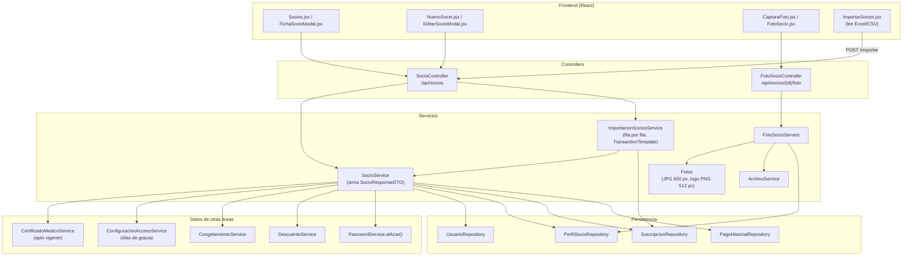

# 03A - Socios, Fotos e Importación (Backend)

Este documento detalla la parte del backend de **SUMMIT** que administra a los socios del gimnasio: su ficha personal, la vista consolidada que combina membresía, apto médico, congelamiento y cobros pendientes, la foto para reconocerlos en recepción y la importación masiva desde una planilla.

---

## 1. Explicación de Relaciones del Área (Arquitectura Punta a Punta)

Un socio es un `Usuario` con rol `SOCIO` más una ficha [`PerfilSocio`](../../summit-backend/src/main/java/com/summit/backend/model/PerfilSocio.java) (relación 1 a 1). Los socios **no inician sesión**: los da de alta recepción y su contraseña es un valor al azar que nadie conoce.

### Flujo Integral Backend + Frontend

1. **Alta y edición**:
   - El frontend (`NuevoSocio.jsx`, `EditarSocioModal.jsx`) envía un [`SocioRequestDTO`](../../summit-backend/src/main/java/com/summit/backend/dto/SocioRequestDTO.java) o [`SocioUpdateRequestDTO`](../../summit-backend/src/main/java/com/summit/backend/dto/SocioUpdateRequestDTO.java) a [`SocioController`](../../summit-backend/src/main/java/com/summit/backend/controller/SocioController.java) (`/api/socios`).
   - [`SocioService`](../../summit-backend/src/main/java/com/summit/backend/service/SocioService.java) valida que el email y el DNI no estén repetidos, crea el `Usuario` y su `PerfilSocio` en la misma transacción, y asocia un descuento habitual si se eligió uno (solo si está activo).
   - Las bajas son lógicas: el socio pasa a `CANCELADO` y se puede reactivar.

2. **Vista consolidada del socio** ([`SocioResponseDTO`](../../summit-backend/src/main/java/com/summit/backend/dto/SocioResponseDTO.java)): cada socio se devuelve con datos calculados de otras áreas:
   - **Apto médico** (`CertificadoMedicoService`): si está vigente y hasta cuándo.
   - **Membresía** (`SuscripcionRepository` y `ConfiguracionAccesoService`): plan actual, vencimiento y si está al día contando los días de gracia.
   - **Congelamiento** (`CongelamientoService`): hasta cuándo está congelada hoy.
   - **Cobro a verificar** (`PagoHistorialRepository`): si pagó por transferencia o QR y un admin todavía no lo confirmó (para no volver a cobrarle).
   - **Descuento habitual** y **versión de la foto**.
   - En la lista completa, los congelamientos y los cobros a verificar se consultan **una sola vez para todos** los socios, para no hacer dos consultas por socio.

3. **Foto**: recepción saca la foto con la cámara de la PC o del celular (`CapturaFoto.jsx`). [`FotoSocioController`](../../summit-backend/src/main/java/com/summit/backend/controller/FotoSocioController.java) la recibe y [`FotoSocioService`](../../summit-backend/src/main/java/com/summit/backend/service/FotoSocioService.java) la pasa por [`Fotos.normalizar`](../../summit-backend/src/main/java/com/summit/backend/service/Fotos.java), que verifica el tipo real, descarta los datos ocultos (ubicación) y la vuelve a codificar como JPG de hasta 600 px. La guarda con `ArchivoService` en `uploads/fotos`. El panel la pide con `?v=<versión>` y el navegador la guarda un día.

4. **Importación** (solo ADMIN): `ImportarSocios.jsx` lee una planilla Excel o CSV en el navegador y manda las filas ya separadas ([`ImportacionSociosDTO`](../../summit-backend/src/main/java/com/summit/backend/dto/ImportacionSociosDTO.java)). [`ImportacionSociosService`](../../summit-backend/src/main/java/com/summit/backend/service/ImportacionSociosService.java) valida cada fila como un alta normal y la guarda en su propia transacción: una fila con error no frena a las demás. Con plan y vencimiento, el socio queda con su membresía hasta esa fecha.

### Diagrama de Arquitectura y Relaciones del Módulo

---

## 2. Análisis Detallado Archivo por Archivo

---

### 2.1. [`PerfilSocio.java`](../../summit-backend/src/main/java/com/summit/backend/model/PerfilSocio.java)

- **Ruta**: `summit-backend/src/main/java/com/summit/backend/model/PerfilSocio.java`
- **Propósito del archivo**: Entidad de la tabla `perfiles_socio`: los datos personales del socio que no hacen al inicio de sesión. Se separa de `usuarios` (1 a 1) para mantener la normalización: el personal no tiene estas columnas vacías.

#### Atributos de Clase / Entidad
| Nombre | Tipo | Anotaciones / Configuración | Propósito |
| :--- | :--- | :--- | :--- |
| `idPerfil` | `Long` | `@Id`, `@GeneratedValue(IDENTITY)` | Clave primaria. |
| `usuario` | `Usuario` | `@JsonIgnore`, `@OneToOne(LAZY, optional = false)`, `@JoinColumn(name = "usuario_id", unique = true)` | Socio dueño de la ficha (único: una ficha por socio). |
| `fechaNacimiento` | `LocalDate` | — | Para la edad (métricas). |
| `genero` | `String` | `length = 20` | Género. |
| `domicilio`, `ciudad` | `String` | `length = 150` / `80` | Domicilio. |
| `objetivo` | `String` | `length = 150` | Ej. hipertrofia, bajar de peso. |
| `observaciones` | `String` | `length = 500` | Notas internas del personal. |
| `fotoUrl` | `String` | `@JsonIgnore`, `length = 255` | Ruta dentro de `summit.uploads.dir`; no sale en la API (la foto se pide por `/api/socios/{id}/foto`). |
| `fotoActualizada` | `LocalDateTime` | — | Cuándo se sacó: es la "versión" de la foto. |
| `descuento` | `Descuento` | `@JsonIgnore`, `@ManyToOne(LAZY)`, `descuento_id` | Descuento habitual que se le propone en cada cobro (`null` = sin descuento). |

---

### 2.2. [`PerfilSocioRepository.java`](../../summit-backend/src/main/java/com/summit/backend/repository/PerfilSocioRepository.java)

#### Métodos y consultas
| Método | Consulta / Uso |
| :--- | :--- |
| `edadYGenero(Collection<Long> ids)` | JPQL que devuelve filas `[idUsuario, fechaNacimiento, genero]` de un grupo de socios (métricas por edad y género). |
| `findByUsuarioIdUsuario(Long)` | `@EntityGraph(attributePaths = "descuento")`: la ficha con su descuento en una sola consulta. |
| `countByDescuentoIdDescuento(Long)` | Cuántos socios tienen un descuento como habitual. |
| `sociosPorDescuento()` | `GROUP BY` que devuelve filas `[idDescuento, cantidad]` para la lista de descuentos. |
| `quitarDescuento(Descuento)` | `@Modifying UPDATE ... SET descuento = NULL`: al borrar un descuento del catálogo, sus socios se quedan sin descuento habitual. |
| `fotosDe(Collection<Long> ids)` | Filas `[idUsuario, fotoActualizada]` de los que tienen foto: las versiones de muchas fotos en una consulta. |

---

### 2.3. [`SocioRequestDTO.java`](../../summit-backend/src/main/java/com/summit/backend/dto/SocioRequestDTO.java) y [`SocioUpdateRequestDTO.java`](../../summit-backend/src/main/java/com/summit/backend/dto/SocioUpdateRequestDTO.java)

- **Propósito**: Datos de entrada del alta y de la edición (`record` con validaciones de Jakarta). La edición no cambia el DNI y reemplaza los campos del perfil con lo que se envía (vacío = se borra el dato).

#### Campos y validaciones
| Campo | Alta | Edición | Validaciones |
| :--- | :---: | :---: | :--- |
| `dni` | ✓ | — | `@NotBlank`, `@Size(7..15)`, `@Pattern("^[0-9]+$")`. |
| `nombreCompleto` | ✓ | ✓ | `@NotBlank`, `@Size(3..100)`. |
| `email` | ✓ | ✓ | `@NotBlank`, `@Email`. |
| `telefono` | ✓ | ✓ | `@Size(max = 25)`. |
| `fechaNacimiento` | ✓ | ✓ | `@Past` (anterior a hoy). |
| `genero`, `domicilio`, `ciudad`, `objetivo`, `observaciones` | ✓ | ✓ | `@Size` según el largo de la columna (20, 150, 80, 150 y 500). |
| `idDescuento` | ✓ | ✓ | Descuento habitual (`null` = sin descuento). |

---

### 2.4. [`SocioResponseDTO.java`](../../summit-backend/src/main/java/com/summit/backend/dto/SocioResponseDTO.java)

- **Propósito**: Vista consolidada de un socio (`record` con `@Builder`).

#### Campos
| Grupo | Campos | Propósito |
| :--- | :--- | :--- |
| Identidad | `idSocio`, `dni`, `nombreCompleto`, `email`, `telefono`, `estado`, `fechaCreacion` | Datos del `Usuario`. |
| Apto médico | `aptoMedicoVigente`, `vencimientoApto` | Si puede entrenar según su certificado. |
| Membresía | `planActual` ("Sin Plan" si no tiene), `idPlanActual` (se propone al cobrar), `membresiaAlDia`, `vencimientoMembresia` | Estado de la cuota. |
| Cobros | `cobroAVerificar` | Pagó por transferencia o QR y falta que un admin lo confirme. |
| Congelamiento | `congeladaHasta` | Último día de un congelamiento que rige hoy. |
| Descuento | `idDescuentoHabitual`, `descuentoHabitual` | Descuento que se le propone en cada cobro. |
| Perfil | `fechaNacimiento`, `genero`, `domicilio`, `ciudad`, `objetivo`, `observaciones` | Ficha personal. |
| Foto | `fotoVersion` | Versión de la foto (`null` si no tiene): la imagen se pide a `/api/socios/{id}/foto?v=<fotoVersion>`. |

---

### 2.5. [`ImportacionSociosDTO.java`](../../summit-backend/src/main/java/com/summit/backend/dto/ImportacionSociosDTO.java)

- **Propósito**: Contenedor (`final class` con constructor privado) de tres `record`:

| Record | Campos | Propósito |
| :--- | :--- | :--- |
| `Fila` | `numero`, `nombreCompleto`, `dni`, `email`, `telefono`, `fechaNacimiento`, `genero`, `domicilio`, `ciudad`, `objetivo`, `observaciones`, `plan`, `vence` | Una fila de la planilla. `numero` es el de la fila en el archivo (para los mensajes). Con `plan` y `vence`, el socio queda con su membresía hasta esa fecha (sin cobro: lo pagó en el sistema anterior). |
| `Pedido` | `filas` | Lo que manda el panel. |
| `Resultado` | `numero`, `estado` (`CREADO`, `EXISTE` o `ERROR`), `mensaje`, `idSocio`, `aviso` | El resultado de cada fila; `aviso` explica algo que no se pudo cargar (por ejemplo, el plan). |

---

### 2.6. [`SocioController.java`](../../summit-backend/src/main/java/com/summit/backend/controller/SocioController.java)

- **Propósito del archivo**: Endpoints de socios bajo `/api/socios`. `SecurityConfig` deja consultar a ADMIN, RECEPCION y PROFESOR; modificar, a ADMIN y RECEPCION; importar, solo a ADMIN.

#### Endpoints
| Método y ruta | Cuerpo | Respuesta | Lógica |
| :--- | :--- | :--- | :--- |
| `GET /` | — | `List<SocioResponseDTO>` | `socioService.listarTodos()`. |
| `GET /{id}` | — | `SocioResponseDTO` | Un socio; 404 si no existe o no es socio. |
| `POST /` | `@Valid SocioRequestDTO` | `201` + `SocioResponseDTO` | Alta. |
| `POST /importar` | `ImportacionSociosDTO.Pedido` | `List<Resultado>` | Importación desde planilla. |
| `PUT /{id}` | `@Valid SocioUpdateRequestDTO` | `SocioResponseDTO` | Edición. |
| `DELETE /{id}` | — | `{ mensaje }` | Baja lógica (`CANCELADO`). |
| `PATCH /{id}/reactivar` | — | `SocioResponseDTO` | Vuelve a `ACTIVO`. |

---

### 2.7. [`SocioService.java`](../../summit-backend/src/main/java/com/summit/backend/service/SocioService.java)

- **Ruta**: `summit-backend/src/main/java/com/summit/backend/service/SocioService.java`
- **Propósito del archivo**: Gestión de los socios y armado de su vista consolidada.
- **Atributos (inyectados)**: `UsuarioRepository`, `PerfilSocioRepository`, `CertificadoMedicoService`, `SuscripcionRepository`, `ConfiguracionAccesoService`, `PasswordEncoder`, `PasswordService`, `DescuentoService`, `CongelamientoService`, `PagoHistorialRepository`.

#### Métodos
1. **`listarTodos()`**:
   - **Variables locales**: `config` (reglas de acceso, una vez), `congelados` (`Map<Long, LocalDate>`, `congelamientoService.congeladosHoy()`: idSocio → último día congelado), `conCobroAVerificar` (`Set<Long>`, los socios con pagos `PENDIENTE` recientes).
   - **Lógica**: `findByRol(Rol.SOCIO).stream().map(... mapToDTO(usuario, config, congelados.get(id), conCobroAVerificar.contains(id)))`. Esas dos consultas se hacen una sola vez para toda la lista.
2. **`buscarPorId(Long id)`**: `mapToDTO(buscarSocio(id), config)`.
3. **`crearSocio(SocioRequestDTO request)`** (`@Transactional`):
   - Email o DNI repetidos → `IllegalArgumentException`.
   - Crea el `Usuario` con rol `SOCIO`, estado `ACTIVO` y `password(passwordEncoder.encode(passwordService.alAzar()))`: la columna es obligatoria y los socios no entran, así que lleva una al azar que nadie conoce.
   - Crea el `PerfilSocio` con los textos opcionales limpios (`textoOpcional`) y el descuento: `request.idDescuento() != null ? descuentoService.activo(id) : null` (un descuento inactivo da error).
4. **`actualizarSocio(Long id, SocioUpdateRequestDTO request)`** (`@Transactional`):
   - `if (!socio.getEmail().equals(request.email()) && existsByEmail(...))` → "El nuevo email ya se encuentra registrado por otro usuario".
   - Actualiza nombre, email y teléfono.
   - `findByUsuarioIdUsuario(id).orElseGet(() -> PerfilSocio.builder().usuario(usuario).build())`: los socios creados antes de existir el perfil no lo tienen; se crea al editar.
   - Reemplaza los campos del perfil y el descuento con `descuentoElegido`.
5. **`descuentoElegido(Long idDescuento, Descuento actual)`** (`private`): `null` si no se eligió; el actual si se mantiene el mismo (aunque después se haya desactivado); si es otro, tiene que estar activo (`descuentoService.activo`).
6. **`cancelarSocio(Long id)`** (`@Transactional`): `estado = CANCELADO` (baja lógica).
7. **`reactivarSocio(Long id)`**: `estado = ACTIVO`.
8. **`buscarSocio(Long id)`** (`private`): `findById(id).filter(u -> u.getRol() == Rol.SOCIO).orElseThrow(NoSuchElementException)`: un id de un empleado no se trata como socio.
9. **`textoOpcional(String)`** (`private static`): `null` si está vacío; si no, el texto sin espacios de los bordes.
10. **`desdeCobrosAVerificar()`** (`private static`): `now().minusDays(PagoService.DIAS_COBRO_A_VERIFICAR)`: desde cuándo un cobro a verificar sigue en curso.
11. **`mapToDTO(usuario, config)`** (`private`): versión para un solo socio: consulta el congelamiento vigente y si tiene cobros a verificar, y llama a la otra versión.
12. **`mapToDTO(usuario, config, congeladaHasta, cobroAVerificar)`** (`private`):
    - **Variables locales**: `certificado` (`obtenerCertificadoActual`), `perfil`, `sub` (la suscripción activa con el vencimiento más lejano).
    - **Estructuras de control** para `membresiaAlDia`:
      - `if (!config.isRequerirMembresiaActiva())` → `true` (el gimnasio no exige la cuota al día).
      - `else if (sub != null)`: `limite = vencimiento + diasGraciaMembresia`; al día si hoy no es posterior al límite.
      - Sin suscripción → `false`.
    - Arma el DTO con ternarios para los datos opcionales (`sub != null ? ... : null`, `perfil != null ? ... : null`) y `aptoMedicoVigente = certificadoMedicoService.esVigente(certificado, config)`.

---

### 2.8. [`FotoSocioController.java`](../../summit-backend/src/main/java/com/summit/backend/controller/FotoSocioController.java)

- **Propósito del archivo**: Foto del socio bajo `/api/socios/{idSocio}/foto`. La sacan o quitan ADMIN y RECEPCION; la ve también PROFESOR.

#### Endpoints
| Método | Respuesta | Lógica |
| :--- | :--- | :--- |
| `POST` (`multipart/form-data`, parte `foto`) | `{ fotoVersion }` | Guarda la foto y reemplaza la anterior. |
| `GET` | Imagen JPG o `404` | `respuestaFoto(() -> fotoSocioService.cargar(idSocio))`. |
| `DELETE` | `204` | Quita la foto y borra el archivo. |

#### Métodos auxiliares
1. **`respuestaFoto(Supplier<Optional<ArchivoService.Archivo>> buscar)`** (`static`, de visibilidad de paquete): si hay foto, responde `image/jpeg` con `Cache-Control: max-age=1 día, private` (la guarda solo el navegador de quien la pidió, nunca un intermediario); si no, `404` con `{"error": "No tiene foto"}`. Como el panel la pide con `?v=<versión>`, una foto nueva cambia la dirección y el navegador no muestra la vieja.

---

### 2.9. [`FotoSocioService.java`](../../summit-backend/src/main/java/com/summit/backend/service/FotoSocioService.java)

- **Propósito del archivo**: Guardar, entregar y quitar la foto del socio en `summit.uploads.dir/fotos`.

#### Métodos
1. **`guardar(Long idSocio, MultipartFile archivo)`**:
   - `byte[] jpg = Fotos.normalizar(archivo)` (valida y recodifica).
   - Busca o crea la ficha del socio, guarda el archivo nuevo (`socio-<id>-<uuid>.jpg`) y actualiza `fotoUrl` y `fotoActualizada`.
   - **Recién con la nueva ya guardada** borra el archivo de la anterior (`if (anterior != null)`): si algo falla en el medio, el socio no se queda sin foto.
   - Devuelve la versión.
2. **`cargar(Long idSocio)`**: `Optional` con el archivo de la foto, o vacío si no tiene.
3. **`eliminar(Long idSocio)`**: si tiene foto, pone `fotoUrl` y `fotoActualizada` en `null`, guarda y borra el archivo.
4. **`version(Long idUsuario)`**: la versión de la foto de un usuario o `null` (el personal nunca tiene).
5. **`versiones(Collection<Long> idsUsuario)`**: `if (idsUsuario.isEmpty()) return Map.of();`; si no, una sola consulta (`fotosDe`) que arma el mapa idUsuario → versión. Lo usan las listas (tablero, control de acceso).
6. **`version(PerfilSocio perfil)`** (`public static`): `null` si no hay perfil o foto; si no, `Fotos.version(fotoActualizada)`.
7. **`buscarSocio(Long idSocio)`** (`private`): solo usuarios con rol `SOCIO`.

---

### 2.10. [`Fotos.java`](../../summit-backend/src/main/java/com/summit/backend/service/Fotos.java)

- **Propósito del archivo**: Utilidad (`final`, constructor privado) que revisa y vuelve a codificar las fotos de personas y el logo del gimnasio. Volver a codificar descarta los datos ocultos de las fotos de celular (por ejemplo, el lugar donde se sacó) y hace que todas ocupen poco.

#### Constantes
| Nombre | Valor | Propósito |
| :--- | :--- | :--- |
| `LADO_MAXIMO` / `LADO_MINIMO` | 600 / 120 px | Tamaño de las fotos de personas. |
| `PIXELES_MAXIMOS` | 16.000.000 | Tope antes de abrir la imagen: una imagen chica en bytes puede declarar un tamaño enorme y llenar la memoria ("bomba de descompresión"). |
| `CALIDAD_JPG` | 0,85 | Compresión del JPG. |
| `LADO_MAXIMO_LOGO` / `LADO_MINIMO_LOGO` | 512 / 48 px | Tamaño del logo. |

#### Métodos
1. **`version(LocalDateTime fecha)`**: milisegundos del momento en que se sacó la foto (0 si no hay fecha): cambia con cada foto nueva.
2. **`normalizar(MultipartFile archivo)`**:
   - Vacío → "Adjuntá la foto".
   - Tipo real con `ArchivoService.tipoDe` (primeros 12 bytes): solo `image/jpeg` o `image/png`.
   - `leer(contenido)` y `if (min(ancho, alto) < 120)` → "La foto es muy chica".
   - `escala = min(1.0, 600 / max(ancho, alto))`: solo achica, nunca agranda.
   - Dibuja sobre una imagen `TYPE_INT_RGB` con **fondo blanco** (las partes transparentes de un PNG saldrían negras en un JPG), interpolación bicúbica y calidad alta, y devuelve `aJpg(foto)`.
3. **`leer(byte[] contenido)`** (`private`): abre la imagen en memoria (`MemoryCacheImageInputStream`; con un stream común ImageIO usa archivos temporales), toma el primer lector y **antes de decodificar** compara `ancho × alto` declarados con `PIXELES_MAXIMOS`. Una imagen dañada o con un formato que Java no lee (por ejemplo, JPG en CMYK) da "No se pudo leer la imagen: probá con otra foto".
4. **`aJpg(BufferedImage foto)`** (`private`): escribe el JPG con compresión explícita al 85 %.
5. **`normalizarLogo(MultipartFile archivo)`**: igual que las fotos pero devuelve **PNG** de hasta 512 px sin deformar y conservando la transparencia (`TYPE_INT_ARGB`, sin fondo blanco). Lo usa `DatosGimnasioService` (capítulo 12).

---

### 2.11. [`ImportacionSociosService.java`](../../summit-backend/src/main/java/com/summit/backend/service/ImportacionSociosService.java)

- **Propósito del archivo**: Importa socios desde una planilla (por ejemplo, la del sistema anterior del gimnasio).
- **Atributos**: `SocioService`, `UsuarioRepository`, `PlanRepository`, `SuscripcionRepository`, `Validator` (las mismas validaciones que el alta) y `TransactionTemplate` (una transacción por fila).

#### Constantes
- `MAXIMO_FILAS` = 2000.

#### Métodos
1. **`importar(List<Fila> filas)`**:
   - Sin filas → "La planilla no tiene filas para importar"; más de 2000 → "dividí la planilla".
   - `planes`: mapa de los planes por su `clave` (nombre sin mayúsculas, acentos ni espacios de más).
   - `dnisVistos`, `emailsVistos`: para detectar repetidos **dentro de la planilla**.
   - `for` sobre las filas: `numero` = el de la fila o la posición + 1. Cada fila va en un `try/catch`: si algo falla, esa fila queda como `ERROR` con el mensaje y se sigue con la próxima.
2. **`importarFila(...)`** (`private`):
   - Limpia el DNI (`replaceAll("[\\s.\\-]", "")`, saca espacios, puntos y guiones) y pasa el email a minúsculas.
   - DNI repetido en la planilla → `ERROR` con la fila donde apareció antes.
   - DNI ya registrado → `EXISTE` ("Ya estaba registrado: no se modificó").
   - Arma un `SocioRequestDTO` y lo valida con `validator.validate`: los mensajes, ordenados y unidos por " · ", son el error de la fila.
   - Email repetido en la planilla o ya usado por otra persona → `ERROR`.
   - **Membresía opcional**: con plan, busca el plan por su clave; si no existe, aviso "No existe el plan X: quedó sin membresía"; si falta el vencimiento, aviso y sin membresía. Con vencimiento pero sin plan, aviso "Falta el plan".
   - `transacciones.execute(...)`: crea el socio con `socioService.crearSocio` y, si hay plan, una `Suscripcion` activa con `fechaInicio = vence - duracionDias` y `fechaVencimiento = vence`.
   - Devuelve `CREADO` con "Importado con <plan> hasta el <fecha>" o "Importado", y el aviso si hubo.
3. **`clave(String nombre)`** (`private static`): normaliza a NFD, quita los acentos (`\p{M}`), compacta los espacios y pasa a minúsculas: "PASE  libre" coincide con "Pase Libre".
