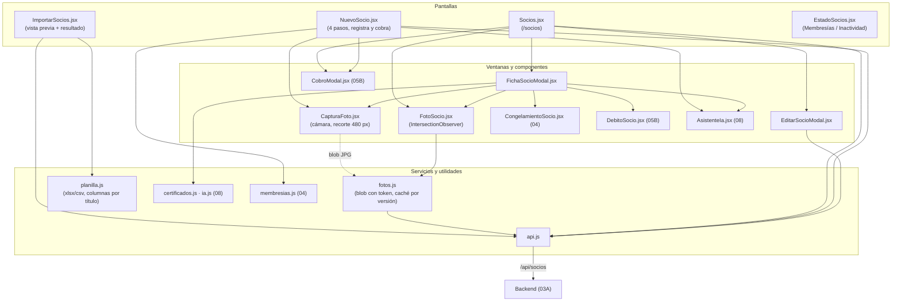

# 03B - Socios, Fotos e Importación (Frontend)

Este documento detalla las pantallas y componentes del frontend de **SUMMIT** que usa recepción para trabajar con los socios: la lista con filtros y acciones, el alta en cuatro pasos (que termina cobrando), la ficha del socio, la edición, la foto con la cámara, la importación desde una planilla y la vista *Estado de socios*.

---

## 1. Explicación de Relaciones del Área (Arquitectura Punta a Punta)

### Flujo Integral Backend + Frontend

1. **Lista de socios** ([`Socios.jsx`](../../summit-frontend/src/pages/Socios.jsx), ruta `/socios`): pide `GET /api/socios` (la vista consolidada de cada socio, capítulo 03A), los planes y los débitos automáticos activos. Muestra indicadores, busca por nombre, DNI, email o teléfono, filtra por estado, pagina de a 15, exporta a CSV y abre tres ventanas: **cobro** (`CobroModal`, capítulo 05B), **ficha** y **edición**.

2. **Alta** ([`NuevoSocio.jsx`](../../summit-frontend/src/pages/NuevoSocio.jsx), ruta `/socios/nuevo`): un asistente de cuatro pasos (datos personales con la foto, contacto, apto médico con lectura por IA, y cobro). El último botón registra al socio y le cobra de una vez: `POST /api/socios`, luego el cobro (`POST /api/pagos`), el certificado y la foto. Una pantalla final muestra qué se guardó y qué falta.

3. **Ficha** ([`FichaSocioModal.jsx`](../../summit-frontend/src/components/socios/FichaSocioModal.jsx)): datos personales con la foto, membresía (con congelamiento y débito automático), certificados médicos (ver, analizar con IA, rechazar, volver a aprobar, cargar uno nuevo) y los últimos ingresos.

4. **Foto**: [`CapturaFoto.jsx`](../../summit-frontend/src/components/socios/CapturaFoto.jsx) usa la cámara del navegador (o una imagen elegida), recorta un cuadrado de 480 px y lo entrega como JPG. [`fotos.js`](../../summit-frontend/src/services/fotos.js) la sube y la descarga con el token (no alcanza con un ``), y [`FotoSocio.jsx`](../../summit-frontend/src/components/socios/FotoSocio.jsx) la muestra recién cuando aparece en pantalla, con las iniciales mientras tanto.

5. **Importación** ([`ImportarSocios.jsx`](../../summit-frontend/src/pages/ImportarSocios.jsx) + [`planilla.js`](../../summit-frontend/src/utils/planilla.js), solo ADMIN): lee el Excel o CSV **en el navegador**, reconoce las columnas por su título, muestra una vista previa con los problemas de cada fila y manda al backend solo las filas válidas.

6. **Estado de socios** ([`EstadoSocios.jsx`](../../summit-frontend/src/pages/EstadoSocios.jsx), ruta `/socios/estado`): reúne en pestañas *Membresías* (vencidas o por vencer, capítulo 04) e *Inactividad* (socios al día que dejaron de venir, capítulo 11).

### Diagrama de Arquitectura y Relaciones del Módulo

---

## 2. Análisis Detallado Archivo por Archivo

---

### 2.1. [`Socios.jsx`](../../summit-frontend/src/pages/Socios.jsx)

- **Ruta**: `summit-frontend/src/pages/Socios.jsx`
- **Propósito del archivo**: Lista de socios con indicadores, búsqueda, filtros, exportación y las acciones de cada socio.
- **Relaciones**: `StatCard`, `CobroModal`, `EditarSocioModal`, `FichaSocioModal`, `FotoSocio`, `Paginador`, `cobroParaOfrecer` (`membresias.js`) y las utilidades de formato.

#### Constantes y funciones del módulo
| Nombre | Propósito |
| :--- | :--- |
| `FILTROS_ESTADO` | "Todos los estados" más cada estado de `ESTADOS_USUARIO`. |
| `estadoVisible(s)` | Con la cuenta `ACTIVO` pero la membresía vencida (pasados los días de gracia) se lo muestra `INACTIVO`; la cuenta no cambia y vuelve a figurar activo en cuanto paga. |
| `POR_PAGINA` | 15. |

#### Estados
| Nombre | Propósito |
| :--- | :--- |
| `socios`, `planes`, `loading`, `error` | Datos de la pantalla. |
| `busqueda` | Arranca con `?buscar=` (el tablero manda acá con un DNI, por ejemplo los débitos a revisar). |
| `filtroEstado`, `menuEstadoAbierto`, `pagina` | Filtro y paginación. |
| `modal` | `{ tipo: 'cobro' \| 'editar' \| 'ficha', socio }` o `null`. |
| `conDebito` | `Set` con los socios que tienen débito automático activo (`GET /debitos?estado=ACTIVO`, solo ADMIN y RECEPCION). |

#### Funciones
1. **`fetchSocios()`**: `GET /socios` y ordena por nombre con `localeCompare`.
2. **`fetchDebitos()`**: si el rol puede editar, arma el conjunto de socios con débito; si falla, la tabla funciona igual sin la marca.
3. **`fetchPlanes()`**: `GET /planes` (para el cobro).
4. **`useEffect([])`**: carga todo una sola vez al entrar; un segundo efecto cierra el menú de estados al hacer clic afuera.
5. **Filtro** (`sociosFiltrados`): coincide el estado visible (o "Todos") y el texto buscado en nombre, DNI, email o teléfono.
6. **`exportar()`**: CSV `socios-AAAA-MM-DD.csv` con DNI, nombre, email, teléfono, estado, plan, vencimiento, si está al día, apto vigente y vencimiento del apto.
7. **Paginación**: `paginas = max(1, ceil(n / 15))` y `paginaActual = min(pagina, paginas - 1)`: si un filtro deja menos páginas, se queda en la última que existe.

#### Estructuras de control en el JSX
- Botones **Importar** (solo ADMIN) y **Nuevo Socio** (ADMIN y RECEPCION).
- Cuatro `StatCard`: Total, Activos, Al Día y Sin apto vigente.
- Por socio, la etiqueta de la membresía sale de una cadena de ternarios:
  - Al día pero la cuenta no está activa → "No puede ingresar".
  - Al día y ya vencida (`dias < 0`) → "EN GRACIA" (todavía entra por los días de gracia).
  - Al día → "AL DÍA (Vence ...)".
  - Si no → "VENCIDA (...)" o "SIN MEMBRESÍA".
  - Además, "DÉBITO" si paga con débito automático y "COBRO A VERIFICAR" si hay un pago pendiente de confirmar.
- Apto: "Apto OK" (con el vencimiento en el `title`), "Apto vencido" o "Sin apto".
- El botón **Cobrar** o **Renovar** aparece solo si `cobroParaOfrecer(socio)` indica que hay algo para pagar.
- La ficha recibe el socio **recargado de la lista** (`socios.find(...)`): al congelar o cargar algo, la ficha abierta se actualiza. Al cerrarla se vuelven a pedir los débitos.

---

### 2.2. [`NuevoSocio.jsx`](../../summit-frontend/src/pages/NuevoSocio.jsx)

- **Ruta**: `summit-frontend/src/pages/NuevoSocio.jsx`
- **Propósito del archivo**: Alta de un socio en un asistente de cuatro pasos. El cobro va último: su botón registra al socio y le cobra de una vez.
- **Relaciones**: `CapturaFoto`, `DetalleCobro`, `CobroModal`, `ComprobantePago`, `SelectorPlan`, `SelectorMetodo` y `OpcionAVerificar` (`OpcionesCobro.jsx`), `usePresupuesto`, `registrarCobro`, `listarDescuentos` (`membresias.js`), `subirFotoSocio`, `subirCertificado`, `validarArchivoApto` (`certificados.js`), `analizarArchivo` (`ia.js`) y los componentes del asistente de IA.

#### Constantes
- `STEPS`: `['Datos Personales', 'Contacto y Acceso', 'Apto Médico', 'Cobro']`.
- `FORM_INICIAL`: datos personales, contacto, cobro (`idPlan`, `sinCobro`, `idDescuento`, `bonificarMatricula`, `metodoPago: 'EFECTIVO'`, `comprobante`, `aVerificar`), apto (`archivoApto`, `fechaEmisionApto`, `patologias`, `resumenIa`), `observaciones` y `foto` (el JPG de `CapturaFoto`, que se sube después de crear al socio).

#### Función `validarPaso(paso, form)`
Devuelve `{ campo: mensaje }`:
- **Paso 0**: nombre y apellido obligatorios; DNI de 7 a 15 dígitos (`/^\d{7,15}$/`); fecha de nacimiento anterior a hoy.
- **Paso 1**: email con formato válido.
- **Paso 2**: si se eligió un certificado, el archivo válido (`validarArchivoApto`) y la fecha de emisión obligatoria, no futura y de no más de 365 días.
- **Paso 3**: un plan o "todavía no paga".

#### Estados principales
`step`, `form`, `errores`, `planes` (solo activos), `descuentos` (solo activos), `enviando`, `errorEnvio`, `resultado` (`{ socio, cobro, apto, foto }`), `cobrando` ("Cobrar ahora" en la pantalla final), los del asistente de IA (`estadoIa`, `analisisIa`, `analizandoIa`, `errorIa`), `sacandoFoto` y `urlFoto` (vista previa; la dirección `blob:` se libera al cambiar la foto).

#### Funciones
1. **`usePresupuesto(...)`**: con un plan elegido, el backend calcula el total del primer cobro como para un socio nuevo (plan − descuento + matrícula).
2. **`elegirArchivoApto(archivo)`**: con otro archivo, lo que la IA leyó del anterior ya no vale: limpia el resumen y la lectura.
3. **`leerCertificadoConIa()`**: manda el archivo y el DNI del paso 1 (para detectar un certificado de otra persona). No guarda nada: solo muestra la lectura.
4. **`usarAnalisisIa()`**: copia la fecha, las patologías y el resumen al formulario; se pueden corregir antes de registrar.
5. **`siguiente()` / `anterior()`**: valida el paso actual antes de avanzar.
6. **`elegirPlan` / `elegirSinCobro`**: un plan o "todavía no paga", una cosa o la otra. **`elegirMetodo`**: en efectivo se borra el comprobante, y solo una transferencia o un QR pueden quedar "a verificar".
7. **`cobroListo`**: hay plan, presupuesto calculado y sin errores.
8. **`registrar()`** (`async`):
   - Valida el paso 3; con plan, exige que el total ya esté calculado.
   - **1.** `POST /socios` con el nombre armado como "Nombre Apellido". Si falla, muestra los `detalles` de validación.
   - **2.** Si hay plan y el método no es tarjeta, `registrarCobro(...)` con `totalMostrado` (si un precio cambió mientras tanto, el backend responde 409). Un error del cobro no deshace el alta: queda en `cobro.error`.
   - **3.** Si hay certificado, `subirCertificado(...)`. **4.** Si hay foto, `subirFotoSocio(...)`.
   - Guarda `resultado`; con tarjeta (`TARJETA_MP`) abre enseguida la ventana de cobro, donde se carga la tarjeta.

#### Pantalla final (`if (resultado)`)
- Un `Item` por cada parte, verde si quedó bien o ámbar si falta: datos guardados; cobro registrado (o "a verificar": la membresía empieza cuando un admin lo confirma) o "Sin cobrar" con el botón **Cobrar ahora**; certificado cargado o pendiente (sin apto vigente no puede ingresar, Ley 5397); foto guardada o pendiente.
- Si se cobró, el comprobante (`ComprobantePago`) para entregarle al socio.
- Botones "Ver lista de socios" y "Registrar otro socio" (vuelve al paso 0 con el formulario vacío).

#### Pasos en el JSX
- **Paso 1**: foto opcional (sacar, sacar otra, quitar), nombre, apellido, DNI (solo dígitos al escribir), nacimiento, género y objetivo.
- **Paso 2**: email, teléfono, domicilio, ciudad y observaciones.
- **Paso 3**: aviso legal del apto, archivo (PDF o imagen, 5 MB), botón "Leer el certificado con IA" con su resultado, fecha de emisión y patologías.
- **Paso 4**: resumen del socio, `SelectorPlan` o "Todavía no paga", descuento habitual y, con plan, el `DetalleCobro` (con la opción de bonificar la matrícula), `SelectorMetodo` (con "Tarjeta MP" si está habilitada), número de comprobante y la opción "a verificar".
- El botón final dice "Registrar sin cobrar", "Registrar y cobrar $ X" o "Registrar y cobrar" según el caso.

---

### 2.3. [`FichaSocioModal.jsx`](../../summit-frontend/src/components/socios/FichaSocioModal.jsx)

- **Ruta**: `summit-frontend/src/components/socios/FichaSocioModal.jsx`
- **Propósito del archivo**: Ficha completa del socio.
- **Props**: `socio`, `onClose`, `onActualizado` (para que la lista recargue), `puedeEditar` (ADMIN y RECEPCION; el profesor solo mira) y `onEditar`.

#### Componentes internos
- **`Dato({ label, valor })`**: etiqueta y valor (`'—'` si está vacío).
- **`Seccion({ icon, titulo, children })`**: bloque con título e ícono.

#### Estados
`certificados`, `ingresos` (los últimos 6), `nuevoApto`, `subiendo`, `mensaje`; los del asistente de IA: `analisis` (`{ clave, datos, patologias }`, donde `clave` es el id del certificado o `'nuevo'`: un solo estado sirve para todas las filas y nunca hay dos lecturas a la vez), `analizando` y `errorIa`; `rechazo` (`{ id, motivo, error }`); `fotoVersion` (se actualiza al sacar o quitar la foto sin esperar a la lista), `sacandoFoto`, `errorFoto`.

#### Funciones
1. **`guardarFoto(foto)`** / **`quitarFoto()`**: suben o quitan la foto (con confirmación) y actualizan la versión local.
2. **`cambiarEstadoCertificado(id, estado, motivo)`**: `PATCH /socios/{id}/certificados/{idCert}/estado`; reemplaza el certificado en la lista con la respuesta. Queda registrado quién lo revisó.
3. **`confirmarRechazo()`** (exige un motivo de al menos 5 caracteres) y **`reaprobar(c)`** (con confirmación).
4. **`cargar()`** (`useCallback`): en paralelo, los certificados y, si puede editar, el historial de ingresos (`/asistencia/historial/{id}`).
5. **`analizar(clave)`**: con `'nuevo'` analiza el archivo elegido (con el DNI del socio); con un id, el backend lee el certificado guardado.
6. **`guardarAnalisis()`**: confirma en un certificado ya cargado las patologías revisadas y el resumen (`guardarObservaciones`).
7. **`usarEnCargaNueva()`**: en la carga nueva, la lectura completa el formulario y se guarda al subir.
8. **`errorDe(clave)`** / **`resultadoDe(clave)`**: muestran el error o la tarjeta de la lectura solo debajo del certificado que corresponde. La tarjeta incluye un campo para **corregir las patologías antes de guardarlas** (supervisión humana).
9. **`verArchivo(id)`**: abre el archivo del certificado (con el token).
10. **`cargarApto(e)`**: valida archivo y fecha, sube el certificado y avisa hasta cuándo vence.
11. **`idQueRige`**: el certificado que rige el ingreso, calculado igual que el backend: el de vencimiento más lejano entre los no rechazados (`filter` + `reduce`). Se marca "ACTUAL".

#### Secciones del JSX
- **Datos personales**: foto (con "Sacar/Cambiar foto" y "Quitar"), email, teléfono, nacimiento con la edad, género, domicilio, objetivo y observaciones.
- **Membresía**: plan, vencimiento con los días, estado ("Congelada hasta...", "Al día" o "Vencida o sin plan"), descuento habitual, y los componentes `CongelamientoSocio` y `DebitoSocio`.
- **Certificados médicos**: cada uno con sus fechas, la marca "ACTUAL" o "RECHAZADO" (con motivo, quién y cuándo), las patologías, el resumen de la IA y los botones "Analizar con IA", "Ver archivo", "Rechazar" o "Volver a aprobar". Debajo, el formulario para cargar uno nuevo.
- **Últimos ingresos**: fecha y hora, y "Permitido", el motivo del rechazo o "Por excepción" con quién la autorizó y por qué.

---

### 2.4. [`EditarSocioModal.jsx`](../../summit-frontend/src/components/socios/EditarSocioModal.jsx)

- **Propósito del archivo**: Edición de los datos del socio, baja lógica y reactivación.

#### Lógica
- `datos` arranca con los del socio (el DNI no se edita: va en el subtítulo).
- `habitualDesactivado`: el descuento que tiene puede haberse desactivado; igual se muestra como opción "(desactivado)" para poder dejarlo (el backend lo acepta si es el mismo).
- **`ejecutar(accion)`**: envoltura común que maneja `procesando`, el error (con los `detalles` de validación) y `onGuardado`.
- **`guardar(e)`**: `PUT /socios/{id}` con la fecha vacía como `null` y el descuento como número.
- **`darDeBaja()`**: con confirmación ("No podrá ingresar al gimnasio"), `DELETE /socios/{id}`.
- **`reactivar()`**: `PATCH /socios/{id}/reactivar`.
- El pie muestra "Reactivar socio" si está `CANCELADO` o "Dar de baja" si no.

---

### 2.5. [`CapturaFoto.jsx`](../../summit-frontend/src/components/socios/CapturaFoto.jsx)

- **Ruta**: `summit-frontend/src/components/socios/CapturaFoto.jsx`
- **Propósito del archivo**: Sacar la foto del socio con la cámara (o elegir una imagen, por ejemplo desde el celular), revisarla y confirmarla.
- **Props**: `nombre`, `onListo(blob)` (puede devolver `{ ok, error }`: si falla, el error se muestra acá y se puede reintentar), `onCerrar`, `subtitulo`.

#### Constantes y funciones del módulo
| Nombre | Propósito |
| :--- | :--- |
| `LADO`, `LADO_MINIMO`, `CALIDAD_JPG` | 480 px, 120 px (el mismo mínimo del servidor) y 0,88. |
| `recortar(fuente, ancho, alto)` | Recorta el **centro en un cuadrado** y lo lleva a 480 px en un `canvas`; devuelve un `Blob` JPG. Dibujar en un canvas además descarta los datos ocultos de la imagen original. |
| `textoErrorCamara(error)` | Traduce los errores del navegador: sin permiso (`NotAllowedError`), sin cámara (`NotFoundError`, `OverconstrainedError`) o cámara ocupada (`NotReadableError`). |

#### Estados
`paso` (`'camara'`, `'sinCamara'`, `'revisar'` o `'guardando'`), `error`, `motivoSinCamara`, `foto` (`{ blob, url }`), `camaraLista`; `videoRef` y `archivoRef`.

#### Efectos y funciones
1. **`useEffect([paso])`**: en el paso `'camara'`:
   - Sin `navigator.mediaDevices.getUserMedia` (fuera de `localhost` o sin https el navegador no deja usar la cámara) pasa a `'sinCamara'` con el motivo.
   - Pide la cámara frontal (`facingMode: 'user'`, 1280×720 ideal, sin audio) y la conecta al `<video>`. La bandera `cancelado` evita usar un stream que llegó tarde.
   - La limpieza detiene todas las pistas: al salir del paso, la cámara se apaga.
2. **`useEffect([foto])`**: libera la dirección `blob:` de la foto anterior.
3. **`sacar()`**: recorta el cuadro actual del video.
4. **`elegirArchivo(archivo)`**: abre la imagen, rechaza las de menos de 120 px y la recorta igual que una foto.
5. **`usar()`**: pasa a `'guardando'`, llama a `onListo(foto.blob)` y, si devuelve un error, vuelve a `'revisar'` mostrándolo.
6. **`otraVez()`**: vuelve a la cámara (o a elegir otra imagen si no hay cámara).

#### JSX
- Se dibuja en el `<body>` con `createPortal`: dentro de otra ventana (la ficha del socio) quedaría recortada.
- El video se ve **espejado** (como un espejo, para que el socio se acomode) pero la foto se guarda sin espejar; un círculo guía la posición de la cara.
- El pie cambia según el paso: "Subir una imagen", "Cancelar" y "Sacar foto"; o "Sacar otra/Elegir otra" y "Usar esta foto".

---

### 2.6. [`FotoSocio.jsx`](../../summit-frontend/src/components/socios/FotoSocio.jsx)

- **Propósito del archivo**: Muestra la foto del socio, o sus iniciales si no tiene (o mientras carga).
- **Props**: `idSocio`, `fotoVersion`, `nombre`, `className` (tamaño y forma) y `texto` (tamaño de las iniciales).

#### Lógica
- **`iniciales(nombre)`**: las primeras letras de las dos primeras palabras, en mayúscula.
- **Primer `useEffect`**: si hay foto, un `IntersectionObserver` (con 200 px de margen) marca `visible` cuando el recuadro aparece en pantalla: en una lista larga no se piden todas las fotos juntas.
- **Segundo `useEffect`**: cuando es visible, pide `urlFotoSocio(idSocio, fotoVersion)`; la bandera `vigente` descarta una respuesta que llegue después de cambiar de socio.

---

### 2.7. [`fotos.js`](../../summit-frontend/src/services/fotos.js)

- **Propósito del archivo**: Subir, quitar y descargar las fotos de los socios. La descarga necesita el token, así que no alcanza con poner la dirección en un ``: se pide con `apiFetch` y se muestra como `blob:`.

#### Funciones
1. **`urlFoto(ruta)`** (interna): caché `fotos` (`Map` de ruta con versión → `Promise`). Cada foto se pide **una sola vez por versión**; si el pedido falla, se borra de la caché para reintentar la próxima vez.
2. **`urlFotoSocio(idSocio, version)`**: `/socios/{id}/foto?v={version}`.
3. **`subir(ruta, foto)`** / **`subirFotoSocio(idSocio, foto)`**: `FormData` con la parte `foto` (`foto.jpg`); devuelve `{ ok, fotoVersion }` o `{ ok: false, error }`.
4. **`quitar(ruta)`** / **`quitarFotoSocio(idSocio)`**: `DELETE`; devuelve `{ ok }` o el error.

---

### 2.8. [`ImportarSocios.jsx`](../../summit-frontend/src/pages/ImportarSocios.jsx)

- **Ruta**: `summit-frontend/src/pages/ImportarSocios.jsx` (ruta `/socios/importar`, solo ADMIN)
- **Propósito del archivo**: Importar socios desde una planilla de Excel o CSV, con vista previa antes y resultado fila por fila después.

#### Constantes y componentes internos
- `ESTADOS`: texto, color e ícono de `CREADO` ("Importado"), `EXISTE` ("Ya estaba") y `ERROR` ("Con error").
- `Resumen({ titulo, valor, clase })`: tarjeta con un número.

#### Estados
`archivo` (nombre), `socios` (las filas leídas con sus `problemas`), `error`, `importando`, `resultados`.

#### Funciones
1. **`elegir(elegido)`**: limpia lo anterior, lee la planilla (`leerPlanilla`) y la convierte (`sociosDePlanilla`). Si faltan columnas obligatorias, avisa cuáles; si no hay filas, también. Al final limpia el `<input>` para poder elegir el mismo archivo otra vez.
2. **`validos`**: las filas sin problemas.
3. **`importar()`**: manda solo las válidas (sin el campo `problemas` y con las fechas vacías como `null`) a `POST /socios/importar` con `pedirJson`.
4. **`contar(estado)`**, **`socioDe(numero)`**.
5. **`bajarErrores()`**: CSV `socios-con-error.csv` con las filas que tenían problemas antes de mandar y las que el backend devolvió con `ERROR`.

#### JSX
- Botón "Bajar planilla de ejemplo" (CSV con los títulos que entiende y una fila de muestra).
- Explicación de las columnas obligatorias (nombre, DNI, email) y opcionales (incluidos **Plan** y **Vence**, que dejan al socio con su membresía sin cobro).
- Después de importar, tres resúmenes: importados, ya estaban y con error (los del backend más los que no se mandaron).
- Tabla con la fila, el socio, el contacto, la membresía y el estado: los problemas en rojo, el resultado con su mensaje y su aviso, o "Lista para importar".

---

### 2.9. [`planilla.js`](../../summit-frontend/src/utils/planilla.js)

- **Propósito del archivo**: Lectura de planillas para la importación. Reconoce las columnas por su título, con o sin acentos y con nombres parecidos.

#### Constantes
- `COLUMNAS`: para cada campo, los títulos que acepta (ya normalizados). Por ejemplo `dni`: "dni", "documento", "nro de documento"; `email`: "email", "e mail", "mail", "correo"; `vence`: "vence", "vencimiento", "vence la cuota", "fecha de vencimiento".
- `COLUMNAS_EJEMPLO`, `FILA_EJEMPLO`: la planilla de ejemplo.

#### Funciones
1. **`normalizar(texto)`**: NFD sin acentos, minúsculas y todo lo que no es letra o número pasado a espacio.
2. **`leerCsv(texto)`**: detecta el separador por la primera línea (`;` si tiene al menos tantos como `,`: el "Guardar como CSV" de Excel en español usa `;`) y recorre carácter por carácter respetando las comillas (`""` dentro de comillas es una comilla) y los saltos `\r\n`.
3. **`textoDeArchivo(archivo)`**: lo decodifica como UTF-8 y, si aparece el carácter de reemplazo (`�`), lo vuelve a leer como `windows-1252` (la codificación de los CSV de Excel en Windows). Quita el BOM.
4. **`leerPlanilla(archivo)`**: `.csv`/`.txt` con `leerCsv`; `.xlsx` con `read-excel-file`, que se importa **recién en ese momento** (`await import(...)`) para no cargarlo en el resto del panel; otro formato da error (un `.xls` viejo hay que guardarlo como `.xlsx`).
5. **`fechaIso(valor)`**: `'AAAA-MM-DD'` a partir de una fecha de Excel (`Date`), `"31/12/2026"`, `"31-12-26"` o `"2026-12-31"`. Con año de 2 dígitos, más de 40 es 19xx y si no 20xx. Devuelve `null` si no es una fecha válida.
6. **`sociosDePlanilla(filas)`**:
   - La primera fila con algún dato es la de títulos; busca el índice de cada campo.
   - Si falta DNI, Email o el nombre (completo o nombre + apellido), devuelve `faltan`.
   - Por cada fila con datos: `numero` (la fila en el archivo), nombre (completo o armado), DNI sin espacios, puntos ni guiones, email en minúsculas y las fechas convertidas.
   - Arma `problemas`: falta el nombre, DNI inválido o faltante, email inválido o faltante, fechas que no se pudieron leer, DNI repetido en la planilla (con la fila donde apareció).

---

### 2.10. [`EstadoSocios.jsx`](../../summit-frontend/src/pages/EstadoSocios.jsx)

- **Ruta**: `summit-frontend/src/pages/EstadoSocios.jsx` (ruta `/socios/estado`, ADMIN y RECEPCION)
- **Propósito del archivo**: En un solo lugar, a quién conviene contactar: las membresías vencidas o por vencer (para renovarlas) y los socios al día que dejaron de venir (para escribirles). Antes eran *Membresías > Estado de Membresías* y *Socios > Inactividad*; sus direcciones viejas llegan a la pestaña que corresponde.

#### Lógica
- `PESTANAS`: `membresias` (`CalendarClock`) e `inactividad` (`UserX`), con `usePestana` (la pestaña queda en `?vista=`).
- Dentro de `DentroDePestana`, un ternario muestra `EstadoMembresias` (capítulo 04) o `Inactividad` (capítulo 11).
