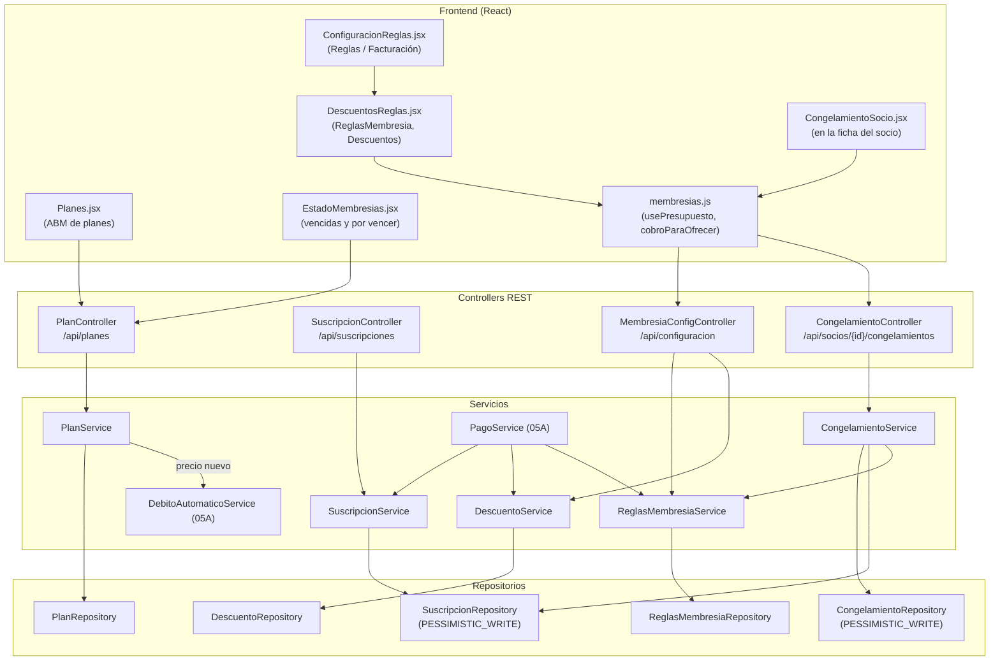

# 04 - Planes, Membresías, Descuentos y Congelamientos

Este documento detalla los modelos, repositorios, DTOs, servicios, controllers y pantallas que conforman el módulo de **Planes, Membresías, Descuentos y Congelamientos** de **SUMMIT**: la oferta comercial del gimnasio, la vigencia de la cuota de cada socio, las reglas de matrícula y congelamiento y el catálogo de descuentos.

---

## 1. Explicación de Relaciones del Área (Arquitectura Punta a Punta)

### Flujo Integral Backend + Frontend

1. **Oferta comercial (`Plan`)**:
   - [`Plan`](../../summit-backend/src/main/java/com/summit/backend/model/Plan.java) define precio, duración en días y frecuencia semanal (`vecesPorSemana`: `null` = pase libre, 1 a 7 = días por semana).
   - [`PlanService`](../../summit-backend/src/main/java/com/summit/backend/service/PlanService.java) normaliza la frecuencia (0 o `null` se guarda como `null`) y, si cambia el precio, actualiza el monto de los débitos automáticos de ese plan.
   - [`PlanController`](../../summit-backend/src/main/java/com/summit/backend/controller/PlanController.java) (`/api/planes`) lo expone; en el frontend lo administra [`Planes.jsx`](../../summit-frontend/src/pages/Planes.jsx) (ruta `/planes`, *Membresías*). Solo el ADMIN crea, edita o desactiva.

2. **Vigencia de la cuota (`Suscripcion`)**:
   - [`Suscripcion`](../../summit-backend/src/main/java/com/summit/backend/model/Suscripcion.java) une un socio con un plan entre `fechaInicio` y `fechaVencimiento`.
   - [`SuscripcionService.extenderOcrearSuscripcion`](../../summit-backend/src/main/java/com/summit/backend/service/SuscripcionService.java) se llama con cada cobro aprobado (capítulo 05A): si la membresía activa no venció, le suma los días del plan; si no tiene o venció, crea una nueva desde hoy. La membresía se **bloquea** (`PESSIMISTIC_WRITE`) para que un congelamiento simultáneo no pise el vencimiento.
   - [`EstadoMembresias.jsx`](../../summit-frontend/src/pages/EstadoMembresias.jsx) (pestaña de *Estado de socios*) clasifica a los socios por los días que faltan para el vencimiento y permite renovar desde ahí.

3. **Reglas y descuentos**:
   - [`ReglasMembresia`](../../summit-backend/src/main/java/com/summit/backend/model/ReglasMembresia.java) (fila única, id 1) define la matrícula de inscripción y los límites de los congelamientos. La crea [`ReglasMembresiaService`](../../summit-backend/src/main/java/com/summit/backend/service/ReglasMembresiaService.java) al arrancar.
   - [`Descuento`](../../summit-backend/src/main/java/com/summit/backend/model/Descuento.java) es el catálogo (porcentaje o monto fijo, siempre sobre el precio del plan, nunca sobre la matrícula). [`DescuentoService`](../../summit-backend/src/main/java/com/summit/backend/service/DescuentoService.java) valida los valores y calcula los pesos que descuenta (`montoSobre`).
   - [`MembresiaConfigController`](../../summit-backend/src/main/java/com/summit/backend/controller/MembresiaConfigController.java) los expone bajo `/api/configuracion` (recepción los lee al cobrar; solo el ADMIN los cambia). En el frontend están en *Configuración y reglas* ([`ConfiguracionReglas.jsx`](../../summit-frontend/src/pages/ConfiguracionReglas.jsx) con los componentes de [`DescuentosReglas.jsx`](../../summit-frontend/src/pages/DescuentosReglas.jsx)).

4. **Congelamiento**:
   - [`Congelamiento`](../../summit-backend/src/main/java/com/summit/backend/model/Congelamiento.java) pausa la membresía entre dos fechas: mientras dura, el socio no ingresa y el vencimiento se corre esos días.
   - [`CongelamientoService.registrar`](../../summit-backend/src/main/java/com/summit/backend/service/CongelamientoService.java) valida las reglas (mínimo de días, tope anual, sin superposición, membresía vigente al empezar) y suma los días al vencimiento. `terminar` lo corta si el socio volvió antes (descuenta los días no usados) o lo anula si todavía no empezó (descuenta todos).
   - [`CongelamientoController`](../../summit-backend/src/main/java/com/summit/backend/controller/CongelamientoController.java) (`/api/socios/{id}/congelamientos`) lo usa [`CongelamientoSocio.jsx`](../../summit-frontend/src/components/socios/CongelamientoSocio.jsx), dentro de la ficha del socio.

5. **Cliente del frontend**: [`membresias.js`](../../summit-frontend/src/services/membresias.js) reúne las llamadas de reglas, descuentos, presupuesto, cobro y congelamientos, la regla de cuándo ofrecer cobrar (`cobroParaOfrecer`) y el hook `usePresupuesto`.

### Diagrama de Arquitectura y Relaciones del Módulo

---

## 2. Análisis Detallado Archivo por Archivo

---

### 2.1. [`Plan.java`](../../summit-backend/src/main/java/com/summit/backend/model/Plan.java)

- **Propósito del archivo**: Entidad de la tabla `planes`: cada modalidad de membresía que ofrece el gimnasio. Lleva `@JsonIgnoreProperties({"hibernateLazyInitializer", "handler"})` porque se serializa cuando llega como proxy LAZY dentro de una suscripción.

#### Atributos de Clase / Entidad
| Nombre | Tipo | Anotaciones / Configuración | Propósito |
| :--- | :--- | :--- | :--- |
| `idPlan` | `Long` | `@Id`, `@GeneratedValue(IDENTITY)` | Clave primaria. |
| `nombrePlan` | `String` | `unique = true`, `nullable = false`, `length = 50` | Nombre comercial único. |
| `descripcion` | `String` | `length = 255` | Lo que incluye. |
| `precioBase` | `BigDecimal` | `nullable = false`, `precision = 10`, `scale = 2` | Precio de lista de cada período. |
| `duracionDias` | `Integer` | `nullable = false` | Días que extiende cada cobro (por ejemplo 30). |
| `vecesPorSemana` | `Integer` | — | `null` = pase libre; 1 a 7 = días de acceso por semana (lo aplica el control de acceso). |
| `activo` | `Boolean` | `nullable = false` | Baja lógica: uno inactivo no se ofrece para cobrar. |

#### Métodos
1. **`prePersist()`** (`@PrePersist`): `if (activo == null) activo = true;` y `if (duracionDias == null) duracionDias = 30;`.

---

### 2.2. [`Suscripcion.java`](../../summit-backend/src/main/java/com/summit/backend/model/Suscripcion.java)

- **Propósito del archivo**: Entidad de la tabla `suscripciones`: la vigencia de la membresía de un socio en un plan.

#### Atributos
| Nombre | Tipo | Configuración | Propósito |
| :--- | :--- | :--- | :--- |
| `idSuscripcion` | `Long` | PK autoincremental | Identificador. |
| `usuario` | `Usuario` | `@ManyToOne(LAZY)`, `usuario_id`, no nulo | Socio. |
| `plan` | `Plan` | `@ManyToOne(LAZY)`, `plan_id`, no nulo | Plan actual (cambia si renueva con otro). |
| `fechaInicio` | `LocalDate` | no nulo | Comienzo. |
| `fechaVencimiento` | `LocalDate` | no nulo | Último día pago; lo corren los cobros y los congelamientos. |
| `activa` | `Boolean` | no nulo | Membresía vigente del socio. |

No tiene métodos propios (Lombok genera getters, setters y builder).

---

### 2.3. [`Descuento.java`](../../summit-backend/src/main/java/com/summit/backend/model/Descuento.java) y [`TipoDescuento.java`](../../summit-backend/src/main/java/com/summit/backend/model/TipoDescuento.java)

- **Propósito**: Descuento del catálogo que arma el dueño (ej. "Familiar 10 %", "Estudiante $ 2.000"). Cada socio puede tener uno habitual (`PerfilSocio.descuento`) y cada cobro guarda el nombre y el monto descontado, así que modificarlo o borrarlo no cambia los cobros anteriores.

#### Atributos de `Descuento`
| Nombre | Tipo | Configuración | Propósito |
| :--- | :--- | :--- | :--- |
| `idDescuento` | `Long` | PK | Identificador. |
| `nombre` | `String` | `unique`, `length = 60` | Nombre. |
| `tipo` | `TipoDescuento` | `@Enumerated(STRING)`, texto | `PORCENTAJE` o `MONTO_FIJO`. |
| `valor` | `BigDecimal` | `precision = 10`, `scale = 2` | Porcentaje o pesos. |
| `activo` | `boolean` | `@Builder.Default = true` | Uno desactivado no se ofrece ni se aplica como habitual. |

#### Constantes de `TipoDescuento`
- `PORCENTAJE`: `valor` = porcentaje del precio del plan (10 = 10 %).
- `MONTO_FIJO`: `valor` = pesos que se restan.

---

### 2.4. [`ReglasMembresia.java`](../../summit-backend/src/main/java/com/summit/backend/model/ReglasMembresia.java)

- **Propósito**: Reglas de las membresías que define el dueño (fila única, id 1, sin `@GeneratedValue`).

#### Atributos
| Nombre | Tipo | Propósito |
| :--- | :--- | :--- |
| `idReglas` | `Long` | Siempre 1. |
| `matriculaMonto` | `BigDecimal` | Matrícula de inscripción; 0 = no se cobra. |
| `matriculaReinscripcionDias` | `int` | Se vuelve a cobrar si estuvo más de estos días sin cuota; 0 = solo la primera vez. |
| `congelamientoMinDias` | `int` | Mínimo de cada congelamiento. |
| `congelamientoMaxDiasAnio` | `int` | Máximo por año calendario; 0 = el gimnasio no congela. |

---

### 2.5. [`Congelamiento.java`](../../summit-backend/src/main/java/com/summit/backend/model/Congelamiento.java) y [`MotivoCongelamiento.java`](../../summit-backend/src/main/java/com/summit/backend/model/MotivoCongelamiento.java)

- **Propósito**: Congelamiento de una membresía. Si el socio vuelve antes, se termina y se le descuentan los días no usados; si todavía no empezó, se anula y se le descuentan todos.

#### Atributos de `Congelamiento`
| Nombre | Tipo | Configuración | Propósito |
| :--- | :--- | :--- | :--- |
| `idCongelamiento` | `Long` | PK | Identificador. |
| `usuario` | `Usuario` | `@ManyToOne(LAZY)`, no nulo | Socio. |
| `suscripcion` | `Suscripcion` | `@ManyToOne(LAZY)`, no nulo | Membresía a la que se le corrió el vencimiento. |
| `desde`, `hasta` | `LocalDate` | no nulos | Primer y último día congelado (incluidos). |
| `motivo` | `MotivoCongelamiento` | texto | `VACACIONES`, `SALUD` u `OTRO`. |
| `observacion` | `String` | `length = 200` | Detalle. |
| `diasAplicados` | `int` | no nulo | Días sumados al vencimiento (0 si se anuló). |
| `terminadoAntes` | `boolean` | — | Volvió antes: `hasta` pasó a ser el día anterior a su vuelta. |
| `anulado` | `boolean` | — | Se anuló antes de empezar. |
| `registradoPor` | `Usuario` | `@ManyToOne(LAZY)` | Empleado que lo cargó. |
| `fechaRegistro` | `LocalDateTime` | no nulo | Momento de carga. |

#### Métodos
1. **`onCreate()`** (`@PrePersist`): `if (fechaRegistro == null) fechaRegistro = now()`.

---

### 2.6. [`PlanRepository.java`](../../summit-backend/src/main/java/com/summit/backend/repository/PlanRepository.java) y [`ReglasMembresiaRepository.java`](../../summit-backend/src/main/java/com/summit/backend/repository/ReglasMembresiaRepository.java)

- `PlanRepository`: hereda el CRUD de `JpaRepository` y agrega `existsByNombrePlan(String)` (lo usa `DataSeeder`).
- `ReglasMembresiaRepository`: solo el CRUD heredado.

---

### 2.7. [`SuscripcionRepository.java`](../../summit-backend/src/main/java/com/summit/backend/repository/SuscripcionRepository.java)

#### Métodos y consultas
| Método | Consulta / Uso |
| :--- | :--- |
| `findFirstByUsuarioIdUsuarioAndActivaTrueOrderByFechaVencimientoDesc` | La membresía activa que vence más tarde (vista del socio, control de acceso). |
| `findByUsuarioIdUsuario` | Historial del socio. |
| `activasParaActualizar(idUsuario)` | `@Lock(PESSIMISTIC_WRITE)`: bloquea las membresías activas del socio (de la que vence más tarde a la primera) para que dos operaciones a la vez (cobro y congelamiento) no pisen el vencimiento de la otra. |
| `findParaActualizar(idSuscripcion)` | Bloquea una membresía puntual (al terminar un congelamiento). |
| `ultimoVencimiento(idUsuario)` | `MAX(fechaVencimiento)`: hasta cuándo tuvo cuota (`null` si nunca tuvo); decide si corresponde cobrar matrícula. |
| `countByActivaTrueAndFechaVencimientoBetween` | Membresías que vencen en un rango (tablero). |
| `vencimientosConPlan()` | Filas `[idUsuario, nombrePlan, fechaInicio, fechaVencimiento]` para las métricas (activos en una fecha, bajas, socios por plan). |

---

### 2.8. [`DescuentoRepository.java`](../../summit-backend/src/main/java/com/summit/backend/repository/DescuentoRepository.java)

| Método | Uso |
| :--- | :--- |
| `findAllByOrderByActivoDescNombreAsc` | Catálogo completo: primero los activos, por nombre. |
| `findByActivoTrueOrderByNombreAsc` | Solo los que se ofrecen al cobrar. |
| `existsByNombreIgnoreCase`, `existsByNombreIgnoreCaseAndIdDescuentoNot` | Nombre repetido al crear o editar (sin importar mayúsculas). |

---

### 2.9. [`CongelamientoRepository.java`](../../summit-backend/src/main/java/com/summit/backend/repository/CongelamientoRepository.java)

| Método | Consulta / Uso |
| :--- | :--- |
| `findByUsuarioIdUsuarioOrderByDesdeDescIdCongelamientoDesc` | Historial del socio, con `@EntityGraph("registradoPor")`. |
| `findParaActualizar(idCongelamiento, idUsuario)` | `@Lock(PESSIMISTIC_WRITE)`: dos pedidos de "terminar" a la vez no devuelven los días dos veces. |
| `vigenteEl(idUsuario, fecha)` | El congelamiento no anulado que incluye la fecha (como no se superponen, hay uno como mucho). |
| `vigentesEl(fecha)` | Filas `[idUsuario, hasta]` de todos los congelados en una fecha (lista de socios). |
| `seSuperpone(idUsuario, desde, hasta)` | `COUNT(c) > 0` de un congelamiento no anulado que se cruza con el rango (`c.desde <= hasta AND c.hasta >= desde`). |
| `diasUsadosEntre(idUsuario, inicioAnio, finAnio)` | `COALESCE(SUM(diasAplicados), 0)` de los congelamientos que **empiezan** en ese año. |

---

### 2.10. DTOs: [`DescuentoDTO`](../../summit-backend/src/main/java/com/summit/backend/dto/DescuentoDTO.java), [`DescuentoRequestDTO`](../../summit-backend/src/main/java/com/summit/backend/dto/DescuentoRequestDTO.java), [`CongelamientoDTO`](../../summit-backend/src/main/java/com/summit/backend/dto/CongelamientoDTO.java) y [`CongelamientoRequestDTO`](../../summit-backend/src/main/java/com/summit/backend/dto/CongelamientoRequestDTO.java)

| DTO | Campos | Notas |
| :--- | :--- | :--- |
| `DescuentoDTO` (`record`) | `idDescuento`, `nombre`, `tipo`, `valor`, `activo`, `socios` | `socios`: cuántos lo tienen como habitual. |
| `DescuentoRequestDTO` (`record`) | `nombre` (`@NotBlank`, `@Size(2..60)`), `tipo` (`@NotNull`), `valor` (`@NotNull`), `activo` (`null` = activo) | Alta o edición. |
| `CongelamientoDTO` (clase con `@Data` y `@Builder`) | `idCongelamiento`, `desde`, `hasta`, `dias`, `motivo`, `observacion`, `estado` (`PROGRAMADO`, `EN_CURSO`, `TERMINADO` o `ANULADO`), `terminadoAntes`, `registradoPor` (nombre), `fechaRegistro`, `vencimientoMembresia` (solo al registrar o terminar), `aviso` | Para la ficha del socio. |
| `CongelamientoRequestDTO` (`record`) | `desde`, `hasta`, `motivo` (`@NotNull`), `observacion` (`@Size(max = 200)`) | Pedido de congelamiento. |

---

### 2.11. [`PlanService.java`](../../summit-backend/src/main/java/com/summit/backend/service/PlanService.java)

#### Métodos
1. **`listar()`**, **`buscarPorId(Long id)`** (404 si no existe).
2. **`crear(Plan plan)`**: normaliza la frecuencia y guarda.
3. **`actualizar(Long id, Plan planData)`**: actualización **parcial**: cada campo se cambia solo si viene (`if (... != null)`), incluido `activo` (permite reactivar). Para pasar a pase libre se envía `vecesPorSemana = 0`. Guarda el `precioAnterior` y, si el precio nuevo es distinto (`compareTo != 0`), llama a `debitoAutomaticoService.actualizarMontoDelPlan(id, precio)`: los socios con débito en ese plan pagan el precio nuevo desde el próximo cobro.
4. **`normalizarVecesPorSemana(Integer veces)`** (`private`): `null` o 0 → `null`; fuera de 1..7 → "Las veces por semana deben estar entre 1 y 7 (0 = pase libre)".
5. **`desactivar(Long id)`**: `activo = false` (baja lógica).

---

### 2.12. [`SuscripcionService.java`](../../summit-backend/src/main/java/com/summit/backend/service/SuscripcionService.java)

#### Métodos
1. **`listarPorSocio(Long idUsuario)`**.
2. **`extenderOcrearSuscripcion(Usuario usuario, Plan plan)`** (`@Transactional`):
   - `sub` = la primera de `activasParaActualizar` (bloqueada hasta el final de la transacción).
   - `if (sub != null && !sub.getFechaVencimiento().isBefore(hoy))`: **extiende** la actual sumando `plan.getDuracionDias()` al vencimiento y le pone el plan nuevo.
   - `else`: crea una nueva desde hoy hasta `hoy + duracionDias`.
3. **`crearSuscripcion(Long idUsuario, Long idPlan)`** (`@Transactional`): busca usuario y plan (404 si no existen) y llama a la anterior. Es transaccional porque llama a un método de la misma clase (sin pasar por el proxy de Spring).
4. **`verificarCuotaAlDia(Long idUsuario)`**: la membresía activa existe y no venció (sin contar los días de gracia).

---

### 2.13. [`DescuentoService.java`](../../summit-backend/src/main/java/com/summit/backend/service/DescuentoService.java)

#### Constantes
`CIEN` (100) y `VALOR_MAXIMO` (10.000.000).

#### Métodos
1. **`listar(boolean soloActivos)`** (`@Transactional(readOnly = true)`): el catálogo (completo o solo activos) con la cantidad de socios que tiene cada uno como habitual (`sociosPorDescuento()`).
2. **`crear(DescuentoRequestDTO pedido)`**: nombre repetido (sin mayúsculas) → error; `validarValor`; guarda el valor con 2 decimales (`HALF_UP`) y activo si no se indica.
3. **`actualizar(Long id, DescuentoRequestDTO pedido)`**: igual, excluyendo el propio id al buscar repetidos; `activo` solo cambia si viene. Los cobros ya hechos no cambian.
4. **`eliminar(Long id)`**: primero `perfilSocioRepository.quitarDescuento(descuento)` (los socios que lo tenían como habitual se quedan sin descuento) y después lo borra.
5. **`buscar(Long id)`** (404) y **`activo(Long id)`**: un descuento que se puede aplicar o asignar tiene que estar activo; si no, "El descuento X está desactivado".
6. **`montoSobre(Descuento d, BigDecimal precio)`** (`public static`): si es porcentaje, `precio × valor / 100` redondeado al centavo; si es monto fijo, el valor. Nunca más que el precio (`monto.min(precio)`). Lo usa `PagoService` para armar el presupuesto.
7. **`validarValor(tipo, valor)`** (`private static`): mayor a 0; un porcentaje no supera 100; menor que el máximo; como mucho 2 decimales (`stripTrailingZeros().scale() > 2`).
8. **`sociosPorDescuento()`** y **`aDto(...)`** (`private`).

---

### 2.14. [`ReglasMembresiaService.java`](../../summit-backend/src/main/java/com/summit/backend/service/ReglasMembresiaService.java)

#### Constantes
`ID_REGLAS` = 1; por defecto, sin matrícula, reinscripción a los 30 días, congelamientos de 7 días o más y hasta 30 por año; `MATRICULA_MAXIMA` = 10.000.000.

#### Métodos
1. **`initReglas()`** (`@PostConstruct`): crea la fila con los valores por defecto si no existe.
2. **`obtener()`**: la fila 1 (si falta, `IllegalStateException`).
3. **`actualizar(ReglasMembresia cambios)`** (`@Transactional`): la pantalla manda las reglas completas. Valida: matrícula entre 0 y el máximo; reinscripción entre 0 y 3650 días; máximo anual entre 0 y 365; mínimo entre 1 y 365; y, si el gimnasio congela (`maximo > 0`), el mínimo no puede superar el máximo. Guarda con la matrícula a 2 decimales.

---

### 2.15. [`CongelamientoService.java`](../../summit-backend/src/main/java/com/summit/backend/service/CongelamientoService.java)

- **Atributos**: `CongelamientoRepository`, `UsuarioRepository`, `SuscripcionRepository`, `DebitoAutomaticoRepository`, `ReglasMembresiaService`.

#### Métodos
1. **`historial(Long idSocio)`**: los congelamientos del socio convertidos a DTO con el estado calculado hoy.
2. **`vigente(Long idUsuario, LocalDate fecha)`**: el que rige en una fecha (lo usa el control de acceso).
3. **`congeladosHoy()`**: mapa idUsuario → último día congelado (lista de socios, seguimiento).
4. **`registrar(Long idSocio, CongelamientoRequestDTO pedido, String emailRegistrador)`** (`@Transactional(isolation = READ_COMMITTED)`):
   - **Lo primero es bloquear la membresía** (`activasParaActualizar`): un pedido igual al mismo tiempo (un doble clic) espera acá y, gracias a `READ_COMMITTED`, después ve el congelamiento que guardó el primero (con el aislamiento por defecto de MySQL seguiría viendo la base como estaba al empezar).
   - Validaciones en orden:
     - La cuenta no está activa → `IllegalStateException`.
     - `congelamientoMaxDiasAnio == 0` → "El gimnasio no congela membresías".
     - `desde` anterior a hoy → "tiene que empezar hoy o más adelante".
     - `hasta` anterior a `desde` → error.
     - `dias = DAYS.between(desde, hasta) + 1` menor que el mínimo → "El congelamiento mínimo es de N días".
     - Sin membresía → "El socio no tiene una membresía para congelar".
     - La membresía vence antes de `desde` → "primero tiene que renovarla".
     - `seSuperpone(...)` → "Ya tiene un congelamiento en esas fechas".
     - `usados + dias > maximoAnual` (los días del año en que empieza) → "Supera el máximo de N días congelados por año: en AAAA ya usó X y le quedan Y".
   - Suma `dias` al vencimiento, guarda el congelamiento (con quién lo cargó) y arma el DTO con el vencimiento nuevo.
   - Si el socio tiene un débito automático `ACTIVO`, agrega el aviso: Mercado Pago le sigue cobrando cada mes mientras está congelada (cada cobro igual le suma su mes).
5. **`terminar(Long idSocio, Long idCongelamiento)`** (`@Transactional`):
   - Bloquea el congelamiento. Ya anulado o ya terminado (`hasta` anterior a hoy) → `IllegalStateException`.
   - `if (!desde.isBefore(hoy))` (no empezó o empieza hoy): **anula** y devuelve todos los días (`diasAplicados = 0`).
   - `else`: lo **termina ayer**: `devueltos = DAYS.between(ayer, hasta)`, `hasta = ayer`, resta los días y marca `terminadoAntes`. Desde hoy el socio ya puede ingresar.
   - Bloquea la membresía (`findParaActualizar`) y le resta los días devueltos.
6. **`estado(Congelamiento c, LocalDate hoy)`** (`private static`): `ANULADO` si está anulado; `PROGRAMADO` si empieza después de hoy; `TERMINADO` si terminó antes de hoy; si no, `EN_CURSO`.
7. **`socio(Long)`** (solo rol `SOCIO`) y **`aDto(...)`** (`private`).

---

### 2.16. Controllers: [`PlanController`](../../summit-backend/src/main/java/com/summit/backend/controller/PlanController.java), [`SuscripcionController`](../../summit-backend/src/main/java/com/summit/backend/controller/SuscripcionController.java), [`MembresiaConfigController`](../../summit-backend/src/main/java/com/summit/backend/controller/MembresiaConfigController.java) y [`CongelamientoController`](../../summit-backend/src/main/java/com/summit/backend/controller/CongelamientoController.java)

| Método y ruta | Roles (SecurityConfig) | Lógica |
| :--- | :--- | :--- |
| `GET /api/planes`, `GET /api/planes/{id}` | Autenticado | Lista y detalle. |
| `POST /api/planes` | ADMIN | `201` + plan creado. |
| `PUT /api/planes/{id}` | ADMIN | Actualización parcial. |
| `DELETE /api/planes/{id}` | ADMIN | Desactiva (`{ mensaje: "Plan desactivado" }`). |
| `GET /api/suscripciones/socio/{id}` | ADMIN, RECEPCION | Historial de membresías. |
| `POST /api/suscripciones` | ADMIN, RECEPCION | `{ idUsuario, idPlan }`: crea o extiende sin cobro (uso administrativo). |
| `GET /api/suscripciones/verificar/{id}` | ADMIN, RECEPCION | `{ cuotaAlDia }`. |
| `GET/PUT /api/configuracion/membresias` | Lee ADMIN y RECEPCION; cambia ADMIN | Reglas de membresía. |
| `GET /api/configuracion/descuentos?activos=` | Lee ADMIN y RECEPCION | Catálogo (o solo activos). |
| `POST`, `PUT /{id}`, `DELETE /{id}` en `/api/configuracion/descuentos` | ADMIN | Alta (`201`), edición y borrado (`204`). |
| `GET /api/socios/{id}/congelamientos` | ADMIN, RECEPCION, PROFESOR | Historial. |
| `POST /api/socios/{id}/congelamientos` | ADMIN, RECEPCION | `201`; registra quién lo cargó (`auth.getName()`). |
| `POST /api/socios/{id}/congelamientos/{idC}/terminar` | ADMIN, RECEPCION | Termina o anula. |

`MembresiaConfigController` y `CongelamientoController` están en `ConflictosExceptionHandler`: una regla que choca con el estado actual (superposición, tope anual) responde `409`.

---

### 2.17. [`membresias.js`](../../summit-frontend/src/services/membresias.js)

- **Propósito del archivo**: Cliente del frontend para membresías, descuentos, presupuesto, cobro y congelamientos. Todas las llamadas usan `pedirJson` (lanzan el mensaje del backend).

#### Funciones exportadas
| Función | Pedido |
| :--- | :--- |
| `obtenerReglas()`, `guardarReglas(reglas)` | `GET/PUT /configuracion/membresias` |
| `listarDescuentos(soloActivos)`, `crearDescuento`, `actualizarDescuento`, `eliminarDescuento` | `/configuracion/descuentos` |
| `pedirPresupuesto(pedido)` | `POST /pagos/presupuesto` (mismo pedido que el cobro, sin medio de pago; sin `idUsuario` = socio nuevo) |
| `registrarCobro(pedido)` | `POST /pagos` |
| `cobrarConTarjeta(pedido)`, `configTarjeta()` | `POST /pagos/tarjeta`, `GET /pagos/tarjeta/config` |
| `listarCongelamientos`, `congelarMembresia`, `terminarCongelamiento` | `/socios/{id}/congelamientos` |
| `textoValorDescuento(d)` | `"10 %"` o `"$ 2.500"` |

#### Constantes y reglas
- `DIAS_PARA_OFRECER_COBRO` = 7.
- **`cobroParaOfrecer(socio)`**: `null` si el socio está de baja, tiene un cobro a verificar o está congelado; `'COBRAR'` si no tiene membresía o venció (aunque esté en los días de gracia); `'RENOVAR'` si vence dentro de 7 días; si no, `null` (ya está paga).
- `MOTIVOS_CONGELAMIENTO`, `textoMotivoCongelamiento`, `ESTADOS_CONGELAMIENTO` (texto y color de cada estado; el anulado va tachado).

#### Hook `usePresupuesto(pedido)`
- Recalcula el detalle del cobro cuando cambia el pedido (plan, descuento, matrícula). Usa `JSON.stringify(pedido)` como `clave` del efecto.
- Espera **250 ms** antes de pedirlo (`setTimeout`), para no mandar un pedido por cada tecla del descuento especial; la limpieza cancela la espera y marca la respuesta vieja como no vigente.
- `pedido` `null` = todavía no hay plan.
- Devuelve `{ presupuesto, calculando, error, recalcular }` (`recalcular` fuerza otra vuelta, por ejemplo si al cobrar el total cambió).

---

### 2.18. [`Planes.jsx`](../../summit-frontend/src/pages/Planes.jsx)

- **Ruta**: `summit-frontend/src/pages/Planes.jsx` (ruta `/planes`, *Membresías*)
- **Propósito del archivo**: Catálogo de planes con indicadores, filtros, exportación y el alta o edición.

#### Funciones y subcomponentes
1. **`textoFrecuencia(veces)`**: "N veces por semana" (singular para 1) o "Pase libre".
2. **`PlanModal({ plan, onClose, onGuardado })`**: formulario con nombre, descripción, precio, duración y frecuencia (`''` = pase libre). Al guardar envía `vecesPorSemana: 0` para pase libre (en la edición, `null` significaría "no cambiar"). `POST /planes` o `PUT /planes/{id}`. En la edición avisa que los débitos automáticos pasan al precio nuevo desde el próximo cobro.

#### Componente `Planes`
- **Datos**: `useCarga` pide en paralelo `/planes` y `/socios` (para contar las membresías al día de cada plan).
- **Estados**: `search`, `tipo` (`TODOS`, `LIBRE`, `LIMITE`), `showInactive`, `modal`.
- **`membresiasAlDia(plan)`**: socios con ese plan y la membresía al día.
- **`cambiarEstado(plan)`**: con confirmación, desactiva (`DELETE`) o reactiva (`PUT { activo: true }`).
- **Filtro y orden**: activos primero y por nombre.
- **`exportar()`**: CSV `planes.csv`.
- **JSX**: cuatro `StatCard` (total, activos, con límite semanal, membresías al día), barra de búsqueda y una tarjeta por plan con su frecuencia, precio, descripción y membresías al día. Los botones de edición solo para el ADMIN.

---

### 2.19. [`EstadoMembresias.jsx`](../../summit-frontend/src/pages/EstadoMembresias.jsx)

- **Propósito del archivo**: Pestaña *Membresías* de *Estado de socios*: los socios agrupados por los días que faltan para que venza su membresía, para renovarles a tiempo.

#### Constantes
- `TABS`: seis categorías con su función `incluye(s)`. Los congelados hoy van aparte (su vencimiento ya incluye los días congelados):

| Categoría | Condición |
| :--- | :--- |
| Vencidas | no congelado y `dias < 0` |
| 0-7 días | no congelado y `0 <= dias <= 7` |
| 8-15 días | no congelado y `8 <= dias <= 15` |
| 15+ días | no congelado y `dias > 15` |
| Congeladas | `congeladaHasta` |
| Sin membresía | no congelado y `dias === null` |

- `COLORES`: clases de cada color.

#### Lógica
- **`cargar()`**: `/socios` (sin los `CANCELADO`) y `/planes` en paralelo.
- `conDias`: cada socio con `dias = diasHasta(vencimiento)`; la lista de la categoría se ordena por días ascendente.
- Cada categoría es un botón con su cantidad (`aria-pressed`). La tabla muestra socio, contacto, plan y vencimiento (con "Congelada hasta..." si corresponde) y, para ADMIN y RECEPCION, el botón **Renovar** o **Cobrar** que abre `CobroModal`.

---

### 2.20. [`ConfiguracionReglas.jsx`](../../summit-frontend/src/pages/ConfiguracionReglas.jsx)

- **Ruta**: `summit-frontend/src/pages/ConfiguracionReglas.jsx` (ruta `/ajustes/reglas`, ADMIN y RECEPCION)
- **Propósito del archivo**: Un solo panel para lo que antes estaba repartido en *Ajustes > Reglas de Acceso*, *Membresías > Descuentos y reglas* y *Ajustes > Facturación*.

#### Lógica
- `PESTANAS`: `reglas` (ADMIN y RECEPCION) y `facturacion` (solo ADMIN y solo con la factura electrónica prendida).
- `pestanas`: filtradas por rol y por `useFunciones().facturacion`; a *Facturación* le agrega el contador de comprobantes rechazados + inciertos (`useAvisoFacturacion`), en rojo si hay rechazados.
- Si queda una sola pestaña, no se muestran las pestañas.
- **Reglas** (dentro de `DentroDeSeccion`, cada bloque con su título chico): `ConfiguracionAcceso` (capítulo 07B; recepción la ve sin poder cambiarla) y, solo para el ADMIN, `ReglasMembresia` y `Descuentos`.
- **Facturación** (dentro de `DentroDePestana`): `AjustesFacturacion` (capítulo 13B).
- Usa `usePestana` y `usePanelPestanas`.

---

### 2.21. [`DescuentosReglas.jsx`](../../summit-frontend/src/pages/DescuentosReglas.jsx)

- **Propósito del archivo**: Exporta los dos bloques de membresía de *Configuración y reglas* (solo ADMIN): `ReglasMembresia` y `Descuentos`.

#### Componentes auxiliares
- **`Tarjeta`**: caja con ícono, título y una acción.
- **`Numero`**: campo numérico con la unidad a la derecha ("días", "%") o a la izquierda ("$").
- **`useMensaje()`**: `[mensaje, mostrar]`; los de "listo" se van solos a los 3 segundos.
- **`Mensaje`**, **`Nota`**.

#### Componente `ReglasMembresia`
- Carga las reglas con `obtenerReglas()`. Mientras no están, muestra "Cargando reglas..." (con `aparece-tarde` y `data-cargando`) o el error.
- **`guardar()`**: convierte los valores a número (`Number` y `parseInt`, con 0 si están vacíos) y llama a `guardarReglas`; muestra "Reglas guardadas: se aplican desde el próximo cobro o congelamiento".
- `conMatricula`: el campo de reinscripción se deshabilita si la matrícula es $ 0 (no tiene sentido).
- Dos tarjetas: *Matrícula de inscripción* y *Congelamiento de membresías*, cada una con su nota explicativa.

#### Subcomponente `FormDescuento`
Formulario con nombre, tipo y valor (con `%` o `$` según el tipo y máximo 100 si es porcentaje).

#### Componente `Descuentos`
- **Estados**: `descuentos`, `edicion` (el que se crea, sin id, o el que se edita), `errorDescuento`, `procesando`.
- **`editar(d)`**: abre el formulario vacío (porcentaje) o con los datos del descuento.
- **`guardarDescuento(e)`**: crea o actualiza y recarga.
- **`cambiarActivo(d)`**: alterna activo/desactivado ("Dejar de ofrecerlo al cobrar").
- **`borrar(d)`**: la confirmación dice cuántos socios lo tienen como habitual y se quedan sin descuento, que los cobros ya hechos no cambian y que, si solo se quiere dejar de ofrecer, conviene desactivarlo.
- **JSX**: cada descuento con su nombre, cuántos socios lo tienen como habitual, el valor ("− 10 %"), el botón de estado, editar y borrar (deshabilitados mientras se edita otro). Si no hay ninguno, una sugerencia ("Familiar" del 10 %).

---

### 2.22. [`CongelamientoSocio.jsx`](../../summit-frontend/src/components/socios/CongelamientoSocio.jsx)

- **Propósito del archivo**: Congelamiento de la membresía desde la ficha del socio: el que está en curso o programado (con su botón para terminarlo o anularlo), el formulario para congelar y los anteriores.
- **Props**: `socio`, `onCambio` (para que la ficha y la lista recarguen el vencimiento).

#### Funciones del módulo
- **`diasEntre(desde, hasta)`**: días entre dos fechas, las dos incluidas (`+ 1`); 0 si falta alguna.
- **`textoDias(n)`**: "1 día" o "N días".

#### Estados y variables
- `congelamientos`, `reglas`, `form` (`null` = formulario cerrado), `procesando`, `mensaje` (`ok`, `aviso` en ámbar o `error`).
- `vigentes` (en curso o programados), `anteriores` (terminados o anulados), `gimnasioCongela` (`!reglas || maxDiasAnio > 0`) y `dias` (los del rango elegido).

#### Funciones
1. **`cargar()`** + `useEffect`: el historial y las reglas.
2. **`abrir()`**: formulario desde hoy, motivo "Vacaciones".
3. **`congelar(e)`**: registra, cierra el formulario y muestra el rango y el vencimiento nuevo; si el backend mandó un `aviso` (débito automático), el mensaje va en ámbar con el aviso.
4. **`terminar(c)`**: la pregunta cambia según el estado (anular un programado devuelve todos los días; terminar uno en curso devuelve los no usados). Después informa si quedó anulado o cuántos días usó, y el vencimiento nuevo.

#### JSX
- Cada vigente con su texto ("Congelada hasta..." o "Congelamiento programado del... al..."), motivo, días, observación y quién lo cargó, y el botón "Volvió: terminar hoy" o "Anular".
- El formulario muestra en vivo cuántos días son y los límites del gimnasio. Si está cerrado, el botón "Congelar membresía" aparece solo si el gimnasio congela, el socio está `ACTIVO` y tiene una membresía.
- Los anteriores van en un `
` desplegable (tachados los anulados y "(volvió antes)" los terminados antes).
