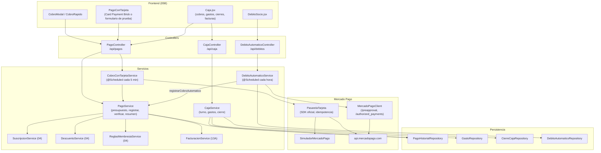

# 05A - Cobros, Caja, Gastos, Débito Automático y Tarjeta (Backend)

Este documento detalla el backend del área de dinero de **SUMMIT**: el cálculo y registro de los cobros de membresía (con descuento y matrícula), los pagos "a verificar", el cobro con tarjeta por Mercado Pago, el débito automático mensual, los gastos y el turno y cierre de caja (arqueo).

---

## 1. Explicación de Relaciones del Área (Arquitectura Punta a Punta)

**Regla central:** solo un pago `APROBADO` extiende la membresía y suma como ingreso en la caja.

### Flujo Integral Backend + Frontend

1. **Cobro en recepción** (efectivo, transferencia, QR o tarjeta en el posnet):
   - El frontend (`CobroModal.jsx`) pide primero el **presupuesto** (`POST /api/pagos/presupuesto`): [`PagoService.calcular`](../../summit-backend/src/main/java/com/summit/backend/service/PagoService.java) arma precio del plan − descuento (del catálogo o especial con motivo) + matrícula (si corresponde por primera inscripción o por reinscripción).
   - Al confirmar (`POST /api/pagos`) se manda el **total que vio recepción** (`totalMostrado`). El backend lo vuelve a calcular y, si cambió (un precio, un descuento, la matrícula), responde `409` sin registrar nada.
   - Si la plata entró, el pago queda `APROBADO`, se extiende la membresía (`SuscripcionService`) y se guarda hasta cuándo quedó paga. Una transferencia o un QR que todavía no se ve acreditado queda `PENDIENTE` ("a verificar") hasta que un ADMIN lo confirme o rechace (`POST /api/pagos/{id}/verificar`).
   - Todo cobro deja su factura en la cola de ARCA (`FacturacionService.encolarFactura`, capítulo 13A).

2. **Cobro con tarjeta por Mercado Pago** (opcional, `summit.pagos.tarjeta.modo`):
   - El formulario de Mercado Pago (Card Payment Brick) convierte la tarjeta en un **token**: los datos de la tarjeta nunca pasan por SUMMIT.
   - [`CobroConTarjetaService`](../../summit-backend/src/main/java/com/summit/backend/service/CobroConTarjetaService.java) primero controla el total (como cualquier cobro), recién después cobra con [`PasarelaTarjeta`](../../summit-backend/src/main/java/com/summit/backend/mercadopago/PasarelaTarjeta.java) (SDK oficial) usando una **clave de idempotencia** por intento, y al final registra el pago con el id de Mercado Pago (único).
   - Rechazada → `402` sin registrar nada. En proceso → queda a verificar y una tarea programada lo confirma sola cuando se acredita.
   - Con `MP_TARJETA=SIMULADOR`, [`SimuladorMercadoPago`](../../summit-backend/src/main/java/com/summit/backend/mercadopago/SimuladorMercadoPago.java) responde como Mercado Pago sin cuenta (el titular de la tarjeta de prueba decide el resultado).

3. **Débito automático mensual** (opcional, `MP_ACCESS_TOKEN`):
   - Recepción da de alta la adhesión ([`DebitoAutomaticoService.adherir`](../../summit-backend/src/main/java/com/summit/backend/service/DebitoAutomaticoService.java)): se crea una suscripción en Mercado Pago (`preapproval`) con [`MercadoPagoClient`](../../summit-backend/src/main/java/com/summit/backend/service/MercadoPagoClient.java) y el socio la autoriza en el link (un QR en recepción).
   - Cada hora una tarea consulta los cobros (no hace falta publicar el sistema en internet): cada cobro aprobado nuevo se registra como pago `DEBITO_AUTOMATICO` y extiende la membresía; un rechazo queda como alerta.
   - La baja se hace con un clic (Defensa del Consumidor) y solo se marca si Mercado Pago la confirma.

4. **Caja** ([`CajaService`](../../summit-backend/src/main/java/com/summit/backend/service/CajaService.java)):
   - **Turno**: desde el último cierre (o desde el comienzo del día) hasta ahora. El efectivo esperado es el fondo que dejó el cierre anterior + cobros aprobados en efectivo − gastos en efectivo que salieron de la caja.
   - **Gastos**: un gasto en efectivo no puede superar el efectivo de la caja; si lo pagó el dueño con su plata se marca "fuera de caja" y no entra en el arqueo. No se borran: se anulan con motivo, solo mientras el turno sigue abierto.
   - **Cierre (arqueo)**: recepción cuenta el efectivo; si hay diferencia, la observación es obligatoria. Lo que no se retira queda de fondo para el turno siguiente. Dos cierres simultáneos se detectan por la restricción `UNIQUE (desde)`.

### Diagrama de Arquitectura y Relaciones del Módulo

---

## 2. Análisis Detallado Archivo por Archivo

---

### 2.1. [`PagoHistorial.java`](../../summit-backend/src/main/java/com/summit/backend/model/PagoHistorial.java)

- **Propósito del archivo**: Entidad de la tabla `pago_historial`: cada cobro de membresía.

#### Atributos de Clase / Entidad
| Nombre | Tipo | Configuración | Propósito |
| :--- | :--- | :--- | :--- |
| `idPago` | `Long` | PK | Identificador. |
| `usuario`, `plan` | `Usuario`, `Plan` | `@ManyToOne(LAZY)`, no nulos | Socio y plan cobrado. |
| `montoAbonado` | `BigDecimal` | `precision 10, scale 2` | Total cobrado. |
| `fechaPago` | `LocalDateTime` | no nulo | Momento del cobro. |
| `metodoPago` | `MetodoPago` | texto, `length = 30` | Medio de pago. |
| `comprobanteNro` | `String` | `length = 50` | Número de operación (o `"MP <id>"`). |
| `estadoPago` | `EstadoPago` | `columnDefinition = "varchar(20) not null default 'APROBADO'"`, `@Builder.Default` | Con el `default`, al agregar la columna a una base con pagos viejos MySQL los completa con `APROBADO` (si no, Java no podría leerlos). |
| `mpPaymentId` | `String` | `unique`, `length = 40` | Id del cobro en Mercado Pago: un mismo cobro nunca se registra dos veces. |
| `registradoPor` | `Usuario` | `@ManyToOne(LAZY)` | Quién cobró (`null` en los automáticos). |
| `verificadoPor`, `fechaVerificacion` | `Usuario`, `LocalDateTime` | — | Quién confirmó o rechazó un pago a verificar, y cuándo. |
| `precioLista`, `descuentoNombre`, `descuentoMonto`, `matriculaMonto` | — | nullables | Detalle del cobro: `montoAbonado = precioLista − descuentoMonto + matriculaMonto`. `matriculaMonto`: `null` = no correspondía, `0` = bonificada. |
| `venceMembresia` | `LocalDate` | — | Hasta cuándo quedó paga la membresía (para el comprobante). |

#### Métodos
1. **`prePersist()`**: `fechaPago = now().truncatedTo(MICROS)` (la precisión de la base: así queda exacto para los turnos de caja) y `estadoPago = APROBADO` si falta.

---

### 2.2. Enums: [`EstadoPago`](../../summit-backend/src/main/java/com/summit/backend/model/EstadoPago.java), [`MetodoPago`](../../summit-backend/src/main/java/com/summit/backend/model/MetodoPago.java), [`EstadoDebito`](../../summit-backend/src/main/java/com/summit/backend/model/EstadoDebito.java) y [`CategoriaGasto`](../../summit-backend/src/main/java/com/summit/backend/model/CategoriaGasto.java)

| Enum | Constantes |
| :--- | :--- |
| `EstadoPago` | `PENDIENTE` (a verificar), `APROBADO`, `RECHAZADO`. |
| `MetodoPago` | `EFECTIVO`, `TRANSFERENCIA`, `MERCADO_PAGO` (en pantalla "QR / billetera"), `TARJETA_DEBITO`, `TARJETA_CREDITO`, `DEBITO_AUTOMATICO` (lo registra el sistema, nunca recepción). |
| `EstadoDebito` | `PENDIENTE_AUTORIZACION`, `ACTIVO`, `PAUSADO`, `CANCELADO`. |
| `CategoriaGasto` | `ALQUILER`, `SERVICIOS`, `SUELDOS`, `LIMPIEZA`, `MANTENIMIENTO`, `EQUIPAMIENTO`, `INSUMOS`, `IMPUESTOS`, `OTROS`. |

---

### 2.3. [`DebitoAutomatico.java`](../../summit-backend/src/main/java/com/summit/backend/model/DebitoAutomatico.java)

- **Propósito**: Adhesión de un socio al débito automático de su plan (Mercado Pago Suscripciones). Cada cobro que confirma Mercado Pago se registra como un `PagoHistorial`.

#### Atributos
| Nombre | Propósito |
| :--- | :--- |
| `usuario`, `plan`, `monto` | Socio, plan y lo que cobra cada mes (se actualiza si cambia el precio del plan). |
| `estado` | Refleja el de la suscripción en Mercado Pago. |
| `mpPreapprovalId` (`unique`), `linkAutorizacion` | Id de la suscripción y link donde el socio la autoriza (QR). |
| `emailPagador`, `medioPago` | Cuenta de Mercado Pago con la que paga y el medio que eligió (`account_money`, `debvisa`, `master`...). |
| `fechaAlta`, `creadoPor` | Alta y quién la hizo. |
| `proximoCobro`, `ultimoCobro` | Fechas de cobro. |
| `ultimoRechazo`, `detalleRechazo` | Alerta para recepción hasta que entre un cobro aprobado. |
| `ultimaSincronizacion` | Última consulta a Mercado Pago. |
| `fechaBaja`, `bajaPor` | Baja. |

`prePersist()`: `fechaAlta = now()` y `estado = PENDIENTE_AUTORIZACION` si faltan.

---

### 2.4. [`Gasto.java`](../../summit-backend/src/main/java/com/summit/backend/model/Gasto.java)

- **Propósito**: Egreso de la caja. No se borra: se anula con motivo.

#### Atributos
| Nombre | Configuración | Propósito |
| :--- | :--- | :--- |
| `fecha` | no nulo | Momento (con microsegundos, `prePersist`). |
| `monto` | `precision 12, scale 2` | Importe. |
| `categoria`, `descripcion`, `metodoPago` | texto | Rubro, detalle y medio. |
| `fueraDeCaja` | `columnDefinition = "bit not null default 0"` | En efectivo pero lo pagó el dueño: cuenta como gasto pero no en el arqueo. El `default` completa con 0 los gastos que ya existían. |
| `comprobanteNro` | `length = 50` | Factura o recibo del proveedor. |
| `registradoPor` | — | Quién lo cargó. |
| `anulado`, `anuladoPor`, `fechaAnulacion`, `motivoAnulacion` | — | Anulación. |

---

### 2.5. [`CierreCaja.java`](../../summit-backend/src/main/java/com/summit/backend/model/CierreCaja.java) y [`TotalMetodoCierre.java`](../../summit-backend/src/main/java/com/summit/backend/model/TotalMetodoCierre.java)

- **Propósito**: Foto del arqueo de un turno.

#### Atributos de `CierreCaja`
| Nombre | Propósito |
| :--- | :--- |
| `desde` (`unique`) | Comienzo del turno (el cierre anterior). Único: dos personas que cierran a la vez no pueden guardar los dos. |
| `hasta` | Momento del cierre. |
| `fondoInicial`, `ingresosEfectivo`, `egresosEfectivo`, `efectivoEsperado` | `esperado = fondo + ingresos − egresos` en efectivo. |
| `efectivoContado`, `diferencia` | Lo contado y `contado − esperado` (negativo = faltante). |
| `retiro`, `fondoSiguiente` | Lo que se lleva el dueño y lo que queda (`contado − retiro`). |
| `totalIngresos`, `totalEgresos`, `cantidadCobros`, `cantidadGastos` | Todos los medios. |
| `observacion`, `cerradoPor` | Comentario y quién cerró. |
| `metodos` | `@ElementCollection(fetch = EAGER)` en la tabla `cierres_caja_metodos`: lista de `TotalMetodoCierre`. |

`TotalMetodoCierre` (`@Embeddable`): `metodoPago`, `ingresos`, `egresos`.

---

### 2.6. [`PagoHistorialRepository.java`](../../summit-backend/src/main/java/com/summit/backend/repository/PagoHistorialRepository.java)

#### Métodos y consultas
| Método | Uso |
| :--- | :--- |
| `findByUsuarioIdUsuarioOrderByFechaPagoDesc` | Historial del socio, con `@EntityGraph` de plan y personal. |
| `findAll(Pageable)`, `findByEstadoPago(estado, Pageable)` | Listado de caja (con socio, plan y personal en la misma consulta). |
| `findParaActualizar(idPago)` | `PESSIMISTIC_WRITE`: dos personas no aprueban el mismo pago a la vez (extendería la membresía dos veces). |
| `existsByMpPaymentId`, `findByMpPaymentId` | Evitar duplicados de Mercado Pago. |
| `findByEstadoPagoAndMpPaymentIdNotNullAndMetodoPagoIn` | Cobros con tarjeta que Mercado Pago dejó en proceso. |
| `existsBy...AndMatriculaMontoIsNotNullAndFechaPagoAfter` | Si un cobro reciente a verificar ya resolvió la matrícula (no se cobra dos veces). |
| `existsByUsuarioIdUsuarioAndEstadoPagoAndFechaPagoAfter`, `sociosConPagosDesde` | Cobros a verificar recientes de un socio o de todos (lista de socios). |
| `aprobadosEntre(desde, hasta)` | Filas `[fechaPago, monto, metodoPago, nombrePlan]` para las métricas. |
| `sumarDesde`, `countByEstadoPagoAndFechaPagoGreaterThanEqual`, `sumarPorMetodoDesde` | Resumen de caja (solo aprobados). |
| `aprobadosPorMetodoEntre(desde, hasta)` | Filas `[metodoPago, total, cantidad]` de un turno. |
| `countByEstadoPago`, `sumarPorEstado` | Cuántos pagos a verificar hay y cuánto suman. |

---

### 2.7. [`GastoRepository`](../../summit-backend/src/main/java/com/summit/backend/repository/GastoRepository.java), [`CierreCajaRepository`](../../summit-backend/src/main/java/com/summit/backend/repository/CierreCajaRepository.java) y [`DebitoAutomaticoRepository`](../../summit-backend/src/main/java/com/summit/backend/repository/DebitoAutomaticoRepository.java)

| Repositorio | Método | Uso |
| :--- | :--- | :--- |
| `GastoRepository` | `findAll(Pageable)` | Con el personal (`@EntityGraph`). |
| | `sumarPorMetodoEntre(desde, hasta)` | Filas `[metodo, total, cantidad]` de los gastos **no anulados y no fuera de caja** de un turno. |
| | `sumarDesde`, `countByAnuladoFalseAndFechaGreaterThanEqual` | Egresos del día y del mes. |
| `CierreCajaRepository` | `findFirstByOrderByHastaDesc` | El último cierre: donde empieza el turno abierto. |
| | `findAll(Pageable)` | Historial con quién cerró. |
| `DebitoAutomaticoRepository` | `findAllByOrderByFechaAltaDesc`, `findByEstadoInOrderByFechaAltaDesc` | Listados. |
| | `findFirstByUsuarioIdUsuarioOrderByFechaAltaDesc` | La adhesión más reciente (aunque esté de baja), para la ficha. |
| | `findFirstByUsuarioIdUsuarioAndEstadoInOrderByFechaAltaDesc` | La vigente. |
| | `findByPlanIdPlanAndEstadoIn`, `countByEstado` | Cambio de precio y métricas. |

---

### 2.8. DTOs

| DTO | Campos principales | Notas |
| :--- | :--- | :--- |
| [`CobroRequestDTO`](../../summit-backend/src/main/java/com/summit/backend/dto/CobroRequestDTO.java) (`record`) | `idUsuario` (puede faltar en el presupuesto de un socio nuevo), `idPlan`, `idDescuento` **o** `descuentoEspecial` (`{ monto, motivo }`), `bonificarMatricula`, `metodoPago`, `comprobante`, `aVerificar` (`@JsonProperty("aVerificar")`), `totalMostrado` | El cobro y su presupuesto usan el mismo pedido. |
| [`PresupuestoDTO`](../../summit-backend/src/main/java/com/summit/backend/dto/PresupuestoDTO.java) | `idPlan`, `plan`, `precioLista`, `idDescuento`, `descuentoNombre`, `descuentoMonto`, `matriculaCorresponde`, `matriculaMotivo`, `matriculaMonto`, `matriculaBonificada`, `total` | Detalle antes de confirmar. |
| [`PagoListadoDTO`](../../summit-backend/src/main/java/com/summit/backend/dto/PagoListadoDTO.java) | Socio (nombre, DNI, teléfono para WhatsApp), plan, monto, método, comprobante, estado, quién cobró y verificó, el detalle, `venceMembresia` y `factura` (`FacturaResumenDTO`) | Listado de caja y ficha. |
| [`CajaResumenDTO`](../../summit-backend/src/main/java/com/summit/backend/dto/CajaResumenDTO.java) | Ingresos y cobros de hoy (con el detalle por método) y del mes, pendientes a verificar (cantidad y monto), egresos de hoy y del mes | Tarjetas de la caja. |
| [`TurnoCajaDTO`](../../summit-backend/src/main/java/com/summit/backend/dto/TurnoCajaDTO.java) | `desde`, `hasta`, `fondoInicial`, `metodos` (`TotalMetodo(metodoPago, ingresos, egresos)`), totales, efectivo esperado, cantidades, `ultimoCierre`, `ultimoCierrePor` | El turno abierto. |
| [`CierreCajaDTO`](../../summit-backend/src/main/java/com/summit/backend/dto/CierreCajaDTO.java) | La foto completa del cierre | Historial de cierres. |
| [`CierreRequestDTO`](../../summit-backend/src/main/java/com/summit/backend/dto/CierreRequestDTO.java) | `efectivoContado` (`@NotNull`), `retiro` (`null` = nada), `observacion` (`@Size(max = 300)`) | Pedido de cierre. |
| [`GastoDTO`](../../summit-backend/src/main/java/com/summit/backend/dto/GastoDTO.java) | Datos del gasto, la anulación y `anulable` (del turno abierto y sin anular) | Listado de gastos. |
| [`GastoRequestDTO`](../../summit-backend/src/main/java/com/summit/backend/dto/GastoRequestDTO.java) | `monto`, `categoria`, `descripcion` (`@Size(3..200)`), `metodoPago`, `fueraDeCaja`, `comprobante` (`@Size(max = 50)`) | Alta de gasto. |
| [`DebitoAutomaticoDTO`](../../summit-backend/src/main/java/com/summit/backend/dto/DebitoAutomaticoDTO.java) | Socio, plan, monto, estado, `linkAutorizacion` (solo mientras falta autorizar), medio, fechas y rechazo | Ficha y listado. |
| [`CobroConTarjetaDTO`](../../summit-backend/src/main/java/com/summit/backend/dto/CobroConTarjetaDTO.java) | `cobro` (`CobroRequestDTO`), `tarjeta` (`token`, `medio`, `emisor`, `cuotas`, `email`, `tipoDocumento`, `documento`), `idempotencia` | Cobro con tarjeta. |

---

### 2.9. [`PagoService.java`](../../summit-backend/src/main/java/com/summit/backend/service/PagoService.java)

- **Ruta**: `summit-backend/src/main/java/com/summit/backend/service/PagoService.java`
- **Propósito del archivo**: Registra los cobros de recepción, los confirma si quedaron a verificar, registra los cobros automáticos y arma el resumen de caja.

#### Constantes y clases internas
| Nombre | Propósito |
| :--- | :--- |
| `VERIFICABLES` | `TRANSFERENCIA` y `MERCADO_PAGO`: los únicos que pueden quedar a verificar. |
| `DIAS_COBRO_A_VERIFICAR` (`public static`) | 30: un cobro a verificar de los últimos 30 días cuenta como "en curso" (no se cobra la matrícula dos veces y la lista no ofrece cobrar de nuevo); uno más viejo sin resolver se considera olvidado. |
| `TotalCambiadoException` | El total que vio recepción ya no es el que corresponde (`409`). |
| `Matricula` (`record`) | `(corresponde, motivo, monto)`. |

#### Métodos
1. **`presupuesto(CobroRequestDTO pedido)`** (`readOnly`): sin `idUsuario` es un socio nuevo; llama a `calcular`.
2. **`registrarPago(CobroRequestDTO pedido, String emailRegistrador)`** (`@Transactional`):
   - `DEBITO_AUTOMATICO` → "se registran solos cuando Mercado Pago confirma el cobro".
   - `aVerificar` con un método que no es verificable → error.
   - Comprobante de más de 50 caracteres → error.
   - `prepararCobro(pedido)` (calcula y compara con `totalMostrado`).
   - Un cobro de $ 0 no puede quedar a verificar.
   - `guardar(...)` con estado `PENDIENTE` o `APROBADO`. Es atómico: si falla la extensión de la membresía, el pago no queda guardado.
3. **`prepararCobro(CobroRequestDTO pedido)`** (`readOnly`): exige socio y `totalMostrado`; si `totalMostrado.compareTo(total) != 0`, lanza `TotalCambiadoException("El total cambió: ahora es $ X...")`. La usa también el cobro con tarjeta **antes** de cobrar.
4. **`registrarCobroConTarjeta(pedido, detalle, metodo, idMercadoPago, aprobado, email)`** (`@Transactional`): si ese pago de Mercado Pago ya estaba registrado (pedido repetido), devuelve ese; si no, lo guarda con comprobante `"MP <id>"`, aprobado o a verificar.
5. **`guardar(...)`** (`private`): arma el `PagoHistorial` con el detalle (`descuentoMonto` solo si hay descuento; `matriculaMonto` `null` si no correspondía, `0` si se bonificó). `if (APROBADO)` extiende la membresía y guarda `venceMembresia`. Siempre encola la factura (`facturacionService.encolarFactura`).
6. **`verificarPago(Long idPago, boolean aprobado, String emailVerificador)`** (`@Transactional`): bloquea el pago; si no está `PENDIENTE` → "Ese pago ya fue aprobado/rechazado". Cambia el estado, guarda quién y cuándo y, si se aprueba, recién ahí extiende la membresía.
7. **`registrarCobroAutomatico(usuario, plan, monto, mpPaymentId, fechaCobro)`** (`@Transactional`): `if (existsByMpPaymentId)` → `false` (la sincronización puede ver el mismo cobro muchas veces). Si no, guarda un pago `DEBITO_AUTOMATICO` aprobado con la fecha del débito, extiende la membresía, encola la factura y devuelve `true`.
8. **`historialPorSocio(Long)`** y **`listar(EstadoPago, Pageable)`** (`readOnly`): convierten a DTO y les agregan su factura con **una sola consulta para toda la lista** (`facturacionService.resumenes(ids)`).
9. **`resumen()`**: ingresos de hoy (por método) y del mes, cantidades, pendientes a verificar y egresos.
10. **`aDto(PagoHistorial)`**: conversión a `PagoListadoDTO`.
11. **`calcular(Usuario socio, Plan plan, CobroRequestDTO pedido)`** (`private`):
    - `precio` = precio del plan con 2 decimales.
    - `if (idDescuento != null && especial != null)` → "Elegí un descuento del listado o uno especial, no los dos".
    - Descuento del catálogo: tiene que estar activo; `DescuentoService.montoSobre(descuento, precio)`.
    - Descuento especial: motivo de 3 a 100 caracteres, monto mayor a 0 y no mayor que el precio; se guarda como `"Especial: <motivo>"`.
    - Matrícula: `matricula(socio)`; `bonificada = corresponde && pedido.bonificarMatricula()`.
    - `total = precio − descuento + matrícula cobrada`.
12. **`matricula(Usuario socio)`** (`private`):
    - Monto 0 → no corresponde.
    - Socio nuevo (`null`) → "Inscripción".
    - Si un cobro a verificar reciente ya la resolvió → no corresponde.
    - Sin membresías anteriores (`ultimoVencimiento == null`) → "Inscripción".
    - Si estuvo sin cuota más días que `matriculaReinscripcionDias` (y el límite no es 0) → "Reinscripción: estuvo N días sin cuota (venció el ...)".
13. **`metodoPago(String)`** (`private static`): obligatorio y uno conocido (`valueOf` en mayúsculas).

---

### 2.10. [`CobroConTarjetaService.java`](../../summit-backend/src/main/java/com/summit/backend/service/CobroConTarjetaService.java)

- **Propósito del archivo**: Cobro con tarjeta en recepción por Mercado Pago, en el orden correcto: calcular y controlar el total → cobrar → registrar.

#### Constantes
- `MOTIVOS`: traduce los códigos de rechazo de Mercado Pago (`status_detail`) a lo que recepción le dice al socio: fondos insuficientes, código de seguridad, vencimiento, número de tarjeta, autorizar con el banco, tarjeta inhabilitada, pago duplicado, demasiados intentos, rechazo por seguridad.

#### Métodos
1. **`cobrar(CobroConTarjetaDTO pedido, String emailRegistrador)`**:
   - Sin cobro, sin tarjeta o sin token → "Faltan los datos de la tarjeta". Sin clave de idempotencia (o de más de 64 caracteres) → error.
   - `detalle = pagoService.prepararCobro(pedido.cobro())`: si el total cambió, **no se llega a cobrar**.
   - `pasarela.cobrar(total, tarjeta, "SUMMIT - <plan>", idempotencia)`: el monto es el que calculó el backend, nunca el del navegador.
   - `if (resultado.rechazado())` → `TarjetaRechazadaException` con el motivo traducido (`402`, no se registra nada).
   - Si no, `registrarCobroConTarjeta(...)` (aprobado, o a verificar si quedó en proceso).
2. **`revisarEnProceso()`** (`@Scheduled(fixedDelay = revisar-ms, 5 min; initialDelay = 1 min)`): si la pasarela está habilitada, consulta cada pago con tarjeta `PENDIENTE` y, si Mercado Pago ya lo aprobó o rechazó, llama a `verificarPago(..., null)` (sin persona: lo verificó el sistema). Un error en uno solo se registra y sigue con los demás. Así no hace falta exponer el sistema a internet para recibir avisos de Mercado Pago.

---

### 2.11. [`PasarelaTarjeta.java`](../../summit-backend/src/main/java/com/summit/backend/mercadopago/PasarelaTarjeta.java)

- **Propósito del archivo**: Cobro con tarjeta con el SDK oficial de Mercado Pago (Checkout API).

#### Tipos internos
- `Modo`: `APAGADO`, `SIMULADOR`, `MERCADO_PAGO`.
- `Resultado(id, estado, detalle, metodo)`: `aprobado()` si `approved`; `rechazado()` si `rejected` o `cancelled`.

#### Constructor
- Lee `summit.pagos.tarjeta.modo`, el access token y la clave pública. Con `MERCADO_PAGO` y alguna credencial vacía, avisa en el log y queda `APAGADO`.
- Crea el `PaymentClient` sobre el simulador o sobre el cliente HTTP del SDK, envuelto con `conUnaSolaClave`.

#### Métodos
1. **`conUnaSolaClave(MPHttpClient)`** (`private static`): el SDK agrega siempre su propia clave de idempotencia al azar aunque se le pase una (el pedido saldría con las dos). Si el pedido trae la del intento (`x-idempotency-key`), quita la del SDK y rearma el pedido: un pedido repetido no cobra dos veces.
2. **`habilitada()`**, **`modo()`**, **`publicKey()`** (vacía en el simulador, que usa su propio formulario).
3. **`cobrar(monto, tarjeta, descripcion, idempotencia)`**: arma un `PaymentCreateRequest` con monto, token, cuotas (1 si no vienen), medio, emisor y el pagador (email y documento) y llama a `pagos.create` con la clave.
4. **`consultar(String idPago)`**: `pagos.get(id)`.
5. **`llamar(Llamada)`** (`private`): si no está habilitada → `MercadoPagoNoDisponibleException`. Deduce `TARJETA_DEBITO` si `payment_type_id` es `debit_card`, si no `TARJETA_CREDITO`. Un `MPApiException` 401/403 → "rechazó la credencial del gimnasio"; otro → "no aceptó el pago"; un `MPException` → "No se pudo hablar con Mercado Pago". El detalle técnico solo va al log.
6. **`opciones(encabezados)`** (`private`): token (`TEST-SIMULADOR` en el simulador), encabezados y tiempos (5 s de conexión, 20 s de respuesta).

---

### 2.12. [`SimuladorMercadoPago.java`](../../summit-backend/src/main/java/com/summit/backend/mercadopago/SimuladorMercadoPago.java)

- **Propósito del archivo**: Mercado Pago de mentira para probar y mostrar el cobro con tarjeta sin cuenta. Reemplaza solo la conexión del SDK (`MPHttpClient`): el resto del cobro es igual que con Mercado Pago de verdad.

#### Lógica
- `RESULTADOS`: el titular de la tarjeta de prueba (va en el token `SIM-TITULAR-...`) decide el resultado, con los nombres de las tarjetas de prueba de Mercado Pago: `APRO` aprueba, `CONT` queda en proceso (y se aprueba en la próxima consulta), `FUND`, `SECU`, `EXPI`, `CALL` y `OTHE` rechazan con su motivo.
- **`send(MPRequest)`**: `POST /v1/payments` → `crear`; `GET /v1/payments/{id}` → devuelve el pago (si estaba `in_process`, lo pasa a `approved`); cualquier otra ruta → 404.
- **`crear(...)`** (`synchronized`): si la clave de idempotencia ya se usó, devuelve el mismo pago. Valida el token (`SIM-...`), arma el pago con un id creciente, el estado, el medio y `debit_card`/`credit_card` según el medio. Los pagos viven en memoria (`ConcurrentHashMap`).

---

### 2.13. [`MercadoPagoClient.java`](../../summit-backend/src/main/java/com/summit/backend/service/MercadoPagoClient.java)

- **Propósito del archivo**: Adaptador para el débito automático: es la **única** clase que habla con la API REST de Mercado Pago Suscripciones, con el `HttpClient` de Java y Jackson.

#### Constantes y atributos
`TIMEOUT` (20 s), `POR_PAGINA` (10: el máximo que acepta `/authorized_payments/search`), `url`, `accessToken` (privado: permite cobrar en nombre del gimnasio), `backUrl` (a dónde vuelve el socio; tiene que ser https), `http` (5 s de conexión).

#### Métodos
1. **`habilitado()`**: hay access token.
2. **`crearSuscripcion(emailPagador, motivo, referencia, monto, meses)`**: `POST /preapproval` con `auto_recurring` (cada `meses` meses, en ARS), `external_reference`, `back_url` y `status: pending` (el socio elige el medio y autoriza). La `referencia` también es la clave de idempotencia.
3. **`obtenerSuscripcion(id)`**, **`cancelarSuscripcion(id)`** (`PUT status: cancelled`), **`actualizarMonto(id, monto)`**.
4. **`cobrosDeSuscripcion(id)`**: `while (true)` que recorre las páginas de `/authorized_payments/search` de a 10 hasta que no hay más resultados o se llega al total (con un tope de 1000).
5. **`enviar(metodo, ruta, cuerpo, claveIdempotencia)`** (`private`): sin credencial → `MercadoPagoNoDisponibleException`. Arma el pedido con `Authorization: Bearer`, el JSON y la clave de idempotencia. 401/403 → "rechazó la credencial"; 404 → `NoSuchElementException`; otro error → el mensaje de Mercado Pago. `HttpTimeoutException`, `ConnectException`, `IOException` e `InterruptedException` se traducen a mensajes claros.

---

### 2.14. [`DebitoAutomaticoService.java`](../../summit-backend/src/main/java/com/summit/backend/service/DebitoAutomaticoService.java)

- **Propósito del archivo**: Débito automático mensual (opcional para el socio).

#### Constantes, atributos y records
- `VIGENTES`: `PENDIENTE_AUTORIZACION`, `ACTIVO`, `PAUSADO`.
- `transaccion` (`TransactionTemplate`): cada adhesión se sincroniza en su propia transacción; si una falla, las demás se guardan igual.
- `sincronizando` (`Semaphore(1)`): una sincronización a la vez (la programada y la del botón no se pisan).
- `EstadoDebitoSocio(habilitado, debito)` y `ResultadoSincronizacion(revisados, cobrosNuevos, errores, enCurso)`.

#### Métodos
1. **`habilitado()`**, **`listar(EstadoDebito)`**, **`delSocio(Long)`** (la adhesión más reciente, para la ficha).
2. **`adherir(idSocio, idPlan, emailPagador, emailQuienDaDeAlta)`** (`@Transactional`):
   - Sin credencial → 503. Validaciones: el usuario es socio y no está de baja; el plan está activo y tiene precio; `mesesDelPlan` (30 días o múltiplo, hasta 12 meses); email válido (el de Mercado Pago, o el del socio).
   - Si ya tiene una vigente: si nunca se autorizó, se cancela y se reemplaza; si está activa o pausada → "Para cambiar de plan, primero dalo de baja".
   - Guarda la adhesión, crea la suscripción con la referencia `SUMMIT-DEB-<id>` y guarda el id y el link. Si Mercado Pago no devolvió el link, lanza una excepción: se deshace todo y no queda una adhesión sin link.
3. **`darDeBaja(idDebito, emailQuien)`**: `baja(...)`.
4. **`actualizarMontoDelPlan(idPlan, nuevoMonto)`**: actualiza en Mercado Pago y en la base cada adhesión vigente del plan; si una falla, queda en el log y no frena el cambio de precio.
5. **`sincronizarProgramado()`** (`@Scheduled(fixedDelay = sincronizar-ms, 1 h; initialDelay = 2 min)`): sin credencial no hace nada; si hubo novedades, las registra en el log.
6. **`sincronizarTodos()`**: `tryAcquire` del semáforo (si ya hay una en curso, devuelve `enCurso = true`); recorre las adhesiones vigentes contando cobros nuevos y errores.
7. **`sincronizar(idDebito)`**: "Actualizar" de una sola (después de que el socio autorizó).
8. **`sincronizarUno(idDebito)`** (`private`, dentro de `transaccion.execute`):
   - Sin `mpPreapprovalId` → 0.
   - Si la suscripción ya no existe en Mercado Pago (`NoSuchElementException`), la marca de baja.
   - `actualizarDesde(debito, suscripcion)`.
   - Por cada cobro: fecha del débito (o de creación, o ahora); si está `approved`, `registrarCobroAutomatico(...)` (cuenta los nuevos) y actualiza `ultimoCobro`; si está `rejected` y es más nuevo que el último rechazo, guarda el rechazo con `textoRechazo`.
   - Un cobro aprobado posterior al último rechazo **apaga la alerta**.
9. **`actualizarDesde(debito, suscripcion)`** (`private`): `switch` sobre el estado de Mercado Pago: `authorized` → `ACTIVO`; `paused` → `PAUSADO`; `cancelled` → baja (la canceló el socio desde la app de Mercado Pago); `pending` → sigue esperando. Guarda el próximo cobro (solo si está activo) y el medio de pago.
10. **`baja(...)`** (`private`): ya cancelado → error. Primero cancela en Mercado Pago (si falla, la excepción corta acá y **no** se marca la baja: seguiría cobrando) y después marca la baja.
11. **`cancelarEnMercadoPago`**, **`marcarBaja`**, **`mesesDelPlan`**, **`fecha(JsonNode)`** (fechas de Mercado Pago con zona → hora local) y **`textoRechazo(detalle)`** (código → texto simple) (`private`).

---

### 2.15. [`CajaService.java`](../../summit-backend/src/main/java/com/summit/backend/service/CajaService.java)

- **Ruta**: `summit-backend/src/main/java/com/summit/backend/service/CajaService.java`
- **Propósito del archivo**: Caja de recepción: turno abierto, cierre (arqueo) y gastos.

#### Constantes y record interno
- `MONTO_MAXIMO` = 100.000.000.
- `Turno(desde, hasta, fondoInicial, ingresos, egresos, cobros, gastos, anterior)` con métodos derivados: `ingresosEfectivo()`, `egresosEfectivo()`, `efectivoEsperado()` (`fondo + ingresos − egresos` en efectivo), `totalIngresos()`, `totalEgresos()` y `metodos()` (solo los medios con movimientos, en el orden de `MetodoPago`).

#### Métodos
1. **`turnoActual()`** (`readOnly`): calcula el turno hasta `ahora()` y lo devuelve con el último cierre y quién lo hizo.
2. **`cerrar(CierreRequestDTO pedido, String emailCajero)`** (`@Transactional`):
   - `contado` y `retiro` válidos (0 permitido); retiro mayor que lo contado → error.
   - `diferencia = contado − esperado`. `if (diferencia != 0 && observacion < 5 caracteres)` → "Hay un faltante/sobrante de $ X: explicá el motivo".
   - Guarda la foto completa con `saveAndFlush`. Si salta `DataIntegrityViolationException` (mismo `desde` que un cierre recién guardado), "Otra persona acaba de cerrar la caja" (`409`).
3. **`listarCierres(Pageable)`**.
4. **`ahora()`** (`private static`): `now()` truncado a microsegundos **más un microsegundo**. Es el fin del turno sin incluir y, a la vez, el comienzo del siguiente: ningún cobro o gasto queda en dos turnos ni en ninguno (se guardan con esa misma precisión).
5. **`calcularTurno(hasta)`** (`private`): `desde` = el último cierre o el comienzo del día; `fondoInicial` = el fondo que dejó el cierre anterior o 0; suma por método los cobros aprobados y los gastos de caja.
6. **`registrarGasto(GastoRequestDTO pedido, String emailCajero)`** (`@Transactional`):
   - `DEBITO_AUTOMATICO` no es un medio para gastos.
   - `fueraDeCaja` solo vale en efectivo.
   - En efectivo y de la caja: si el monto supera el efectivo que hay (`efectivoEsperado`, nunca negativo), "En la caja hay $ X en efectivo: no alcanza para pagar $ Y. Si lo pagó el dueño con su plata, marcá que no salió de la caja". Así el esperado nunca queda negativo (ningún conteo podría coincidir).
7. **`listarGastos(Pageable)`**: con `anulable` calculado según el inicio del turno abierto.
8. **`anularGasto(idGasto, motivo, emailCajero)`** (`@Transactional`): ya anulado → error; anterior al turno abierto → "ya entró en un cierre de caja: no se puede anular" (cambiaría un arqueo hecho); motivo de 5 a 200 caracteres. Marca la anulación con quién, cuándo y por qué.
9. **`inicioTurnoAbierto()`**, **`montoValido(monto, nombre, ceroPermitido)`** (obligatorio, no negativo, mayor a cero si corresponde, menor que el máximo y con 2 decimales), **`aDto`** (`private`).

---

### 2.16. Controllers: [`PagoController`](../../summit-backend/src/main/java/com/summit/backend/controller/PagoController.java), [`CajaController`](../../summit-backend/src/main/java/com/summit/backend/controller/CajaController.java) y [`DebitoAutomaticoController`](../../summit-backend/src/main/java/com/summit/backend/controller/DebitoAutomaticoController.java)

| Método y ruta | Roles | Respuesta / Lógica |
| :--- | :--- | :--- |
| `POST /api/pagos` | ADMIN, RECEPCION | `201` + `PagoListadoDTO`. Quién cobró sale del token, nunca del cuerpo. `409` si cambió el total. |
| `POST /api/pagos/tarjeta` | ADMIN, RECEPCION | `201` (aprobado o a verificar), `409` (total), `402` (rechazada), `503` (sin conexión). |
| `GET /api/pagos/tarjeta/config` | ADMIN, RECEPCION | `{ modo, publicKey }` para el formulario. |
| `POST /api/pagos/presupuesto` | ADMIN, RECEPCION | `PresupuestoDTO`. |
| `POST /api/pagos/{id}/verificar` | ADMIN | Cuerpo `{ aprobado: true/false }`; si no es booleano, `400` "Indicá si el pago se aprueba o se rechaza". |
| `GET /api/pagos?estado=` | ADMIN, RECEPCION | Página de 20, del más reciente al más viejo. |
| `GET /api/pagos/resumen`, `GET /api/pagos/socio/{id}` | ADMIN, RECEPCION | Resumen e historial. |
| `GET /api/caja/turno` | ADMIN, RECEPCION | Turno abierto. |
| `POST /api/caja/cierres` / `GET /api/caja/cierres` | ADMIN, RECEPCION | Cerrar (`201`) y listar (páginas de 10 por `hasta` descendente). |
| `GET /api/caja/gastos` / `POST /api/caja/gastos` | ADMIN, RECEPCION | Listar (páginas de 15) y registrar (`201`). |
| `POST /api/caja/gastos/{id}/anular` | ADMIN, RECEPCION | Cuerpo `{ motivo }`. |
| `GET /api/debitos/estado` | ADMIN, RECEPCION | `{ habilitado }` (sin credencial, las pantallas explican cómo activarlo). |
| `GET /api/debitos?estado=`, `GET /api/debitos/socio/{id}` | ADMIN, RECEPCION | Listado y adhesión del socio. |
| `POST /api/debitos` | ADMIN, RECEPCION | `{ idSocio, idPlan, emailPagador? }` → `201` con el link de autorización. |
| `POST /api/debitos/{id}/baja`, `POST /api/debitos/{id}/sincronizar`, `POST /api/debitos/sincronizar` | ADMIN, RECEPCION | Baja, actualizar una o todas. |

`CajaController` y `DebitoAutomaticoController` están en `ConflictosExceptionHandler` (`409` en los choques de estado).
