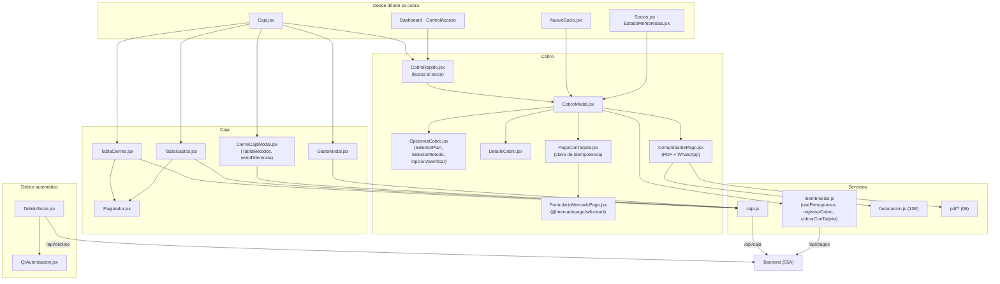

# 05B - Cobros, Caja, Gastos, Débito Automático y Tarjeta (Frontend)

Este documento detalla las pantallas y componentes del frontend de **SUMMIT** con los que recepción cobra las cuotas (en persona o con tarjeta por Mercado Pago), entrega el comprobante, administra la caja (gastos, turno y cierre) y gestiona el débito automático de un socio.

---

## 1. Explicación de Relaciones del Área (Arquitectura Punta a Punta)

### Flujo Integral Backend + Frontend

1. **Cobrar** ([`CobroModal.jsx`](../../summit-frontend/src/components/socios/CobroModal.jsx)): se abre desde la lista de socios, *Estado de socios*, el alta, el tablero, el control de acceso o la caja (estos tres con [`CobroRapido.jsx`](../../summit-frontend/src/components/socios/CobroRapido.jsx), que primero busca al socio).
   - Propone el plan que ya tiene el socio y su descuento habitual: para renovar alcanza con elegir cómo paga.
   - El total lo calcula el backend con `usePresupuesto` (`POST /api/pagos/presupuesto`) y se muestra en [`DetalleCobro.jsx`](../../summit-frontend/src/components/socios/DetalleCobro.jsx) antes de confirmar.
   - El plan y el medio se eligen con un toque ([`OpcionesCobro.jsx`](../../summit-frontend/src/components/socios/OpcionesCobro.jsx)); una transferencia o un QR puede quedar "a verificar".
   - Al confirmar, `POST /api/pagos` con el total que vio recepción; si cambió un precio (`409`), recalcula y muestra el total nuevo.
   - Con **Tarjeta MP**, después de confirmar se carga la tarjeta en [`PagoConTarjeta.jsx`](../../summit-frontend/src/components/socios/PagoConTarjeta.jsx): el formulario de Mercado Pago ([`FormularioMercadoPago.jsx`](../../summit-frontend/src/components/socios/FormularioMercadoPago.jsx), Card Payment Brick) o, en el simulador, uno de prueba.

2. **Comprobante** ([`ComprobantePago.jsx`](../../summit-frontend/src/components/socios/ComprobantePago.jsx)): resumen del cobro, PDF (imprimir, descargar, compartir) y mensaje por WhatsApp. Con la factura electrónica prendida, espera unos segundos a que ARCA la autorice y entonces el PDF es la factura con CAE y QR.

3. **Caja y Pagos** ([`Caja.jsx`](../../summit-frontend/src/pages/Caja.jsx), ruta `/caja`): el turno abierto con el efectivo que debería haber, cuatro tarjetas (ingresos y gastos de hoy, resultado del mes, a verificar) y pestañas de **Cobros** (con aprobar/rechazar los a verificar y facturar), **Gastos** ([`TablaGastos.jsx`](../../summit-frontend/src/components/caja/TablaGastos.jsx)), **Cierres de caja** ([`TablaCierres.jsx`](../../summit-frontend/src/components/caja/TablaCierres.jsx)) y **Facturas** (`TablaFacturas.jsx`, capítulo 13B). Registra gastos con [`GastoModal.jsx`](../../summit-frontend/src/components/caja/GastoModal.jsx) y cierra la caja con [`CierreCajaModal.jsx`](../../summit-frontend/src/components/caja/CierreCajaModal.jsx). Las llamadas de caja están en [`caja.js`](../../summit-frontend/src/services/caja.js).

4. **Débito automático** ([`DebitoSocio.jsx`](../../summit-frontend/src/components/debito/DebitoSocio.jsx), en la ficha del socio): alta con un QR ([`QrAutorizacion.jsx`](../../summit-frontend/src/components/debito/QrAutorizacion.jsx)) que el socio escanea para autorizar en Mercado Pago, estado, último cobro, alerta de rechazo, actualizar y baja.

### Diagrama de Arquitectura y Relaciones del Módulo

---

## 2. Análisis Detallado Archivo por Archivo

---

### 2.1. [`caja.js`](../../summit-frontend/src/services/caja.js)

| Función / Constante | Pedido / Contenido |
| :--- | :--- |
| `obtenerTurno()` | `GET /caja/turno` |
| `cerrarCaja(cierre)` | `POST /caja/cierres` |
| `listarCierres(pagina, tamanio = 10)` | `GET /caja/cierres?page=&size=&sort=hasta,desc` |
| `listarGastos(pagina, tamanio = 15)` | `GET /caja/gastos?page=&size=&sort=fecha,desc` |
| `registrarGasto(gasto)`, `anularGasto(idGasto, motivo)` | `POST /caja/gastos`, `POST /caja/gastos/{id}/anular` |
| `CATEGORIAS_GASTO` | Valor y texto de cada rubro (ej. "Servicios (luz, agua, gas, internet)"). |
| `textoCategoriaGasto(valor)` | El texto sin la aclaración entre paréntesis. |

---

### 2.2. [`OpcionesCobro.jsx`](../../summit-frontend/src/components/socios/OpcionesCobro.jsx)

- **Propósito del archivo**: Elecciones del cobro con un toque (alta de socio y cobro en recepción).

#### Exportaciones
| Nombre | Propósito |
| :--- | :--- |
| `TARJETA_MP` | `'TARJETA_MP'`: el cobro con tarjeta por Mercado Pago. No es un medio del backend: se cobra con `PagoConTarjeta` y queda como débito o crédito según la tarjeta. |
| `SelectorPlan({ planes, valor, onCambiar })` | Planes como tarjetas (nombre, precio y "3 veces por semana · 30 días" o "Libre · 30 días"), con `role="radiogroup"` y radios ocultos (`sr-only`) para teclado y lectores de pantalla. |
| `SelectorMetodo({ valor, onCambiar, conTarjeta })` | Medios de `METODOS_PAGO` como botones con ícono (más "Tarjeta MP" si `conTarjeta`). Usa textos cortos ("Débito", "Crédito") para que el botón no se parta en dos renglones. |
| `OpcionAVerificar({ marcada, onCambiar })` | "Todavía no se ve acreditado: dejar a verificar" (no extiende la membresía ni suma en la caja hasta que un admin lo confirme). |

---

### 2.3. [`DetalleCobro.jsx`](../../summit-frontend/src/components/socios/DetalleCobro.jsx)

- **Propósito**: Muestra el cobro tal como lo calcula el backend: precio del plan, descuento (en verde con "−"), matrícula (tachada si se bonifica, con la casilla "Bonificar la matrícula") y el total.
- **Estructuras de control**: con error, lo muestra; sin presupuesto, "Calculando el total..." si está calculando o nada; mientras recalcula, el detalle se ve semitransparente (`opacity-60`).

---

### 2.4. [`CobroModal.jsx`](../../summit-frontend/src/components/socios/CobroModal.jsx)

- **Ruta**: `summit-frontend/src/components/socios/CobroModal.jsx`
- **Propósito del archivo**: Cobro presencial en recepción.
- **Props**: `socio`, `planes`, `onClose`, `onGuardado(pago)` (se llama al cerrar el comprobante) y `metodoInicial` (por ejemplo, la tarjeta elegida en el alta).

#### Estados y variables
| Nombre | Propósito |
| :--- | :--- |
| `datos` | `idPlan`, `descuento` (id, `''` o `'ESPECIAL'`), `especialMonto`, `especialMotivo`, `bonificarMatricula`, `metodoPago`, `comprobante`, `aVerificar`. |
| `cargandoTarjeta` | El paso de la tarjeta, después de confirmar. |
| `descuentos` | Catálogo activo. |
| `registrado` | El cobro ya registrado: se muestra su comprobante. |
| `propuesto` / `idPlan` | Mientras recepción no elija otro: el plan que ya tiene el socio (si sigue activo) o el único plan activo. |
| `especialCompleto` | El descuento especial entra al cálculo recién cuando tiene monto mayor a 0 y motivo de 3 caracteres o más. |
| `pedido` | Lo que se manda al presupuesto y al cobro. |
| `listo` | Hay presupuesto, no está calculando, no hay error y el especial está completo si se eligió. |

#### Funciones y efectos
1. **`useEffect([socio.idDescuentoHabitual])`**: carga los descuentos activos y, si el socio tiene uno habitual que sigue activo, lo propone.
2. **`registrar(e)`**: con tarjeta pasa al paso de la tarjeta; si no, `registrarCobro({ ...pedido, metodoPago, comprobante, aVerificar, totalMostrado })`. Si el error es `409` (cambió un precio), `recalcular()` muestra el total nuevo.

#### Pantallas según el estado
- **`registrado`**: "Cobro registrado" con el `ComprobantePago`. Si quedó en proceso en Mercado Pago (`PENDIENTE` con comprobante `MP ...`), lo aclara: se confirma solo.
- **`cargandoTarjeta`**: `PagoConTarjeta` con el pedido y el total; "Elegir otro medio de pago" vuelve atrás y un total cambiado también.
- **Formulario**: el socio (con un aviso ámbar si ya tiene un cobro a verificar: hay que fijarse en Caja antes de cobrarle otra vez), `SelectorPlan`, el descuento (con la opción "Especial (monto y motivo)..."), `DetalleCobro`, `SelectorMetodo` (en efectivo se borra el comprobante), el número de comprobante y `OpcionAVerificar` si el método es verificable. El botón dice "Cobrar $ X" o "Pagar con tarjeta $ X".

---

### 2.5. [`CobroRapido.jsx`](../../summit-frontend/src/components/socios/CobroRapido.jsx)

- **Propósito del archivo**: Cobro desde el tablero, el control de acceso o la caja sin ir a la lista de socios.
- **Props**: `idSocio` (si viene, se abre directo), `onClose`, `onCobrado(pago, socio)`.

#### Lógica
- Carga los planes y, con `idSocio`, ese socio (`/socios/{id}`); sin él, la lista de socios no dados de baja.
- `if (socio)` → muestra `CobroModal`. Mientras lee un socio puntual, no muestra nada (es un instante).
- Sin socio: buscador por nombre o DNI con hasta 8 resultados, cada uno con su plan, vencimiento y días.

---

### 2.6. [`PagoConTarjeta.jsx`](../../summit-frontend/src/components/socios/PagoConTarjeta.jsx)

- **Propósito del archivo**: Cobro con tarjeta por Mercado Pago. La tarjeta se carga en el formulario de Mercado Pago (o en uno de prueba) y el backend cobra el total que calculó.

#### Funciones y constantes del módulo
- `FormularioMercadoPago` se importa con `lazy`: el formulario y su librería se descargan recién cuando se cobra con tarjeta.
- **`claveNueva()`**: 16 bytes al azar en hexadecimal con `crypto.getRandomValues` (`crypto.randomUUID` solo existe con https). Una clave por intento de cobro: si el pedido se repite, Mercado Pago no cobra dos veces.
- `TITULARES_DE_PRUEBA`: `APRO` (aprobado), `CONT` (en proceso), `FUND` (sin fondos), `SECU` (código incorrecto), `OTHE` (rechazado).
- **`FormularioDePrueba({ total, onCobrar })`**: para el simulador. No manda datos de tarjeta: solo arma el token `SIM-<titular>-<clave>` y si es débito (`debvisa`) o crédito (`visa`).

#### Componente `PagoConTarjeta({ pedido, total, onListo, onVolver, onTotalCambiado })`
- **Estados**: `config` (`{ modo, publicKey }` de `configTarjeta()`), `error`, `clave`.
- **`cobrar(tarjeta)`**: `cobrarConTarjeta({ cobro: pedido, tarjeta, idempotencia: clave })` y `onListo(pago)`. Si falla: muestra el error; `409` → `onTotalCambiado()`; `402` (rechazada) → **clave nueva**, porque el próximo intento es otro cobro. Relanza el error para que el formulario vuelva a quedar listo.
- **JSX**: según `config.modo`, el formulario de prueba o el de Mercado Pago (con `Suspense`); "Preparando el cobro con tarjeta…" mientras carga; y "Elegir otro medio de pago".

---

### 2.7. [`FormularioMercadoPago.jsx`](../../summit-frontend/src/components/socios/FormularioMercadoPago.jsx)

- **Propósito**: Card Payment Brick de Mercado Pago (`@mercadopago/sdk-react`): la tarjeta vuelve convertida en un token y sus datos nunca pasan por SUMMIT.
- **Lógica**: `initMercadoPago(publicKey, { locale: 'es-AR' })` una sola vez por clave (`iniciadoCon`). `<CardPayment>` con el monto y un máximo de 1 cuota; `onSubmit` traduce lo que devuelve el Brick (`token`, `payment_method_id`, `issuer_id`, `installments`, email y documento del pagador) al formato del backend y devuelve la promesa de `onCobrar`.

---

### 2.8. [`ComprobantePago.jsx`](../../summit-frontend/src/components/socios/ComprobantePago.jsx)

- **Propósito del archivo**: Comprobante de un cobro: resumen, PDF y WhatsApp.

#### Constantes
- `ESPERA_MS` = 20.000 y `CADA_MS` = 1.500: recién cobrado, se pregunta por la factura cada 1,5 s hasta 20 s (casi siempre ARCA responde en un segundo).

#### Lógica
- **`useEffect`**: si la facturación está prendida y el pago está aprobado, consulta los comprobantes del cobro (`comprobantesDelCobro`, `facturaDelCobro`) y repite mientras la factura siga en curso y no pasaron 20 s. La bandera `vigente` y `clearTimeout` cortan el sondeo al cerrar.
- `autorizada`: la factura si ya tiene CAE. `documento` (`useMemo`): `documentoFactura(autorizada)` o `documentoComprobante(pago)`.
- `mensaje` de WhatsApp: saludo con el primer nombre, monto, plan, medio, hasta cuándo quedó paga y la referencia (la factura con su CAE o el número de comprobante).
- **JSX**: el resumen (con "A verificar..." si está pendiente y "Autorizada por ARCA · CAE ..." si corresponde, aclarando "sin validez fiscal" en el simulador o en homologación, y si fue anulada con una nota de crédito); avisos de "Pidiendo la factura a ARCA…", "todavía no salió" o "ARCA rechazó la factura"; `BotonesPdf` y el link `wa.me` ("Avisarle por WhatsApp" si tiene un número válido, o "elegís el contacto").

---

### 2.9. [`Caja.jsx`](../../summit-frontend/src/pages/Caja.jsx)

- **Ruta**: `summit-frontend/src/pages/Caja.jsx` (ruta `/caja`, ADMIN y RECEPCION)
- **Propósito del archivo**: Caja y Pagos: ingresos y egresos, el turno abierto con su cierre y, en pestañas, los cobros, los gastos, los cierres y las facturas.

#### Componentes y funciones del módulo
| Nombre | Propósito |
| :--- | :--- |
| `TarjetaMonto` | Tarjeta de un monto con detalle; puede ser clicable y quedar resaltada. |
| `TAMANIO_PAGINA` | 15. |
| `detalleCobro(p)` | "Plan $ 20.000 · Familiar − $ 2.000 · Matrícula $ 5.000" (o "Matrícula bonificada"); `null` si no hay descuento ni matrícula. |
| `textoFactura(f)`, `claseFactura(f)` | "Factura C 00002-00000154", "Factura pendiente", "... anulada", con su color. |
| `PESTANAS` | `cobros`, `gastos`, `cierres` y `facturas` (esta solo con la factura electrónica prendida). |

#### Estados
`pestana` (`usePestana`), `modal` (`'cobro'`, `'gasto'` o `'cierre'`), `comprobante`, `turno`, `version` (cambiarla recarga gastos y cierres), `resumen`, `pagina`, `numeroPagina`, `soloAVerificar`, `busqueda`, `error`, `aviso`, `cargando`, `verificando`.

#### Funciones
1. **`cargar()`** (`useCallback`): en paralelo, `/pagos/resumen`, la página de cobros (filtrada por `PENDIENTE` si corresponde) y el turno.
2. **`cambiarFiltro(valor)`**: alterna "Todos" / "A verificar" y vuelve a la página 0.
3. **`verificar(pago, aprobado)`**: rechazar pide confirmación; `POST /pagos/{id}/verificar`; muestra "aprobado: la membresía quedó extendida" o "rechazado".
4. **`facturar(pago)`** (ADMIN, con la facturación prendida): pide la factura de un cobro que no tiene (por ejemplo, de antes de prenderla) y recarga a los 2 s.
5. **Búsqueda** en la página actual por socio, DNI, plan o comprobante; **`exportar()`**: CSV de la página con todo el detalle (y la factura si corresponde).

#### JSX
- Acciones: **Registrar gasto** y **Registrar cobro** (`CobroRapido`).
- **Turno abierto**: efectivo que debería haber, cómo se calcula (fondo + cobros − gastos en efectivo), el último cierre y quién lo hizo; si da negativo, un aviso para revisar los gastos. Botón **Cerrar caja**.
- Cuatro tarjetas: ingresos de hoy (con el detalle por medio), gastos de hoy (lleva a la pestaña Gastos), resultado del mes (ingresos − gastos) y a verificar (alterna el filtro).
- **Pestaña Cobros**: tabla con fecha y hora, plan y socio (con el detalle), medio y quién cobró ("Automático" en los débitos), comprobante y factura (con "Facturar" si falta), estado con **Aprobar/Rechazar** para el ADMIN, y el monto (+verde si aprobado, ámbar si pendiente, tachado si rechazado) con el botón "Comprobante" o "Factura".
- Las otras pestañas muestran `TablaGastos`, `TablaCierres` y `TablaFacturas`.
- Al registrar un gasto o cerrar la caja, cambia a la pestaña correspondiente, sube `version` y recarga.

---

### 2.10. [`GastoModal.jsx`](../../summit-frontend/src/components/caja/GastoModal.jsx)

- **Propósito**: Registrar un gasto. Uno en efectivo sale de la caja, así que no puede superar lo que hay en ella.
- **Lógica**:
  - Pide el turno para mostrar cuánto efectivo hay (`enCaja`, nunca negativo); sin él, el backend controla igual.
  - `noAlcanza`: en efectivo, sin "fuera de caja" y con un monto mayor a lo que hay → el botón se deshabilita y explica qué hacer.
  - En efectivo aparece la casilla "No salió de la caja: lo pagó el dueño con su plata" (cuenta como gasto del mes pero no se descuenta del efectivo). Al guardar, `fueraDeCaja` solo se manda en efectivo.

---

### 2.11. [`CierreCajaModal.jsx`](../../summit-frontend/src/components/caja/CierreCajaModal.jsx)

- **Propósito del archivo**: Cierre de caja (arqueo): muestra lo que se movió en el turno, recepción escribe el efectivo que contó y ve al instante si coincide, falta o sobra.

#### Exportaciones auxiliares
- **`textoDiferencia(diferencia)`**: "Coincide" (verde), "Faltan $ X" (rojo) o "Sobran $ X" (ámbar).
- **`TablaMetodos({ metodos })`**: cobros y gastos por medio de pago (también la usa `TablaCierres`).

#### Lógica del componente
- `contado`, `retiro`; `contadoNegativo` (la plata contada nunca es negativa); `errorRetiro` (no negativo y no más de lo contado); `diferencia` redondeada al centavo; `hayDiferencia` hace obligatoria la observación.
- **`cerrar(e)`**: `cerrarCaja(...)`; con `409` (otra persona cerró recién) vuelve a pedir el turno.
- Si da negativo el esperado, explica que se cargaron gastos en efectivo por más de lo que había y cómo corregirlo.
- Después de cerrar: esperado, contado, diferencia, retiro y lo que queda de fondo para el próximo turno.

---

### 2.12. [`TablaGastos.jsx`](../../summit-frontend/src/components/caja/TablaGastos.jsx), [`TablaCierres.jsx`](../../summit-frontend/src/components/caja/TablaCierres.jsx) y [`Paginador.jsx`](../../summit-frontend/src/components/caja/Paginador.jsx)

| Componente | Lógica |
| :--- | :--- |
| `TablaGastos({ version, onCambio })` | Página de gastos (del más nuevo al más viejo) que se recarga con `version`. Los anulados van tachados con quién y por qué. Los `anulable` (del turno abierto) muestran "Anular", que despliega una fila para escribir el motivo (5 caracteres o más) y confirmar; al anular avisa al padre (`onCambio`) para que recalcule el turno. |
| `TablaCierres({ version })` | Página de cierres con desde, hasta, esperado, contado y la diferencia en color. Cada fila se despliega para ver la cantidad de cobros y gastos, la `TablaMetodos`, el retiro, el fondo siguiente, la observación y quién cerró. |
| `Paginador({ pagina, nombre, onCambiar })` | Pie de una tabla con la respuesta `Page` de Spring: "Página 1 de 3 · 40 cobros" y Anterior/Siguiente (deshabilitados con `first` y `last`). No se muestra si no hay elementos. |

---

### 2.13. [`DebitoSocio.jsx`](../../summit-frontend/src/components/debito/DebitoSocio.jsx)

- **Propósito del archivo**: Débito automático del socio dentro de su ficha.

#### Lógica
- **Estados**: `estado` (`{ habilitado, debito }` de `/debitos/socio/{id}`), `planes`, `form` (`{ idPlan, emailPagador }` mientras se adhiere), `procesando`, `error`.
- **`pedir(path, opciones, mensajeError)`**: envoltura común para los pedidos.
- **`abrirAlta()`**: abre el formulario con los planes aptos (`planAptoDebito`: activos y de 30 días o múltiplos).
- **`adherir()`**: `POST /debitos` y muestra la adhesión con su QR.
- **`actualizar(idDebito)`**: `POST /debitos/{id}/sincronizar` (después de que el socio autorizó).
- **`darDeBaja(debito)`**: la pregunta cambia si nunca se autorizó ("el link deja de servir") o si está activo ("Mercado Pago deja de cobrarle").
- **JSX**:
  - Sin credencial: explica que falta cargar la de Mercado Pago en el servidor.
  - Vigente: insignia de estado, plan y monto, medio (`textoMedioPago`), cuenta, próximo y último cobro, alta y quién; alerta si el último cobro fue rechazado (si no entra, la membresía vence como siempre); el QR mientras falta autorizar; "Actualizar estado" y "Dar de baja".
  - Formulario: plan, email de la cuenta de Mercado Pago (opcional) y una explicación de con qué puede pagar.
  - Sin débito: "No tiene débito automático" (o la fecha de baja) y el botón para darlo de alta.

---

### 2.14. [`QrAutorizacion.jsx`](../../summit-frontend/src/components/debito/QrAutorizacion.jsx)

- **Propósito**: QR del link de Mercado Pago (`QRCodeSVG` de `qrcode.react`, 148 px, corrección de errores media) para que el socio lo escanee con el celular y autorice el débito, con los tres pasos explicados, "Copiar link" (vuelve a "Copiar" a los 2 s; si no hay acceso al portapapeles queda "Abrir") y "Abrir".
