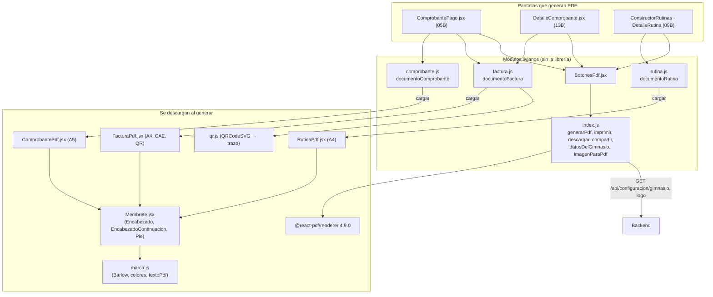

# 06 - Motor de PDF: Comprobantes, Facturas y Rutinas

Este documento detalla la carpeta `src/components/pdf/` del frontend de **SUMMIT**: cómo se generan en el navegador los tres documentos PDF del sistema (el comprobante de un cobro, la factura o nota de crédito electrónica y la rutina de entrenamiento) y cómo se imprimen, descargan o comparten.

---

## 1. Explicación de Relaciones del Área (Arquitectura Punta a Punta)

Los PDF se arman **en el navegador** con `@react-pdf/renderer` (versión fija 4.9.0): el backend no genera documentos. Para que las pantallas no pesen más, la librería y cada documento se descargan **recién cuando alguien genera un PDF**.

### Flujo Integral

1. **Un documento es un objeto** (no un componente): `{ cargar, datos, nombreArchivo, titulo, texto }`. Lo arman tres módulos livianos:
   - [`comprobante.js`](../../summit-frontend/src/components/pdf/comprobante.js) (`documentoComprobante(pago)`), usado por `ComprobantePago.jsx` (capítulo 05B).
   - [`factura.js`](../../summit-frontend/src/components/pdf/factura.js) (`documentoFactura(comprobante)`), usado por `ComprobantePago.jsx` y el detalle de un comprobante fiscal (capítulo 13B).
   - [`rutina.js`](../../summit-frontend/src/components/pdf/rutina.js) (`documentoRutina(rutina)`), usado por el constructor y el detalle de rutinas (capítulo 09B).

2. **Generar**: [`index.js`](../../summit-frontend/src/components/pdf/index.js) importa en paralelo la librería, el componente del documento (`cargar()`) y sus datos (`datos()`, que traen los datos del gimnasio y el logo), y llama a `pdf(...).toBlob()`. Cada objeto se genera **una sola vez** (`WeakMap`): si se toca "Descargar" y después "Compartir", se reusa.

3. **Acciones** ([`BotonesPdf.jsx`](../../summit-frontend/src/components/pdf/BotonesPdf.jsx)): **Imprimir** (en la PC abre el diálogo de impresión sobre el PDF; en el celular, la tablet y Safari lo abre en una pestaña), **Descargar PDF** y, en pantallas táctiles, **Compartir** con el menú del sistema (WhatsApp, mail, Drive) usando la Web Share API.

4. **Diseño común**: [`marca.js`](../../summit-frontend/src/components/pdf/marca.js) registra las tipografías Barlow y Barlow Condensed (licencia SIL OFL 1.1, en `fuentes/`), define colores y márgenes y limpia los textos (`textoPdf` saca los emojis, que las tipografías no tienen). [`Membrete.jsx`](../../summit-frontend/src/components/pdf/Membrete.jsx) arma el encabezado con el logo y los datos del gimnasio, el encabezado chico de las páginas siguientes y el pie con "Página X de Y".

5. **Documentos**:
   - [`ComprobantePdf.jsx`](../../summit-frontend/src/components/pdf/ComprobantePdf.jsx): A5, el detalle del cobro y la leyenda "Documento no válido como factura".
   - [`FacturaPdf.jsx`](../../summit-frontend/src/components/pdf/FacturaPdf.jsx): A4 con los datos que exige ARCA (letra y código, punto de venta y número, CAE y su vencimiento, QR de [`qr.js`](../../summit-frontend/src/components/pdf/qr.js)) y la marca de agua "SIN VALIDEZ FISCAL" fuera de producción.
   - [`RutinaPdf.jsx`](../../summit-frontend/src/components/pdf/RutinaPdf.jsx): A4 con un bloque por día y los ejercicios numerados, sin cortar un día entre hojas si entra en una.

### Diagrama de Arquitectura y Relaciones del Módulo

---

## 2. Análisis Detallado Archivo por Archivo

---

### 2.1. [`index.js`](../../summit-frontend/src/components/pdf/index.js)

- **Ruta**: `summit-frontend/src/components/pdf/index.js`
- **Propósito del archivo**: Base de los PDF del panel. Es liviano: no importa la librería de forma estática.

#### Funciones exportadas
1. **`generarPdf(documento)`**: si el objeto no está en `generados` (`WeakMap`), arma una promesa que espera en paralelo (`Promise.all`) `import('@react-pdf/renderer')`, `documento.cargar()` y `documento.datos` (si es una función, la llama). Con eso hace `pdf(createElement(modulo.default, datos)).toBlob()`. Si la promesa falla (por ejemplo, sin conexión al bajar la librería), la borra del mapa para que el próximo intento vuelva a probar.
2. **`esTactil()`**: `matchMedia('(pointer: coarse)')`: celular o tablet (en una PC con pantalla táctil manda el mouse).
3. **`puedeCompartirArchivos()`**: `navigator.canShare` con un PDF de prueba.
4. **`descargarPdf(documento)`**: genera y descarga con su nombre (sin caracteres inválidos para un archivo); devuelve `'descargado'`.
5. **`compartirPdf(documento)`**:
   - Si el navegador no comparte archivos, descarga (`'descargado'`).
   - Compartir solo se permite poco después de un toque: si el PDF tardó y `navigator.userActivation` ya no está activo, devuelve `'tocar-de-nuevo'` (el PDF queda generado y el próximo toque abre el menú al instante).
   - `navigator.share({ files, title, text })` → `'compartido'`; `AbortError` → `'cancelado'`; `NotAllowedError` → `'tocar-de-nuevo'`.
6. **`imprimirPdf(documento)`**:
   - En táctiles o Safari abre **antes de cualquier espera** una pestaña (pasado el toque, el navegador bloquea las pestañas nuevas) con "Preparando el PDF…" y después le pone el PDF (`'abierto'`). Si la pestaña fue bloqueada, descarga (`'descargado'`).
   - En la PC carga el PDF en un `iframe` invisible y llama a `contentWindow.print()` (`'impreso'`). El marco queda 10 minutos porque algunos navegadores leen el PDF mientras el diálogo está abierto.
7. **`datosDelGimnasio()`**: `GET /configuracion/gimnasio` guardado 5 minutos (`MINUTOS_GIMNASIO`); sin conexión devuelve lo último que se leyó o `null` (el PDF sale sin esos datos).
8. **`imagenParaPdf(url, ladoMaximo = 512)`**: baja una imagen (las direcciones `/api/...` con la sesión), la dibuja en un `canvas` de hasta 512 px y devuelve un PNG como *data URL*, porque la librería solo acepta PNG y JPG. Sirve para cualquier formato que muestre el navegador (WebP, SVG sin tamaño se dibuja al máximo). Si falla, `null` (el PDF sale sin la imagen).

---

### 2.2. [`marca.js`](../../summit-frontend/src/components/pdf/marca.js)

- **Propósito**: Colores, tipografías y estilos comunes de los PDF. Lo importan solo los documentos diferidos (trae la librería).

#### Contenido
| Elemento | Descripción |
| :--- | :--- |
| `Font.register` | Barlow (regular, itálica, semibold, bold) y Barlow Condensed (semibold, bold) desde `fuentes/*.ttf`. Cubren todo el español (á, ñ, ü, ¿, ¡, °, ×). El PDF incluye solo las letras que usa. |
| `Font.registerHyphenationCallback` | Devuelve la palabra entera: sin cortar con guiones (la librería trae las reglas del inglés). |
| `COLORES` | `bordo`, `bordoMedio`, `bordoClaro`, `bronce` (solo decorativo), `bronceTexto`, `texto` (casi negro), `textoSuave` (7,5:1 sobre blanco), líneas y fondos. Se leen bien también impresos en blanco y negro. |
| `FUENTES` | `{ texto: 'Barlow', titulos: 'Barlow Condensed' }`. |
| `MARGENES` | `{ arriba: 46, abajo: 58, costados: 38 }` (lugar para el pie y el encabezado chico). |
| `estilosBase` | `pagina` (sin ligaduras: con ellas, al buscar en el PDF "hipertrofia" salía "hipertrofa"; sin `lineHeight` en la página porque la librería dejaba de escribir los números de página) y `etiqueta` (mayúsculas chicas). |
| `textoPdf(texto)` | Saca emojis y símbolos de los teclados del celular (que saldrían como cuadraditos) y compacta espacios. |

---

### 2.3. [`Membrete.jsx`](../../summit-frontend/src/components/pdf/Membrete.jsx)

- **Propósito**: Partes comunes de los PDF del gimnasio.

#### Exportaciones
1. **`contactoDe(gimnasio)`**: "Dirección, Ciudad · Tel. ... · email · @instagram" con lo que haya cargado el admin (si no hay teléfono, el WhatsApp). Separa con un solo espacio: con dos, al cortar la línea la librería agregaba un guion.
2. **`Encabezado({ gimnasio, logoUrl, tipo, detalle })`**: el logo (opcional), el nombre y el contacto del gimnasio a la izquierda (con `flexBasis: 0` para que un contacto largo pase a otra línea) y, a la derecha, el tipo de documento en bronce y un detalle (la fecha de emisión).
3. **`EncabezadoContinuacion({ izquierda, derecha })`**: `fixed` en el margen de arriba, con `render` que solo dibuja en las páginas 2 en adelante: de quién es y qué es, por si las hojas se separan.
4. **`Pie({ texto })`**: el texto con un filete bronce y, aparte, "Página X de Y" (`render` con `pageNumber` y `totalPages`). El número va en su propio `Text` sin ancho fijo porque, en el navegador, la librería no lo escribía con ancho propio.

---

### 2.4. [`BotonesPdf.jsx`](../../summit-frontend/src/components/pdf/BotonesPdf.jsx)

- **Propósito**: Botones "Imprimir", "Descargar PDF" y, en celular o tablet, "Compartir" de un documento.
- **Props**: `documento` (armado con `useMemo` para que se genere una sola vez mientras los datos no cambien; `null` lo deshabilita) y `className`.

#### Lógica
- `ACCIONES`: `{ compartir, descargar, imprimir }`.
- **`avisoDe(accion, resultado)`**: lo que se le dice a la persona: "tocá Compartir de nuevo", "se abrió en otra pestaña", "este navegador no deja compartir archivos: se descargó", "se descargó el PDF: abrilo y elegí Imprimir".
- **`ejecutar(accion)`**: marca `enCurso`, ejecuta y muestra el aviso; si falla, "No se pudo generar el PDF. Revisá la conexión".
- **JSX**: en táctiles, *Compartir* va primero y ocupa todo el ancho (es lo que más se usa). El aviso tiene `role="status"` y `aria-live="polite"`; mientras genera dice "Preparando el PDF…".

---

### 2.5. [`comprobante.js`](../../summit-frontend/src/components/pdf/comprobante.js) y [`ComprobantePdf.jsx`](../../summit-frontend/src/components/pdf/ComprobantePdf.jsx)

#### `comprobante.js`
- **`numeroComprobante(idPago)`**: el id con 6 dígitos (`000123`).
- **`documentoComprobante(pago)`**: nombre "Comprobante 000123 Juan Pérez.pdf", texto para compartir con el primer nombre y el monto, `cargar: () => import('./ComprobantePdf')` y `datos` con el pago, el número, el gimnasio y su logo.

#### `ComprobantePdf.jsx` (A5 vertical)
- Encabezado con "Comprobante de pago" y "N.º 000123 · fecha hora".
- "Recibimos de" con el nombre y el DNI del socio.
- Tabla: el plan (con el precio de lista o, en los cobros sin detalle, el total), el descuento en bronce con "−", la matrícula ("Bonificada" si es 0) y **Total abonado** en grande.
- Datos: medio de pago, comprobante del pago, "Membresía paga hasta" y quién atendió.
- Avisos si está a verificar o rechazado.
- Leyenda "Documento no válido como factura. Conservalo como constancia de tu pago." y el pie con el contacto.

---

### 2.6. [`factura.js`](../../summit-frontend/src/components/pdf/factura.js), [`qr.js`](../../summit-frontend/src/components/pdf/qr.js) y [`FacturaPdf.jsx`](../../summit-frontend/src/components/pdf/FacturaPdf.jsx)

#### `factura.js`
- **`documentoFactura(comprobante)`**: nombre con el tipo, la letra y el número (`nombreComprobante`, capítulo 13B), texto para compartir ("la factura" o "la nota de crédito") y `datos` que cargan en paralelo el gimnasio y el módulo `qr.js`, el logo y el QR a partir de `comprobante.qrUrl`.

#### `qr.js`
- **`qrParaPdf(texto)`**: dibuja un `QRCodeSVG` (corrección media, sin margen) fuera de la pantalla con `createRoot` y `flushSync`, toma el `viewBox` y el segundo `path` (el primero es el fondo blanco) y desmonta. Devuelve `{ viewBox, d }` para dibujarlo con `<Svg>` y `<Path>`: un QR **vectorial**, nítido al imprimir.

#### `FacturaPdf.jsx` (A4)
- Arma el comprobante con los datos que pide ARCA (RG 1415, RG 4291 y el QR de la RG 4892) y, en la factura B, el IVA contenido (Ley 27.743).
- **Funciones auxiliares**: `importe` (con centavos, `45.000,00`), `conPesos`, `capitalizar`, y los componentes `Linea`, `Par` y `Renglon`.
- **`renglones(c)`**: en una nota de crédito, un renglón "Anulación de la Factura ..."; en una factura, el plan, el descuento (negativo) y la matrícula si se cobró; en los cobros sin detalle, solo el plan por el total.
- `AMBIENTE_SIN_VALIDEZ`: "Simulador de ARCA" o "Pruebas de ARCA (homologación)".
- **Estructura**:
  - Marca de agua `fixed` "SIN VALIDEZ FISCAL" rotada −30° si `!c.deVerdad`.
  - Cabecera en tres columnas: el emisor (logo, nombre de fantasía, razón social, domicilio, condición frente al IVA), la **letra** en un recuadro con "COD. 06/11" y una línea vertical, y los datos del comprobante (punto de venta con 5 dígitos, número con 8, fecha, CUIT con guiones, ingresos brutos, inicio de actividades).
  - Período facturado y vencimiento del pago.
  - Receptor: "A CONSUMIDOR FINAL" o el nombre y DNI si se identifica (`docTipo === 96`); condición de venta "Contado (<medio>)"; en una nota de crédito, el comprobante asociado y el motivo.
  - Tabla de renglones e **Importe total**.
  - En la B, el cuadro del Régimen de Transparencia Fiscal con el IVA contenido.
  - Autorización: el QR sobre un fondo blanco (así la marca de agua no se mete entre los módulos y el celular lo lee), el CAE, su vencimiento y la leyenda (autorizado por ARCA o sin validez fiscal).
  - Pie con el contacto.

---

### 2.7. [`rutina.js`](../../summit-frontend/src/components/pdf/rutina.js) y [`RutinaPdf.jsx`](../../summit-frontend/src/components/pdf/RutinaPdf.jsx)

#### `rutina.js`
- **`documentoRutina(rutina, { objetivoSocio, logoUrl })`**: nombre "Rutina Juan Pérez.pdf", texto para compartir con el nombre de la rutina y `datos` con la rutina, el objetivo (el de la rutina o el del perfil del socio), el gimnasio, el logo (el que se pase o el del gimnasio) y la fecha de hoy.

#### `RutinaPdf.jsx` (A4 vertical)
- Pensada para seguirla en el gimnasio: cada día en su bloque, los ejercicios numerados en el orden en que se hacen y los números grandes.
- **Constantes**: `COL` (anchos de las columnas: número, series, carga, descanso) y `ALTO_UTIL` (alto de la hoja sin márgenes).
- **`altoFila(e)`** y **`altoDia(ejercicios)`**: estiman (de más, a propósito) el alto de cada ejercicio según el largo del nombre y de la nota, para saber si un día entra entero en una hoja.
- **`gruposDelDia(ejercicios)`**: "Pecho · Tríceps · Hombros" sin repetidos.
- **`Fila`**: número en un círculo, nombre del ejercicio, grupo muscular, observación en itálica, "series × reps" en grande, la carga (`formatKg`) y el descanso (`formatDescanso`); las filas pares con fondo.
- **`Dia`**: si entra en una hoja, no se corta (`wrap={false}`) y pasa entero a la siguiente; si no entra, se corta entre ejercicios y su encabezado (`fixed`, con `minPresenceAhead`) se repite arriba de la hoja siguiente.
- **`RutinaPdf`**: metadatos del documento (título, autor, idioma `es-AR`), encabezado de continuación, encabezado con "Rutina de entrenamiento" y la fecha de emisión, el nombre de la rutina con la cantidad de días y ejercicios, los datos (socio, objetivo, profesor, vigente desde), una guía de lectura, los días y el pie. Usa `agruparPorDia`, `formatDescanso`, `formatKg` y `nombreGrupo` de `entrenamiento/comun.js` (capítulo 09B).

---

### 2.8. [`fuentes/`](../../summit-frontend/src/components/pdf/fuentes)

- **Contenido**: `Barlow-Regular.ttf`, `Barlow-Italic.ttf`, `Barlow-SemiBold.ttf`, `Barlow-Bold.ttf`, `BarlowCondensed-SemiBold.ttf`, `BarlowCondensed-Bold.ttf` y `OFL.txt`.
- **Propósito**: tipografías de los PDF, de The Barlow Project Authors, con licencia SIL Open Font License 1.1 (`OFL.txt`). Son los TTF originales de `github.com/google/fonts`, sin modificar. Vite las empaqueta como archivos y `marca.js` las registra.
