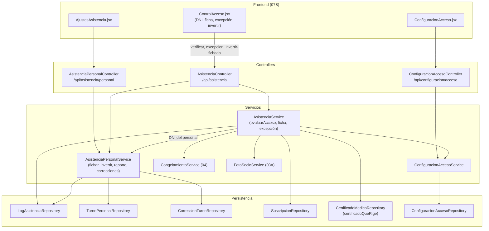

# 07A - Control de Acceso y Asistencia del Personal (Backend)

Este documento detalla el backend del control de acceso de recepción de **SUMMIT**: las reglas que decide si un socio puede entrar (cuenta, congelamiento, cuota, límite semanal y apto médico), el ingreso por excepción con auditoría, la configuración de esas reglas y el registro de entradas y salidas del personal con sus horas trabajadas y correcciones.

---

## 1. Explicación de Relaciones del Área (Arquitectura Punta a Punta)

En recepción se escribe (o se lee con un lector) el **DNI** de quien llega. El mismo control sirve para los socios y para el personal:

### Flujo Integral Backend + Frontend

1. **Socios** (`POST /api/asistencia/molinete/verificar`):
   - [`AsistenciaService.evaluarAcceso`](../../summit-backend/src/main/java/com/summit/backend/service/AsistenciaService.java) evalúa **todas** las reglas sin escribir en la base, en este orden: cuenta activa → membresía no congelada → cuota al día (con días de gracia) → límite semanal del plan → apto médico vigente (con días de gracia; Ley 5397). No se detiene en la primera falta: arma la lista completa.
   - Con esa evaluación arma la **ficha del monitor** ([`CheckInResponse`](../../summit-backend/src/main/java/com/summit/backend/dto/CheckInResponse.java)): foto, plan, faltas (lo que bloquea) y avisos (lo que no bloquea, como "la cuota vence en 3 días"), días de la semana usados, vencimientos y si se puede hacer una excepción.
   - Registra el intento en [`LogAsistencia`](../../summit-backend/src/main/java/com/summit/backend/model/LogAsistencia.java) con el resultado (el primer motivo de rechazo) y responde `200` o `403`.
   - Volver a entrar el mismo día no descuenta otro día del plan.

2. **Ingreso por excepción** (`POST /api/asistencia/molinete/excepcion`): recepción puede dejar pasar a un socio con la cuota vencida o sin días del plan esta semana (por ejemplo, "pagó por transferencia y todavía no se acreditó"), **nunca** sin apto médico (exigencia legal) ni con la cuenta inactiva o la membresía congelada. Debe estar habilitado en las reglas (`permitirOverrideManual`). Queda registrado quién lo autorizó y por qué.

3. **Reglas** ([`ConfiguracionAcceso`](../../summit-backend/src/main/java/com/summit/backend/model/ConfiguracionAcceso.java), fila única): exigir cuota al día, exigir apto médico, permitir excepciones y los días de gracia de cada uno. Las administra [`ConfiguracionAccesoService`](../../summit-backend/src/main/java/com/summit/backend/service/ConfiguracionAccesoService.java) (`/api/configuracion/acceso`).

4. **Personal** (el mismo `verificar`): si el DNI es de alguien del equipo, [`AsistenciaPersonalService.ficharEnRecepcion`](../../summit-backend/src/main/java/com/summit/backend/service/AsistenciaPersonalService.java) decide si es su **entrada** o su **salida** (si tiene un turno en curso, es la salida) y abre o cierra un [`TurnoPersonal`](../../summit-backend/src/main/java/com/summit/backend/model/TurnoPersonal.java). Maneja los casos raros: turno partido, turno que pasa la medianoche, salida olvidada, lectura repetida y paso tomado al revés (recepción lo corrige en el momento con "Es una entrada" / "Es una salida").

5. **Horas del equipo** (solo ADMIN, `/api/asistencia/personal`): un reporte por persona y por día ([`AsistenciaPersonalDTO`](../../summit-backend/src/main/java/com/summit/backend/dto/AsistenciaPersonalDTO.java)) con quién está trabajando ahora y los turnos sin salida; el admin carga turnos olvidados, corrige horas y anula turnos, y cada cambio queda en [`CorreccionTurno`](../../summit-backend/src/main/java/com/summit/backend/model/CorreccionTurno.java).

### Diagrama de Arquitectura y Relaciones del Módulo

---

## 2. Análisis Detallado Archivo por Archivo

---

### 2.1. [`ConfiguracionAcceso.java`](../../summit-backend/src/main/java/com/summit/backend/model/ConfiguracionAcceso.java)

- **Propósito**: Entidad de la tabla `configuracion_acceso` (fila única, id 1). Usa `@Data` de Lombok y las columnas toman el nombre en `snake_case` por la estrategia de nombres de Spring.

#### Atributos
| Nombre | Tipo | Propósito | Por defecto |
| :--- | :--- | :--- | :--- |
| `idConfiguracion` | `Long` | Siempre 1. | 1 |
| `requerirMembresiaActiva` | `boolean` | Exige la cuota al día. | `true` |
| `requerirCertificadoMedico` | `boolean` | Exige el apto médico vigente. | `true` |
| `permitirOverrideManual` | `boolean` | Habilita el ingreso por excepción. | `false` |
| `diasGraciaMembresia` | `int` | Días que se tolera la cuota vencida. | 3 |
| `diasGraciaCertificado` | `int` | Días que se tolera el apto vencido. | 7 |

---

### 2.2. [`LogAsistencia.java`](../../summit-backend/src/main/java/com/summit/backend/model/LogAsistencia.java)

- **Propósito**: Entidad de la tabla `logs_asistencia`: cada paso por el control de acceso.

#### Atributos
| Nombre | Tipo | Configuración | Propósito |
| :--- | :--- | :--- | :--- |
| `idLog` | `Long` | PK | Identificador. |
| `usuario` | `Usuario` | `@ManyToOne(LAZY)`, no nulo | Socio o persona del equipo. |
| `fechaHora` | `LocalDateTime` | no nulo (`prePersist` = ahora) | Momento. |
| `tipoEvento` | `TipoEventoAsistencia` | texto, `length = 20` | Tipo de paso. |
| `resultado` | `ResultadoAsistencia` | texto, `length = 35` | Resultado (el primer motivo de rechazo). |
| `autorizadoPor` | `Usuario` | `@JsonIgnore`, `@ManyToOne(LAZY)` | Quién autorizó una excepción. En el historial sale solo el nombre (`@JsonProperty("autorizadoPorNombre")`), no la cuenta completa del empleado. |
| `motivoExcepcion` | `String` | `length = 200` | Por qué. |

#### Enums relacionados
| Enum | Constantes |
| :--- | :--- |
| [`TipoEventoAsistencia`](../../summit-backend/src/main/java/com/summit/backend/model/TipoEventoAsistencia.java) | `INGRESO_MOLINETE` (ingreso de un socio o entrada del personal), `CHECKOUT` (salida del personal), `INGRESO_EXCEPCION` (recepción lo dejó pasar). |
| [`ResultadoAsistencia`](../../summit-backend/src/main/java/com/summit/backend/model/ResultadoAsistencia.java) | `PERMITIDO`, `DENEGADO_CUENTA_INACTIVA`, `DENEGADO_MEMBRESIA_CONGELADA`, `DENEGADO_CUOTA_VENCIDA`, `DENEGADO_LIMITE_SEMANAL`, `DENEGADO_CERTIFICADO_MEDICO`. |

---

### 2.3. [`TurnoPersonal.java`](../../summit-backend/src/main/java/com/summit/backend/model/TurnoPersonal.java) y [`CorreccionTurno.java`](../../summit-backend/src/main/java/com/summit/backend/model/CorreccionTurno.java)

#### `TurnoPersonal` (tabla `turnos_personal`, índices por `(usuario_id, entrada)` y por `entrada`)
| Nombre | Propósito |
| :--- | :--- |
| `usuario` | Persona del equipo. |
| `entrada`, `salida` | `salida` es `null` mientras está en curso o si se olvidó de marcarla. Un turno que pasa la medianoche cuenta en el día en que empezó. |
| `origen` | [`OrigenTurno`](../../summit-backend/src/main/java/com/summit/backend/model/OrigenTurno.java): `RECEPCION` (lo abrió su paso por el control) o `MANUAL` (lo cargó el admin). |
| `anulado` | No suma horas, pero queda guardado. |
| `logEntrada`, `logSalida` | Los pasos por recepción que lo abrieron y lo cerraron (`null` si las horas las cargó el admin). |

#### `CorreccionTurno` (tabla `correcciones_turno`, índice por `turno_id`)
| Nombre | Propósito |
| :--- | :--- |
| `turno`, `autor`, `fecha` | Qué turno, quién y cuándo. |
| `accion` | [`AccionCorreccion`](../../summit-backend/src/main/java/com/summit/backend/model/AccionCorreccion.java): `ALTA` (turno entero cargado), `CAMBIO` (horas cambiadas o salida cargada), `ANULACION`. |
| `entradaAnterior`, `salidaAnterior`, `entradaNueva`, `salidaNueva` | Las horas de antes y de después (en un alta, las de antes vacías; al anular, las de después). |
| `motivo` | Obligatorio. |

---

### 2.4. Repositorios

| Repositorio | Método | Uso |
| :--- | :--- | :--- |
| [`ConfiguracionAccesoRepository`](../../summit-backend/src/main/java/com/summit/backend/repository/ConfiguracionAccesoRepository.java) | (CRUD) | Fila única. |
| [`LogAsistenciaRepository`](../../summit-backend/src/main/java/com/summit/backend/repository/LogAsistenciaRepository.java) | `findByUsuarioIdUsuarioOrderByFechaHoraDesc` | Historial de una persona. |
| | `findByTipoEventoNotAndFechaHoraBetweenOrderByFechaHoraDesc` | Actividad en vivo del tablero (sin las salidas del personal), con el usuario en la misma consulta. |
| | `countByTipoEventoNotAndFechaHoraBetween`, `countByResultadoAndTipoEventoNotAndFechaHoraBetween` | Contadores del tablero. |
| | `findByUsuarioIdUsuarioAndResultadoAndFechaHoraBetween` | Ingresos permitidos de la semana (límite semanal). |
| | `ingresosPermitidos(desde, hasta)` | Filas `[fechaHora, idUsuario, tipoEvento]` de socios para las métricas. |
| | `ultimoIngresoPorSocio()` | `MAX(fechaHora)` por socio, para el seguimiento de inactividad. |
| | `ingresosDeSocios(desde, hasta)` | Filas `[fechaHora, idUsuario]` para la ocupación. |
| [`TurnoPersonalRepository`](../../summit-backend/src/main/java/com/summit/backend/repository/TurnoPersonalRepository.java) | `findFirstByUsuarioIdUsuarioAndAnuladoFalseOrderByEntradaDescIdTurnoDesc` | Último turno: decide si el paso es entrada o salida. |
| | `findFirstBy...AndIdTurnoNotAndEntradaLessThanEqual...` | El turno anterior a uno. |
| | `findByUsuarioIdUsuarioAndAnuladoFalseAndEntradaBetween` | Superposiciones al corregir. |
| | `existsBy...AndEntradaAfter` | Sin salida solo puede quedar el último. |
| | `findByEntradaGreaterThanEqualAndEntradaLessThanOrder...` | Turnos de un período. |
| | `findByAnuladoFalseAndEntradaGreaterThanEqual` | Candidatos a estar en curso. |
| | `findBySalidaIsNullAndAnuladoFalseAndEntradaGreaterThanEqual...` | Turnos sin salida recientes. |
| [`CorreccionTurnoRepository`](../../summit-backend/src/main/java/com/summit/backend/repository/CorreccionTurnoRepository.java) | `findByTurnoIdTurnoInOrderByFechaAscIdCorreccionAsc` | Correcciones de varios turnos con su autor. |
| | `existsByTurnoIdTurno` | Si el admin ya corrigió un turno. |

---

### 2.5. DTOs

#### [`CheckInResponse`](../../summit-backend/src/main/java/com/summit/backend/dto/CheckInResponse.java) (la ficha del monitor)
| Grupo | Campos |
| :--- | :--- |
| Resultado | `permitido`, `resultado`, `mensaje`, `fechaHora`. |
| Persona | `nombreSocio`, `idUsuario`, `fotoVersion` (si no tiene, recepción la puede sacar en ese momento), `dni`, `rol`, `plan`. |
| Motivos | `faltas` (bloquean) y `avisos` (no bloquean). |
| Semana | `diasSemanaPermitidos` (`null` = pase libre), `diasSemanaUsados`, `diasSemanaRestantes`. |
| Vencimientos | `vencimientoCuota`, `diasParaVencerCuota`, `vencimientoApto`, `diasParaVencerApto` (negativos si ya venció). |
| Excepción y congelamiento | `excepcionPosible`, `idCongelamiento`, `congeladaHasta`. |
| Personal | `fichada` (`ENTRADA` o `SALIDA`), `idTurno`, `entradaTurno`, `minutosTrabajados`, `fichadaRepetida`, `inversionPosible`. |

#### [`IngresoDTO`](../../summit-backend/src/main/java/com/summit/backend/dto/IngresoDTO.java)
Un intento de ingreso para la "Actividad en vivo" del tablero: `idLog`, `fechaHora`, `idUsuario`, `nombre`, `dni`, `rol`, `resultado`, `tipoEvento`, `fotoVersion`.

#### [`AsistenciaPersonalDTO`](../../summit-backend/src/main/java/com/summit/backend/dto/AsistenciaPersonalDTO.java)
`record` con `desde`, `hasta`, `equipo` (`Miembro`: todo el personal, también el inactivo, para el filtro), `personas` (`Persona` con días trabajados, minutos, días incompletos y su detalle `Dia` con los `Turno`), `totales` (`Totales`), `trabajandoAhora` y `sinSalida`. Cada `Turno` tiene su `estado` (`COMPLETO`, `EN_CURSO`, `SIN_SALIDA`), los minutos, si está anulado, el origen y sus `Correccion`.

#### [`TurnoRequest`](../../summit-backend/src/main/java/com/summit/backend/dto/TurnoRequest.java)
`(idUsuario, entrada, salida, motivo)`: `idUsuario` solo al cargar uno nuevo; `salida` vacía solo si la persona está trabajando ahora.

---

### 2.6. [`ConfiguracionAccesoService.java`](../../summit-backend/src/main/java/com/summit/backend/service/ConfiguracionAccesoService.java) y [`ConfiguracionAccesoController.java`](../../summit-backend/src/main/java/com/summit/backend/controller/ConfiguracionAccesoController.java)

#### Métodos del servicio
1. **`initDefaultConfig()`** (`@PostConstruct`): crea la fila 1 con los valores por defecto si no existe.
2. **`obtenerConfiguracionGlobal()`**: la fila 1 (404 si falta).
3. **`actualizarConfiguracion(ConfiguracionAcceso cambios)`**: copia solo los campos editables sobre la guardada y la guarda.

#### Endpoints
`GET /api/configuracion/acceso` (ADMIN y RECEPCION) y `PUT /api/configuracion/acceso` (ADMIN).

---

### 2.7. [`AsistenciaService.java`](../../summit-backend/src/main/java/com/summit/backend/service/AsistenciaService.java)

- **Ruta**: `summit-backend/src/main/java/com/summit/backend/service/AsistenciaService.java`
- **Propósito del archivo**: Reglas de ingreso de los socios, ficha del monitor e ingreso por excepción.

#### Constantes
`DIAS_AVISO_CUOTA` (7), `DIAS_AVISO_APTO` (15), `FECHA_CORTA` (`dd/MM`), `DIAS_SEMANA` (`lun` ... `dom`).

#### Enum interno `Vigencia`
`NO_EXIGIDA`, `FALTA`, `RECHAZADA` (solo apto), `VENCIDA`, `EN_GRACIA`, `VENCE_HOY`, `POR_VENCER`, `AL_DIA`. **`bloquea()`**: verdadero para `FALTA`, `RECHAZADA` y `VENCIDA`.

#### Record interno `EvaluacionAcceso`
Contiene el usuario, la fecha, la configuración, la suscripción activa, el certificado que rige, el congelamiento de hoy, las vigencias de cuota y apto, los días de la semana con ingreso, si se excedió el límite y la lista de `motivos`. Métodos derivados: `permitido()` (sin motivos), `resultado()` (el primer motivo), `esPersonal()`, `diasSemanaPermitidos()`, `yaIngresoHoy()`, `diasParaVencerCuota()`, `diasParaVencerApto()`, `graciaRestanteCuota()` y `graciaRestanteApto()`.

#### Métodos
1. **`verificarAccesoMolinete(String dni)`**: DNI vacío → 400; no existe → 404. `if (usuario.getRol() != Rol.SOCIO)` → `asistenciaPersonalService.ficharEnRecepcion(usuario)`. Si es socio, `validarAccesoInterno(usuario, INGRESO_MOLINETE)`.
2. **`evaluarAcceso(Usuario usuario)`** (`readOnly`): evalúa sin registrar:
   - Cuenta no `ACTIVO` → `DENEGADO_CUENTA_INACTIVA`. Para el personal termina ahí.
   - Congelamiento vigente hoy → `DENEGADO_MEMBRESIA_CONGELADA` (aunque el gimnasio no exija la cuota: los días se le suman al vencimiento).
   - `vigenciaCuota(...)` bloquea → `DENEGADO_CUOTA_VENCIDA`.
   - Límite semanal: `permitidos != null && config.isRequerirMembresiaActiva() && !diasConIngreso.contains(hoy) && diasConIngreso.size() >= permitidos` → `DENEGADO_LIMITE_SEMANAL`. Si ya entró hoy, volver no descuenta otro día.
   - `vigenciaApto(...)` bloquea → `DENEGADO_CERTIFICADO_MEDICO`.
3. **`validarAccesoInterno(usuario, tipoEvento)`** (`private`): evalúa, arma la ficha y registra el log con el resultado.
4. **`vigenciaCuota`**, **`vigenciaApto`** (`private static`): `NO_EXIGIDA` si la regla está apagada; `FALTA` si no hay membresía o certificado; `RECHAZADA` si el certificado que rige fue rechazado; si no, `vigenciaPorFecha`.
5. **`vigenciaPorFecha(hoy, vencimiento, diasGracia, diasAviso)`** (`private static`): `dias < 0` → `VENCIDA` si ya pasaron los días de gracia (`diasGracia + dias < 0`), si no `EN_GRACIA`; `dias == 0` → `VENCE_HOY`; `dias <= diasAviso` → `POR_VENCER`; si no, `AL_DIA`.
6. **`diasConIngresoEnLaSemana(idUsuario, hoy)`** (`private`): los días distintos (de lunes a hoy) con un ingreso permitido, en un `TreeSet`.
7. **`fichaRecepcion(EvaluacionAcceso)`** (`private`): arma la ficha con textos para el recepcionista, en el orden de las reglas: cuenta, congelamiento ("si volvió antes, terminá el congelamiento", con el id para hacerlo desde la ficha), cuota (`fichaCuota`), límite semanal ("ya usó 3 de 3 (lun 28/09, mié 30/09, vie 02/10)"), apto (`fichaApto`) y semana (`fichaSemana`). El mensaje es "Acceso permitido" o las faltas unidas por " · ".
8. **`fichaCuota`** / **`fichaApto`** (`private static`): `switch` sobre la vigencia: falta, vencida ("hace N días"), en gracia ("quedan N días" o "hoy es el último"), vence hoy o por vencer.
9. **`fichaSemana`** (`private static`): si el ingreso se permite y es el primero del día, el de hoy cuenta como usado; avisa "Hoy usa su último día disponible de la semana" o "Ya había ingresado hoy: no descuenta otro día".
10. **`registrarIngresoExcepcion(dni, motivo, emailAutorizante)`** (`@Transactional`):
    - Motivo de 5 a 200 caracteres.
    - Si el socio puede entrar normalmente → "no hace falta una excepción".
    - `if (!admiteExcepcion(...))`: explica por qué no (sin apto médico es una exigencia legal; cuenta no activa; membresía congelada; o el gimnasio no permite excepciones).
    - Registra un `INGRESO_EXCEPCION` con resultado `PERMITIDO` (cuenta como visita y como día usado), quién autorizó y el motivo.
    - La ficha pasa las faltas a avisos y el mensaje dice "Ingreso por excepción autorizado por <nombre>: <motivo>".
11. **`admiteExcepcion(EvaluacionAcceso)`** (`private static`): no permitido, no es personal, el gimnasio lo habilitó y **todos** los motivos son cuota vencida o límite semanal.
12. **`historial(Long idUsuario)`**: los pasos de una persona, del más nuevo al más viejo.
13. Auxiliares: `textoDias`, `textoEstado` (en femenino: "activa", "dada de baja"...), `detalleDias`, `textoGracia`, `registrarLog` y `fichaBase` (con la versión de la foto).

---

### 2.8. [`AsistenciaPersonalService.java`](../../summit-backend/src/main/java/com/summit/backend/service/AsistenciaPersonalService.java)

- **Ruta**: `summit-backend/src/main/java/com/summit/backend/service/AsistenciaPersonalService.java`
- **Propósito del archivo**: Entradas y salidas del equipo, horas trabajadas y correcciones (Fase 9). El equipo ficha en el mismo control de acceso que los socios, sin pasos de más.

#### Constantes
| Nombre | Valor | Propósito |
| :--- | :--- | :--- |
| `HORAS_MAXIMAS_TURNO` | 16 | Un turno sin salida que empezó hace más ya no está en curso: se olvidó de marcar la salida. |
| `HORAS_MAXIMAS_CORRECCION` | 24 | Ningún turno puede durar más. |
| `MINUTOS_REPETIDA` | 2 | El mismo DNI otra vez enseguida (el lector leyó dos veces): no se registra nada. |
| `MINUTOS_PARA_INVERTIR` | 15 | Plazo para que recepción corrija "Es una entrada" / "Es una salida". |
| `HORAS_TURNO_LARGO` | 12 | Al registrar una salida de un turno más largo, se avisa por si en realidad estaba llegando. |
| `DIAS_SIN_SALIDA` | 31 | Turnos sin salida que se avisan arriba de la pantalla. |
| `MAX_DIAS_PERIODO` | 366 | El reporte no puede superar un año. |

#### Concurrencia
`candado` (`Object`) + `TransactionTemplate`: los cambios en los turnos van de a uno y cada uno en su transacción. Dos pasos del mismo DNI casi a la vez, o recepción y el admin al mismo tiempo, no pueden abrir dos turnos ni cerrar el mismo dos veces (son pocos por día, alcanza con un solo candado).

#### Métodos de recepción
1. **`ficharEnRecepcion(Usuario persona)`**: `synchronized (candado)` + transacción → `fichar(id)`.
2. **`fichar(Long idUsuario)`** (`private`):
   - Si el último paso por recepción fue hace menos de 2 minutos: devuelve la misma ficha (entrada o salida) con `fichadaRepetida` y el aviso "Ya se había registrado su ... a las HH:mm: no se registró otra vez".
   - `if (ultimo != null && enCurso(ultimo, ahora))`: es la **salida**: pone la hora, registra un `CHECKOUT` y devuelve `fichaSalida`. Con la cuenta inactiva también puede cerrar el turno que tenía en curso.
   - Cuenta no activa: registra un `INGRESO_MOLINETE` denegado y devuelve `fichaCuentaInactiva`.
   - Si no, es una **entrada**: crea un turno de origen `RECEPCION` con su log. Si el último turno quedó sin salida (y ya no está en curso), se lo avisa como incompleto.
3. **`invertirFichada(idTurno, fichadaMostrada, emailOperador)`** / **`invertir(...)`**: corrige en el momento un paso tomado al revés. Validaciones: lo que dice la ficha coincide con el turno (si no, "ya se corrigió"); es el último paso de la persona (si no, lo corrige el admin); la hora la registró recepción (no el admin); no pasaron más de 15 minutos.
4. **`eraUnaEntrada(turno, operador, ahora)`** (`private`): la ficha dice SALIDA pero está llegando: registra una corrección, el turno vuelve a quedar sin salida, el paso cambia a `INGRESO_MOLINETE` y abre un turno nuevo.
5. **`eraUnaSalida(turno, operador, ahora)`** (`private`): la ficha dice ENTRADA pero se está yendo: exige que haya un turno anterior sin salida y que cerrarlo no supere 24 horas; corrige ese turno con la hora del paso, el paso pasa a `CHECKOUT` y el turno que había abierto se **borra**.

#### Métodos del admin
6. **`reporte(desde, hasta, idUsuario)`** (`readOnly`): valida el período (obligatorio, ordenado, menos de un año). Junta los turnos del período (opcionalmente de una persona), los en curso de ahora y los sin salida de los últimos 31 días (sin los en curso), y las correcciones de todos en una consulta. Las personas son el personal activo (aunque no haya trabajado) más quien tenga turnos. Calcula los totales.
7. **`persona(...)`** (`private`): agrupa los turnos por el día en que empezaron (`TreeMap`). Por día: minutos de los turnos completos no anulados, si alguno quedó sin salida o sigue en curso. Suma minutos, días trabajados e incompletos.
8. **`agregarTurno(TurnoRequest, emailAdmin)`**: persona del equipo (no socio), motivo válido, `validarHorario`, guarda un turno `MANUAL` y una corrección `ALTA`.
9. **`corregirTurno(idTurno, TurnoRequest, emailAdmin)`**: no anulado; lo que no cambió **al minuto** (lo que se ve) queda como estaba, con sus segundos; si no cambió nada → "No cambiaste ninguna hora"; `validarHorario`; corrección `CAMBIO` (guardada antes de cambiar, así las horas "anteriores" son las de ahora).
10. **`anularTurno(idTurno, motivo, emailAdmin)`**: no anulado; corrección `ANULACION`; `anulado = true`.
11. **`validarHorario(persona, idTurno, entrada, salida)`** (`private`): entrada obligatoria y no futura; con salida: posterior a la entrada, no más de 24 horas después y no futura; sin salida: solo el último turno de alguien que empezó hace menos de 16 horas. Revisa que no se superponga con otro turno de la persona (busca los que empezaron hasta 24 horas antes) y, si se superpone, describe con cuál ("el del jue 22/10 de 07:58 a 16:03").
12. **`seSuperponen(...)`** (`private static`): intervalos `[entrada, salida)`; uno en curso ocupa desde su entrada en adelante; uno sin salida, solo el minuto de su entrada (no se sabe hasta cuándo trabajó).

#### Auxiliares
`ultimoTurno`, `anteriorSinSalida`, `enCurso` (sin salida y empezó hace menos de 16 h), `enCursoPorPersona` (el último turno de cada persona si está en curso), `pasoEnRecepcion` (el log de salida o de entrada; `null` si la hora la cargó el admin), `cierraEnPlazo`, `estado`, `turnoDTO`, `correcciones`, `registrarCorreccion`, `registrarLog`, `personal`, `motivo` (5 a 200 caracteres), `mismoMinuto`, **`minutosEntre`** (sin contar los segundos, como se ven: de 07:58 a 16:03 son 8 h 05 min), **`duracion`** ("8 h 05 min") y `diaCorto` ("jue 22/10").

#### Fichas del monitor
- **`fichaEntrada(...)`**: "Entrada registrada"; si un turno anterior quedó sin salida, lo avisa y habilita "Es una salida" si el paso es reciente y cerrarlo no supera 24 horas.
- **`fichaSalida(...)`**: "Salida registrada" con a qué hora entró y los minutos trabajados; habilita "Es una entrada" durante 15 minutos (con la cuenta activa) y, si el turno duró 12 horas o más, avisa que quizás estaba llegando.
- **`fichaCuentaInactiva(...)`**: "Cuenta inactiva: no puede registrar su entrada".

---

### 2.9. [`AsistenciaController.java`](../../summit-backend/src/main/java/com/summit/backend/controller/AsistenciaController.java) y [`AsistenciaPersonalController.java`](../../summit-backend/src/main/java/com/summit/backend/controller/AsistenciaPersonalController.java)

| Método y ruta | Roles | Lógica |
| :--- | :--- | :--- |
| `POST /api/asistencia/molinete/verificar` | ADMIN, RECEPCION | `{ dni }` → `CheckInResponse` con `200` si se permite o `403` si no. |
| `POST /api/asistencia/molinete/excepcion` | ADMIN, RECEPCION | `{ dni, motivo }`; quién autoriza sale del token. |
| `POST /api/asistencia/molinete/invertir-fichada` | ADMIN, RECEPCION | `{ idTurno, fichada }` (record `InvertirFichadaRequest`). |
| `GET /api/asistencia/historial/{idUsuario}` | ADMIN, RECEPCION | Historial de pasos. |
| `GET /api/asistencia/personal?desde=&hasta=&idUsuario=` | ADMIN | Reporte de horas. |
| `POST /api/asistencia/personal/turnos` | ADMIN | Carga un turno olvidado (`201`). |
| `PUT /api/asistencia/personal/turnos/{id}` | ADMIN | Corrige horas (salida vacía = sigue trabajando). |
| `POST /api/asistencia/personal/turnos/{id}/anular` | ADMIN | `{ motivo }`. |

Los dos controllers están en `ConflictosExceptionHandler`: una `IllegalStateException` (por ejemplo, "ya se corrigió" o "pasaron más de 15 minutos") responde `409`.
