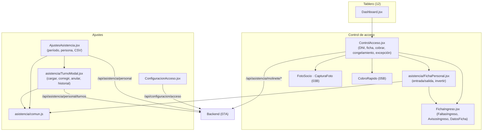

# 07B - Control de Acceso y Asistencia del Personal (Frontend)

Este documento detalla los componentes y pantallas del frontend de **SUMMIT** del control de acceso de recepción (la ficha que ve el recepcionista al escribir un DNI), las reglas de acceso y la asistencia del personal (horas trabajadas y correcciones).

---

## 1. Explicación de Relaciones del Área (Arquitectura Punta a Punta)

### Flujo Integral Backend + Frontend

1. **Control de acceso** ([`ControlAcceso.jsx`](../../summit-frontend/src/components/ControlAcceso.jsx), dentro del tablero): recepción escanea o escribe el DNI y se llama a `POST /api/asistencia/molinete/verificar`.
   - Si es un **socio**, muestra la ficha: foto (o el botón para sacarla ahí mismo), "Acceso permitido/denegado", lo que le falta ([`FichaIngreso.jsx`](../../summit-frontend/src/components/FichaIngreso.jsx): `FaltasIngreso`), los avisos (`AvisosIngreso`) y los datos de la semana, la cuota y el apto (`DatosFicha`).
   - Desde la misma ficha se puede **cobrar la cuota** (si está vencida o por vencer), **terminar un congelamiento** (si volvió antes) o **dejarlo pasar por excepción** escribiendo el motivo.
   - Si es alguien del **equipo**, muestra [`FichaPersonal.jsx`](../../summit-frontend/src/components/asistencia/FichaPersonal.jsx): "Entrada registrada" o "Salida registrada" con la hora en grande y, si el sistema lo tomó al revés, el botón para corregirlo en el momento.

2. **Reglas de acceso** ([`ConfiguracionAcceso.jsx`](../../summit-frontend/src/pages/ConfiguracionAcceso.jsx), dentro de *Configuración y reglas*): interruptores para exigir la cuota y el apto médico, permitir excepciones y los días de gracia. Recepción las ve; solo el ADMIN las cambia.

3. **Asistencia del personal** ([`AjustesAsistencia.jsx`](../../summit-frontend/src/pages/AjustesAsistencia.jsx), pestaña de *Gestión de personal*, solo ADMIN): quién está trabajando ahora, los turnos sin salida y las horas de cada persona por día, semana o mes, con exportación a CSV. Cada turno se toca para corregirlo con [`TurnoModal.jsx`](../../summit-frontend/src/components/asistencia/TurnoModal.jsx). Los textos y cálculos de fechas están en [`comun.js`](../../summit-frontend/src/components/asistencia/comun.js).

### Diagrama de Arquitectura y Relaciones del Módulo

---

## 2. Análisis Detallado Archivo por Archivo

---

### 2.1. [`ControlAcceso.jsx`](../../summit-frontend/src/components/ControlAcceso.jsx)

- **Ruta**: `summit-frontend/src/components/ControlAcceso.jsx`
- **Propósito del archivo**: Control de acceso de recepción.
- **Props**: `onIngreso` (para que el tablero recargue la actividad en vivo) y `acciones` (botones al lado del DNI; en el tablero, "Nuevo socio" y "Cobrar cuota").

#### Funciones del módulo
- **`cuotaParaCobrar(r)`**: un socio no congelado sin membresía, con la cuota vencida (aunque esté en los días de gracia) o que vence dentro de `DIAS_PARA_OFRECER_COBRO` (7) días.

#### Estados
`dni`, `loading`, `resultado` (la ficha del backend), `error`, `excepcion` (`{ motivo, enviando, error }`), `terminando`, `cobrando`, `cobrado`, `sacandoFoto`, `invirtiendo`; `inputRef` mantiene el foco en el campo del DNI.

#### Funciones
1. **`verificar(dniLimpio)`**: limpia el estado anterior, `POST /asistencia/molinete/verificar`. Un `200` (permitido) o `403` con ficha (denegado) se muestran como ficha; cualquier otra cosa es un error ("Tu usuario no tiene permiso para registrar ingresos" o "No se pudo verificar el ingreso"). Siempre vacía el campo y le devuelve el foco, para el siguiente.
2. **`invertirFichada()`**: `POST /asistencia/molinete/invertir-fichada` con el turno y lo que dice la ficha; muestra la ficha corregida.
3. **`guardarFoto(foto)`**: socio sin foto: se la saca ahí mismo y el tablero recarga la actividad (la fila ya muestra la foto).
4. **`confirmarExcepcion()`**: `POST /asistencia/molinete/excepcion` con el DNI y el motivo; la ficha pasa a "permitido".
5. **`terminarYVerificar()`**: con confirmación, termina el congelamiento (`terminarCongelamiento`) y vuelve a verificar el ingreso.
6. **`alCobrar(pago)`**: si no lo dejaba pasar, vuelve a verificar (con la cuota al día, ahora puede entrar) y muestra el cobro.
7. **`limpiar()`**: vuelve a "esperando" para que la ficha del anterior no quede a la vista del que sigue.

#### JSX
- Es un `@container`: con lugar a lo ancho, la ficha pone al lado de la foto lo que le falta y los botones.
- Campo del DNI con `inputMode="numeric"`, "Verificar" y, al lado, las `acciones`.
- `resultado.fichada` → `FichaPersonal`; si no, la ficha del socio: la foto (para comparar la cara con quien tiene adelante) o un ícono, el estado, DNI, plan y hora, el botón "Sacar foto" si no tiene, las faltas, el cobro recién hecho, los botones (cobrar, terminar congelamiento, dejar pasar) en una fila, el formulario del motivo de la excepción (5 caracteres o más), los avisos y `DatosFicha`.

---

### 2.2. [`FichaIngreso.jsx`](../../summit-frontend/src/components/FichaIngreso.jsx)

- **Propósito**: Partes de la ficha de un intento de ingreso.

#### Exportaciones
1. **`FaltasIngreso({ faltas })`**: lo que le impide entrar, en rojo con `XCircle`.
2. **`AvisosIngreso({ avisos })`**: advertencias que no le impiden entrar, en ámbar con `AlertTriangle`.
3. **`DatosFicha({ ficha })`**: tres datos chicos (`DatoFicha`):
   - **Días esta semana** (`datoSemana`): "Pase libre" con los días usados, o "2 de 3" con "Le queda 1 esta semana" (en rojo si fue rechazado por el límite).
   - **Cuota**: el vencimiento y `textoVencimiento(dias)`; en rojo si no tiene, está vencida o fue el motivo del rechazo.
   - **Apto médico**: igual que la cuota.

---

### 2.3. [`FichaPersonal.jsx`](../../summit-frontend/src/components/asistencia/FichaPersonal.jsx)

- **Propósito**: Ficha del control de acceso cuando pasa alguien del equipo.

#### Funciones del módulo
- **`diaDeLaFicha(fechaHora)`**: `"25/10/2026 16:03:12"` → `"2026-10-25"`.
- **`cuandoEntro(entrada, diaSalida)`**: "a las 07:58", "ayer a las 22:00" o "el jue 23/10 a las 22:00".

#### Lógica
- Título "Entrada/Salida registrada" o "... ya registrada" si fue una lectura repetida; la hora en grande y el rol.
- En una salida: "Trabajó **8 h 05 min** · entró a las 07:58".
- Si `inversionPosible`, el botón "¿Está llegando? Es una entrada" o "¿Se está yendo? Es una salida".

---

### 2.4. [`ConfiguracionAcceso.jsx`](../../summit-frontend/src/pages/ConfiguracionAcceso.jsx)

- **Propósito del archivo**: Reglas de acceso (dentro de *Configuración y reglas*).

#### Componentes internos
`Interruptor` (un `switch` deshabilitado si no es ADMIN), `Regla` (título, detalle y el control) y `Tarjeta`.

#### Lógica
- **Estado `config`** con los valores por defecto (cuota y apto exigidos, sin excepciones, 3 y 7 días de gracia) hasta que llegan los del backend (`GET /configuracion/acceso`).
- **`handleSave()`**: `PUT /configuracion/acceso`; un `403` → "Solo un administrador puede modificar las reglas de acceso". El aviso de éxito se va a los 3 segundos.
- **JSX**: el botón "Guardar" solo para el ADMIN (a recepción le muestra que es de solo lectura). Tarjeta **Requisitos de acceso** (requerir membresía activa, requerir apto médico — Ley 5397 —, permitir ingresos por excepción, aclarando que nunca sin apto vigente) y tarjeta **Períodos de gracia** (días de cuota y de apto).

---

### 2.5. [`comun.js`](../../summit-frontend/src/components/asistencia/comun.js)

- **Propósito**: Textos de roles y de horas y los períodos de la asistencia del personal.

#### Exportaciones
| Nombre | Propósito |
| :--- | :--- |
| `ROLES_PERSONAL`, `textoRol(rol)` | Texto y color de cada rol. |
| `duracion(minutos)` | 485 → "8 h 05 min"; 45 → "45 min"; 480 → "8 h". |
| `horasDecimales(minutos)` | 485 → "8,08" (para sumar en Excel). |
| `aFecha(iso)`, `aIso(d)`, `sumarDias(iso, dias)` | Fechas armadas a mano (año, mes, día): `new Date('2026-10-25')` es UTC y en Argentina daría el día anterior. |
| `diaCorto(iso)` | "sáb 25/10". |
| `hora(fechaHora)` | "07:58" sin pasar por `Date` (no depende de la zona del navegador). |
| `horaSalida(entrada, salida)` | "16:03" o "02:15 (+1)" si salió al día siguiente. |
| `MODOS`, `periodo(modo, referencia)` | Día, semana (de lunes a domingo, con título "Semana del 20 al 26 de octubre") o mes; devuelve `desde`, `hasta`, `titulo` y el nombre para el archivo. |
| `moverPeriodo(modo, referencia, paso)` | El período anterior (−1) o siguiente (+1). |
| `ESTADOS_TURNO`, `ACCIONES_CORRECCION` | Textos de estados y de correcciones ("Cargado a mano", "Corregido", "Anulado"). |

---

### 2.6. [`AjustesAsistencia.jsx`](../../summit-frontend/src/pages/AjustesAsistencia.jsx)

- **Ruta**: `summit-frontend/src/pages/AjustesAsistencia.jsx` (pestaña *Asistencia* de *Gestión de personal*)
- **Propósito del archivo**: Horas trabajadas del equipo y corrección de turnos.

#### Componentes internos
- **`Iniciales`**, **`Tarjeta`**.
- **`ChipTurno({ turno, onClick })`**: "07:58 – 16:03" que se toca para corregir; "sin salida" en rojo, "en curso" en verde, anulado tachado; el `title` muestra la última corrección.
- **`DetallePersona({ persona, onTurno })`**: los días de la persona con sus turnos, las horas del día y "Incompleto" si alguno quedó sin salida.

#### Estados
`modo` (por defecto `mes`), `referencia` (un día del período), `idUsuario` (`''` = todo el equipo), `datos`, `cargando`, `error`, `aviso`, `editando` (turno a corregir), `cargandoTurno` (`{ idUsuario, dia }` para uno olvidado), `cambiadas` (personas abiertas o cerradas a mano) y `pedido` (`useRef`: si cambian los filtros mientras carga, la respuesta vieja se descarta).

#### Funciones y efectos
1. **`cargar(silencioso)`**: `GET /asistencia/personal?desde=&hasta=&idUsuario=`; un `403` dice que solo el administrador la ve.
2. **`useEffect`** que recarga **cada 60 segundos** en silencio (si la pestaña del navegador está visible), para "trabajando ahora" y los turnos en curso.
3. **Abiertas por defecto**: en un día o con una sola persona, el detalle se ve abierto; en semana o mes, cerrado. `abierta(pp)` lo combina con lo que se tocó a mano (`cambiadas`), que se reinicia al cambiar de modo o de persona.
4. **`guardado(mensaje)`**: cierra la ventana, muestra el aviso y recarga.
5. **`exportarResumen()`**: CSV por persona (días trabajados, días incompletos, horas en decimal y en texto).
6. **`exportarDetalle()`**: CSV por turno (día, entrada, salida, horas solo si es completo y no anulado, estado y las correcciones con quién, cuándo y por qué).

#### JSX
- Una explicación de cómo marca el equipo (pasando el DNI por el control de acceso al llegar y al irse).
- **Trabajando ahora**: cada persona con la hora a la que entró (se toca para corregir).
- **Turnos sin salida** de los últimos días, con "Cargar salida".
- Barra del período: Día/Semana/Mes, anterior y siguiente (no se puede pasar de hoy), selector de día o de mes, "Volver a hoy" y el filtro por persona (con los inactivos marcados).
- Cuatro tarjetas: horas trabajadas, días trabajados, personas que trabajaron y turnos sin salida (en rojo si hay).
- Una fila por persona (desplegable) con su rol, si está trabajando ahora, los días incompletos y el botón para cargarle un turno; debajo, su `DetallePersona`.
- `TurnoModal` para corregir (`editando`) o cargar uno nuevo (`cargandoTurno`).

---

### 2.7. [`TurnoModal.jsx`](../../summit-frontend/src/components/asistencia/TurnoModal.jsx)

- **Propósito del archivo**: Cargar un turno olvidado (sin `turno`) o corregir uno (día, entrada, salida y motivo), y anularlo.

#### Exportaciones y funciones del módulo
- **`cambios(c)`**: "Entrada 07:58 → 07:30 · Salida sin salida → 16:03": lo que cambió en una corrección, comparado al minuto.
- **`HistorialTurno({ turno })`**: si lo abrió recepción, lo dice; cada corrección con su acción, autor, fecha, motivo y los cambios (en un alta, las horas cargadas).

#### Lógica del componente
- **Estados**: `idUsuario`, `dia`, `entrada`, `salida`, `motivo`, `anulando`, `enviando`, `error`.
- `salidaAlDiaSiguiente`: una salida más temprana que la entrada es del día siguiente (pasó la medianoche); `minutos` suma 24 horas en ese caso.
- `activos`: para elegir a quién se le carga el turno, los activos (y el elegido aunque esté inactivo).
- **`guardar(e)`**: arma `entrada` (`díaThh:mm`) y `salida` (del día siguiente si corresponde, o `null`) y hace `POST /asistencia/personal/turnos` (nuevo) o `PUT /asistencia/personal/turnos/{id}`.
- **`anular()`**: `POST .../anular` con el motivo.
- El motivo debe tener 5 caracteres o más; la ayuda aclara que queda registrado con el nombre de quien lo hace.
- **JSX**: un turno anulado solo muestra su historial. En la carga o corrección, muestra en vivo la duración ("Turno de 8 h 05 min · la salida es del día siguiente") o "Sin salida solo si la persona sigue trabajando ahora", el motivo y el historial.
