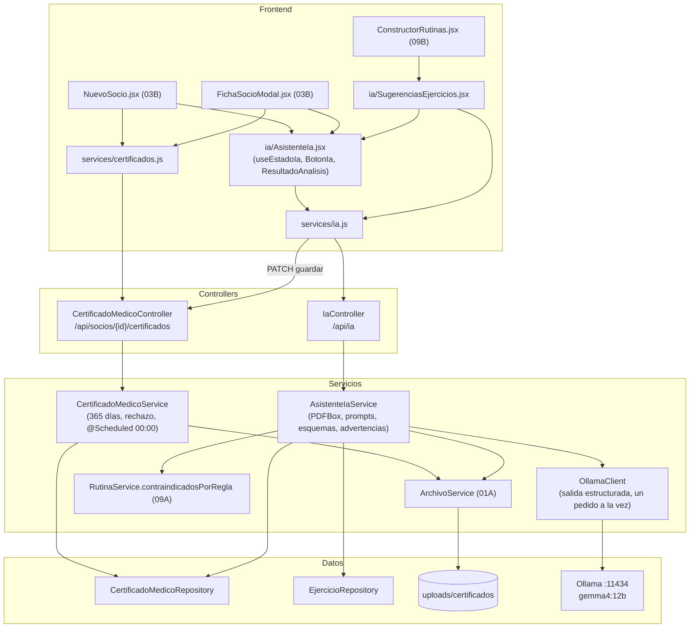

# 08 - Certificados Médicos y Asistente de IA

Este documento detalla el módulo de **certificados médicos** (apto físico, Ley 5397) de **SUMMIT** y el **asistente de IA local** que lee los certificados y sugiere ejercicios a evitar: el modelo de datos, la validación de vigencia, la revisión manual (rechazar o volver a aprobar), la comunicación con Ollama y las pantallas que lo usan.

---

## 1. Explicación de Relaciones del Área (Arquitectura Punta a Punta)

### Flujo Integral Backend + Frontend

1. **Carga del certificado**:
   - Recepción sube el archivo (PDF o imagen, 5 MB) en el alta del socio (`NuevoSocio.jsx`) o en su ficha (`FichaSocioModal.jsx`) con [`certificados.js`](../../summit-frontend/src/services/certificados.js).
   - [`CertificadoMedicoService.registrarCertificado`](../../summit-backend/src/main/java/com/summit/backend/service/CertificadoMedicoService.java) valida la fecha (no futura y de menos de 365 días), calcula el vencimiento a 365 días de la emisión y guarda el archivo con `ArchivoService` (que verifica el tipo real por su firma de bytes).

2. **Vigencia**: un certificado habilita el ingreso si existe, no fue rechazado y hoy no pasó el vencimiento más los días de gracia de las reglas de acceso. Rige el de vencimiento más lejano que no fue rechazado (`CertificadoMedicoRepository.certificadoQueRige`). Una tarea programada marca `VENCIDO` cada medianoche los que pasaron su fecha.

3. **Revisión manual**: recepción o el admin pueden **rechazar** un certificado con motivo (ilegible, no es del socio, sin firma) o **volver a aprobarlo**. Queda registrado quién lo revisó y cuándo.

4. **Asistente de IA local** (opcional, Ollama con `gemma4:12b`):
   - **Lee un certificado** ([`AsistenteIaService.analizar`](../../summit-backend/src/main/java/com/summit/backend/service/AsistenteIaService.java)): si es un PDF con texto, le manda el texto; si es un PDF escaneado o una foto, le manda la imagen. El modelo responde un JSON que cumple un esquema (paciente, médico, matrícula, apto, fecha, patologías, zonas afectadas, restricciones, resumen y señales de un certificado falso).
   - El servicio **no confía ciegamente** en la IA: recorta y valida todo, y los controles críticos (DNI de otra persona, no apto, vencido, fecha ilegible, imposible o futura, matrícula ausente) los calcula el propio código como **advertencias**. Las señales de un certificado falso son opinión del modelo y viajan aparte.
   - **Nada se guarda sin una persona**: la lectura se muestra en [`AsistenteIa.jsx`](../../summit-frontend/src/components/ia/AsistenteIa.jsx) (`ResultadoAnalisis`) y recién al tocar "Usar estos datos" o "Guardar en la ficha" se guarda (`PATCH /api/socios/{id}/certificados/{id}`).
   - **Sugiere ejercicios a evitar** (`ejerciciosAEvitar`): combina la regla firme del catálogo (contraindicaciones contra las patologías del socio) con la opinión de la IA, marcando el origen de cada sugerencia. Lo muestra [`SugerenciasEjercicios.jsx`](../../summit-frontend/src/components/ia/SugerenciasEjercicios.jsx) en el constructor de rutinas.
   - [`OllamaClient`](../../summit-backend/src/main/java/com/summit/backend/service/OllamaClient.java) es la única clase que habla con Ollama. Por ser local, los datos de salud (Ley 25.326) nunca salen del gimnasio. Si Ollama no está, responde `503` y el resto del sistema sigue funcionando.

### Diagrama de Arquitectura y Relaciones del Módulo

---

## 2. Análisis Detallado Archivo por Archivo

---

### 2.1. [`CertificadoMedico.java`](../../summit-backend/src/main/java/com/summit/backend/model/CertificadoMedico.java) y [`EstadoLegalCertificado.java`](../../summit-backend/src/main/java/com/summit/backend/model/EstadoLegalCertificado.java)

#### Atributos de `CertificadoMedico` (tabla `certificados_medicos`)
| Nombre | Tipo | Configuración | Propósito |
| :--- | :--- | :--- | :--- |
| `idCertificado` | `Long` | PK | Identificador. |
| `usuario` | `Usuario` | `@JsonIgnore`, `@ManyToOne(LAZY)`, no nulo | Socio (el certificado se pide siempre por socio). |
| `archivoUrl` | `String` | `@JsonIgnore`, `length = 255` | Ruta interna en disco; el archivo se descarga por `/archivo`, que valida permisos. |
| `fechaEmision`, `fechaVencimiento` | `LocalDate` | no nulos | Emisión y vencimiento (365 días). |
| `estadoLegal` | `EstadoLegalCertificado` | texto | `VIGENTE`, `VENCIDO`, `RECHAZADO`, `PENDIENTE_REVISION`. |
| `observacionesPatologias` | `String` | `length = 500` | Patologías separadas por coma (las cruza el constructor de rutinas). |
| `resumenIa` | `String` | `length = 1000` | Lectura de la IA confirmada por una persona. |
| `motivoRechazo` | `String` | `length = 200` | Por qué se rechazó. Un rechazado deja de habilitar el ingreso aunque no esté vencido. |
| `revisadoPor`, `fechaRevision` | `Usuario`, `LocalDateTime` | `@JsonIgnore` en el usuario | Quién lo revisó y cuándo. |

#### Métodos
- **`nombreRevisadoPor()`** con `@JsonProperty("revisadoPorNombre")`: en la ficha sale solo el nombre de quien revisó, no la cuenta completa del empleado.

---

### 2.2. [`CertificadoMedicoRepository.java`](../../summit-backend/src/main/java/com/summit/backend/repository/CertificadoMedicoRepository.java)

| Método | Uso |
| :--- | :--- |
| `findFirstByUsuarioIdUsuarioOrderByFechaVencimientoDesc` | El de vencimiento más lejano (incluidos los rechazados). |
| `findFirstByUsuarioIdUsuarioAndEstadoLegalNotOrderByFechaVencimientoDesc` | El de vencimiento más lejano con un estado distinto del indicado. |
| `certificadoQueRige(idUsuario)` (`default`) | El que rige para el ingreso: el de vencimiento más lejano **que no fue rechazado**; si todos fueron rechazados, el último (y el control de acceso bloquea por "rechazado"). Así, rechazar uno nuevo (por ejemplo, ilegible) no le quita el ingreso a quien tiene otro vigente. |
| `findByUsuarioIdUsuario`, `findByUsuarioIdUsuarioOrderByFechaEmisionDesc` | Listas del socio. |
| `vencimientoAptoPorSocio()` | `@Query` con `MAX(fechaVencimiento)` por socio sin los rechazados: filas `[idUsuario, vencimiento]` para el seguimiento. |
| `findByEstadoLegalAndFechaVencimientoBefore` | Vigentes que ya vencieron (tarea de medianoche). |

---

### 2.3. [`CertificadoMedicoService.java`](../../summit-backend/src/main/java/com/summit/backend/service/CertificadoMedicoService.java)

- **Propósito del archivo**: Motor de validación del apto médico (Ley 5397).

#### Métodos
1. **`isAptoMedicoVigente(Long idUsuario)`**: `esVigente(obtenerCertificadoActual(id), config)`.
2. **`esVigente(Optional<CertificadoMedico>, ConfiguracionAcceso)`**: si el gimnasio no exige certificado → `true`; sin certificado o rechazado → `false`; si no, hoy no pasó `vencimiento + diasGraciaCertificado`.
3. **`obtenerCertificadoActual(Long)`**: `certificadoQueRige`.
4. **`listarPorSocio(Long)`**: del más nuevo al más viejo.
5. **`buscarDelSocio(idSocio, idCertificado)`**: el certificado tiene que ser de ese socio; si no, 404. Evita ver o analizar uno ajeno cambiando el número en la dirección.
6. **`registrarCertificado(idUsuario, archivo, fechaEmision, observaciones, resumenIa)`**:
   - Solo para usuarios con rol `SOCIO`.
   - **Primero** valida las fechas y los textos (así un certificado inválido no deja archivos guardados) y **después** guarda el archivo.
   - Guarda el certificado como `VIGENTE`. Si la base falla, borra el archivo que había guardado (`try/catch` que relanza).
7. **`actualizarObservaciones(idSocio, idCertificado, observaciones, resumenIa)`** (`@Transactional`): reemplaza las patologías y el resumen (vacío los borra). Es el **único punto** donde lo que leyó la IA llega a la base, y solo cuando una persona toca "Guardar en la ficha".
8. **`cambiarEstado(idSocio, idCertificado, nuevoEstado, motivo, emailRevisor)`** (`@Transactional`):
   - `RECHAZADO`: no puede estar ya rechazado; motivo de 5 a 200 caracteres.
   - `VIGENTE`: solo si estaba rechazado; recalcula el vencimiento desde la emisión (no se puede si ya pasaron 365 días) y borra el motivo.
   - Otro estado → 400. Registra quién y cuándo.
9. **`textoOpcional(texto, maximo, campo)`** (`private static`): vacío → `null`; más largo que la columna → error claro (400) en lugar de un error técnico de la base.
10. **`calcularVencimiento(fechaEmision)`** (`private`): obligatoria, no futura y `emision + 365` no anterior a hoy ("El certificado ya se encuentra vencido (> 365 días)").
11. **`procesarCertificadosVencidos()`** (`@Scheduled(cron = "0 0 0 * * ?")`): cada medianoche marca `VENCIDO` los `VIGENTE` cuya fecha ya pasó y lo registra en el log.

---

### 2.4. [`CertificadoMedicoController.java`](../../summit-backend/src/main/java/com/summit/backend/controller/CertificadoMedicoController.java)

- **Ruta base**: `/api/socios/{idSocio}/certificados`. Escriben ADMIN y RECEPCION; consulta también PROFESOR.

| Método y ruta | Lógica |
| :--- | :--- |
| `POST /` (`multipart/form-data`) | Partes `archivo`, `fechaEmision` (ISO), `observacionesPatologias` y `resumenIa` (opcionales). `201` con el certificado. |
| `PATCH /{idCertificado}` | `{ observacionesPatologias, resumenIa }`: confirma lo que propuso la IA. PATCH porque modifica solo dos campos. |
| `PATCH /{idCertificado}/estado` | `{ estado: RECHAZADO \| VIGENTE, motivo }`; quién revisó sale del token. |
| `GET /` | Lista del socio. |
| `GET /vigencia` | `{ idSocio, aptoMedicoVigente }`. |
| `GET /actual` | El que rige, o 404. |
| `GET /{idCertificado}/archivo` | El archivo con su tipo MIME y `Content-Disposition: inline` para verlo en el navegador. |

Está en `ConflictosExceptionHandler`: rechazar uno ya rechazado responde `409`.

---

### 2.5. [`OllamaClient.java`](../../summit-backend/src/main/java/com/summit/backend/service/OllamaClient.java)

- **Propósito del archivo**: Adaptador hacia la IA local. El resto del sistema no sabe que existe Ollama: solo llama a `generarJson`. Si se cambia de proveedor, se modifica solo esta clase.

#### Atributos y tipos
| Nombre | Propósito |
| :--- | :--- |
| `url`, `modelo`, `timeout`, `habilitada` | `summit.ia.*` (por defecto `http://localhost:11434`, `gemma4:12b`, 180 s, `true`). |
| `http` | `HttpClient` con 3 s de conexión. |
| `turno` (`Semaphore(1)`) | **Un pedido a la vez**: la placa de video del gimnasio no procesa dos lecturas juntas. |
| `Estado(disponible, modelo, motivo)` | `record` que se envía tal cual al frontend. |
| `IaNoDisponibleException` | Cualquier problema con la IA → `503`. |

#### Métodos
1. **`estado()`**: si está deshabilitada, lo dice. Consulta `GET /api/tags` (3 s) y busca el modelo por `name` o `model`; si no está, "Falta descargar el modelo ... (ollama pull ...)"; si no responde, "Ollama no está corriendo en ...".
2. **`generarJson(prompt, imagenes, esquema)`**:
   - `if (!turno.tryAcquire())` → "El asistente está procesando otro pedido: probá de nuevo en unos segundos" (no se encolan pedidos).
   - Arma el cuerpo para `POST /api/generate`: `model`, `prompt`, `images` (base64, si hay), `format` (el **JSON Schema**: Ollama restringe la generación token por token para que la respuesta lo cumpla; con un `enum`, el modelo no puede inventar valores), `stream: false`, `think: false` (sin razonamiento previo: mucho más rápido), `keep_alive: "10m"` (el modelo queda cargado) y `temperature: 0` (respuestas estables).
   - Si Ollama no responde `200`, lanza la excepción con su error. Devuelve el campo `response` convertido en JSON.
   - Traduce `HttpTimeoutException` ("tardó demasiado"), `ConnectException` ("no está corriendo"), `IOException` e `InterruptedException`. Siempre libera el semáforo (`finally`).

---

### 2.6. [`AsistenteIaService.java`](../../summit-backend/src/main/java/com/summit/backend/service/AsistenteIaService.java)

- **Ruta**: `summit-backend/src/main/java/com/summit/backend/service/AsistenteIaService.java`
- **Propósito del archivo**: Lógica de negocio de la IA: qué pedirle, cómo preparar el certificado y qué hacer con la respuesta. Ningún método guarda datos.

#### Constantes
| Nombre | Valor | Propósito |
| :--- | :--- | :--- |
| `MIN_TEXTO_PDF` | 40 | Con menos caracteres (sin espacios) el PDF está escaneado: se manda como imagen. |
| `MAX_LADO_IMAGEN` | 1600 px | Una foto de celular mide ~4000 px: achicarla reduce el envío y el tiempo sin perder legibilidad. |
| `MAX_PAGINAS_ESCANEADAS` | 2 | Un certificado rara vez tiene más. |
| `MAX_EJERCICIOS_EN_PROMPT` | 150 | Para no superar la ventana de contexto del modelo. |

#### Métodos públicos
1. **`estado()`**: delega en `OllamaClient`.
2. **`analizarArchivo(MultipartFile archivo, String dniEsperado)`**: lee un certificado **antes** de subirlo (alta o carga nueva).
3. **`analizarGuardado(idSocio, idCertificado)`** (`readOnly`): lee uno ya guardado (valida que sea del socio con `buscarDelSocio`) y compara con el DNI real del socio.
4. **`ejerciciosAEvitar(Long idSocio)`** (`readOnly`):
   - El socio existe y es socio (404).
   - Toma el certificado de vencimiento más lejano (`findFirstByUsuarioIdUsuarioOrderByFechaVencimientoDesc`) y sus patologías y resumen. Sin ninguno de los dos → 400 (no gasta 30 s de GPU en una consulta vacía).
   - Catálogo ordenado por nombre; hasta 150 en el prompt.
   - `rutinaService.contraindicadosPorRegla(idSocio)`: la regla firme (idEjercicio → patologías que chocan).
   - Consulta a la IA con un esquema cuyo `idEjercicio` es un `enum` con los ids reales: **no puede inventar ejercicios**. Igual filtra los ids contra el catálogo y se queda con el primer motivo de cada uno (`putIfAbsent`).
   - Combina las dos fuentes recorriendo el catálogo: `origen` = `AMBOS`, `REGLA` o `IA`; si la IA no explicó el motivo, arma "Contraindicado por: ...". Ordena primero lo de la regla.

#### Método privado `analizar(byte[] contenido, String dniEsperado)`
1. Tipo real por la firma de bytes (`ArchivoService.tipoDe`).
2. `etiquetasDelCatalogo()`: las zonas que usa el catálogo; el modelo solo podrá elegir de esa lista.
3. Preparación:
   - **PDF** (con `PDFBox`, `try-with-resources`): extrae el texto de las primeras 3 páginas; si tiene 40 caracteres o más, va como texto (cortado en 6000) y `fuente = TEXTO_PDF`; si no, dibuja hasta 2 páginas a 150 dpi como imágenes (`PDF_ESCANEADO`). Un PDF dañado o con contraseña → 400.
   - **Imagen**: `imagenParaModelo` (`IMAGEN`).
4. `ollama.generarJson(promptCertificado(...), imagenes, esquemaCertificado(...))`.
5. **Validación de la respuesta**: patologías (hasta 10 de 80 caracteres), `apto` solo si es un booleano real, la fecha tal como la leyó (para detectar fechas imposibles) y la fecha válida (`fecha`), nombres recortados, DNI solo dígitos, etiquetas normalizadas y filtradas contra el catálogo.
6. Arma el `AnalisisCertificadoDTO` con las advertencias calculadas, las señales de alerta (hasta 6), las restricciones, el resumen (hasta 1000, el largo de la columna), las observaciones sugeridas, la fuente, el modelo y los segundos.

#### Prompts y esquemas
- **`promptCertificado(texto, etiquetas)`**: define cada campo con su significado exacto. Decisiones tomadas a partir de pruebas: un **ejemplo real** de fecha (`2026-03-21`) en vez de un patrón (un modelo copiaba el patrón); "No inventes nada"; pedir la fecha **tal como figura aunque parezca imposible** (si el modelo corrigiera un 31 de febrero, no se podría avisar); las señales de alerta con ejemplos y aclarando que un certificado normal no tiene ninguna; y **no** pedirle que evalúe la fecha ni la matrícula (no sabe qué día es hoy).
- **`esquemaCertificado(etiquetas)`**: campos que admiten `null`, `etiquetas` con `enum`, todos obligatorios y `senalesDeAlerta` al final (el modelo juzga después de leer todo).
- **`promptEjercicios(patologias, resumen, catalogo)`**: rol de profesor que cuida la prevención de lesiones y el catálogo como tabla `id | nombre | grupo | descripción | contraindicado para`.
- **`esquemaEjercicios(ids)`**: `ejercicios` con `idEjercicio` (`enum` de ids) y `motivo`, y una `recomendacion`.

#### Utilidades
1. **`advertencias(...)`** (`static`, lógica pura que se prueba aislada en `AsistenteIaReglasTest`):
   - DNI del certificado distinto del socio (comparando solo dígitos y solo si se conocen los dos): "El certificado parece ser de otra persona".
   - `apto == false`: "indica que NO está apto".
   - Fecha válida pero de más de un año: "está vencido". Fecha con formato pero inválida: "no existe en el calendario" o "es posterior a hoy". Sin fecha: "No se pudo leer la fecha de emisión".
   - Sin matrícula: "No figura la matrícula del médico"; matrícula sin números: "no tiene número".
2. **`etiquetasDelCatalogo()`**: las contraindicaciones del catálogo separadas por coma, normalizadas y sin repetir (`TreeSet`).
3. **`observaciones(patologias, etiquetas)`** (`static`): las patologías más las etiquetas que no estén ya mencionadas, hasta 500 caracteres: el texto listo para el campo del certificado.
4. **`lista(nodo, maximo, largoMaximo)`**: textos recortados, sin comas (se reemplazan por " -" porque el campo de patologías las usa de separador), sin repetidos y con un tope.
5. **`fecha(texto)`**: `LocalDate.parse`; futura o inválida → `null`.
6. **`imagenParaModelo(contenido)`**: si Java no puede leerla (WEBP), va tal cual; si mide más de 1600 px, la achica y la manda como JPG; en base64.
7. **`base64(BufferedImage)`**, **`normalizar`** (sin tildes y en mayúsculas), **`recortar`** (con "…"), **`vacio`**, **`segundosDesde`** (con un decimal).

---

### 2.7. [`IaController.java`](../../summit-backend/src/main/java/com/summit/backend/controller/IaController.java)

- **Ruta base**: `/api/ia` (ADMIN, RECEPCION y PROFESOR).

| Método y ruta | Lógica |
| :--- | :--- |
| `GET /estado` | `{ disponible, modelo, motivo }`: la página habilita o deshabilita los botones y explica por qué. |
| `POST /certificados/analizar` (`multipart`) | `archivo` y `dni` opcional; parámetros `required = false` para responder un mensaje en español desde el servicio. |
| `POST /socios/{idSocio}/certificados/{idCertificado}/analizar` | Lee uno guardado. POST y no GET porque es una operación costosa que no debe dispararse sola (por ejemplo, por un precargado del navegador). |
| `POST /socios/{idSocio}/ejercicios-a-evitar` | Sugerencias para el constructor. |

---

### 2.8. DTOs: [`AnalisisCertificadoDTO`](../../summit-backend/src/main/java/com/summit/backend/dto/AnalisisCertificadoDTO.java) y [`SugerenciaEjerciciosDTO`](../../summit-backend/src/main/java/com/summit/backend/dto/SugerenciaEjerciciosDTO.java)

| DTO | Campos |
| :--- | :--- |
| `AnalisisCertificadoDTO` (`record`) | `pacienteNombre`, `pacienteDni`, `medicoNombre`, `medicoMatricula`, `advertencias` (reglas exactas del backend), `senalesDeAlerta` (opinión de la IA), `apto` (`Boolean`, admite `null`), `fechaEmision`, `patologias`, `etiquetas`, `restricciones`, `resumen`, `observacionesSugeridas`, `fuente` (`TEXTO_PDF`, `PDF_ESCANEADO`, `IMAGEN`), `modelo`, `segundos`. |
| `SugerenciaEjerciciosDTO` (`record`) | `patologias`, `ejercicios` (`EjercicioAEvitar`: `idEjercicio`, `nombre`, `grupoMuscular`, `motivo`, `origen` — `REGLA` bloquea en el constructor y pide confirmación; `IA` es solo una sugerencia —, `riesgosRegla`), `recomendacion`, `modelo`, `segundos`. |

---

### 2.9. [`certificados.js`](../../summit-frontend/src/services/certificados.js)

| Exportación | Propósito |
| :--- | :--- |
| `TIPOS_APTO`, `MAX_MB_APTO` | PDF, JPG, PNG, WEBP y 5 MB. |
| `validarArchivoApto(archivo)` | Validación previa en el navegador (el backend vuelve a validar el contenido real). |
| `subirCertificado(idSocio, archivo, fechaEmision, patologias, resumenIa)` | `FormData` con las partes opcionales solo si tienen texto; devuelve `{ ok, certificado }` o `{ ok: false, error }`. |
| `verArchivoCertificado(idSocio, idCertificado)` | Abre la pestaña **antes** del `await` (para que el navegador no la bloquee), descarga el archivo con el token y lo muestra como `blob:`. |

---

### 2.10. [`ia.js`](../../summit-frontend/src/services/ia.js)

- **Propósito**: Única puerta del frontend hacia `/api/ia`. Todas las funciones devuelven `{ ok, datos }` o `{ ok: false, error }`.

| Función | Lógica |
| :--- | :--- |
| `llamar(pedido, porDefecto)` (interna) | Normaliza la respuesta; una falla de red → "No hay conexión con el servidor". |
| `estadoIa()` | Se consulta **una vez por sesión**: guarda la **promesa** (si varios componentes preguntan a la vez, esperan la misma consulta). Si falla, devuelve "no disponible" con el motivo. |
| `analizarArchivo(archivo, dni)` | `FormData` a `/ia/certificados/analizar`. |
| `analizarCertificado(idSocio, idCertificado)` | Lee uno guardado. |
| `ejerciciosAEvitar(idSocio)` | Sugerencias. |
| `guardarObservaciones(idSocio, idCertificado, observaciones, resumen)` | `PATCH` del certificado: el paso de **supervisión humana**. |

---

### 2.11. [`AsistenteIa.jsx`](../../summit-frontend/src/components/ia/AsistenteIa.jsx)

- **Propósito del archivo**: Piezas del asistente que comparten el alta de socio, la ficha y el constructor, para que las tres pantallas muestren la IA igual. El **violeta** identifica en toda la app lo que hace la IA.

#### Exportaciones
1. **`useEstadoIa()`**: hook con el estado (`null` mientras consulta); la bandera `vigente` evita actualizar si se salió de la pantalla.
2. **`useCronometro(activo)`** (interno): suma un segundo con `setInterval` mientras analiza (el modelo tarda de 20 s a 1 min; mostrar los segundos evita que parezca colgado).
3. **`BotonIa({ onClick, cargando, estado, children })`**: deshabilitado si analiza o la IA no está; el `title` explica por qué; mientras analiza, "Analizando… N s".
4. **`AvisoIaNoDisponible({ estado })`**: "Asistente de IA no disponible: <motivo>" solo cuando ya se sabe que no está.
5. **`ResultadoAnalisis({ analisis, acciones })`**: la tarjeta de la lectura, en este orden intencional: cómo se leyó, el modelo y los segundos; las **advertencias** en rojo; las **señales de un posible certificado falso** en naranja (aclarando que las juzga la IA); a quién pertenece y quién firma; apto (`Apto`: sí, no o "no lo indica") y fecha; patologías; indicaciones; resumen; el aviso permanente "Lo propone la IA y puede equivocarse: comparalo con el certificado antes de guardarlo"; y los botones de la pantalla que la usa.

---

### 2.12. [`SugerenciasEjercicios.jsx`](../../summit-frontend/src/components/ia/SugerenciasEjercicios.jsx)

- **Propósito del archivo**: Dentro de la tarjeta "Ficha médica" del constructor de rutinas, pide y muestra los ejercicios a evitar.
- **Props**: `idSocio`, `onSugerencias(Map)` (el constructor marca los ejercicios en el selector).

#### Lógica
- `ORIGEN`: `REGLA` en ámbar, `IA` en violeta y `AMBOS` ("Regla + IA") en rojo (el caso de mayor certeza).
- **`useEffect([idSocio])`**: con otro socio, las sugerencias anteriores ya no valen: limpia y le pasa al constructor un `Map` vacío.
- **`pedir()`**: no es automático (tarda unos 30 s y ocupa la placa de video): se dispara con el botón. Si sale bien, le pasa al constructor un `Map` idEjercicio → `{ motivo, origen }`.
- **JSX**: el botón ("Ejercicios a evitar según la IA" o "Volver a consultar"), el aviso si no está disponible, el error, la lista con nombre, origen y motivo, la recomendación y "Son sugerencias: el criterio final es del profesor".
