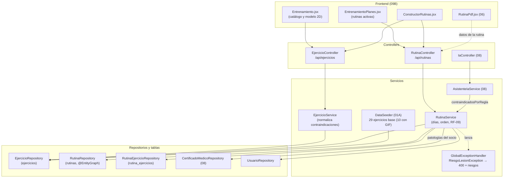

# 09A - Entrenamiento: Ejercicios y Rutinas (Backend)

Este documento detalla el backend del módulo de **entrenamiento** de **SUMMIT**: el catálogo de ejercicios (con su zona en el modelo muscular 2D y sus contraindicaciones), las rutinas por días que arma el profesor y el **cruce preventivo de patologías (RF-09)** contra el certificado médico del socio.

---

## 1. Explicación de Relaciones del Área (Arquitectura Punta a Punta)

### Flujo Integral Backend + Frontend

1. **Catálogo de ejercicios**:
   - En cada arranque, `DataSeeder.crearEjerciciosBase()` (01A) se asegura de que estén los **29 ejercicios base** (uno o más por grupo muscular, con su zona del modelo 2D y sus contraindicaciones): crea los que falten (buscándolos por nombre) y, en los que ya existen, solo completa el GIF (`urlMedia`) o la zona (`svgTargetId`) si estaban vacíos. Lo que el gimnasio cargó o editó no se toca.
   - **GIF demostrativo**: 10 ejercicios base traen un GIF en `urlMedia` (`/gym-exercises/<archivo>.gif`). Los archivos están en `summit-frontend/public/gym-exercises/` y los sirve el frontend como estáticos (Vite en desarrollo, Caddy en producción): el backend solo guarda la ruta.
   - ADMIN y PROFESOR dan de alta y editan ejercicios desde la pantalla de Entrenamiento ([`EjercicioController`](../../summit-backend/src/main/java/com/summit/backend/controller/EjercicioController.java)). Todo el personal puede consultarlos.
   - Las contraindicaciones se guardan normalizadas (`"HERNIA,RODILLA"`) para que se crucen igual con la ficha médica.

2. **Rutina del socio**:
   - El profesor elige el socio en el constructor (09B) y crea la rutina con nombre y objetivo. **Cada socio tiene una sola rutina activa**: al crear una nueva, las anteriores pasan a inactivas y quedan como historial (no se editan).
   - La rutina se organiza en **días (1 a 7)** y, dentro de cada día, por **orden**. Cada ejercicio lleva series, repeticiones, peso sugerido, descanso y observaciones.

3. **Cruce preventivo (RF-09)**:
   - Al agregar un ejercicio, [`RutinaService`](../../summit-backend/src/main/java/com/summit/backend/service/RutinaService.java) compara las patologías del certificado del socio (08) con las contraindicaciones del ejercicio, sin distinguir mayúsculas ni tildes y buscando la contraindicación **dentro** del texto de la patología ("Condromalacia rotuliana en rodilla izquierda" contiene "RODILLA").
   - Si hay riesgo, responde `400` con la lista de `riesgos` (`RiesgoLesionException`): el frontend muestra la advertencia y el profesor puede **forzarlo** asumiendo el riesgo (`?forzar=true`).
   - `contraindicadosPorRegla` aplica la misma regla a todo el catálogo de una vez: es la "regla firme" que el asistente de IA (08) combina con su propia opinión.

4. **Salida**: el detalle de la rutina alimenta el constructor y el PDF de la rutina (06), que el profesor imprime o descarga para el socio.

### Diagrama de Arquitectura y Relaciones del Módulo

---

## 2. Análisis Detallado Archivo por Archivo

---

### 2.1. [`Ejercicio.java`](../../summit-backend/src/main/java/com/summit/backend/model/Ejercicio.java) y [`GrupoMuscular.java`](../../summit-backend/src/main/java/com/summit/backend/model/GrupoMuscular.java)

- **Ruta**: `summit-backend/src/main/java/com/summit/backend/model/`
- **Propósito del archivo**: Ejercicio del catálogo (tabla `ejercicios`) y el enumerado de los 11 grupos musculares.

#### Atributos de `Ejercicio`
| Nombre | Tipo | Configuración | Propósito |
| :--- | :--- | :--- | :--- |
| `idEjercicio` | `Long` | PK | Identificador. |
| `nombre` | `String` | no nulo, `length = 100` | Nombre (único sin distinguir mayúsculas; lo controla el servicio). |
| `descripcion` | `String` | `length = 500` | Cómo se ejecuta. |
| `grupoMuscular` | `GrupoMuscular` | `@Enumerated(STRING)` + `@JdbcTypeCode(VARCHAR)`, `length = 30` | Se guarda como texto y no como `ENUM` de MySQL: agregar un grupo no obliga a modificar la columna. |
| `urlMedia` | `String` | `length = 255` | GIF, video o imagen del ejercicio. Los ejercicios base con GIF guardan una ruta relativa al frontend (`/gym-exercises/air_bike.gif`); también acepta una URL completa. |
| `svgTargetId` | `String` | `length = 50` | Zona del modelo muscular 2D (por ejemplo, `pecho-medio`, `dorsales-anchos`, `cuadriceps`). |
| `patologiasContraindicadas` | `String` | `length = 500` | Palabras separadas por coma (`HERNIA,LUMBAR`). |

#### `GrupoMuscular`
`PECHO`, `ESPALDA`, `BICEPS`, `TRICEPS`, `HOMBROS`, `CUADRICEPS`, `ISQUIOS`, `GLUTEOS`, `PANTORRILLAS`, `ABDOMINALES`, `CORE`.

---

### 2.2. [`Rutina.java`](../../summit-backend/src/main/java/com/summit/backend/model/Rutina.java) y [`RutinaEjercicio.java`](../../summit-backend/src/main/java/com/summit/backend/model/RutinaEjercicio.java)

#### Atributos de `Rutina` (tabla `rutinas`)
| Nombre | Tipo | Configuración | Propósito |
| :--- | :--- | :--- | :--- |
| `idRutina` | `Long` | PK | Identificador. |
| `nombre`, `objetivo` | `String` | 100 (no nulo) y 255 | Por ejemplo, "Hipertrofia 4 días" y "Ganar masa muscular". |
| `socio` | `Usuario` | `@ManyToOne(LAZY)`, `socio_id` no nulo | Dueño de la rutina. |
| `profesor` | `Usuario` | `@ManyToOne(LAZY)`, `profesor_id` | Profesor a cargo (puede quedar vacío si la arma un ADMIN sin indicarlo). |
| `fechaCreacion` | `LocalDate` | no nulo | Fecha de alta. |
| `activa` | `Boolean` | no nulo | Solo una activa por socio; las demás son historial. |
| `ejercicios` | `List<RutinaEjercicio>` | `@OneToMany(mappedBy, cascade = ALL, orphanRemoval = true)` | Quitar un ejercicio de la lista lo borra de la base. |

- **`@JsonIgnoreProperties({"hibernateLazyInitializer", "handler"})`**: evita errores al serializar proxies `LAZY`.
- **`@PrePersist prePersist()`**: completa `fechaCreacion = hoy` y `activa = true` si vienen vacíos.

#### Atributos de `RutinaEjercicio` (tabla `rutina_ejercicios`)
| Nombre | Tipo | Configuración | Propósito |
| :--- | :--- | :--- | :--- |
| `idRutinaEjercicio` | `Long` | PK | Identificador. |
| `rutina` | `Rutina` | `@JsonIgnore`, `@ManyToOne(LAZY)`, no nulo | Evita el ciclo rutina → ejercicios → rutina al serializar. |
| `ejercicio` | `Ejercicio` | `@ManyToOne(EAGER)`, no nulo | El ejercicio del catálogo. |
| `diaNumero` | `Integer` | | Día 1 a 7. Las rutinas armadas antes de existir los días lo tienen vacío y cuentan como día 1. |
| `orden` | `Integer` | | Posición dentro del día. |
| `series`, `repeticiones` | `Integer` | | 1 a 20 y 1 a 100. |
| `pesoSugeridoKg` | `Double` | | 0 a 500 kg. |
| `descansoSegundos` | `Integer` | | 0 a 600 s. |
| `observaciones` | `String` | `length = 300` | Indicaciones del profesor. |

---

### 2.3. Repositorios

| Repositorio | Método | Uso |
| :--- | :--- | :--- |
| [`EjercicioRepository`](../../summit-backend/src/main/java/com/summit/backend/repository/EjercicioRepository.java) | `findByGrupoMuscularOrderByNombre` | Ejercicios del grupo que se tocó en el modelo 2D. |
| | `findByNombreIgnoreCase` (`Optional<Ejercicio>`) | `DataSeeder` busca cada ejercicio base por nombre para crearlo si falta o completarle el GIF y la zona. |
| | `existsByNombreIgnoreCase`, `existsByNombreIgnoreCaseAndIdEjercicioNot` | Nombre único en el alta y en la edición. |
| [`RutinaRepository`](../../summit-backend/src/main/java/com/summit/backend/repository/RutinaRepository.java) | `findBySocioIdUsuarioAndActivaTrue` | Rutinas activas a desactivar al crear una nueva. |
| | `findBySocioIdUsuarioAndActivaTrueOrderByFechaCreacionDescIdRutinaDesc` | Con `@EntityGraph` (socio, profesor, ejercicios y su ejercicio): trae todo en una consulta y evita el problema N+1. |
| | `findConDetalleByIdRutina` | Detalle de una rutina con el mismo `@EntityGraph`. |
| | `resumenActivas()` | `@Query` que devuelve, por rutina activa, los datos del socio y del profesor, el mayor día con ejercicios (`MAX(COALESCE(diaNumero, 1))`) y la cantidad de ejercicios, con subconsultas: el listado del personal sin traer los ejercicios. |
| [`RutinaEjercicioRepository`](../../summit-backend/src/main/java/com/summit/backend/repository/RutinaEjercicioRepository.java) | (solo `JpaRepository`) | Guarda el ejercicio recién agregado para devolverlo con su id. |

---

### 2.4. [`EjercicioService.java`](../../summit-backend/src/main/java/com/summit/backend/service/EjercicioService.java)

- **Propósito del archivo**: Catálogo filtrable por grupo muscular, con las contraindicaciones que usa el cruce preventivo.

#### Métodos
1. **`listar(Pageable)`**: página del catálogo convertida a `EjercicioDTO`.
2. **`buscarPorGrupoMuscular(GrupoMuscular)`**: ordenados por nombre.
3. **`buscarPorId(Long)`**: 404 si no existe.
4. **`crear(EjercicioDTO)`**:
   - Nombre obligatorio y único ("Ya existe un ejercicio llamado ...").
   - Grupo muscular obligatorio y válido (si no, informa las opciones).
   - Textos opcionales con su largo máximo (reutiliza `RutinaService.textoOpcional`).
   - Contraindicaciones normalizadas.
5. **`actualizar(Long, EjercicioDTO)`**: actualiza **solo los campos que vienen**; un texto vacío borra ese dato. Controla el nombre único excluyendo al propio ejercicio.
6. **`toDTO(Ejercicio)`** (`public static`): también lo usa el asistente de IA.

#### Métodos privados
- **`validarNombre`**, **`grupoMuscular`** (`valueOf` en mayúsculas dentro de `try/catch`).
- **`normalizarPatologias(String)`**: `" hernia, Rodilla ,,"` → `"HERNIA,RODILLA"` (recorta, pasa a mayúsculas, quita vacíos y repetidos con `Stream.distinct`); vacío → `null`; más de 500 caracteres → 400.

---

### 2.5. [`EjercicioController.java`](../../summit-backend/src/main/java/com/summit/backend/controller/EjercicioController.java)

- **Ruta base**: `/api/ejercicios`. Consulta cualquier usuario del personal; alta y edición, ADMIN y PROFESOR (`SecurityConfig`).

| Método y ruta | Lógica |
| :--- | :--- |
| `GET /` | Página del catálogo (`Pageable`: 20 por defecto y 50 como máximo, `spring.data.web.pageable.*`). El frontend pide `?size=50&sort=nombre&page=N` hasta la última página. |
| `GET /grupo/{grupo}` | Ejercicios del grupo (`GrupoMuscular.valueOf` en mayúsculas). |
| `GET /{id}` | Un ejercicio. |
| `POST /` | Alta (`201`). El frontend también lo usa para crear un ejercicio con GIF que todavía no está en la base (09B, `cargarCatalogo`). |
| `PUT /{id}` | Edición parcial. El frontend manda solo `{ urlMedia, svgTargetId }` para vincular el GIF a un ejercicio que no lo tenía. |

---

### 2.6. [`RutinaService.java`](../../summit-backend/src/main/java/com/summit/backend/service/RutinaService.java)

- **Propósito del archivo**: Rutinas por días con el cruce preventivo de patologías.

#### Constantes
| Nombre | Propósito |
| :--- | :--- |
| `DIAS_MAXIMOS = 7` | Una rutina tiene como máximo 7 días. |
| `POR_DIA_Y_ORDEN` | `Comparator`: día, posición dentro del día y, en las rutinas viejas sin posición, orden de alta (`idRutinaEjercicio`), con `nullsLast`. |

#### Métodos públicos
1. **`listarActivasPorSocio(Long)`** (`readOnly`): la más reciente primero.
2. **`listarActivas()`** (`readOnly`): convierte las filas de `resumenActivas()` en `RutinaResumenDTO`.
3. **`buscarPorId(Long)`** (`readOnly`).
4. **`crear(RutinaRequestDTO, emailUsuario)`** (`@Transactional`):
   - Socio obligatorio, con rol `SOCIO` y en estado `ACTIVO`.
   - Nombre obligatorio (100) y objetivo opcional (255).
   - `resolverProfesor`: si la crea un PROFESOR, es él; si la crea un ADMIN, puede indicar un profesor activo (opcional).
   - **Desactiva las rutinas activas anteriores** del socio y guarda la nueva.
5. **`actualizar(idRutina, datos)`**: solo nombre u objetivo, y solo si vinieron en el JSON (`datos.vino(...)`).
6. **`desactivar(idRutina)`**: baja lógica (`activa = false`).
7. **`agregarEjercicio(idRutina, datos, forzar)`** (`@Transactional`):
   - La rutina tiene que estar activa (`rutinaModificable`).
   - El ejercicio tiene que existir; el día por defecto es 1; el orden, si viene, tiene que ser 1 o mayor.
   - `aplicarDatos(item, datos, true)`: en el alta, series y repeticiones son obligatorias y se validan todos los rangos.
   - **RF-09**: si no se fuerza y `riesgosDelSocio` devuelve patologías, lanza `RiesgoLesionException`.
   - `ubicar`: lo inserta en la posición pedida (o al final del día) y renumera el día.
8. **`actualizarEjercicio(idRutina, idRutinaEjercicio, datos)`**: aplica solo lo que vino. Si cambia de día, lo ubica en el nuevo día y **renumera el día anterior**; si solo cambia la posición, lo reubica en el mismo día.
9. **`quitarEjercicio(idRutina, idRutinaEjercicio)`**: lo saca de la lista (`orphanRemoval` lo borra) y renumera el día.
10. **`validarEjercicioContraindicado(idSocio, idEjercicio)`** (`readOnly`): las patologías en riesgo (lista vacía si es seguro).
11. **`contraindicadosPorRegla(idSocio)`** (`readOnly`): lee las patologías **una sola vez** y recorre todo el catálogo: `Map` idEjercicio → patologías en riesgo, en orden de inserción (`LinkedHashMap`). Lo usa `AsistenteIaService.ejerciciosAEvitar` (08).

#### Mapeo a DTO
- **`toDTO(Rutina)`**: con `ejerciciosOrdenados` y `totalDias` (el último día con ejercicios; 0 si está vacía).
- **`toDTO(RutinaEjercicio)`**: datos del ejercicio del catálogo (nombre, grupo, media) más los de la rutina.
- **`dia(item)`**: día vacío → 1.
- **`ejerciciosOrdenados(rutina)`**: ordena con `POR_DIA_Y_ORDEN` y, en las rutinas viejas sin `orden`, informa la posición dentro del día (`Map.merge`).

#### Cruce preventivo
1. **`riesgosDelSocio(idSocio, ejercicio)`**: sin contraindicaciones → lista vacía; si no, `riesgos(patologiasDelSocio(idSocio), contraindicadas)`.
2. **`patologiasDelSocio(idSocio)`**: las `observacionesPatologias` del certificado de vencimiento más lejano.
3. **`riesgos(patologias, contraindicadas)`** (`static`): normaliza las contraindicaciones; recorre las patologías del socio y marca las que **contienen** alguna contraindicación. Por eso la IA agrega etiquetas como `LUMBAR` al guardar las patologías: alimentan esta comparación.
4. **`normalizar(texto)`**: `Normalizer.Form.NFD` y quita las marcas diacríticas (`\p{M}`), en mayúsculas.

#### Orden dentro del día
1. **`ubicar(rutina, item, dia, posicion)`**: arma la lista del día sin el ejercicio, lo inserta en `min(posicion, tamaño + 1) - 1` (o al final), le asigna el día y renumera.
2. **`renumerarDia(rutina, dia)`** y **`renumerar(lista)`**: deja el orden como 1, 2, 3… y guarda explícito el día 1 en las rutinas viejas.

#### Validaciones
| Método | Regla |
| :--- | :--- |
| `aplicarDatos(item, datos, esAlta)` | En el alta valida todo; en la edición, solo lo que vino en el JSON (lo que viene vacío se borra). |
| `validarSeries` | 1 a 20. |
| `validarRepeticiones` | 1 a 100. |
| `validarPeso` | 0 a 500 kg; la comparación negada también rechaza `NaN`. |
| descanso | 0 a 600 s. |
| `textoOpcional(texto, maximo, error)` | Vacío → `null`; más largo → 400. Paquete-visible: la usa también `EjercicioService`. |
| `validarNombre`, `validarObjetivo`, `validarDia`, `validarOrden` | Obligatorio y 100; 255; 1 a 7; 1 o mayor. |

#### `RiesgoLesionException`
Extiende `IllegalArgumentException` y guarda la lista de `riesgos`. `GlobalExceptionHandler` la convierte en `400` con `{ error, riesgos }`: con esa lista el frontend ofrece agregarlo igual.

---

### 2.7. [`RutinaController.java`](../../summit-backend/src/main/java/com/summit/backend/controller/RutinaController.java)

- **Ruta base**: `/api/rutinas`. Arman ADMIN y PROFESOR; el resto del personal consulta. El cruce preventivo es dato de salud: solo ADMIN y PROFESOR.

| Método y ruta | Lógica |
| :--- | :--- |
| `GET /` | Rutinas activas de todos los socios (`RutinaResumenDTO`). |
| `GET /socio/{idSocio}` | Rutinas activas del socio. |
| `GET /validar-ejercicio?idSocio&idEjercicio` | `{ contraindicado, riesgos }`; sin alguno de los dos → 400. |
| `GET /{id}` | Detalle (`RutinaDTO`). |
| `POST /` | Alta (`201`). Acepta `{ idSocio, nombre, objetivo }` o el formato anterior `{ socio: { idUsuario } }`. |
| `PUT /{id}` | Nombre u objetivo. |
| `DELETE /{id}` | Baja lógica: `{ mensaje: "Rutina desactivada" }`. |
| `POST /{id}/ejercicios?forzar=false` | Agrega un ejercicio (`201`) o `400` con los riesgos. |
| `PUT /{id}/ejercicios/{idRutinaEjercicio}` | Edita o mueve. |
| `DELETE /{id}/ejercicios/{idRutinaEjercicio}` | Quita. |

---

### 2.8. DTOs

| DTO | Tipo | Campos y particularidades |
| :--- | :--- | :--- |
| [`EjercicioDTO`](../../summit-backend/src/main/java/com/summit/backend/dto/EjercicioDTO.java) | `record` | `idEjercicio`, `nombre`, `descripcion`, `grupoMuscular` (texto), `urlMedia`, `svgTargetId`, `patologiasContraindicadas`. Sirve para alta, edición y consulta. |
| [`RutinaDTO`](../../summit-backend/src/main/java/com/summit/backend/dto/RutinaDTO.java) | `record` | Datos de la rutina, del socio y del profesor, `activa`, `totalDias` y `ejercicios` ordenados por día y orden. |
| [`RutinaEjercicioDTO`](../../summit-backend/src/main/java/com/summit/backend/dto/RutinaEjercicioDTO.java) | clase `@Data` | Mutable: `ejerciciosOrdenados` completa el `orden` faltante. Incluye `nombreEjercicio`, `grupoMuscular` y `urlMedia` del catálogo. |
| [`RutinaResumenDTO`](../../summit-backend/src/main/java/com/summit/backend/dto/RutinaResumenDTO.java) | `record` | Fila del listado: sin ejercicios, con `totalDias` y `cantidadEjercicios`. |
| [`RutinaRequestDTO`](../../summit-backend/src/main/java/com/summit/backend/dto/RutinaRequestDTO.java) | clase | `idSocio`, `idProfesor` (solo ADMIN), `nombre`, `objetivo` y `socio` (formato anterior). Los *setters* de nombre y objetivo anotan el campo en `enviados` (`@JsonIgnore`): `vino(campo)` distingue "no vino" de "vino vacío" en la edición parcial. `idSocioIndicado()` acepta los dos formatos. |
| [`RutinaEjercicioRequestDTO`](../../summit-backend/src/main/java/com/summit/backend/dto/RutinaEjercicioRequestDTO.java) | clase | `idEjercicio`, `diaNumero`, `orden`, `series`, `repeticiones`, `pesoSugeridoKg`, `descansoSegundos`, `observaciones` y `ejercicio` (formato anterior). Mismo mecanismo de `enviados`/`vino`; día y orden vacíos dejan el ejercicio donde estaba. |
