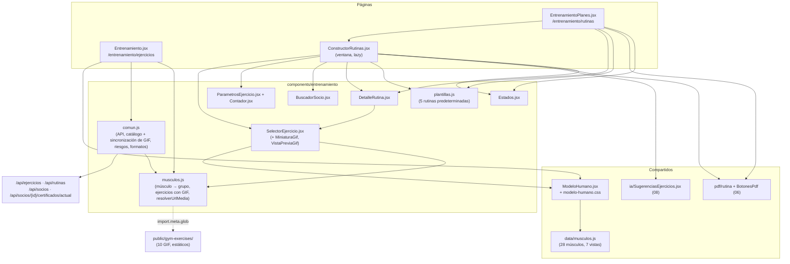

# 09B - Entrenamiento: Modelo Muscular y Rutinas (Frontend)

Este documento detalla el frontend del módulo de **entrenamiento** de **SUMMIT**: el catálogo de ejercicios con el **modelo muscular 2D interactivo**, la lista de rutinas de los socios con las **rutinas predeterminadas**, y el **constructor de rutinas por días** con el cruce preventivo de patologías y las sugerencias del asistente de IA.

---

## 1. Explicación de Relaciones del Área (Arquitectura Punta a Punta)

### Flujo Integral Backend + Frontend

1. **Ejercicios** (`/entrenamiento/ejercicios`, todo el personal): [`Entrenamiento.jsx`](../../summit-frontend/src/pages/Entrenamiento.jsx) muestra el [`ModeloHumano`](../../summit-frontend/src/components/ModeloHumano.jsx). Se toca una zona del cuerpo, después el músculo, y el panel explica su función y ejercicios clave (de [`data/musculos.js`](../../summit-frontend/src/data/musculos.js)) junto con los ejercicios que el gimnasio tiene cargados para ese músculo (`svgTargetId`) y para su grupo, cada uno con su **GIF demostrativo** (o un espacio reservado si no tiene).

   - **GIF de los ejercicios**: los archivos están en [`public/gym-exercises/`](../../summit-frontend/public/gym-exercises) (10 GIF). `resolverUrlMedia` (en `musculos.js`) encuentra el GIF de cada ejercicio por su `urlMedia` o, si no tiene, por su nombre. Se ven en el catálogo, como miniatura en cada fila del selector, del constructor y del detalle de la rutina, y en una **vista previa flotante** al pasar el puntero (`VistaPreviaGif`). Al cargar el catálogo, `cargarCatalogo` vincula o crea en la base los ejercicios con GIF que falten (el backend hace lo mismo al arrancar, 09A).

2. **Rutinas** (`/entrenamiento/rutinas`, ADMIN y PROFESOR en el menú; el PROFESOR empieza aquí): [`EntrenamientoPlanes.jsx`](../../summit-frontend/src/pages/EntrenamientoPlanes.jsx) lista **una fila por socio**: su rutina activa o "sin rutina" (si el socio está activo). Desde ahí se ve el detalle, se descarga el PDF (06), se desactiva o se abre el constructor. El sistema no sigue lo que entrena cada socio: la rutina le llega impresa o en PDF.

3. **Constructor** (ventana sobre Rutinas): [`ConstructorRutinas.jsx`](../../summit-frontend/src/pages/ConstructorRutinas.jsx) no es una pantalla fija; la dirección dice qué hay abierto (`?nueva=1&socio=&plantilla=` o `?rutina=`), así "Atrás" la cierra y un link la vuelve a abrir. Los links viejos (`/rutinas/constructor`) redirigen ahí (`AlConstructor` en `App.jsx`).
   - **Nueva**: se arma un **borrador** local (días, ejercicios, parámetros) y se crea todo junto con "Crear rutina".
   - **Edición**: cada cambio se guarda al momento con `PUT`, `POST` o `DELETE` puntuales y se relee la rutina (el backend reordena días y posiciones).
   - **Ficha médica**: muestra las patologías del certificado y el resumen de la IA; marca con ⚠ los ejercicios contraindicados (`riesgosLocales`, la misma regla del backend) y, al elegir uno, lo confirma el backend (`/rutinas/validar-ejercicio`). Un contraindicado solo se agrega con "Agregar igual" (`?forzar=true`).
   - **IA**: el panel `SugerenciasEjercicios` (08) marca con ✦ violeta lo que la IA sugiere evitar; no bloquea.
   - **Rutinas predeterminadas**: 5 plantillas ([`plantillas.js`](../../summit-frontend/src/components/entrenamiento/plantillas.js)) que se cargan como borrador, buscando cada ejercicio por nombre en el catálogo.

### Diagrama de Arquitectura y Relaciones del Módulo

---

## 2. Análisis Detallado Archivo por Archivo

---

### 2.1. [`Entrenamiento.jsx`](../../summit-frontend/src/pages/Entrenamiento.jsx)

- **Ruta**: `summit-frontend/src/pages/Entrenamiento.jsx`
- **Propósito del archivo**: Pantalla "Catálogo de Ejercicios y Biomecánica".

#### Componentes y lógica
- **`EjercicioCatalogo`**: nombre, grupo, descripción y, si tiene, "Contraindicado con: ..." en ámbar. Debajo, un **espacio dedicado al GIF demostrativo**:
  - `urlGif = resolverUrlMedia(e)` y estado `errorGif` (si la imagen no carga, `onError` lo pone en `true`); `tieneGif` combina los dos.
  - Con GIF: `` de 176 px (192 px desde `sm`) con `object-contain` y `alt` "Demostración de ...".
  - Sin GIF: recuadro punteado con el ícono `Dumbbell` y "Espacio para GIF demostrativo".
- **`Entrenamiento`**:
  - Estado `catalogo { datos, cargando, error }` cargado una vez con `cargarCatalogo()`.
  - **`ejerciciosDe(idMusculo)`**: se le pasa al modelo como `contenidoExtra`. Con `ejerciciosDelMusculo` arma dos secciones: "En el catálogo del gimnasio" (los que trabajan ese músculo) y "Más de <grupo>". Si no hay ninguno, lo dice.

---

### 2.2. [`ModeloHumano.jsx`](../../summit-frontend/src/components/ModeloHumano.jsx), [`modelo-humano.css`](../../summit-frontend/src/components/modelo-humano.css) y [`data/musculos.js`](../../summit-frontend/src/data/musculos.js)

- **Propósito del archivo**: Modelo del cuerpo interactivo en dos niveles: zona y músculo.

#### Props
| Prop | Propósito |
| :--- | :--- |
| `onMuscleSelect(id, titulo)` | Al elegir un músculo; el `id` coincide con el `svgTargetId` del catálogo. |
| `contenidoExtra(id)` | Contenido adicional del panel (por ejemplo, los ejercicios del catálogo). |
| `extraAntes` | Lo pone arriba del texto (lo usa el selector del constructor). |
| `estilo` | Para cambiar el alto (dentro de una ventana). |

#### Estructura
- **Vista general**: un `<svg>` con `viewBox="0 0 3553 3513"`, la imagen `/assets/modelo-muscular.webp` de fondo y 7 grupos de *paths* transparentes que se pueden tocar: brazos (frente y atrás), pecho, abdomen, espalda y piernas (frente y atrás).
- **Vistas de detalle**: 7 `<svg>` (`vista-pecho`, `vista-brazos-frente`, `vista-abdomen`, `vista-espalda`, `vista-piernas-frente`, `vista-piernas-trasera`, `vista-brazos-trasero`), cada uno con su foto `.webp` y un *path* por músculo (`sub-musculo`).
- **Panel** (`columna-lista`): "Análisis Biomecánico", el título, la explicación (`mecanica`, HTML propio con `dangerouslySetInnerHTML`), el contenido extra y la **leyenda de regiones** con el color de cada músculo (botones accesibles con `aria-pressed`).
- **`data/musculos.js`**: `MUSCULOS_DATA.musculos` (28 músculos con `titulo`, `mecanica` y `color`) y `leyendas` (qué músculos tiene cada vista). Los "Ejercicios Clave" de cada músculo nombran también los ejercicios del catálogo que tienen GIF (por ejemplo, Femorales: "Peso muerto con barra"; Cuádriceps: "Sentadilla con mancuernas", "Extensión de cuádriceps en máquina" y "Air Bike"; Aductores: "Aducción en máquina"; Abductores: "Abducción de cadera en polea"; Pantorrillas: "Extensión de gemelos en prensa"; Recto abdominal: "Abdominales en V con mancuerna"; Tríceps cabeza medial: "Fondos en banco para tríceps").

#### Estado y métodos
| Elemento | Lógica |
| :--- | :--- |
| `activeDetail`, `activeSubMusculo`, `currentTitle` | Vista abierta, músculo elegido y título del panel. |
| `tooltip` | Nombre de la zona que sigue al mouse (`handleMouseEnterGeneral`, `handleMouseMoveGeneral`, `handleMouseLeaveGeneral`). |
| `isTransitioning` | Bloquea toques durante la animación (550 ms al entrar, 500 ms al volver). |
| `handleGeneralPartClick(detailId, titulo)` | Abre la vista de la zona. |
| `handleSubMusculoClick(subId)` | Elige el músculo, sube el panel (`scrollTo`) y avisa con `onMuscleSelect`. |
| `handleBack()` | "← Volver al Cuerpo" y muestra durante 2,5 s un *badge* con la última zona vista (`showBadge`). |

---

### 2.3. [`comun.js`](../../summit-frontend/src/components/entrenamiento/comun.js)

- **Propósito del archivo**: Utilidades compartidas por Ejercicios, Rutinas y el constructor.

| Exportación | Lógica |
| :--- | :--- |
| `DIAS_MAXIMOS = 7` | Igual que el backend. |
| `puedeEditarEntrenamiento(usuario)` | ADMIN y PROFESOR (RECEPCION solo consulta). |
| `nombreGrupo(grupo)` | `PECHO` → "Pecho", `ISQUIOS` → "Isquiotibiales", etc. |
| `leerError(res, porDefecto)` | El `{ error }` del backend o "No tenés permiso" con `403`. |
| `obtenerJson(ruta, porDefecto)` | GET que lanza un `Error` con el mensaje y el `status`; sin red → "No se pudo conectar con el servidor". |
| `enviarJson(ruta, method, body)` | POST, PUT o DELETE; devuelve `{ ok, status, data }` sin lanzar. |
| `cargarCatalogo()` | Recorre las páginas de `/ejercicios?size=50&sort=nombre` (el backend pagina de a 50 como máximo) hasta la última, con un tope de 20 páginas, y después **sincroniza los ejercicios con GIF** (`EJERCICIOS_CON_GIF` de `musculos.js`), comparando por nombre normalizado (`normalizar`): si el ejercicio existe y le falta `urlMedia` o `svgTargetId`, los completa y, si el usuario puede editar (`puedeEditarEntrenamiento(usuarioActual())`) y el id es real, lo guarda con `PUT /ejercicios/{id}`; si no existe y puede editar, lo crea con `POST /ejercicios`; si no puede editar o el alta falla, lo agrega **solo en memoria** con un id negativo (`-(i + 1)`), para que igual se vea con su GIF. Al final completa con `resolverUrlMedia` el `urlMedia` de los que no lo tienen y devuelve la lista ordenada por nombre (`localeCompare` en español). Una promesa compartida (`sincronizacionEnCurso`) evita que dos pantallas que cargan a la vez dupliquen las altas. |
| `resolverUrlMedia` | Reexportado de `musculos.js` para las pantallas. |
| `useSocios()` | Hook con la lista de `GET /socios`, estados de carga y error y `recargar`. |
| `cargarPatologias(idSocio)` | `GET /socios/{id}/certificados/actual`: `{ estado: 'ok', patologias, resumenIa }`, `sin-certificado` (404) o `error`. |
| `normalizar(texto)`, `riesgosLocales(patologias, contraindicadas)` | La misma regla del backend (sin mayúsculas ni tildes, la patología **contiene** la contraindicación) para marcar las listas al instante. La que vale es la del backend. |
| `formatNumero`, `formatKg` (vacío = "Peso corporal"), `formatDescanso` ("1 min 30 s"), `seriesPorReps` ("4 × 10"), `fechaCorta` ("lun 29/09") | Formatos. |
| `agruparPorDia(ejercicios)` | `[[1, [...]], [2, [...]]]` ordenado por día. |
| `coincide(texto, ...campos)` | Búsqueda sin mayúsculas ni tildes. |

---

### 2.4. [`musculos.js`](../../summit-frontend/src/components/entrenamiento/musculos.js)

| Exportación | Lógica |
| :--- | :--- |
| `GRUPO_DE_MUSCULO` | Cada músculo del modelo con su grupo del catálogo (por ejemplo, `dorsales-anchos` → `ESPALDA`, `oblicuos` → `CORE`). Los antebrazos flexores y extensores no tienen grupo propio: muestran solo los ejercicios que los marcan. |
| `EJERCICIOS_CON_GIF` | Los 10 ejercicios que tienen GIF en `public/gym-exercises/`, con `nombre`, `grupoMuscular`, `svgTargetId`, `patologiasContraindicadas`, `descripcion` y `urlMedia` (los mismos datos que carga `DataSeeder` en el backend). |
| `normalizarSlug(texto)` | Sin tildes (`normalize('NFD')`), en minúsculas y con `_` en lugar de espacios y signos: "Peso muerto con barra" → `peso_muerto_con_barra`. |
| `ARCHIVOS_GIF`, `GIFS_POR_SLUG` (internas) | `import.meta.glob('/public/gym-exercises/*.{gif,webp,png,jpg,jpeg}')` detecta en la compilación todos los archivos de la carpeta (también los que se agreguen después) y arma un `Map` slug del nombre de archivo → URL pública (`/gym-exercises/...`). |
| `GIF_POR_NOMBRE` (interna) | `Map` slug del nombre del ejercicio → `urlMedia` de `EJERCICIOS_CON_GIF`. |
| `resolverUrlMedia(ejercicioOUrl, nombreOpcional)` | Recibe el ejercicio (`urlMedia`, `nombre` o `nombreEjercicio`) o directamente la URL y el nombre. Con `urlMedia`: la devuelve tal cual si empieza con `http(s)://`, `data:` o `/`; le agrega `/` si empieza con `gym-exercises/`; si no, la busca en `/gym-exercises/`. Sin `urlMedia`: busca por el nombre en `GIF_POR_NOMBRE` y después en `GIFS_POR_SLUG` (un archivo nuevo con el nombre del ejercicio se muestra sin tocar la base). Si no encuentra nada, `null`. |
| `ejerciciosDelMusculo(catalogo, idMusculo)` | `{ directos, delGrupo, grupo }`: los que tienen ese `svgTargetId` y, aparte, el resto de su grupo. |

---

### 2.5. [`plantillas.js`](../../summit-frontend/src/components/entrenamiento/plantillas.js)

- **Propósito del archivo**: Rutinas predeterminadas para asignar rápido y ajustar al socio.

| Plantilla | Objetivo | Nivel | Días |
| :--- | :--- | :--- | :--- |
| Full body 3 días | Salud general | Principiante | 3 |
| Torso / Piernas 4 días | Hipertrofia | Intermedio | 4 |
| Push / Pull / Legs | Hipertrofia | Intermedio | 3 |
| Fuerza 5×5 | Fuerza | Intermedio | 3 |
| Tonificación 3 días | Pérdida de peso | Principiante | 3 |

| Exportación | Lógica |
| :--- | :--- |
| `ej(nombre, series, repeticiones, descanso, observaciones)` (interna) | Ejercicio de una plantilla (por ejemplo, `PLANCHA`: 3 × 30, "Sostener 30 segundos por serie"). |
| `PLANTILLAS`, `plantillaPorId(id)`, `resumenPlantilla(p)` | Lista, búsqueda y "3 días · 15 ejercicios". |
| `armarDesdePlantilla(plantilla, catalogo)` | Busca cada ejercicio **por nombre normalizado** en el catálogo y devuelve `{ items, faltantes }`: los ítems del borrador (con día, series, repeticiones, descanso, notas y el `urlMedia` del catálogo para mostrar su GIF; peso vacío) y los nombres que el catálogo no tiene (sin repetir). |

---

### 2.6. Componentes de apoyo

#### [`SelectorEjercicio.jsx`](../../summit-frontend/src/components/entrenamiento/SelectorEjercicio.jsx)
- **Propósito**: Elegir un ejercicio con el dedo: buscador, filtros por grupo o tocando el cuerpo.
- **Props**: `catalogo`, `cargando`, `elegido`, `onElegir(id)` (`''` para cambiarlo), `marca(ejercicio)`, `deshabilitado`.
- **`Marca`**: ⚠ ámbar (contraindicado: regla firme, pide confirmación) o ✦ violeta (la IA sugiere evitarlo: solo informa).
- **`Opcion`**: todo el renglón es un botón de 48 px o más, con la miniatura del GIF a la izquierda. Recibe `onHover`, `onMoverHover` y `onSalirHover` (eventos `onMouseEnter`/`onMouseOver`, `onMouseMove` y `onMouseLeave`) para la vista previa.
- **Exportaciones para el GIF** (también las usan `DetalleRutina` y el constructor):
  - **`calcularPosicionHover(clientX, clientY)`**: posición de la vista previa (248 × 285 px, margen 14 px) a 20 px a la derecha del puntero; si no entra en la ventana, la pone a la izquierda, y la centra en vertical sin salirse de arriba ni de abajo.
  - **`VistaPreviaGif({ hover })`**: con `hover = { ejercicio, x, y }`, dibuja con `createPortal` sobre `document.body` una tarjeta flotante (`fixed`, `z-[9999]`, `pointer-events-none`, `role="tooltip"`) con el GIF grande (`resolverUrlMedia`), el nombre y el grupo. Si no hay GIF o falla la carga (`errorImg`, que se reinicia con `useEffect` al cambiar de ejercicio), muestra "Sin GIF demostrativo". Con `hover` en `null` no dibuja nada.
  - **`MiniaturaGif({ ejercicio, tamano = 'w-11 h-11' })`**: miniatura en la fila (`loading="lazy"`); sin GIF o con error, un recuadro punteado con el ícono `Dumbbell`.
- **Lógica**:
  - `hover` (`{ ejercicio, x, y }` o `null`): `mostrarHover` y `moverHover` (que no actualiza el estado si la posición y el ejercicio no cambiaron) lo calculan con `calcularPosicionHover`; no se muestra si el selector está `deshabilitado`. `salirHover` lo limpia, igual que elegir un ejercicio, "Cambiar", abrir o cerrar "Por el cuerpo", salir de la lista o desplazarla (`onScroll`).
  - `grupos` (`useMemo`): los grupos presentes en el catálogo, ordenados por nombre.
  - `resultados` (`useMemo`): por músculo elegido en el cuerpo (directos + del grupo) o por grupo; la búsqueda separa **cada palabra** ("press banca" encuentra "Press de banca plano").
  - Con un ejercicio elegido muestra la tarjeta con su miniatura (`w-12 h-12`) y "Cambiar"; al pasar el puntero por la tarjeta también aparece la vista previa del GIF.
  - Debajo de la lista: "N ejercicios: pasá el puntero para ver su GIF o tocá uno para elegirlo."
  - Teclado: Enter elige si hay un solo resultado; flecha abajo pasa a la lista.
  - Sin resultados dentro de un filtro, ofrece "Buscar en todos los grupos".
  - **"Por el cuerpo"**: abre el `ModeloHumano` en una ventana. Se carga con `lazy` (las imágenes y los SVG pesan) y muestra los ejercicios del músculo **arriba** del texto (`extraAntes`) para elegirlos ahí mismo, también con miniatura y vista previa del GIF.

#### [`ParametrosEjercicio.jsx`](../../summit-frontend/src/components/entrenamiento/ParametrosEjercicio.jsx) y [`Contador.jsx`](../../summit-frontend/src/components/entrenamiento/Contador.jsx)
| Exportación | Lógica |
| :--- | :--- |
| `PARAMETROS_INICIALES` | 4 series, 10 repeticiones, sin peso, 90 s de descanso. |
| `parametrosDe(e)` | Ejercicio de la rutina → valores del formulario (texto). |
| `validarParametros(p)` | Los mismos rangos que el backend (series 1 a 20, repeticiones 1 a 100, peso 0 a 500 o vacío = peso corporal, descanso 0 a 600, notas 300). Devuelve `{ datos }` o `{ error }`. |
| `ParametrosEjercicio` | Series, repeticiones, carga (paso 2,5 kg) y descanso (paso 15 s) con `Contador`, más las notas para el socio. Grilla `auto-fit`: 2 columnas en el celular, 4 en la PC. |
| `Contador` | Número con botones − y + (44 px en pantallas táctiles); se puede escribir y abre el teclado numérico. `vacioPermitido`: bajar del mínimo deja el campo vacío. |

#### [`BuscadorSocio.jsx`](../../summit-frontend/src/components/entrenamiento/BuscadorSocio.jsx)
- Busca por nombre, DNI o email (hasta 8 resultados) con navegación por teclado (flechas, Enter, Escape) y cierre al tocar afuera. Con un socio elegido muestra su tarjeta y "Cambiar". Marca el estado si no está activo.

#### [`DetalleRutina.jsx`](../../summit-frontend/src/components/entrenamiento/DetalleRutina.jsx)
- Lectura de la rutina por días (`agruparPorDia`): número, miniatura del GIF (`MiniaturaGif`), nombre, grupo, series × repeticiones, carga, descanso y observaciones.
- Estado `hover`: al pasar el puntero por una fila calcula la posición (`calcularPosicionHover`) y muestra `VistaPreviaGif` con el ejercicio (el `nombreEjercicio` de la rutina se pasa como `nombre`); se limpia al salir de la fila o de la lista.

#### [`Estados.jsx`](../../summit-frontend/src/components/entrenamiento/Estados.jsx)
- **`Cargando`** (con `data-cargando` y `aparece-tarde`: no parpadea en cargas rápidas), **`Vacio`**, **`ErrorCaja`** (con "Reintentar") y **`Aviso`** (`exito`, `error`, `alerta`, `info`, con `role` accesible y botón de cerrar de 44 px en pantallas táctiles).

---

### 2.7. [`EntrenamientoPlanes.jsx`](../../summit-frontend/src/pages/EntrenamientoPlanes.jsx)

- **Propósito del archivo**: Pantalla "Rutinas": rutina activa de cada socio y quién todavía no tiene.

#### Datos y estado
- `useCarga`: `GET /rutinas` (resumen de las rutinas activas en una consulta) y `GET /socios` en paralelo (`Promise.all`).
- `constructorAbierto`: con `?rutina=` o `?nueva=` en la dirección (y permiso de edición).
- `verPlantillas`: panel de rutinas predeterminadas abierto o cerrado, recordado por computadora en `localStorage` (`summit.rutinas.plantillas`, con `try/catch` por si no hay almacenamiento).

#### Lógica
1. **`abrirConstructor(busqueda)`**: navega sumando un paso al historial (`state.desdeLista`), así "Atrás" cierra la ventana. **`cerrarConstructor()`**: vuelve un paso o limpia la dirección. Al cerrar, recarga la lista (`useEffect` con `useRef` del estado anterior).
2. **`filas`** (`useMemo`): una por socio con su rutina activa más reciente y, aparte, los socios **activos** sin rutina; ordenadas por nombre.
3. **`conteo`** y **filtros**: Todos, Con rutina, Sin rutina y, para el profesor, "Armadas por mí".
4. **`visibles`**: filtro más búsqueda por socio, DNI, email, rutina, objetivo o profesor.
5. **`ver(fila)`**: carga el detalle (`GET /rutinas/{id}`) en una ventana con los botones del PDF (`documentoRutina`, 06) y "Editar rutina".
6. **`desactivar(fila)`**: confirma ("No se borra: queda guardada como inactiva") y llama a `DELETE /rutinas/{id}`.
7. **`exportar()`**: CSV con socio, DNI, rutina, objetivo, días, ejercicios, profesor y fecha.
8. **`acciones(fila, enTarjeta)`**: sin rutina, "Nueva rutina" y un desplegable "Predeterminada…" que abre el constructor con el socio y la plantilla ya cargados; con rutina, Ver, Editar y Desactivar.

#### JSX
- `Encabezado` con "+ Nueva rutina"; aviso de "Modo consulta" para quien no edita.
- `StatCard`: rutinas activas y socios sin rutina.
- Panel plegable de **rutinas predeterminadas** con "Usar plantilla".
- Lista en **tarjetas** en el celular y la tablet, y **tabla** desde 1280 px (`xl`).
- El constructor se carga con `lazy` y `Suspense` ("Abriendo el constructor…").

---

### 2.8. [`ConstructorRutinas.jsx`](../../summit-frontend/src/pages/ConstructorRutinas.jsx)

- **Propósito del archivo**: Constructor de rutinas por días con el cruce preventivo de patologías (RF-09).
- **Componentes**: `Constructor` (toda la lógica) y `ConstructorRutinas`, que lo monta con `key` igual a la rutina (o `'nueva'`): pasar de una rutina a otra arranca de cero.

#### Estado principal
| Estado | Propósito |
| :--- | :--- |
| `catalogo`, `rutina` | Catálogo de ejercicios y rutina guardada (en edición). |
| `borrador`, `nombre`, `objetivo`, `cantidadDias`, `diaActivo` | La rutina en armado. |
| `ficha` | Patologías y resumen de la IA del certificado actual. |
| `sugerenciasIa` | `Map` idEjercicio → `{ motivo, origen }` que completa `SugerenciasEjercicios`. No bloquea. |
| `rutinaVigente` | Rutina activa que la nueva va a reemplazar (se avisa). |
| `alta`, `validacion`, `errorAlta`, `ultimoAgregado` | Formulario de "Agregar ejercicio", su validación contra la ficha y la confirmación junto al formulario (en el celular, el aviso de arriba queda fuera de la vista). |
| `editando`, `ocupado`, `creando`, `aviso` | Ventana de edición de un ejercicio y estados de guardado. |
| `hoverFila` | Ejercicio de la lista del día bajo el puntero y su posición: muestra `VistaPreviaGif` al final de la ventana. |
| `plantillaPendiente` | Plantilla pedida en la dirección: se carga sola cuando están el socio, el catálogo y la ficha. |

#### Efectos (`useEffect`)
1. El aviso de "rutina creada" llega por `location.state` **una sola vez** (se borra del historial).
2. Carga el catálogo (solo si puede editar).
3. En edición, carga la rutina y completa nombre, objetivo y días (`cargarInicial`).
4. Carga la ficha médica del socio (con bandera `vigente` contra respuestas viejas).
5. Busca la rutina activa del socio (`GET /rutinas/socio/{id}`) para avisar que se reemplaza.
6. **Cruce preventivo**: cada vez que se elige un ejercicio consulta `GET /rutinas/validar-ejercicio`. Si el ejercicio tiene **id negativo** (existe solo en memoria, ver `cargarCatalogo`), no consulta al backend: calcula los riesgos con `riesgosLocales(ficha.patologias, ...)` sobre sus contraindicaciones. Por eso el efecto depende también de `ficha.patologias` y `catalogoPorId`.
7. Carga la plantilla pendiente cuando todo está listo.

#### Derivados
- `items` (borrador o ejercicios guardados), `soloLectura` (rutina inactiva), `totalDias` (entre 1 y 7), `delDia`, `diasVacios`.
- `riesgosDe(id)` con `riesgosLocales` y `marcaDe(e)`: ⚠ manda sobre ✦ si el ejercicio tiene las dos.
- `validando`: mientras el backend no confirmó el ejercicio elegido, el botón dice "Revisando ficha médica...".
- `documentoPdf`: el PDF de la rutina guardada, rearmado en cada cambio.

#### Acciones
1. **`ejecutar(operacion, textoExito)`**: en edición, aplica el cambio, **relee la rutina** y muestra el resultado.
2. **`elegirSocio(s)`**: si hay borrador, confirma (los riesgos dependen de la ficha de cada socio) y reinicia.
3. **`agregar(forzar)`**: valida el ejercicio y los parámetros; con riesgo y sin forzar no hace nada (se confirma con "Agregar igual").
   - **Nueva**: lo suma al borrador con `forzar`, los `riesgos` y el `urlMedia` del ejercicio (para la miniatura).
   - **Edición**: `POST /rutinas/{id}/ejercicios?forzar=`; si el backend responde riesgos, los muestra.
   - Mantiene series, repeticiones y descanso para el próximo ejercicio (suelen repetirse) y limpia carga y notas (`limpiarAlta`).
4. **`mover(item, delta)`**: en el borrador intercambia posiciones; en edición manda el nuevo `orden`.
5. **`quitar(item)`**: en edición confirma y llama a `DELETE`.
6. **`agregarDia()`** y **`quitarDia()`**: quitar un día confirma, borra sus ejercicios y **corre un lugar los días siguientes** (en edición, con un `PUT` por ejercicio).
7. **`abrirEdicion(item)`** y **`guardarEdicion()`**: ventana con el día y los parámetros; en edición manda **solo los campos que cambiaron**. Si pasa a otro día, queda al final de ese día.
8. **`guardarDatos()`**: nombre y objetivo (solo lo que cambió).
9. **`crear()`**:
   - Controla socio, nombre y al menos un ejercicio; si el socio ya tiene una rutina activa, confirma que pasará a inactiva.
   - `POST /rutinas` y después un `POST` por ejercicio, **ordenados por día** (el `sort` estable respeta el orden dentro del día) y con su `forzar`. Del ítem del borrador se descartan los datos que solo sirven en pantalla (`clave`, `nombreEjercicio`, `grupoMuscular`, `urlMedia`, `forzar` y `riesgos`).
   - Si alguno falla (por ejemplo, un contraindicado de una plantilla sin confirmar), lo informa sin perder el resto.
   - Pasa a modo edición de la rutina nueva con el aviso de éxito.
10. **`cargarPlantilla(plantilla)`**: confirma si reemplaza el borrador, arma los ítems, completa nombre y objetivo si estaban vacíos e informa los ejercicios que faltan en el catálogo y los marcados con ⚠ (al crear no se agregan si no se confirman).
11. **`cerrar()`**: con un borrador sin crear, pregunta (se perdería); en edición ya está todo guardado.

#### Vista
- **Ventana** de `max-w-6xl` y `92dvh` de alto fijo (no salta mientras carga). Sin permiso de edición, muestra solo el PDF y el detalle.
- **Columna lateral** (arriba hasta 1280 px): tarjeta **Socio** (`BuscadorSocio` con "Apto vigente"), tarjeta **Ficha médica** (patologías en rojo, "Sin patologías declaradas", aviso si no tiene certificado, resumen de la IA y el panel `SugerenciasEjercicios` si hay algo para analizar) y avisos de rutina vigente o rutina inactiva.
- **Rutina**: selector de plantilla (solo en una nueva), nombre y objetivo, **pestañas de días** con la cantidad de ejercicios y "Agregar día", lista del día con subir, bajar, editar y quitar (en el celular, los botones van abajo y separados), aviso de días vacíos.
- **`filaEjercicio(item, indice)`**: cada fila muestra la miniatura del GIF (`MiniaturaGif`) junto al número; arma `ejercicioVisual` con el `urlMedia` del ítem o, si no lo tiene (ejercicios ya guardados), el del catálogo (`catalogoPorId`), y al pasar el puntero actualiza `hoverFila`.
- **Agregar ejercicio**: `SelectorEjercicio` con las marcas, `ParametrosEjercicio`, el **recuadro de riesgo de lesión** con las patologías y "Elegir otro" / "Agregar igual", la nota violeta de la IA y el botón "Agregar al Día N".
- **Pie**: total de días y ejercicios, "Guardando..." y "Crear rutina" o "Listo, cerrar".
