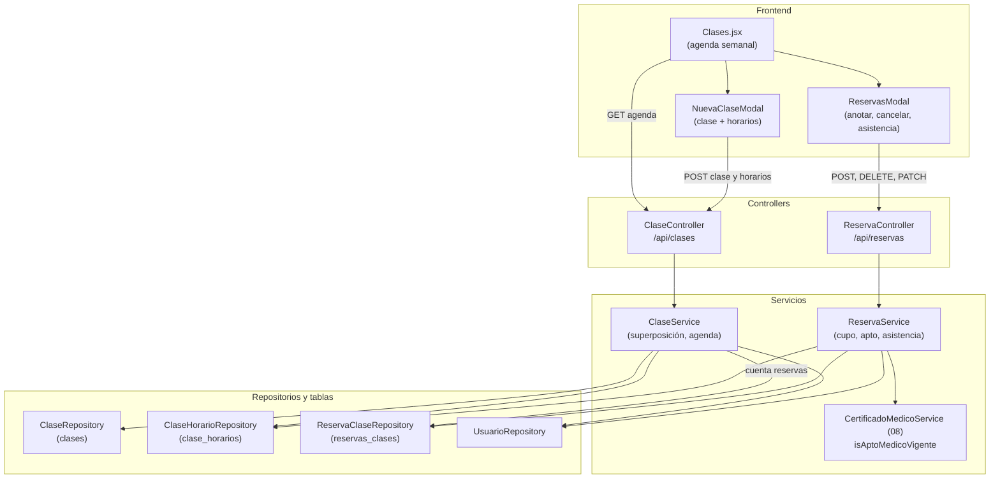

# 10 - Clases, Horarios y Reservas

Este documento detalla el módulo de **clases grupales** de **SUMMIT**: el alta de clases con sus horarios semanales (sin superposiciones), la agenda diaria con cupos, las reservas que hace el personal en nombre de los socios (con control de apto médico y de cupo) y la toma de asistencia.

---

## 1. Explicación de Relaciones del Área (Arquitectura Punta a Punta)

### Flujo Integral Backend + Frontend

1. **Clases y horarios** (solo ADMIN):
   - El administrador crea la clase (nombre, descripción, capacidad y profesor) y le agrega uno o más **horarios semanales** (día, hora de inicio y de fin) desde [`Clases.jsx`](../../summit-frontend/src/pages/Clases.jsx).
   - [`ClaseService`](../../summit-backend/src/main/java/com/summit/backend/service/ClaseService.java) rechaza un horario que se superponga con otro de **la misma clase** o con otra clase **del mismo profesor** ese día (requisito 3.5).

2. **Agenda**: la pantalla muestra la semana (de lunes a domingo); al elegir un día pide `GET /api/clases/agenda?fecha=`: los horarios de las clases activas de ese día de la semana con las reservas no canceladas de **esa fecha** (`reservados/capacidad`).

3. **Reservas** (todo el personal): el sistema es solo para el personal, así que recepción, el profesor o el admin **anotan al socio** en un horario y una fecha. [`ReservaService.reservar`](../../summit-backend/src/main/java/com/summit/backend/service/ReservaService.java) controla que sea un socio activo, que la clase esté activa, que la fecha no sea pasada y coincida con el día del horario, que no esté anotado dos veces, que tenga el **apto médico vigente** (Ley 5397, 08) y que haya **cupo**.

4. **Asistencia**: el día de la clase (o después) se marca cada reserva como **presente** o **ausente** (registro de inasistencias). Una reserva confirmada de una clase futura se puede cancelar; las ya marcadas no se cancelan, así no se pierde el registro.

### Diagrama de Arquitectura y Relaciones del Módulo

---

## 2. Análisis Detallado Archivo por Archivo

---

### 2.1. Modelos: [`Clase`](../../summit-backend/src/main/java/com/summit/backend/model/Clase.java), [`ClaseHorario`](../../summit-backend/src/main/java/com/summit/backend/model/ClaseHorario.java), [`ReservaClase`](../../summit-backend/src/main/java/com/summit/backend/model/ReservaClase.java), [`EstadoReserva`](../../summit-backend/src/main/java/com/summit/backend/model/EstadoReserva.java) y [`DiaSemana`](../../summit-backend/src/main/java/com/summit/backend/model/DiaSemana.java)

#### `Clase` (tabla `clases`)
| Nombre | Tipo | Configuración | Propósito |
| :--- | :--- | :--- | :--- |
| `idClase` | `Long` | PK | Identificador. |
| `nombre` | `String` | no nulo, 100 | Por ejemplo, "Funcional". |
| `descripcion` | `String` | 300 | Opcional. |
| `capacidadMaxima` | `Integer` | no nulo | Cupo por fecha. |
| `profesor` | `Usuario` | `@ManyToOne(LAZY)`, `profesor_id` | Opcional. |
| `activa` | `Boolean` | no nulo | Baja lógica; `@PrePersist` la crea activa. |

#### `ClaseHorario` (tabla `clase_horarios`)
| Nombre | Tipo | Configuración | Propósito |
| :--- | :--- | :--- | :--- |
| `idHorario` | `Long` | PK | Identificador. |
| `clase` | `Clase` | `@ManyToOne(LAZY)`, no nulo | Clase a la que pertenece. |
| `diaSemana` | `DiaSemana` | `@Enumerated(STRING)` + `@JdbcTypeCode(VARCHAR)`, 15 | `LUNES` a `DOMINGO`, guardado como texto. |
| `horaInicio`, `horaFin` | `LocalTime` | no nulos | Rango del horario. |

#### `ReservaClase` (tabla `reservas_clases`)
| Nombre | Tipo | Configuración | Propósito |
| :--- | :--- | :--- | :--- |
| `idReserva` | `Long` | PK | Identificador. |
| `socio` | `Usuario` | `@ManyToOne(LAZY)`, `usuario_id` | Socio anotado. |
| `horario` | `ClaseHorario` | `@ManyToOne(LAZY)` | Horario semanal. |
| `fechaClase` | `LocalDate` | no nulo | Fecha concreta de la clase (el horario se repite cada semana). |
| `fechaReserva` | `LocalDateTime` | no nulo | Cuándo se anotó (`@PrePersist`). |
| `estado` | `EstadoReserva` | texto, 20 | `CONFIRMADA` (por defecto), `CANCELADA`, `ASISTIO`, `AUSENTE`. |

- `Clase` y `ClaseHorario` llevan `@JsonIgnoreProperties({"hibernateLazyInitializer", "handler"})` porque los controllers las devuelven tal cual (con proxies `LAZY`); `ReservaClase` siempre sale convertida en `ReservaDTO`.

---

### 2.2. Repositorios

| Repositorio | Método | Uso |
| :--- | :--- | :--- |
| [`ClaseRepository`](../../summit-backend/src/main/java/com/summit/backend/repository/ClaseRepository.java) | (solo `JpaRepository`) | ABM de clases. |
| [`ClaseHorarioRepository`](../../summit-backend/src/main/java/com/summit/backend/repository/ClaseHorarioRepository.java) | `findByClaseIdClase` | Horarios de una clase. |
| | `findByDiaSemanaAndClaseActivaTrueOrderByHoraInicio` | Con `@EntityGraph` (clase y profesor): la agenda del día y el control de superposición en una consulta. |
| [`ReservaClaseRepository`](../../summit-backend/src/main/java/com/summit/backend/repository/ReservaClaseRepository.java) | `findBySocioIdUsuario` | Reservas de un socio. |
| | `findByHorarioIdHorarioAndFechaClaseOrderByFechaReserva` | Lista de anotados (con `@EntityGraph` del socio). |
| | `countByHorarioIdHorarioAndFechaClaseAndEstadoNot` | Reservas no canceladas: cupo y agenda. |
| | `existsBySocioIdUsuarioAndHorarioIdHorarioAndFechaClaseAndEstadoNot` | Evita anotar dos veces al mismo socio. |

---

### 2.3. [`ClaseService.java`](../../summit-backend/src/main/java/com/summit/backend/service/ClaseService.java)

- **Propósito del archivo**: Clases, horarios sin superposiciones y la agenda diaria con cupos.

#### Métodos
1. **`listar()`**, **`buscarPorId(id)`** (404 si no existe).
2. **`crear(Clase)`**: nombre obligatorio (recortado) y capacidad de al menos 1; `resolverProfesor` verifica que el profesor indicado exista y tenga rol `PROFESOR`.
3. **`actualizar(id, data)`**: cambia nombre, descripción o capacidad si vienen.
4. **`agregarHorario(idClase, horario)`** (`@Transactional`): día y horas obligatorios; la hora de fin tiene que ser posterior a la de inicio; `verificarSuperposicion` y guarda.
5. **`listarHorarios(idClase)`**, **`desactivar(id)`** (baja lógica: deja de aparecer en la agenda).
6. **`agenda(LocalDate fecha)`** (`readOnly`): los horarios de las clases activas del día de la semana de esa fecha, cada uno con la cantidad de reservas no canceladas de esa fecha (`AgendaClaseDTO`).
7. **`diaSemana(LocalDate)`** (`public static`): `DiaSemana.values()[getDayOfWeek().getValue() - 1]` (lunes = 1). También la usa `ReservaService`.
8. **`verificarSuperposicion(clase, nuevo)`** (requisito 3.5): recorre los horarios de ese día; dos rangos se superponen si `inicioNuevo < finExistente` y `finNuevo > inicioExistente`. Si es la misma clase: "La clase ya tiene un horario el lunes de 08:00 a 09:00"; si es otra clase del mismo profesor: "El profesor X ya da Y el lunes de ...". Dos clases de profesores distintos pueden coincidir (por ejemplo, en salones distintos).

---

### 2.4. [`ReservaService.java`](../../summit-backend/src/main/java/com/summit/backend/service/ReservaService.java)

- **Propósito del archivo**: Reservas con control de cupo, cancelación y asistencia.

#### Métodos
1. **`reservar(idUsuario, idHorario, fechaClase)`** (`@Transactional`), en este orden:
   - El usuario existe y es `SOCIO` (404) y está `ACTIVO`.
   - El horario existe (404) y su clase está activa.
   - La fecha no es pasada y su día de la semana coincide con el del horario ("La clase es los lunes y la fecha elegida no coincide").
   - El socio no tiene otra reserva no cancelada para ese horario y fecha.
   - **Apto médico vigente** con `CertificadoMedicoService.isAptoMedicoVigente` (respeta las reglas de acceso: si el gimnasio no lo exige, pasa; considera los días de gracia).
   - **Cupo**: si las reservas no canceladas llegan a la capacidad, "La clase está completa. No hay cupos disponibles."
   - Guarda la reserva `CONFIRMADA`.
2. **`buscar(idReserva)`**: 404 si no existe.
3. **`cancelar(idReserva)`**: solo las `CONFIRMADA` pasan a `CANCELADA` (cancelación lógica). Las marcadas como presente o ausente no se cancelan, así no se borra el registro de inasistencias.
4. **`registrarAsistencia(idReserva, estado)`** (`@Transactional`): solo `ASISTIO` o `AUSENTE`; la reserva no puede estar cancelada ni ser de una fecha futura ("La clase todavía no se dictó").
5. **`listarPorSocio(idUsuario)`**, **`listarPorHorario(idHorario, fecha)`** (`readOnly`).
6. **`toDTO(ReservaClase)`** (`public static`): `ReservaDTO` con nombre y DNI del socio.

---

### 2.5. [`ClaseController.java`](../../summit-backend/src/main/java/com/summit/backend/controller/ClaseController.java) y [`ReservaController.java`](../../summit-backend/src/main/java/com/summit/backend/controller/ReservaController.java)

- **Permisos** (`SecurityConfig`): crear, modificar y desactivar clases (`POST`, `PUT`, `DELETE /api/clases/**`) solo ADMIN; la agenda y las reservas, todo el personal; la asistencia (`PATCH /api/reservas/**`) y la lista de anotados con DNI (`GET /api/reservas/horario/**`), ADMIN, RECEPCION y PROFESOR.

| Método y ruta | Lógica |
| :--- | :--- |
| `GET /api/clases/agenda?fecha=` | Agenda del día (`AgendaClaseDTO`). |
| `GET /api/clases`, `GET /api/clases/{id}` | Clases. |
| `POST /api/clases`, `PUT /api/clases/{id}` | Alta (`201`) y modificación. |
| `GET /api/clases/{id}/horarios`, `POST /api/clases/{id}/horarios` | Horarios de la clase y alta de un horario (`201`). |
| `DELETE /api/clases/{id}` | Baja lógica: `{ mensaje: "Clase desactivada" }`. |
| `POST /api/reservas` | `{ idUsuario, idHorario, fechaClase }`; si falta alguno, 400 "Faltan datos de la reserva". Responde `201` con el `ReservaDTO`. |
| `DELETE /api/reservas/{id}` | Cancela. |
| `PATCH /api/reservas/{id}/asistencia` | `{ estado: "ASISTIO" \| "AUSENTE" }`. |
| `GET /api/reservas/horario/{idHorario}?fecha=` | Anotados de esa fecha. |
| `GET /api/reservas/socio/{idUsuario}` | Reservas del socio. |

---

### 2.6. DTOs: [`AgendaClaseDTO`](../../summit-backend/src/main/java/com/summit/backend/dto/AgendaClaseDTO.java) y [`ReservaDTO`](../../summit-backend/src/main/java/com/summit/backend/dto/ReservaDTO.java)

| DTO | Campos |
| :--- | :--- |
| `AgendaClaseDTO` (`record`) | `idHorario`, `idClase`, `nombreClase`, `descripcion`, `idProfesor`, `profesor`, `diaSemana`, `horaInicio`, `horaFin`, `capacidad`, `reservados`. |
| `ReservaDTO` (`record`) | `idReserva`, `idHorario`, `idSocio`, `nombreSocio`, `dni`, `fechaClase`, `fechaReserva`, `estado`. |

---

### 2.7. [`Clases.jsx`](../../summit-frontend/src/pages/Clases.jsx)

- **Ruta**: `summit-frontend/src/pages/Clases.jsx` (`/clases`, todo el personal).
- **Propósito del archivo**: "Agenda de Clases": horarios, reservas y asistencia.

#### Constantes y utilidades
| Nombre | Propósito |
| :--- | :--- |
| `COLORES` | Borde izquierdo de cada tarjeta, según el id de la clase (cada clase conserva su color). |
| `ESTADOS_RESERVA` | Texto y color de cada estado (Confirmada, Asistió, Ausente, Cancelada). |
| `aIso(d)`, `lunesDe(d)`, `hora(h)` | Fecha local a `YYYY-MM-DD`, lunes de la semana y `HH:mm`. |
| `DIAS_SEMANA` | De `utils/constantes` (01B): nombre y valor del enumerado de cada día. |

#### Componentes
1. **`ClassCard`**: nombre, ocupación `reservados/capacidad` (en rojo si está completa, en verde si no), horario, profesor y descripción. Al tocarla abre las reservas.
2. **`NuevaClaseModal`** (solo ADMIN):
   - Carga los profesores activos (`GET /usuarios/rol/PROFESOR`).
   - Formulario: nombre, capacidad (20 por defecto), profesor y descripción, y la lista de **horarios semanales** ("Agregar horario" copia el último).
   - **`guardar`**: crea la clase y después un `POST` por horario. Si el backend rechaza alguno (superposición), avisa cuáles y no permite volver a crear la clase (`claseCreada`): solo cerrar.
3. **`ReservasModal`** (un horario en una fecha):
   - Carga las reservas (`GET /reservas/horario/{id}?fecha=`) y los socios activos ordenados por nombre.
   - **Anotar** (solo en fechas de hoy en adelante): desplegable sin los socios ya anotados; el botón se deshabilita si la clase está completa. El backend controla el apto y el cupo y el mensaje de error se muestra tal cual.
   - **Asistencia** (hoy o fechas pasadas): presente o ausente por reserva no cancelada.
   - **Cancelar** (reservas confirmadas de hoy en adelante), con confirmación.
   - **Desactivar clase** (solo ADMIN): deja de aparecer en la agenda.
   - `ejecutar(peticion, textoOk)`: centraliza el mensaje de resultado y recarga la lista y la agenda.
4. **`Clases`** (página):
   - Estado: `lunes` de la semana visible, `fecha` elegida y `modal`.
   - `useCarga` pide la agenda cada vez que cambia la fecha.
   - Barra de la semana con "Semana anterior" / "Semana siguiente" (`moverSemana` elige el lunes) y un botón por día con la marca **HOY**.
   - Grilla de tarjetas (1 a 4 columnas según el ancho) o "No hay clases este día".
