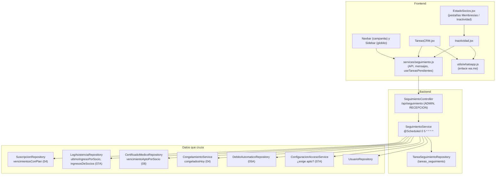

# 11 - CRM: Seguimiento, Inactividad y Tareas

Este documento detalla el módulo de **seguimiento de socios** de **SUMMIT**: la detección de socios que dejaron de venir (inactividad por niveles), las **tareas de contacto** automáticas y manuales, cómo se resuelven solas cuando cambia la situación del socio, y el contacto por **WhatsApp** con mensajes ya armados.

---

## 1. Explicación de Relaciones del Área (Arquitectura Punta a Punta)

### Flujo Integral Backend + Frontend

1. **Radiografía de los socios** (`SeguimientoService.estados`): en pocas consultas agrupadas (sin consultar socio por socio) arma, para cada socio **activo**, su plan y vencimiento de cuota, su último ingreso, los **días distintos** que vino en los últimos 90 días, el vencimiento del apto médico, si está congelado hoy y si tiene débito automático activo. Si nunca vino, los días sin venir se cuentan desde su alta.

2. **Inactividad** (`GET /api/seguimiento/inactividad`): socios **no congelados** con la cuota al día o vencida hace hasta 30 días (todavía se los recupera) que llevan 7 días o más sin venir. Cada uno sale con su nivel: **LEVE** (7 a 14), **MEDIO** (15 a 29) o **ALTO** (30 o más), su promedio semanal, el último contacto registrado y su tarea pendiente. Además devuelve cuántos socios al día vinieron en la última semana. La pantalla [`Inactividad.jsx`](../../summit-frontend/src/pages/Inactividad.jsx) es una pestaña de **Estado de socios** (`/socios/estado?vista=inactividad`).

3. **Tareas automáticas** (`generarTareas`, cada hora en el minuto 5 y al entrar a la pantalla):
   - **Primero resuelve** las pendientes cuya situación cambió: renovó la cuota, trajo un apto nuevo o volvió al gimnasio → `RESUELTA` con el motivo; el socio ya no está activo → `DESCARTADA`.
   - **Después crea** las que faltan: **cuota vencida** hace hasta 15 días, **apto por vencer** en 7 días o menos (solo si el gimnasio exige apto) y **socio inactivo** con la cuota al día y 15 días o más sin venir (sin congelar).
   - Cada tarea automática tiene una **clave única** (por ejemplo, `VENCIDA:12:2026-10-20`): la misma situación nunca genera dos tareas, aunque dos corridas coincidan.

4. **Tareas del equipo** ([`TareasCRM.jsx`](../../summit-frontend/src/pages/TareasCRM.jsx), `/socios/tareas`): recepción ve las pendientes (las atrasadas en rojo), escribe por WhatsApp con el mensaje armado ([`seguimiento.js`](../../summit-frontend/src/services/seguimiento.js) + [`whatsapp.js`](../../summit-frontend/src/utils/whatsapp.js)), marca la tarea como **hecha** (con el canal y qué pasó) o la **descarta**, y carga tareas **manuales**. La campanita del `Navbar` y el globito del `Sidebar` muestran las pendientes y se actualizan cada minuto.

### Diagrama de Arquitectura y Relaciones del Módulo

---

## 2. Análisis Detallado Archivo por Archivo

---

### 2.1. [`TareaSeguimiento.java`](../../summit-backend/src/main/java/com/summit/backend/model/TareaSeguimiento.java) y sus enumerados

- **Propósito del archivo**: Tarea de contactar a un socio (tabla `tareas_seguimiento`).

#### Atributos
| Nombre | Tipo | Configuración | Propósito |
| :--- | :--- | :--- | :--- |
| `idTarea` | `Long` | PK | Identificador. |
| `usuario` | `Usuario` | `@ManyToOne(LAZY)`, no nulo | Socio a contactar. |
| `tipo` | `TipoTarea` | texto, 20 | Por qué hay que contactarlo. |
| `descripcion` | `String` | no nulo, 300 | Qué hay que hacer (las automáticas la arman con las fechas). |
| `vence` | `LocalDate` | no nulo | Para cuándo. |
| `fechaReferencia` | `LocalDate` | | La fecha que la originó: vencimiento de la cuota o del apto, o el último ingreso (`null` si nunca vino o es manual). |
| `clave` | `String` | `unique`, 80 | Identifica la situación de una automática (`VENCIDA:12:2026-10-20`, `APTO:12:...`, `INACTIVO:12:2026-09-30` o `INACTIVO:12:nunca`). `null` en las manuales. |
| `estado` | `EstadoTarea` | texto, 20, `@Builder.Default PENDIENTE` | Estado. |
| `canal` | `CanalContacto` | texto, 20 | Cómo se contactó (solo si se hizo). |
| `nota` | `String` | 300 | Qué pasó, o por qué se resolvió sola. |
| `creadaPor`, `resueltaPor` | `Usuario` | `@ManyToOne(LAZY)` | Quién la cargó (`null` = automática) y quién la resolvió. |
| `fechaCreacion`, `fechaResolucion` | `LocalDateTime` | creación no nula (`@PrePersist`) | Cuándo. |

#### Enumerados
| Enumerado | Valores |
| :--- | :--- |
| [`TipoTarea`](../../summit-backend/src/main/java/com/summit/backend/model/TipoTarea.java) | `CUOTA_POR_VENCER` (ya no se genera; queda por el historial), `CUOTA_VENCIDA`, `APTO_POR_VENCER`, `INACTIVO`, `MANUAL`. |
| [`EstadoTarea`](../../summit-backend/src/main/java/com/summit/backend/model/EstadoTarea.java) | `PENDIENTE`, `HECHA` (alguien contactó al socio), `DESCARTADA` (no hacía falta o el socio se dio de baja), `RESUELTA` (se resolvió sola). |
| [`CanalContacto`](../../summit-backend/src/main/java/com/summit/backend/model/CanalContacto.java) | `WHATSAPP`, `LLAMADA`, `PRESENCIAL`, `EMAIL`, `OTRO`. |

---

### 2.2. [`TareaSeguimientoRepository.java`](../../summit-backend/src/main/java/com/summit/backend/repository/TareaSeguimientoRepository.java)

| Método | Uso |
| :--- | :--- |
| `findByEstadoOrderByVenceAscIdTareaAsc` | Pendientes de la más urgente a la menos, con `@EntityGraph` del socio y de quien la cargó. |
| `findByEstadoInOrderByFechaResolucionDescIdTareaDesc(estados, Pageable)` | Las últimas resueltas (con quién las resolvió). |
| `findByEstadoAndTipoNot(PENDIENTE, MANUAL)` | Automáticas pendientes, para ver si ya se resolvieron. |
| `existsByClave` | Evita crear dos veces la misma situación. |
| `countByEstado`, `countByEstadoAndVenceLessThan` | Pendientes y atrasadas (campanita). |
| `findFirstByUsuarioIdUsuarioAndTipoAndEstadoOrderByIdTareaDesc` | Tarea de inactividad pendiente de un socio. |
| `ultimoContactoPorSocio()` | `@Query`: `MAX(fechaResolucion)` de las tareas `HECHA` por socio. |

---

### 2.3. [`SeguimientoService.java`](../../summit-backend/src/main/java/com/summit/backend/service/SeguimientoService.java)

- **Propósito del archivo**: Inactividad y tareas de contacto.

#### Constantes
| Nombre | Valor | Propósito |
| :--- | :--- | :--- |
| `DIAS_LEVE`, `DIAS_MEDIO`, `DIAS_ALTO` | 7, 15, 30 | Niveles de inactividad. |
| `DIAS_CUOTA_VENCIDA_EN_LISTA` | 30 | La lista de inactividad incluye a quienes vencieron hace hasta 30 días. |
| `DIAS_TAREA_CUOTA_VENCIDA` | 15 | Ventana de la tarea "cuota vencida". |
| `DIAS_AVISO_APTO` | 7 | Ventana de la tarea "apto por vencer". |
| `DIAS_PROMEDIO` | 90 | Período del promedio semanal. |

#### `record EstadoSocio`
`(socio, plan, vencimiento, ultimoIngreso, ingresos90, vencimientoApto, congelado, debitoActivo)` con:
- **`diasSinVenir(hoy)`**: desde el último ingreso o, si nunca vino, desde el alta.
- **`alDia(hoy)`**: el vencimiento existe y no es anterior a hoy.

#### Métodos
1. **`estados(hoy)`** (privado): arma los `EstadoSocio` con seis fuentes agrupadas:
   - `SuscripcionRepository.vencimientosConPlan()`: se queda con el vencimiento **más lejano** de cada socio y su plan.
   - `LogAsistenciaRepository.ultimoIngresoPorSocio()` y `ingresosDeSocios(desde, hasta)` de los últimos 90 días, agrupados en un `Set<LocalDate>` por socio: cuenta **días distintos** (dos fichadas el mismo día no inflan el promedio).
   - `CertificadoMedicoRepository.vencimientoAptoPorSocio()`.
   - `CongelamientoService.congeladosHoy()`.
   - `DebitoAutomaticoRepository.findByEstadoInOrderByFechaAltaDesc([ACTIVO])`.
   - Filtra los usuarios `SOCIO` en estado `ACTIVO`.
2. **`inactividad(minDias)`** (`readOnly`):
   - Mapas del último contacto y de la tarea `INACTIVO` pendiente de cada socio.
   - Recorre los estados sin los congelados: cuenta `sociosAlDia` y `vinieronSemana` (menos de 7 días sin venir).
   - Entra a la lista si su cuota no venció hace más de 30 días y lleva `max(minDias, 7)` días o más sin venir; calcula el nivel.
   - **Promedio semanal**: `round(ingresos90 × 70 / 90) / 10` (los días de 90 divididos por 90/7 semanas, con un decimal).
   - Ordena de más a menos días sin venir.
3. **`generarTareas()`** (`@Scheduled(cron = "0 5 * * * *")`, `synchronized`):
   - Sin transacción de conjunto: cada tarea se guarda por separado.
   - Para cada automática pendiente: si **sobra** (`sobra`), la borra; si ya se resolvió (`motivoResuelta`), la pasa a `RESUELTA` (o `DESCARTADA` si el socio ya no está activo) con el motivo y la fecha.
   - Lee si el gimnasio exige apto y crea las tareas de `tareasPara` que no existan (`existsByClave`); si otra corrida la creó recién, la `DataIntegrityViolationException` por la clave única se ignora.
   - Devuelve `{ creadas, resueltas }` y lo registra en el log si hubo cambios.
4. **`sobra(tarea, hoy)`**: `CUOTA_POR_VENCER` (ya no se usa) y `APTO_POR_VENCER` creadas antes de su ventana (vuelven a crearse con la misma clave cuando falte una semana).
5. **`motivoResuelta(tarea, e, hoy)`** (`switch` por tipo):
   - Socio que ya no está activo → "El socio ya no está activo".
   - Cuota: el vencimiento actual es posterior al de la tarea → "Renovó la cuota: ahora vence el ...".
   - Apto: hay uno que vence después → "Trajo un apto nuevo: vence el ...".
   - Inactivo: ingresó después del último ingreso registrado en la tarea → "Volvió al gimnasio el ...".
   - Manual → nunca se resuelve sola.
6. **`tareasPara(e, hoy, exigeApto)`**: las tres reglas automáticas con su clave, su fecha (`vence`), su referencia y la descripción (por ejemplo, "La cuota (Pase libre) venció el ... y no renovó: invitarlo a volver" o "Tiene la cuota paga y todavía no vino (alta: ...)"). Las fechas en texto las arma `TextoFechas.completa`.
7. **`pendientes()`**, **`resueltas(cantidad)`** (las últimas 50 hechas, descartadas o resueltas solas) y **`cantidades()`** (`{ pendientes, atrasadas }`).
8. **`crear(TareaRequestDTO, email)`** (`@Transactional`): tarea `MANUAL` para un socio; sin fecha es para hoy y no puede ser anterior a hoy. Guarda quién la cargó.
9. **`resolver(idTarea, ContactoRequestDTO, email)`** (`@Transactional`):
   - La tarea existe (404) y está pendiente (si no, `IllegalStateException`: "Esa tarea ya no está pendiente").
   - El estado tiene que ser `HECHA` o `DESCARTADA`; `HECHA` exige el canal.
   - Guarda el canal (solo si se hizo), la nota, quién y cuándo.
10. **`registrarContacto(ContactoRequestDTO, email)`** (`@Transactional`): desde la pantalla de Inactividad. Marca como hecha la tarea `INACTIVO` pendiente del socio o, si no tiene, crea una ya hecha ("Contacto por inactividad") como registro. Canal por defecto: WhatsApp.
11. **Utilidades**: `filasAMapa`, `socio(id)` (404 si no es socio), `usuarioPorEmail`, `textoOpcional`, `aDto` (con los datos de contacto del socio y los nombres de quién la cargó y quién la resolvió).

---

### 2.4. [`SeguimientoController.java`](../../summit-backend/src/main/java/com/summit/backend/controller/SeguimientoController.java)

- **Ruta base**: `/api/seguimiento` (ADMIN y RECEPCION).

| Método y ruta | Lógica |
| :--- | :--- |
| `GET /inactividad?minDias=7` | `InactividadDTO`. |
| `GET /tareas?vista=pendientes\|resueltas` | Pendientes o las últimas 50 resueltas. |
| `GET /tareas/cantidad` | `{ pendientes, atrasadas }`. |
| `POST /tareas/generar` | Genera ahora las automáticas: `{ creadas, resueltas }`. |
| `POST /tareas` | Tarea manual (`@Valid`, `201`). |
| `POST /tareas/{idTarea}/resolver` | `{ estado: HECHA \| DESCARTADA, canal, nota }`. |
| `POST /contactos` | `{ idSocio, canal, nota }`: registra un contacto con un socio inactivo. |

---

### 2.5. DTOs

| DTO | Campos y validaciones |
| :--- | :--- |
| [`InactividadDTO`](../../summit-backend/src/main/java/com/summit/backend/dto/InactividadDTO.java) | `leve`, `medio`, `alto`, `sociosAlDia`, `vinieronSemana` y `socios` (`record Socio`: datos de contacto, plan, vencimiento, último ingreso, `diasSinVenir`, `ingresos90`, `promedioSemanal`, `nivel`, `ultimoContacto`, `idTareaPendiente`). |
| [`TareaDTO`](../../summit-backend/src/main/java/com/summit/backend/dto/TareaDTO.java) | La tarea con nombre, DNI y teléfono del socio, y los nombres de quién la cargó y quién la resolvió. |
| [`TareaRequestDTO`](../../summit-backend/src/main/java/com/summit/backend/dto/TareaRequestDTO.java) | `idSocio` (`@NotNull`), `descripcion` (`@NotBlank`, 3 a 300), `vence` (opcional: hoy). |
| [`ContactoRequestDTO`](../../summit-backend/src/main/java/com/summit/backend/dto/ContactoRequestDTO.java) | `idSocio` (solo al registrar un contacto), `estado` (solo al resolver), `canal`, `nota` (`@Size(max = 300)`). |

---

### 2.6. [`seguimiento.js`](../../summit-frontend/src/services/seguimiento.js)

| Exportación | Lógica |
| :--- | :--- |
| `obtenerInactividad`, `listarTareas`, `generarTareas`, `crearTarea`, `resolverTarea`, `registrarContacto` | Llamadas a la API con `pedirJson` (lanzan el mensaje del backend). |
| `TIPOS_TAREA` | Texto y color de cada tipo ("Cuota vencida", "Apto por vencer", "No viene", "Tarea"...). |
| `CANALES`, `textoCanal(valor)` | Canales de contacto en español. |
| `mensajeTarea(tarea, gimnasio)` | Mensaje de WhatsApp según el tipo, con el nombre de pila del socio, la fecha y la firma del gimnasio. |
| `mensajeInactivo(nombre, dias, gimnasio)` | "Hace N días que no te vemos..." o, si nunca vino, "Todavía no te vimos por el gimnasio...". |
| `actualizarTareasPendientes()` | Pide `/seguimiento/tareas/cantidad` y avisa a los oyentes solo si cambió. |
| `useTareasPendientes(activo)` | Hook con `useSyncExternalStore`: un único temporizador de **1 minuto** compartido por todos los componentes que lo usan, que se detiene cuando ninguno lo muestra. Con `activo` en `false` (roles que no hacen seguimiento) no pregunta. |

### 2.7. [`whatsapp.js`](../../summit-frontend/src/utils/whatsapp.js)

| Función | Lógica |
| :--- | :--- |
| `numeroWhatsApp(telefono)` | Normaliza un teléfono argentino como lo carga recepción ("11 2233-4455", "0351 15 555-1234", "+54 9 11 2233 4455"): quita `00`, `54`, `9` y el `0` inicial, y el `15` de los celulares después del código de área (2 a 4 dígitos). Con 10 dígitos devuelve `549` + número; si no, `null`. |
| `enlaceWhatsApp(telefono, texto)` | `https://wa.me/<número>?text=<mensaje>`: abre WhatsApp (o WhatsApp Web) con el mensaje listo. Sin un número válido, WhatsApp pide elegir el contacto. |

---

### 2.8. [`Inactividad.jsx`](../../summit-frontend/src/pages/Inactividad.jsx) (pestaña de [`EstadoSocios.jsx`](../../summit-frontend/src/pages/EstadoSocios.jsx))

- **Propósito del archivo**: Socios que dejaron de venir, para escribirles antes de que no renueven.
- **`EstadoSocios.jsx`**: une en una pantalla las pestañas **Membresías** (`EstadoMembresias`, 04) e **Inactividad**; la dirección vieja `/socios/inactividad` redirige a `?vista=inactividad`.

#### Lógica
- `useCarga` con `obtenerInactividad(minDias)`; el nombre del gimnasio para firmar los mensajes (`datosDelGimnasio`).
- **Tarjetas**: Alerta leve, media y alta (tocarlas filtra por nivel) y "Vinieron esta semana" (`vinieronSemana / sociosAlDia` en %).
- **Filtros**: nivel, búsqueda por nombre o DNI y "7, 15 o 30 días o más".
- **Tabla**: nivel y socio, último ingreso ("Hace N días" o "Nunca vino"), promedio semanal e ingresos en 90 días, plan y vencimiento, último contacto y los botones **WhatsApp** (enlace con `mensajeInactivo`) y **Otro**.
- Tocar WhatsApp u Otro abre una fila para **registrar el contacto** (canal y "¿Qué te dijo?"); `guardarContacto` llama a `registrarContacto` y recarga.
- **Exportar**: CSV con todos los datos de la lista filtrada.

---

### 2.9. [`TareasCRM.jsx`](../../summit-frontend/src/pages/TareasCRM.jsx)

- **Ruta**: `/socios/tareas` ("Tareas de seguimiento", ADMIN y RECEPCION).

#### Componentes
1. **`textoVence(vence)`**: "Para hoy", "Atrasada (era para el 20/10)" en rojo o "Para el 30/10".
2. **`NuevaTareaModal`**: busca el socio (nombre o DNI, sin los dados de baja, hasta 6 resultados), qué hay que hacer (3 a 300) y para cuándo (desde hoy).
3. **`TareasCRM`**:
   - Pestañas **Pendientes** y **Resueltas**. Al entrar a Pendientes **genera** las tareas del momento antes de listarlas (`cargar(true)`); "Actualizar" hace lo mismo. Después de cada carga actualiza la campanita.
   - Filtros por tipo y búsqueda por socio, DNI o descripción; contador de pendientes y atrasadas.
   - Cada pendiente: tipo, socio, DNI y teléfono, descripción, fecha y quién la cargó, con **WhatsApp** (enlace con `mensajeTarea` que además abre el registro con canal WhatsApp), **Hecha** (abre el registro con canal Llamada) y **Descartar**.
   - El registro pide "¿Cómo lo contactaste?" y "¿Qué te dijo?" y llama a `resolver(tarea, 'HECHA')`; "Todavía no" lo cierra.
   - Cada resuelta: estado ("Hecha", "Descartada" o "Se resolvió sola"), canal, fecha, quién y la nota.
