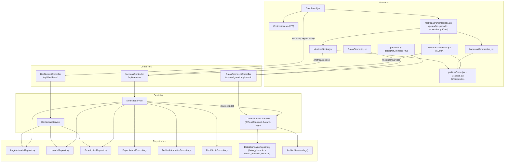

# 12 - Dashboard, Métricas y Datos del Gimnasio

Este documento detalla el **tablero principal** de **SUMMIT** (indicadores del día, control de acceso y actividad en vivo), el **panel de métricas** con datos reales (asistencia, membresías y ganancias, comparadas con el período anterior), la librería de **gráficos en SVG propio** y los **datos del gimnasio** (contacto, logo y horario semanal), que usan los PDF y las métricas.

---

## 1. Explicación de Relaciones del Área (Arquitectura Punta a Punta)

### Flujo Integral Backend + Frontend

1. **Tablero** (`/`, ADMIN y RECEPCION; el PROFESOR empieza en Rutinas): [`Dashboard.jsx`](../../summit-frontend/src/pages/Dashboard.jsx) reúne en una pantalla el trabajo diario de recepción:
   - En el encabezado, el **resumen de socios** (`GET /api/dashboard/resumen`): activos, nuevos del mes, membresías que vencen en 7 días e inactivos.
   - El **control de acceso por DNI** (`ControlAcceso`, 07B) con los botones "Nuevo socio" y "Cobrar cuota" (`CobroRapido`, 05B).
   - La **actividad en vivo** (`GET /api/dashboard/ingresos-hoy`): los intentos de ingreso de hoy con su resultado; tocar un socio abre su ficha completa (`FichaSocioModal`, 03B). Se actualiza cada 30 segundos.
   - Abajo, el **panel de métricas**.

2. **Métricas** ([`MetricasService`](../../summit-backend/src/main/java/com/summit/backend/service/MetricasService.java)): cada indicador se compara con el **período anterior del mismo largo** (por ejemplo, los últimos 30 días contra los 30 previos). Las consultas traen filas simples y se agrupan en Java (con el volumen de un gimnasio es rápido y no depende de funciones de fecha propias de MySQL).
   - **Socios** (`/api/metricas/socios`, ADMIN y RECEPCION): visitas permitidas por día, por hora y por día de la semana, socios distintos, nuevos, bajas, activos, ingresos por excepción, edad y género de quienes vinieron.
   - **Ganancias** (`/api/metricas/ingresos`, solo ADMIN): ingresos aprobados en el tiempo (por día hasta 62 días, si no por mes), por plan, por método y por canal, ticket promedio, débitos activos y cobro recurrente mensual, pagos a verificar.
   - **Planes / Membresías**: foto de hoy armada en el frontend con `/planes`, `/socios` y `/debitos`.

3. **Datos del gimnasio** (`/ajustes/gimnasio`, solo ADMIN los cambia): nombre, contacto y logo salen en los **PDF** (comprobantes, facturas y rutinas); el **horario semanal** lo usan las métricas: los días que el gimnasio no abre no se cuentan como días sin gente y el promedio diario se calcula solo sobre los días abiertos.

### Diagrama de Arquitectura y Relaciones del Módulo

---

## 2. Análisis Detallado Archivo por Archivo

---

### 2.1. [`DashboardService.java`](../../summit-backend/src/main/java/com/summit/backend/service/DashboardService.java), [`DashboardController.java`](../../summit-backend/src/main/java/com/summit/backend/controller/DashboardController.java) y [`DashboardResumenDTO.java`](../../summit-backend/src/main/java/com/summit/backend/dto/DashboardResumenDTO.java)

- **Ruta base**: `/api/dashboard` (ADMIN y RECEPCION).

#### Constantes
| Nombre | Propósito |
| :--- | :--- |
| `DIAS_POR_VENCER = 7` | Ventana de "vencen en 7 días". |
| `SALIDA = CHECKOUT` | La salida del personal queda en `logs_asistencia` pero **no es un ingreso**: se excluye de todos los conteos. |

#### Métodos
1. **`resumen()`** (`GET /resumen`):
   - `sociosTotal`: socios registrados.
   - `sociosActivos`: si las reglas exigen membresía activa, socios con la cuenta activa y la **membresía al día con los días de gracia** (`countConMembresiaAlDia`); si no, solo con la cuenta activa. Así coincide con la lista de socios. `sociosInactivos` es la diferencia.
   - `nuevosEsteMes`: altas desde el día 1.
   - `membresiasPorVencer`: suscripciones activas que vencen entre hoy y dentro de 7 días.
   - `ingresosHoy`, `permitidosHoy`, `denegadosHoy` e `ingresosUltimaHora`, sin las salidas del personal.
2. **`ingresosDeHoy()`** (`GET /ingresos-hoy`): los intentos de hoy del más reciente al más antiguo, como `IngresoDTO` (nombre, DNI, rol, resultado, tipo de evento y la versión de la foto, pedida para todos juntos con `FotoSocioService.versiones`).

---

### 2.2. [`MetricasService.java`](../../summit-backend/src/main/java/com/summit/backend/service/MetricasService.java) y [`MetricasController.java`](../../summit-backend/src/main/java/com/summit/backend/controller/MetricasController.java)

- **Rutas**: `GET /api/metricas/socios` (ADMIN y RECEPCION) y `GET /api/metricas/ingresos` (solo ADMIN), con `?desde=&hasta=` opcionales (por defecto, los últimos 30 días).

#### Constantes y `record`s
| Nombre | Propósito |
| :--- | :--- |
| `MAX_DIAS = 366` | Un período no puede superar un año. |
| `MAX_DIAS_POR_DIA = 62` | Hasta 62 días el gráfico de ingresos va por día; más largo, por mes. |
| `RANGOS_EDAD`, `GENEROS` | Orden fijo de categorías (cada una conserva su color en los gráficos), con "Sin dato". |
| `Periodo(desde, hasta, dias, desdeAnterior, hastaAnterior)` | Rango pedido y el anterior del mismo largo. |
| `Indicador(valor, anterior)` | Número con su valor anterior (`null` = foto de hoy, sin comparación). |
| `Punto(clave, valor)`, `Celda(dia, hora, visitas)` | Datos de un gráfico y celda del mapa día × hora. |
| `AnaliticaSocios`, `AnaliticaIngresos` | Respuestas de cada endpoint. |

#### `socios(desde, hasta)` (`readOnly`)
1. Ingresos **permitidos** del período y del anterior (`ingresosPermitidos`: fecha, socio y tipo de evento).
2. Agrupa por fecha, por hora y en una matriz `calor[7][24]`; junta los socios distintos.
3. **Visitas por día**: recorre todos los días del rango con ceros (la línea no "salta"), pero **omite los días que el gimnasio no abre** salvo que haya entrado alguien igual.
4. **Promedio por día de la semana**: divide por cuántas veces apareció ese día en el período (puede haber 5 lunes y 4 martes).
5. **Indicadores**: `visitas`, `visitantesUnicos`, `promedioPorVisitante`, `promedioDiario` (sobre los días abiertos, `diasAbiertos`), `nuevos`, `bajas`, `sociosActivos` y `excepciones` (ingresos que recepción dejó pasar por excepción).
6. **Perfil**: edad (por rangos) y género de los socios que vinieron (`PerfilSocioRepository.edadYGenero`); quienes no tienen perfil cuentan como "Sin dato".

#### `ingresos(desde, hasta)` (`readOnly`)
1. Pagos **aprobados** del período y del anterior (`PagoHistorialRepository.aprobadosEntre`: fecha, monto, método y plan).
2. **En el tiempo** (`TreeMap`, ordenado por clave `AAAA-MM` o `AAAA-MM-DD`): por mes o por día (sin los días cerrados, salvo que haya entrado algo, por ejemplo un débito automático).
3. Suma por plan, por método y por canal (**presencial** contra **débito automático**).
4. **Cobro recurrente**: lo que cobran por mes los débitos activos (un plan trimestral aporta un tercio de su monto: `monto / max(1, duracionDias / 30)`).
5. **Indicadores**: `ingresos`, `cobros`, `ticketPromedio`, `sociosActivos`, `debitosActivos`, `cobroRecurrente`, `pendientesVerificar` y `montoPendiente` (pagos `PENDIENTE` sin confirmar en Caja).
6. `sociosPorPlan`: socios activos de cada plan hoy.

#### `record Membresias(filas, diasGracia)`
Trabaja sobre las filas `[idUsuario, plan, inicio, vencimiento]` de `vencimientosConPlan()`:
- **`activosAl(fecha)`**: socios con una membresía que cubre esa fecha o vencida hace menos que los días de gracia (quien está en gracia sigue entrando).
- **`bajasEntre(desde, hasta)`**: socios cuya **última** membresía venció dentro del rango (hasta ayer) y no la renovaron.
- **`sociosPorPlanAl(fecha)`**: por socio, la membresía vigente más reciente; cuenta por plan.

#### Auxiliares
- **`periodo(desde, hasta)`**: el fin no puede pasar de hoy; sin inicio, 30 días; el inicio no puede ser posterior al fin y el período no puede superar un año (400).
- **`diasAbiertos`** (los feriados no se conocen: cuentan como abiertos), **`nuevos`**, **`inicio`/`fin`** (fin exclusivo: el comienzo del día siguiente), **`rangoEdad`**, **`categorias`**, **`puntos`**, **`ordenadosDeMayorAMenor`**, **`division`** (0 si el divisor es 0) y **`redondear`** (un decimal).

---

### 2.3. Datos del gimnasio: [`DatosGimnasio`](../../summit-backend/src/main/java/com/summit/backend/model/DatosGimnasio.java), [`HorarioGimnasio`](../../summit-backend/src/main/java/com/summit/backend/model/HorarioGimnasio.java) y [`DatosGimnasioDTO`](../../summit-backend/src/main/java/com/summit/backend/dto/DatosGimnasioDTO.java)

#### `DatosGimnasio` (tabla `datos_gimnasio`, un único registro con id 1)
| Nombre | Tipo | Configuración | Propósito |
| :--- | :--- | :--- | :--- |
| `idDatos` | `Long` | PK (siempre 1) | Registro único. |
| `nombre` | `String` | no nulo, 80 | Sale en los PDF y firma los mensajes de WhatsApp. |
| `direccion`, `ciudad` | `String` | 150 y 80 | Encabezado de los PDF. |
| `telefono` | `String` | 25 | Contacto. |
| `whatsapp` | `String` | 15 | Solo dígitos con código de país y área (lo pide el enlace `wa.me`). |
| `email`, `instagram` | `String` | 100 y 30 | Contacto (Instagram sin `@`). |
| `logoUrl`, `logoActualizado` | `String`, `LocalDateTime` | 255 | Ruta interna del logo (no va en la API) y su versión. |
| `horarios` | `List<HorarioGimnasio>` | `@ElementCollection(EAGER)` en `datos_gimnasio_horarios`, `@OrderColumn(orden)` | Horario de lunes a domingo. |

#### `HorarioGimnasio` (`@Embeddable`)
`dia` (`DiaSemana`, texto), `abre` y `cierra` (`LocalTime`); sin horas = ese día no abre. **`abierto()`**: tiene las dos horas.

#### `DatosGimnasioDTO` (`record`)
Los datos de contacto, `logoUrl` (la dirección con su versión, `/api/configuracion/gimnasio/logo?v=...`, o `null`; se ignora al guardar) y `horarios` (`record Horario(dia, abre, cierra)` en `HH:mm`; `null` al guardar = no se cambian).

#### [`DatosGimnasioRepository`](../../summit-backend/src/main/java/com/summit/backend/repository/DatosGimnasioRepository.java)
`JpaRepository<DatosGimnasio, Long>` sin métodos propios: `DatosGimnasioService` lee y guarda el registro único (id 1) con `findById` y `save`; los horarios se guardan junto con él por ser una colección del registro.

---

### 2.4. [`DatosGimnasioService.java`](../../summit-backend/src/main/java/com/summit/backend/service/DatosGimnasioService.java)

#### Métodos
1. **`crearSiNoExisten()`** (`@PostConstruct`): la primera vez crea "SUMMIT Fitness" con el **horario por defecto** (lunes a viernes de 8 a 22, sábados de 8 a 13 y domingos cerrado); a una base de antes del horario se lo agrega.
2. **`obtener()`**, **`obtenerDTO()`**.
3. **`horarioSemanal()`** (`readOnly`): `EnumMap<DayOfWeek, HorarioGimnasio>`. **`diasCerrados()`**: los días sin horario, que usan las métricas.
4. **`actualizar(DatosGimnasioDTO)`**: valida y guarda (los textos vacíos quedan en `null`):
   - Nombre obligatorio (80); dirección (150) y ciudad (80).
   - Teléfono con la expresión `^[0-9+()\-\s]{6,25}$`.
   - WhatsApp: guarda solo los dígitos y exige de 10 a 15 ("con el código de país y de área, sin 0 ni 15").
   - Email con formato válido (100).
   - Instagram: acepta `@usuario` o el link del perfil y guarda solo el usuario (`^[A-Za-z0-9._]{1,30}$`).
   - **`horarios(pedido)`**: los 7 días, cada uno abierto (abre antes de cerrar) o cerrado (sin horas); completar solo una de las dos horas es un error; tiene que abrir al menos un día.
5. **`guardarLogo(MultipartFile)`** (`@Transactional`): `Fotos.normalizarLogo` lo convierte en PNG de hasta 512 px (con transparencia); guarda el nuevo y **recién después** borra el archivo anterior.
6. **`cargarLogo()`**, **`eliminarLogo()`** (`@Transactional`).
7. **Auxiliares**: `hora` ("La hora ... no es válida (usá el formato 08:30)"), `nombre(dia)` (con tildes), `aDTO`, `texto`, `largoMaximo`.

### 2.5. [`DatosGimnasioController.java`](../../summit-backend/src/main/java/com/summit/backend/controller/DatosGimnasioController.java)

- **Ruta base**: `/api/configuracion/gimnasio`. Lo leen ADMIN, RECEPCION y PROFESOR (el profesor lo necesita para el encabezado del PDF de las rutinas); lo cambia solo ADMIN.

| Método y ruta | Lógica |
| :--- | :--- |
| `GET /` | Datos (`DatosGimnasioDTO`). |
| `PUT /` | Guarda; sin cuerpo → 400. |
| `POST /logo` | Sube el logo (PNG o JPG, 5 MB). |
| `GET /logo` | El PNG con `Cache-Control` privado de un día (la versión en la dirección evita ver uno viejo), o 404. |
| `DELETE /logo` | Quita el logo. |

---

### 2.6. [`Dashboard.jsx`](../../summit-frontend/src/pages/Dashboard.jsx)

- **Propósito del archivo**: Tablero de recepción y gerencia.

#### Componentes internos
- **`Cifra`**: un número del día en una línea ("23 ingresos hoy").
- **`Resumen`**: un dato del encabezado con su tono (verde, azul, ámbar, gris); "vencen en 7 días" se resalta con un anillo si hay alguno.

#### Lógica
1. **`cargarDatos()`**: pide el resumen y los ingresos de hoy en paralelo; se repite cada 30 s (`setInterval`) y después de cada ingreso o cobro.
2. **Actividad en vivo**: búsqueda por nombre o DNI; el primero de la lista es el último que entró (marca **ÚLTIMO**); el personal lleva la marca **PERSONAL**; cada fila muestra la foto (`FotoSocio`), la hora y el resultado (`resultadoIngreso`).
3. **`abrirFicha(ingreso)`**: lee el socio (`GET /socios/{id}`) y abre `FichaSocioModal`; desde la ficha se pasa a `EditarSocioModal` y, al guardar, se vuelve a la ficha actualizada (`alGuardarEdicion`). `refrescarFicha` la relee después de un cambio (foto, apto, congelamiento).
4. **Distribución**: en la PC, el control de acceso ocupa 3/5 y la actividad 2/5 con el mismo alto (la tabla se desplaza adentro); en pantallas chicas, uno debajo del otro.

---

### 2.7. Panel de métricas ([`components/metricas`](../../summit-frontend/src/components/metricas/PanelMetricas.jsx))

#### [`PanelMetricas.jsx`](../../summit-frontend/src/components/metricas/PanelMetricas.jsx)
- Pestañas **Socios**, **Planes / Membresías** y **Ganancias** (solo ADMIN), recordadas en la dirección (`?metricas=`; las direcciones viejas `/socios/metricas`, `/membresias/metricas` y `/membresias/debitos` redirigen aquí).
- `usePanelPestanas` (01B): las pestañas ya vistas quedan armadas y entran suave.
- **`FiltroPeriodo`** (no aplica a Planes / Membresías, que es una foto de hoy).
- **"Ocultar gráficos" / "Ver gráficos"**: preferencia por computadora en `localStorage` (`summit.tablero.graficos`), con `try/catch`.

#### [`comun.jsx`](../../summit-frontend/src/components/metricas/comun.jsx)
- **`pedirMetricas(ruta)`**: con `403` → "Estas métricas son solo para administración."
- **`CargandoMetricas`** (reserva el lugar para que no salte la pantalla), **`ErrorMetricas`**, **`FilaKpis`** (2, 3 o todas en una fila según el ancho) y **`decimal`**.

#### [`MetricasSocios.jsx`](../../summit-frontend/src/components/metricas/MetricasSocios.jsx)
- **Indicadores**: Visitas, Socios que vinieron, Socios activos, Socios nuevos y Bajas (con `subirEsBueno={false}`: que suban es malo).
- **Resumen en palabras**: personas por día abierto, el día y la hora con más gente, la franja más llena (del mapa día × hora) y los ingresos por excepción.
- **Gráficos**: Visitas por día (línea), Edades (dona con color fijo por rango), Hora del día (columnas recortadas de la primera a la última hora con visitas, destacada la hora pico) y Día de la semana (promedio).

#### [`MetricasMembresias.jsx`](../../summit-frontend/src/components/metricas/MetricasMembresias.jsx)
- Foto de hoy con `/planes`, `/socios` y `/debitos` (sin los socios dados de baja): **al día** (más de 7 días), **vence en 7 días**, **vencidas**, **congeladas** y **sin membresía**, con los mismos cortes que Estado de socios.
- **Indicadores**: membresías al día (con el porcentaje), vencen en 7 días, vencidas y el plan más elegido.
- **Gráficos**: membresías más usadas (barras), estado de las membresías (barra apilada con "Ver quiénes son" → `/socios/estado`) y cómo pagan los socios al día (débito automático o presencial).

#### [`MetricasGanancias.jsx`](../../summit-frontend/src/components/metricas/MetricasGanancias.jsx) (solo ADMIN)
- **Indicadores**: ingresos aprobados, cobros aprobados, ticket promedio, ingreso por socio activo (calculado en el frontend, comparado con el período anterior), cobro recurrente con los débitos activos y pagos a verificar con su monto.
- **Gráficos**: ingresos en el tiempo (línea, por día o por mes), cómo se cobra (dona por método con un color fijo por método) e ingresos por plan (barras).

---

### 2.8. Gráficos: [`base.jsx`](../../summit-frontend/src/components/graficos/base.jsx) y [`Graficos.jsx`](../../summit-frontend/src/components/graficos/Graficos.jsx)

- **Propósito**: Gráficos en **SVG propio, sin librerías**, accesibles y adaptados al ancho de la tarjeta.

#### `base.jsx`
| Exportación | Lógica |
| :--- | :--- |
| `SERIES` | Paleta categórica validada para daltonismo, en orden fijo (el color sigue a la categoría); la primera es el bordó del logo. |
| `TINTA`, `GRILLA`, `BASE`, `GRIS_ENFASIS`, `SIN_DATO`, `CERO` | Variables CSS de `index.css`: cambian con el modo oscuro. El texto nunca usa el color de una serie. |
| `RAMPA` | Rampa de un solo tono (bordó) para el mapa de calor. |
| `numero`, `compacto`, `compactoMoneda` ("$300 K"), `etiquetaFecha`, `fechaLarga` | Formatos. |
| `escala`, `escalaAjustada` | Ejes con marcas redondas (0, 5, 10, 15) y techo pegado al dato. |
| `useAncho()` | Mide el contenedor con `ResizeObserver` para adaptar el gráfico. |
| `Tooltip` | Valor en negrita y etiqueta; se da vuelta cerca del borde. |
| `TarjetaKpi` | Indicador con su variación porcentual contra el período anterior: flecha y texto (no solo color); "nuevo" si el anterior era 0. |
| `TarjetaGrafico` | Título, subtítulo y botón **"Ver datos"**: la misma información en una tabla (ningún valor depende solo del color o del mouse). `version` vuelve a montar el gráfico con su animación al cambiar el período. |
| `SinDatos` | Mensaje vacío. |
| `PERIODOS`, `periodoInicial`, `FiltroPeriodo` | 7, 30 y 90 días, este mes, mes anterior, 12 meses y personalizado (con fechas desde y hasta, no futuras). |

#### `Graficos.jsx`
| Componente | Lógica |
| :--- | :--- |
| `GraficoLinea` | Curva suave **monótona** (pasa por cada punto sin inventar picos ni valores bajo cero), área con degradé y línea punteada del promedio. La guía sigue al mouse por la curva; con el teclado va de día en día. |
| `GraficoBarras` | Barras horizontales con el valor en la punta; color único o por categoría. |
| `GraficoColumnas` | Columnas con una **protagonista** (la mayor, en color de acento; el resto en gris) que lleva el valor escrito. |
| `MapaCalor` | Día × hora en un solo tono (hoy no lo usa ninguna pestaña: la franja pico se informa en el texto). |
| `BarraApilada` | Barra 100 % para partes de un todo, con leyenda siempre visible y el porcentaje dentro del tramo si entra. |
| `GraficoDona` | Anillo fino con el total en el centro (o el tramo señalado) y la leyenda con monto y porcentaje; señalar una fila de la leyenda resalta su tramo. |
| Auxiliares | `anchoTexto` (márgenes según lo que hay que escribir), `barraHorizontal` y `columna` (puntas redondeadas de 4 px y base recta), `pendientesMonotonas`, `alturaEnCurva`, `curvaSuave`. |

---

### 2.9. [`DatosGimnasio.jsx`](../../summit-frontend/src/pages/DatosGimnasio.jsx)

- **Ruta**: `/ajustes/gimnasio` (en el menú, solo ADMIN, abajo de todo junto a "Cerrar sesión").

#### Componentes
1. **`LogoGimnasio`**: muestra el logo pidiéndolo **con la sesión** (`apiFetch` → `blob` → `URL.createObjectURL`, liberado al cambiar); "Subir/Cambiar logo" (PNG o JPG, controla 5 MB antes de enviarlo) y "Quitar" con confirmación.
2. **`Horarios`**: los 7 días (`DIAS_SEMANA`) con un tilde "Abierto/Cerrado" (al abrir propone 08:00 a 22:00) y las horas de apertura y cierre. Explica que los días cerrados no aparecen en las métricas.
3. **`DatosGimnasio`**: carga los datos, formulario de nombre, dirección, ciudad, WhatsApp (con la ayuda del formato), teléfono, email e Instagram, y **"Guardar Cambios"** (`PUT`). Muestra el error del backend tal cual (o "Solo un administrador puede..." con `403`) y el mensaje de éxito durante 4 segundos.

#### Uso en los PDF
- `datosDelGimnasio()` ([`pdf/index.js`](../../summit-frontend/src/components/pdf/index.js), 06) los lee con un caché de 5 minutos para el membrete de los comprobantes, facturas y rutinas, y para firmar los mensajes de WhatsApp del seguimiento (11).
