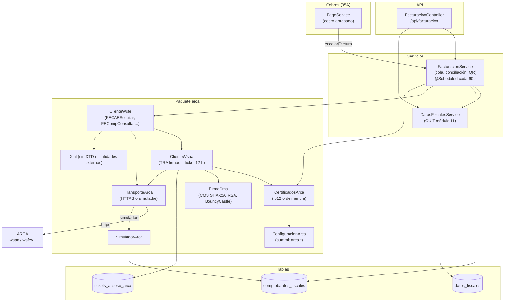

# 13A - Facturación Electrónica ARCA (Backend)

Este documento detalla el backend de la **factura electrónica** de **SUMMIT** con los web services de **ARCA** (ex AFIP): el permiso de acceso (WSAA) firmado con el certificado del gimnasio, el pedido de CAE (WSFEv1), la **cola de emisión** que nunca duplica ni saltea un número aunque se corte la conexión, la anulación con notas de crédito, el **simulador de ARCA** para probar sin certificado y los datos fiscales del dueño. La guía de puesta en marcha está en [`FACTURACION.md`](../../FACTURACION.md).

---

## 1. Explicación de Relaciones del Área (Arquitectura Punta a Punta)

### Flujo Integral Backend + Frontend

1. **Configuración** (`summit.arca.*` en `application.properties`, valores en `application-local.properties`):
   - `habilitada` (por defecto `false`: no se factura nada y el panel no muestra la sección).
   - `ambiente`: **SIMULADOR** (un ARCA de mentira dentro del backend), **HOMOLOGACION** (pruebas de ARCA, sin validez fiscal) o **PRODUCCION** (facturas reales). Cada comprobante guarda su ambiente: los de prueba nunca se mezclan con los reales.
   - `certificado` y `certificado-password`: el archivo `.p12` (certificado + clave privada) fuera del repositorio.
   - `reintentos-ms` (60 s): cada cuánto se revisa la cola.

2. **Alta del comprobante**: cuando un cobro queda **aprobado** (`PagoService`, 05A), en la **misma transacción** se crea su factura `PENDIENTE` (`FacturacionService.encolarFactura`): si el pago se deshace, la factura también, y ningún cobro queda sin facturar. Al confirmarse la transacción, un hilo en segundo plano procesa la cola.

3. **Emisión** (un solo hilo a la vez, porque la fecha de un comprobante no puede ser anterior a la del anterior):
   - **Preparar**: con los datos fiscales del momento, **Factura C** si el dueño es monotributista o **Factura B** si es responsable inscripto (con el IVA del 21 % contenido), a consumidor final o con el DNI del socio; el período facturado es la membresía pagada.
   - **Numerar**: le pregunta a ARCA el último número autorizado y reserva el siguiente (`ENVIANDO`).
   - **Pedir el CAE**: si ARCA lo aprueba, queda `AUTORIZADO` con su CAE; si lo rechaza, `RECHAZADO` (el número no se consume) hasta corregir el motivo y reintentar; si se corta la conexión sin respuesta, queda **`INCIERTO`** y, antes de usar otro número, se le pregunta a ARCA si lo autorizó (**conciliación**).
   - Si ARCA no responde, se reintenta cada vez más espaciado: **1, 5, 15 y 60 minutos**.

4. **Anulación**: una factura autorizada no se modifica ni se borra; se anula con una **nota de crédito** por el total, que pasa por la misma cola.

5. **Panel** (13B): estado de la facturación, datos fiscales, "Probar conexión", lista de comprobantes, reintentos y anulaciones. La caja muestra la factura de cada cobro y el PDF con el **QR de ARCA** (06).

### Diagrama de Arquitectura y Relaciones del Módulo

---

## 2. Análisis Detallado Archivo por Archivo

---

### 2.1. Modelo: [`ComprobanteFiscal.java`](../../summit-backend/src/main/java/com/summit/backend/model/ComprobanteFiscal.java)

- **Tabla**: `comprobantes_fiscales`.
- **Restricciones**: `uk_comprobante_numero` (`ambiente`, `cuit_emisor`, `tipo`, `punto_venta`, `numero`: el número es correlativo y no se repite); índices `idx_comprobante_cola` (`ambiente`, `estado`, `proximo_intento`) e `idx_comprobante_pago`.

#### Atributos
| Grupo | Campos | Propósito |
| :--- | :--- | :--- |
| Identidad | `idComprobante`, `pago` (no nulo), `asociado` | El cobro facturado y, en una nota de crédito, la factura que anula. |
| Estado | `ambiente`, `estado`, `notaCredito` | Ambiente, estado de la cola y si es nota de crédito. |
| Numeración | `tipo`, `puntoVenta`, `numero`, `fecha` | `null` mientras está pendiente (la letra sale de los datos fiscales al enviarse). |
| Emisor | `cuitEmisor`, `emisorRazonSocial`, `emisorDomicilio`, `emisorCondicionIva`, `emisorIngresosBrutos`, `emisorInicioActividades` | Copia de los datos fiscales **del momento** en que se emitió (lo que va impreso). |
| Receptor | `identificarReceptor`, `docTipo`, `docNro`, `condicionIvaReceptor`, `receptorNombre` | Consumidor final sin identificar (DocTipo 99, número 0) o con el DNI del socio (DocTipo 96). |
| Importes | `impTotal` (no nulo), `impNeto`, `impIva` | `DECIMAL(12,2)`. |
| Servicio | `servicioDesde`, `servicioHasta`, `vencimientoPago` | Período de la membresía pagada. |
| Anulación | `motivo` (200) | Por qué se anuló la factura. |
| ARCA | `cae` (14), `caeVencimiento`, `observaciones` (`TEXT`) | Autorización y mensajes de ARCA ("código: mensaje"). |
| Cola | `intentos`, `proximoIntento`, `ultimoError` (500) | Reintentos con espera creciente. |
| Auditoría | `solicitadoPor`, `creado`, `autorizado`, `ultimoPedido`, `ultimaRespuesta` (`TEXT`) | Último XML enviado y recibido, **sin el token ni la firma** del permiso. |
| Concurrencia | `version` (`@Version`) | Bloqueo optimista. |

- **`numeroCompleto()`**: `"00002-00000154"` o `null`.

### 2.2. Enumerados y tablas de apoyo

| Archivo | Contenido |
| :--- | :--- |
| [`TipoComprobante`](../../summit-backend/src/main/java/com/summit/backend/model/TipoComprobante.java) | `FACTURA_B` (6), `NOTA_CREDITO_B` (8), `FACTURA_C` (11), `NOTA_CREDITO_C` (13), con su letra y nombre. `llevaIva()` (solo la B), `notaCredito()` (la que anula cada factura), `factura(CondicionIva)` (monotributo → C, si no → B), `deCodigo`. |
| [`EstadoComprobante`](../../summit-backend/src/main/java/com/summit/backend/model/EstadoComprobante.java) | `PENDIENTE`, `ENVIANDO` (tiene número y se le pide el CAE), `INCIERTO` (se cortó después de enviarlo), `AUTORIZADO`, `RECHAZADO`. |
| [`CondicionIva`](../../summit-backend/src/main/java/com/summit/backend/model/CondicionIva.java) | `MONOTRIBUTO` ("Responsable Monotributo") y `RESPONSABLE_INSCRIPTO` ("IVA Responsable Inscripto"), con el texto impreso. |
| [`AmbienteArca`](../../summit-backend/src/main/java/com/summit/backend/model/AmbienteArca.java) | `SIMULADOR`, `HOMOLOGACION`, `PRODUCCION`; `deVerdad()` solo en producción. |
| [`DatosFiscales`](../../summit-backend/src/main/java/com/summit/backend/model/DatosFiscales.java) | Tabla `datos_fiscales`, fila única (id 1), aparte de `DatosGimnasio` (que es información pública): `cuit`, `razonSocial`, `condicionIva`, `ingresosBrutos`, `inicioActividades`, `domicilioComercial`, `puntoVenta` (el de "web services") e `identificarSocio`. |
| [`TicketAccesoArca`](../../summit-backend/src/main/java/com/summit/backend/model/TicketAccesoArca.java) | Tabla `tickets_acceso_arca` (`uk_ticket_arca`: ambiente + huella del certificado): el permiso del WSAA (`token`, `firma`, `vence` en hora argentina). Se guarda porque **ARCA no da otro mientras haya uno vigente** (12 horas) y no se puede perder al reiniciar. Es un secreto: no se muestra ni se escribe en los logs. |

### 2.3. Repositorios

| Repositorio | Método | Uso |
| :--- | :--- | :--- |
| [`ComprobanteFiscalRepository`](../../summit-backend/src/main/java/com/summit/backend/repository/ComprobanteFiscalRepository.java) | `findFirstByAmbienteAndEstadoInAndProximoIntentoLessThanEqualOrderByIdComprobanteAsc` | El próximo de la cola (el más viejo al que ya le toca). |
| | `findFirstByAmbienteAndEstadoInOrderByIdComprobanteAsc` | ¿Hay algo en el aire o en la cola? |
| | `findParaActualizar(id)` | `@Lock(PESSIMISTIC_WRITE)`: evita que dos pedidos anulen o reintenten el mismo comprobante a la vez. |
| | `ultimaFecha(...)` | La fecha del último comprobante de esa numeración. |
| | `findByPagoIdPagoOrderByIdComprobanteAsc`, `findByPagoIdPagoIn`, `findByAsociado` | Comprobantes de un cobro, de varios cobros (caja) y notas de una factura. |
| | `findByAmbiente`, `findByAmbienteAndEstado`, `countByAmbienteAndEstado` | Listado paginado y contadores. |
| | `reprogramar(...)` | `@Modifying`: "Procesar ahora" pone el próximo intento en este momento. |
| | `findByAmbienteAndCuitEmisorAndTipoAndPuntoVentaAndEstado` | Lo que el simulador "ya autorizó". |
| [`DatosFiscalesRepository`](../../summit-backend/src/main/java/com/summit/backend/repository/DatosFiscalesRepository.java), [`TicketAccesoArcaRepository`](../../summit-backend/src/main/java/com/summit/backend/repository/TicketAccesoArcaRepository.java) | `findByAmbienteAndHuellaCertificado` | Fila única y permiso vigente. |

---

### 2.4. Paquete [`arca`](../../summit-backend/src/main/java/com/summit/backend/arca/)

#### [`ConfiguracionArca.java`](../../summit-backend/src/main/java/com/summit/backend/arca/ConfiguracionArca.java)
- Lee `summit.arca.*` **como texto** (en `application-local.properties` pueden quedar vacíos).
- Ambiente vacío → `SIMULADOR`; uno mal escrito **frena el arranque** (no se puede adivinar si se quería facturar de verdad).
- Direcciones oficiales por ambiente (los manuales vigentes siguen usando `afip.gov.ar`): `wsaahomo`/`wswhomo` en homologación, `wsaa`/`servicios1` en producción, y `simulador:wsaa`/`simulador:wsfe` en el simulador. Se pueden reemplazar con `wsaa-url` y `wsfe-url`.

#### [`CertificadosArca.java`](../../summit-backend/src/main/java/com/summit/backend/arca/CertificadosArca.java)
- **`record CertificadoArca(clave, certificado, huella, cuit, deMentira)`** con `vence()`.
- **`actual()`**: carga una sola vez (doble verificación con `volatile` y `synchronized`). **`olvidar()`**: para releer el archivo después de renovarlo, sin reiniciar.
- **`cargar()`**: abre el `.p12` (`KeyStore PKCS12`) y toma la primera entrada con clave privada. Errores explicados: falta la ruta, no se encuentra el archivo, no tiene la clave privada, la contraseña no es la correcta.
- **`deMentira()`**: en el simulador sin archivo, genera un certificado autofirmado RSA 2048 (nunca sirve contra ARCA).
- **`huella`**: SHA-256 del certificado. **`cuitDe`**: ARCA pone la CUIT en el `serialNumber` del sujeto ("CUIT 20123456789").

#### [`FirmaCms.java`](../../summit-backend/src/main/java/com/summit/backend/arca/FirmaCms.java)
- **`firmar(contenido, certificado)`**: con **BouncyCastle** arma un CMS *SignedData* con el pedido adentro, la firma `SHA256withRSA` y el certificado, en Base64.

#### [`ClienteWsaa.java`](../../summit-backend/src/main/java/com/summit/backend/arca/ClienteWsaa.java)
1. **`credenciales()`** (`synchronized`): si hay un permiso guardado para este ambiente y certificado que vence en más de 10 minutos, lo reutiliza. Si no, arma el **TRA** (`loginTicketRequest` para el servicio `wsfe`, válido de 10 minutos antes a 10 después, para tolerar un reloj algo corrido), lo firma, lo manda a `loginCms`, lee `token`, `sign` y `expirationTime` y los guarda.
2. **`descartar()`**: si ARCA dice que el permiso no vale (error 600), lo borra para pedir otro.
3. **`mensaje(codigo, detalle)`**: traduce los errores más comunes: `coe.alreadyAuthenticated` (hay que esperar que venza), `coe.notAuthorized` (falta asociar el certificado al servicio en el Administrador de Relaciones), certificado no reconocido o vencido, y la hora de la PC no coincide con la de ARCA.

#### [`ClienteWsfe.java`](../../summit-backend/src/main/java/com/summit/backend/arca/ClienteWsfe.java)
- Arma los mensajes SOAP **a mano** (sin generar clases del WSDL, así se ve exactamente qué se manda), respetando el orden de elementos que exige ARCA.
- **`record`s**: `Mensaje`, `Servidores`, `Asociado`, `Solicitud`, `Respuesta` (con el pedido y la respuesta para la auditoría), `Consultado`, `PuntoVenta`.

| Método | Operación de ARCA | Lógica |
| :--- | :--- | :--- |
| `estadoServidores()` | `FEDummy` | Estado de la aplicación, la base y la autenticación (no pide permiso). |
| `ultimoAutorizado(cuit, pv, tipo)` | `FECompUltimoAutorizado` | Último número de esa numeración. |
| `solicitarCae(Solicitud)` | `FECAESolicitar` | Un comprobante de **servicios** (concepto 2) en pesos: documento del receptor, número, fecha, importes, período del servicio, vencimiento del pago, condición frente al IVA del receptor, comprobante asociado (nota de crédito) y el IVA 21 % (Id 5) si corresponde. Devuelve si quedó aprobado, el CAE y su vencimiento, observaciones y errores; en la auditoría **reemplaza el token y la firma por "(oculto)"**. |
| `consultar(cuit, tipo, pv, numero)` | `FECompConsultar` | El comprobante como lo tiene ARCA, o vacío si no existe (error 602). |
| `puntosDeVenta(cuit)` | `FEParamGetPtosVenta` | Puntos de venta habilitados para web services. |

- **`revisar(errores)`**: 500 a 502 (error interno de ARCA) y 600 (permiso a renovar) son **reintentables**; un error SOAP (`revisarFalla`) no se arregla reintentando.
- **`importe`**: dos decimales con redondeo bancario (`HALF_EVEN`).

#### [`TransporteArca.java`](../../summit-backend/src/main/java/com/summit/backend/arca/TransporteArca.java)
- **`enviar(url, soapAction, xml)`**: con una dirección `simulador:...` lo atiende el `SimuladorArca` (recibe exactamente los mismos mensajes que ARCA); si no, `POST` por HTTPS (`HttpClient`, 10 s de conexión y 60 s de respuesta). Acepta HTTP 200 y 500 (los errores SOAP llegan con 500).

#### [`Xml.java`](../../summit-backend/src/main/java/com/summit/backend/arca/Xml.java)
- **`esc`** (escapa texto), **`leer`** (sin DTD ni entidades externas: la respuesta viene de afuera, protección contra XXE), **`primero`**, **`texto`** y **`todos`** (buscan por nombre local, sin importar el prefijo del namespace).

#### [`ArcaException.java`](../../summit-backend/src/main/java/com/summit/backend/arca/ArcaException.java)
- Excepción **chequeada** con `codigo` y `reintentable`; el mensaje es para mostrarle al admin tal cual.

#### [`SimuladorArca.java`](../../summit-backend/src/main/java/com/summit/backend/arca/SimuladorArca.java)
- **Propósito**: un ARCA de mentira para probar y mostrar la facturación sin certificado, y para que los tests simulen cortes.
- **WSAA**: verifica la firma del CMS y las horas del TRA, y entrega un permiso al azar.
- **WSFEv1**: valida las reglas principales del manual con los códigos de ARCA: numeración correlativa y fecha (10016), fecha de servicios de hasta 10 días (10017), fechas de servicio obligatorias y coherentes (10031, 10032, 10036), documento del receptor (10015), tipo admitido (10007), condición frente al IVA según la letra (10243, 10246), suma de importes (10048), sin IVA en la C (10071), IVA del 21 % (10051, 10070, 10061) y nota de crédito con su factura (10197, aviso 10237 si la supera).
- Recuerda lo autorizado **leyéndolo de la base** (comprobantes del ambiente SIMULADOR), así no lo olvida al reiniciar.
- **Fallas programables para los tests** (`fallar(metodo, Falla)`): `SIN_CONEXION`, `CORTE_DESPUES_DE_PROCESAR` (llega pero se pierde la respuesta), `ERROR_INTERNO` y `RECHAZO`; `reiniciar()` olvida todo.

---

### 2.5. [`FacturacionService.java`](../../summit-backend/src/main/java/com/summit/backend/service/FacturacionService.java)

- **Propósito del archivo**: Cola de emisión, conciliación, anulaciones, estado del módulo y prueba de conexión.

#### Constantes
| Nombre | Valor | Propósito |
| :--- | :--- | :--- |
| `DIVISOR_IVA` | 1,21 | IVA contenido en la Factura B. |
| `CONSUMIDOR_FINAL`, `SIN_IDENTIFICAR`, `DNI` | 5, 99, 96 | Códigos de ARCA del receptor. |
| `ESPERAS_MINUTOS` | 1, 5, 15, 60 | Espera creciente entre reintentos. |
| `NUMERO_O_FECHA_FUERA_DE_ORDEN` | 10016 | Alguien usó ese número (por ejemplo, desde la web de ARCA): se pide el siguiente. |
| `ERRORES_PASAJEROS` | 500, 501, 502, 600 | Se arreglan solos: no son un rechazo. |
| `URL_QR` | `https://www.arca.gob.ar/fe/qr/?p=` | Dirección del QR. |
| `MAXIMO_POR_PASADA`, `DIAS_AVISO_CERTIFICADO` | 500, 30 | Tope de una pasada y aviso de vencimiento del certificado. |

#### Concurrencia
- **`ReentrantLock emitiendo`**: un solo hilo emite a la vez; si otro está procesando, espera y hace otra pasada (no queda afuera lo que llegó mientras tanto).
- **`ExecutorService` de un hilo** (`facturacion-arca`, *daemon*), cerrado en `@PreDestroy`.
- **`TransactionTemplate`**: cada paso (preparar, numerar, registrar) es una transacción corta; las llamadas a ARCA quedan **fuera** de las transacciones.
- **`procesarAlConfirmar()`**: registra una `TransactionSynchronization` para procesar recién en `afterCommit` (antes, el comprobante no existe para el hilo de la cola).

#### Alta de comprobantes
1. **`encolarFactura(pago)`**: dentro de la transacción del pago; solo si la facturación está prendida y el pago está aprobado y tiene monto.
2. **`facturar(idPago, conDni, email)`** (`@Transactional`): factura a mano un cobro aprobado **sin una factura vigente** (uno de antes de prender la facturación, o uno cuya factura se anuló para rehacerla con el DNI). Bloquea el pago (`findParaActualizar`).
3. **`anular(idFactura, motivo, email)`** (`@Transactional`): motivo de 3 a 200 caracteres; solo una factura **autorizada**, del ambiente actual y sin otra nota de crédito vigente. Crea la nota `PENDIENTE` por el total.
4. **`reintentar(id)`** (`@Transactional`): solo un `RECHAZADO` del ambiente actual, controlando que el cobro (o la factura) no tenga ya otro comprobante vigente; vuelve a `PENDIENTE` con los intentos en cero.
5. **`procesarAhora()`**: lo que espera un reintento vuelve a la cola ya (`reprogramar`).

#### Cola
1. **`reintentarPendientes()`** (`@Scheduled(fixedDelayString = "${summit.arca.reintentos-ms:60000}")`).
2. **`procesarPendientes()`** → **`procesarCola()`**: hasta 500 por pasada. **Primero lo que quedó en el aire** (`ENVIANDO` o `INCIERTO`): mientras no se sepa si ARCA lo autorizó, no se usa otro número (`conciliar`); si no hay, toma el `PENDIENTE` más viejo al que le toca (`emitir`). Se detiene cuando ARCA no responde.
3. **`emitir(id)`**:
   - `preparar` (transacción): suma un intento; si faltan datos fiscales, espera ("Faltan datos fiscales en Ajustes > Facturación: ..."). Arma tipo, receptor y período: en una **nota de crédito** copia los de la factura (y la rechaza si la factura es de otra CUIT); en una **factura**, identifica al socio solo si se pidió y su DNI tiene 7 u 8 dígitos. El período va desde `venceMembresia - duración del plan` hasta `venceMembresia`. **Neto** = total / 1,21 en la B (o el total en la C) e **IVA** = total − neto. Copia los datos del emisor.
   - `ultimoAutorizado` (fuera de transacción): sin respuesta → espera.
   - `numerar` (transacción): reserva `último + 1` con fecha de hoy (o la del último comprobante si es posterior), estado `ENVIANDO` y `saveAndFlush`.
   - `solicitarCae`: si falla la comunicación → **`INCIERTO`** ("se le va a preguntar si lo autorizó").
   - `registrar` (transacción).
4. **`registrar(id, respuesta)`**: guarda la auditoría; aprobado → `AUTORIZADO` con CAE, vencimiento y observaciones; si no, **libera el número** y: con 10016 vuelve a `PENDIENTE` (enseguida las dos primeras veces); con solo errores pasajeros espera; con cualquier otro motivo → `RECHAZADO` con el primer mensaje.
5. **`conciliar(id)`**: consulta el número en ARCA. Si lo tiene **aprobado con el mismo total, documento y fecha**, queda `AUTORIZADO` ("Se confirmó con ARCA después de un corte de conexión"); si no existe o lo tiene otro comprobante, libera el número y vuelve a `PENDIENTE` para pedir uno nuevo. Así **nunca se duplica ni se saltea un número**.
6. **`esperar`**, **`enElAire`**, **`rechazar`**, **`espera`** (según los intentos: 1, 5, 15 o 60 minutos).

#### Consultas
- **`listar(estado, pageable)`**, **`detalle(id)`**, **`dePago(idPago)`**.
- **`resumenes(idsPago)`**: la última factura de cada cobro (estado, letra, número y si está anulada) para la caja, en una sola consulta.
- **`estado()`**: si está apagada, `EstadoFacturacionDTO.apagada()`; si no, ambiente, certificado (sujeto, CUIT, vencimiento, días que faltan, si es de mentira), datos faltantes, pendientes, inciertos, rechazados, el último error de la cola y **advertencias** (el certificado vence en 30 días o menos, o es de otra CUIT que la de los datos fiscales).
- **`probarConexion()`**: paso a paso, cortando en el primero que falla: servidores (`FEDummy`); certificado y permiso (olvida el certificado para releerlo); datos fiscales; punto de venta habilitado para web services (en homologación ARCA no tiene ninguno y se acepta el configurado); y numeración (último comprobante). Si todo anda, procesa lo que esperaba.

#### Ayudas
- **`facturaVigente`**, **`anulada`**, **`notaVigente`** y **`mismo`** (compara por id: una relación perezosa puede ser un proxy).
- **`aDto(c)`**: el `ComprobanteFiscalDTO` completo, con los datos del socio, del cobro (plan, método, precio de lista, descuento, matrícula) y de su nota de crédito.
- **`qr(c)`** (RG 4892): solo autorizado; un JSON con versión, fecha, CUIT, punto de venta, tipo, número, importe, moneda, cotización, documento del receptor y CAE, en Base64, detrás de la dirección de ARCA.
- **`describir`**, **`estadoTexto`**, **`texto`**, **`sinRespuesta`**, **`mensaje`**, **`recortar`** (500), **`exigirHabilitada`** (`IllegalStateException` → 409), **`exigirAmbienteActual`**, **`buscar`**, **`buscarParaActualizar`**, **`usuario`**, **`ahora`** (truncado a microsegundos, como guarda MySQL).

---

### 2.6. [`DatosFiscalesService.java`](../../summit-backend/src/main/java/com/summit/backend/service/DatosFiscalesService.java)

1. **`obtener()`**: la fila guardada o una vacía.
2. **`dto()`** y **`guardar(DatosFiscalesDTO)`** (`@Transactional`): CUIT válida (sin espacios, puntos ni guiones), razón social (100), condición frente al IVA, Ingresos Brutos (30: el número, "Exento" o "Convenio Multilateral"), inicio de actividades (no futuro), domicilio comercial (150) y punto de venta (1 a 99998).
3. **`faltantes(d)`** (`static`): lo que falta para poder facturar (vacío = está todo).
4. **`cuitValida(cuit)`** (`static`): 11 dígitos con el **dígito verificador módulo 11** (pesos 5, 4, 3, 2, 7, 6, 5, 4, 3, 2; 11 → 0; 10 no es válido).
5. **`cuitConGuiones`**: "20-12345678-6".

### 2.7. [`FacturacionController.java`](../../summit-backend/src/main/java/com/summit/backend/controller/FacturacionController.java)

- **Ruta base**: `/api/facturacion`. Consultan ADMIN y RECEPCION (y recepción puede "Procesar ahora"); el resto, solo ADMIN. Con la facturación apagada responde **409** (`ConflictosExceptionHandler`).

| Método y ruta | Lógica |
| :--- | :--- |
| `GET /estado` | `EstadoFacturacionDTO`. |
| `GET /datos-fiscales`, `PUT /datos-fiscales` | Ver y guardar; al guardar, lo que esperaba por falta de datos se manda enseguida. |
| `POST /probar-conexion` | `PruebaConexionDTO`. |
| `GET /comprobantes?estado=` | Página de 20, los más nuevos primero. |
| `GET /comprobantes/{id}` | Detalle. |
| `GET /pagos/{idPago}` | Comprobantes de un cobro. |
| `POST /pagos/{idPago}/facturar` | `{ conDni }` (`201`). |
| `POST /comprobantes/{id}/anular` | `{ motivo }`: nota de crédito (`201`). |
| `POST /comprobantes/{id}/reintentar` | Reintento de un rechazado. |
| `POST /procesar` | `204`. |

### 2.8. DTOs

| DTO | Campos |
| :--- | :--- |
| [`ComprobanteFiscalDTO`](../../summit-backend/src/main/java/com/summit/backend/dto/ComprobanteFiscalDTO.java) | Identificación, socio, tipo y letra, numeración, estado, ambiente y `deVerdad`, importes, CAE, `qrUrl`, observaciones, error y cola, nota de crédito asociada (`anulada`), emisor, receptor, período del servicio y datos del cobro: todo lo que necesita el PDF de la factura. |
| [`EstadoFacturacionDTO`](../../summit-backend/src/main/java/com/summit/backend/dto/EstadoFacturacionDTO.java) | `habilitada`, `ambiente`, `deVerdad`, datos del certificado, `datosCompletos`, `faltantes`, contadores de la cola, `ultimoError`, `advertencias`; `apagada()`. |
| [`PruebaConexionDTO`](../../summit-backend/src/main/java/com/summit/backend/dto/PruebaConexionDTO.java) | `ok` y `pasos` (`nombre`, `ok`, `detalle`). |
| [`FacturaResumenDTO`](../../summit-backend/src/main/java/com/summit/backend/dto/FacturaResumenDTO.java) | `idComprobante`, `estado`, `letra`, `numero`, `anulada` (para la caja). |
| [`DatosFiscalesDTO`](../../summit-backend/src/main/java/com/summit/backend/dto/DatosFiscalesDTO.java) | Los datos fiscales para ver y guardar. |
