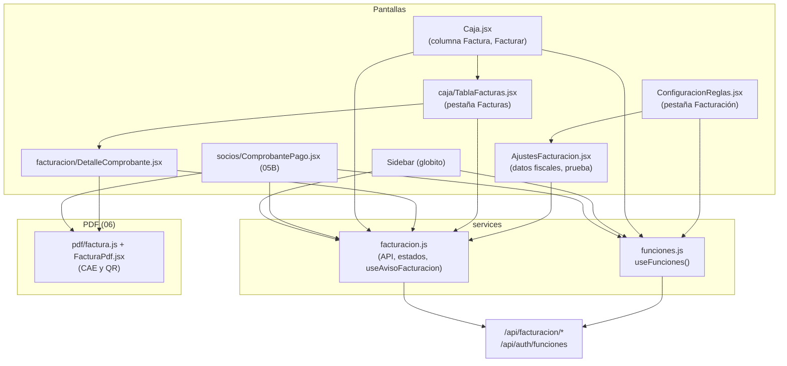

# 13B - Facturación Electrónica ARCA (Frontend)

Este documento detalla el frontend de la **factura electrónica** de **SUMMIT**: cómo se activa la sección según lo que informa el backend, la carga de los **datos fiscales** y la **prueba de conexión** con ARCA, la pestaña **Facturas** de la caja, el **detalle de un comprobante** con sus acciones (reintentar, anular con nota de crédito, facturar de nuevo), los avisos del menú y el comprobante del cobro que se convierte en factura con CAE y QR apenas ARCA la autoriza.

---

## 1. Explicación de Relaciones del Área (Arquitectura Punta a Punta)

### Flujo Integral Backend + Frontend

1. **¿Está prendida?** [`funciones.js`](../../summit-frontend/src/services/funciones.js) pide una vez por carga de página `GET /api/auth/funciones` (`{ recuperacionPorEmail, facturacion, cobroConTarjeta }`) y lo guarda en `localStorage` para arrancar con lo último que se supo. Con `facturacion` en `false`, no aparece nada de este módulo.

2. **Configuración** (Ajustes > Configuración y reglas > **Facturación**, solo ADMIN): [`AjustesFacturacion.jsx`](../../summit-frontend/src/pages/AjustesFacturacion.jsx) carga los datos fiscales del dueño, muestra el ambiente y el certificado y permite **probar la conexión** paso a paso. Al guardar los datos, las facturas que esperaban por falta de datos se mandan enseguida.

3. **Seguimiento** (Caja y Pagos > **Facturas**, ADMIN y RECEPCION): [`TablaFacturas.jsx`](../../summit-frontend/src/components/caja/TablaFacturas.jsx) lista los comprobantes por estado, avisa lo que espera a ARCA ("Mandar ahora") y lo rechazado; cada fila abre [`DetalleComprobante.jsx`](../../summit-frontend/src/components/facturacion/DetalleComprobante.jsx).

4. **En la caja**: cada cobro muestra su factura ("Factura C 00002-00000154", "Factura pendiente", tachada si se anuló) y el admin puede **Facturar** un cobro aprobado que no tiene.

5. **Comprobante del cobro**: [`ComprobantePago.jsx`](../../summit-frontend/src/components/socios/ComprobantePago.jsx) (05B) espera hasta 20 segundos la factura; si ARCA la autoriza, el PDF es la **factura con CAE y QR** (`FacturaPdf`, 06); si no, queda el comprobante común y la factura sale sola después.

6. **Avisos**: `useAvisoFacturacion` consulta cada minuto los pendientes, sin confirmar y rechazados, y los muestra como globito en el menú lateral, en la pestaña Facturas de la caja y en la pestaña Facturación de los ajustes (en rojo si hay rechazados).

### Diagrama de Arquitectura y Relaciones del Módulo

---

## 2. Análisis Detallado Archivo por Archivo

---

### 2.1. [`funciones.js`](../../summit-frontend/src/services/funciones.js)

- **Propósito**: Funciones opcionales que decide el backend: "¿Olvidaste tu contraseña?" por email, la factura electrónica (`summit.arca.habilitada`) y el cobro con tarjeta (`summit.pagos.tarjeta.modo`).

| Elemento | Lógica |
| :--- | :--- |
| `CLAVE`, `PREDETERMINADAS` | `summit.funciones` en `localStorage`; todo en `false` hasta saber. |
| `leerGuardadas()` | Lo último guardado (con `try/catch`). |
| `pedir()` | `fetch` sin sesión a `/auth/funciones` una vez por carga; si cambió, lo guarda y avisa a los oyentes; si falla, se vuelve a intentar con el próximo oyente. |
| `useFunciones()` | `useSyncExternalStore`: todos los componentes ven el mismo valor. |

### 2.2. [`facturacion.js`](../../summit-frontend/src/services/facturacion.js)

#### Llamadas a la API (con `pedirJson`, lanzan el mensaje del backend)
| Función | Ruta |
| :--- | :--- |
| `obtenerEstadoFacturacion` | `GET /facturacion/estado` |
| `obtenerDatosFiscales`, `guardarDatosFiscales` | `GET` / `PUT /facturacion/datos-fiscales` |
| `probarConexion` | `POST /facturacion/probar-conexion` |
| `listarComprobantes(estado, pagina, tamanio)` | `GET /facturacion/comprobantes` |
| `obtenerComprobante`, `comprobantesDelCobro` | Detalle y comprobantes de un cobro. |
| `facturarCobro(idPago, conDni)`, `anularFactura(id, motivo)`, `reintentarComprobante(id)`, `procesarPendientes()` | Acciones. |

#### Constantes y utilidades
| Exportación | Lógica |
| :--- | :--- |
| `ESTADOS_COMPROBANTE` | Texto y color: Pendiente, Enviándose, **Confirmando con ARCA** (incierto), Autorizada, Rechazada. |
| `AMBIENTES` | Simulador, Pruebas de ARCA (homologación) y Producción, con la explicación de su validez fiscal. |
| `CONDICIONES_IVA` | Monotributista (Factura C) y Responsable inscripto (Factura B con el IVA contenido). |
| `enCurso(estado)` | Pendiente, enviándose o incierto: ARCA todavía no dio una respuesta definitiva. |
| `nombreComprobante(c)` | "Factura C 00002-00000154" o "Factura" sola mientras no tiene número. |
| `facturaDelCobro(comprobantes)` | La última que no es nota de crédito. |
| `cuitConGuiones(cuit)` | "20-12345678-6". |
| `actualizarAvisoFacturacion()`, `useAvisoFacturacion(activo)` | Igual que el aviso de tareas (11): un único temporizador de **1 minuto** compartido, que se detiene sin oyentes; avisa solo si cambió `{ pendientes, inciertos, rechazados }`. |

---

### 2.3. [`AjustesFacturacion.jsx`](../../summit-frontend/src/pages/AjustesFacturacion.jsx)

- **Ubicación**: pestaña **Facturación** de [`ConfiguracionReglas.jsx`](../../summit-frontend/src/pages/ConfiguracionReglas.jsx) (`/ajustes/reglas?vista=facturacion`; la dirección vieja `/ajustes/facturacion` redirige), solo ADMIN y con la facturación prendida.

#### Componentes internos
- **`Tarjeta`** (con ícono y título) y **`Fila`** (etiqueta y valor).

#### Lógica
1. Al montar: `cargarEstado()` y los datos fiscales (los `null` se reemplazan por los valores vacíos de `VACIOS`).
2. **`guardar(e)`**: manda el formulario (el punto de venta como número o `null`), muestra "Datos fiscales guardados. Las facturas que esperaban se mandan ahora." y actualiza el estado y el aviso del menú. Los errores del backend (CUIT inválida, campos faltantes) se muestran tal cual.
3. **`probar()`**: muestra cada paso con ✓ o ✗ y su detalle; si todos pasan, "Todo listo para facturar."

#### JSX
- **Datos fiscales** (2/3 del ancho): CUIT (con o sin guiones), razón social, condición frente al IVA (dos tarjetas elegibles con su explicación), Ingresos Brutos, inicio de actividades, punto de venta (1 a 99998), domicilio comercial y la opción **"Facturar a nombre del socio, con su DNI"** (si no, sale a consumidor final; las cuotas están muy por debajo del monto desde el que ARCA exige identificarlo).
- **Conexión con ARCA**: aviso del ambiente si no es producción, ambiente, certificado (de mentira, CUIT y vencimiento, o el error), facturas esperando, rechazadas y las **advertencias** del backend (certificado por vencer o de otra CUIT). Aclara que el ambiente y el certificado se configuran en el servidor (`ARCA_AMBIENTE`, `ARCA_CERTIFICADO`) y remite a `FACTURACION.md`.
- **Probar conexión** con el resultado paso a paso.

### 2.4. [`TablaFacturas.jsx`](../../summit-frontend/src/components/caja/TablaFacturas.jsx)

- **Ubicación**: pestaña **Facturas** de `Caja.jsx` (solo con la facturación prendida; el globito suma rechazados e inciertos).

#### Lógica
- `useCarga`: estado de la facturación y la página de comprobantes en paralelo, con el filtro y la página; al terminar actualiza el aviso del menú.
- **Filtros**: Todas, Pendientes, Sin confirmar, Rechazadas y Autorizadas (cambiar el filtro vuelve a la primera página).
- **`mandarAhora()`**: `procesarPendientes()` y recarga a los 2,5 s.

#### JSX
- Barra con los filtros, "Datos fiscales" (solo ADMIN, lleva a los ajustes) y "Actualizar".
- Avisos: ambiente sin validez fiscal; **faltan datos fiscales** ("hasta completarlos no sale ninguna factura", con el link para el admin o "Avisale a un administrador"); facturas esperando a ARCA con el último error y **"Mandar ahora"**; rechazadas (tocar filtra por ellas).
- Tabla: fecha (o la de creación) y del cobro, comprobante y a quién (consumidor final, a nombre del socio o qué factura anula), socio, estado (con "Anulada" y el error si corresponde) y total (las notas de crédito en rojo y en negativo). Paginación con `Paginador`.

### 2.5. [`DetalleComprobante.jsx`](../../summit-frontend/src/components/facturacion/DetalleComprobante.jsx)

- **Propósito**: Lo que va impreso, la respuesta de ARCA y las acciones del admin.
- **Props**: `idComprobante`, `onClose`, `onCambio`.

#### Lógica
1. **`cargar()`** del comprobante mostrado (`mostrado` puede cambiar a la factura nueva después de "Facturar de nuevo").
2. **Espera de ARCA**: después de una acción, mientras el comprobante (o su nota de crédito) siga en curso y no pasen 20 s (`ESPERA_MS`), lo vuelve a consultar cada **1,5 s** ("Esperando a ARCA…").
3. **`documento`** (`useMemo`): el PDF de la factura (`documentoFactura`, 06) solo si está autorizada.
4. **`ejecutar(hacer)`**: corre la acción, cierra el formulario, arranca la espera y recarga (o pasa a la factura nueva); avisa a la tabla con `onCambio`.
5. **Permisos**: `puedeAnular` (ADMIN, factura autorizada sin nota de crédito) y `puedeFacturarDeNuevo` (ADMIN, factura anulada).

#### JSX
- Estado, "Anulada", "Sin validez fiscal (simulador / pruebas de ARCA)".
- El último error (rojo si fue rechazada, ámbar si espera) con el **próximo intento**.
- Datos: CAE y vencimiento, fecha de emisión, receptor, cobro (plan, método y fecha), período facturado, IVA contenido y neto (en la B), emisor, qué factura anula y su motivo, su nota de crédito y quién la pidió.
- **Respuesta de ARCA** (observaciones) y los **botones del PDF**.
- **Anular**: explica que se emite una nota de crédito por el total que **no cambia la caja ni la membresía** (si se devolvió la plata, se carga como gasto) y pide el motivo (3 a 200).
- **Facturar de nuevo**: con o sin el DNI del socio.
- **Reintentar** (rechazadas).

### 2.6. Integración en otras pantallas

| Archivo | Lógica |
| :--- | :--- |
| [`Caja.jsx`](../../summit-frontend/src/pages/Caja.jsx) (05B) | `textoFactura(f)` y `claseFactura(f)` describen la factura de cada cobro (que llega en el listado gracias a `FacturacionService.resumenes`); botón **Facturar** para un cobro aprobado sin factura (solo ADMIN); columna "Factura" en el CSV; pestaña **Facturas** solo con la facturación prendida. |
| [`ConfiguracionReglas.jsx`](../../summit-frontend/src/pages/ConfiguracionReglas.jsx) | Pestaña **Facturación** (ADMIN y facturación prendida) con el globito de rechazados e inciertos. |
| [`Sidebar.jsx`](../../summit-frontend/src/components/Sidebar.jsx) (01B) | Globito en "Caja & Pagos" con rechazados e inciertos. |
| [`ComprobantePago.jsx`](../../summit-frontend/src/components/socios/ComprobantePago.jsx) (05B) | Con la facturación prendida y el cobro aprobado, consulta la factura del cobro cada 1,5 s durante hasta 20 s: si está **autorizada**, el PDF es la factura y el mensaje de WhatsApp menciona su número y CAE; si sigue en curso, avisa que "la factura todavía no salió" y entrega el comprobante común; si fue rechazada, lo informa. |
| [`pdf/factura.js`](../../summit-frontend/src/components/pdf/factura.js) y [`FacturaPdf.jsx`](../../summit-frontend/src/components/pdf/FacturaPdf.jsx) (06) | El PDF con los datos del emisor y del receptor, el período, el CAE y el **QR de ARCA** (`qrUrl`). |
