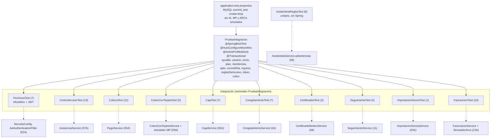

# 14A - Suite de Tests Automáticos (Backend)

Este documento detalla la **suite de tests automáticos** del backend de **SUMMIT**: 83 pruebas en 11 clases que verifican de punta a punta las reglas críticas del gimnasio (permisos, control de acceso, cobros, cobro con tarjeta, caja, congelamientos, certificados, seguimiento, importación, factura electrónica y las reglas del asistente de IA) contra un **MySQL real**, sin tocar la base de desarrollo ni llamar a servicios externos.

---

## 1. Explicación de Relaciones del Área (Arquitectura Punta a Punta)

### Flujo Integral de la Suite

1. **Ejecución**: `./mvnw.cmd test` (o `mvnw test`) dentro de `summit-backend`. Las clases de integración activan el perfil `test` y cargan [`application-test.properties`](../../summit-backend/src/test/resources/application-test.properties).

2. **Aislamiento de la base**: los tests usan una base aparte, **`summit_test`**, en el mismo MySQL que la de desarrollo (con el usuario y la contraseña de `application-local.properties`). Se crea sola (`createDatabaseIfNotExist=true`), Hibernate arma todas las tablas al empezar y las borra al terminar (`ddl-auto=create-drop`). Se usa MySQL y no una base en memoria para no ocultar diferencias de dialecto.

3. **Aislamiento entre tests**: la clase base [`PruebaIntegracion`](../../summit-backend/src/test/java/com/summit/backend/PruebaIntegracion.java) es `@Transactional`: **cada test corre en una transacción que se deshace al terminar**, así nada de lo que crea un test (socios, planes, cobros, cambios en las reglas) lo ve el siguiente.

4. **Sin salir de la PC**: sin IA (`summit.ia.habilitada=false`), sin sincronización de Mercado Pago, el cobro con tarjeta contra el **simulador de Mercado Pago** y la factura electrónica contra el **simulador de ARCA**. Las tareas programadas que dependen del tiempo (débitos, tarjetas en proceso, reintentos de ARCA) se postergan 24 horas: cada test las llama cuando las necesita. Los archivos van a `target/uploads-test`.

5. **Pruebas unitarias puras**: [`AsistenteIaReglasTest`](../../summit-backend/src/test/java/com/summit/backend/service/AsistenteIaReglasTest.java) no levanta Spring: prueba directamente la regla estática `AsistenteIaService.advertencias(...)`.

### Diagrama de Arquitectura de la Suite

---

## 2. Análisis Detallado Archivo por Archivo

---

### 2.1. [`application-test.properties`](../../summit-backend/src/test/resources/application-test.properties)

| Propiedad | Valor | Propósito |
| :--- | :--- | :--- |
| `spring.datasource.url` | `jdbc:mysql://localhost:3306/summit_test?createDatabaseIfNotExist=true...` | Base aparte que se crea sola. |
| `spring.jpa.hibernate.ddl-auto` | `create-drop` | Esquema completo al empezar, borrado al terminar. |
| `jwt.secret` | clave de prueba | Solo sirve para los tests. |
| `summit.uploads.dir` | `target/uploads-test` | Archivos (certificados, fotos, logo) fuera del proyecto real. |
| `summit.ia.habilitada` | `false` | Sin Ollama. |
| `summit.pagos.mp.sincronizar-ms` | 86400000 | Sin sincronizar débitos con Mercado Pago. |
| `summit.pagos.tarjeta.modo`, `summit.pagos.tarjeta.revisar-ms` | `SIMULADOR`, 86400000 | Tarjeta contra el simulador; la revisión de los pagos en proceso la llama cada test. |
| `summit.arca.habilitada`, `summit.arca.ambiente`, `summit.arca.reintentos-ms` | `true`, `SIMULADOR`, 86400000 | Factura contra el simulador de ARCA; cada test procesa la cola cuando quiere. |
| `logging.level.*` | `WARN` / `ERROR` | Salida limpia (el aviso de `create-drop` sobre un esquema inexistente no es un error). |

### 2.2. [`PruebaIntegracion.java`](../../summit-backend/src/test/java/com/summit/backend/PruebaIntegracion.java)

- **Anotaciones**: `@SpringBootTest`, `@AutoConfigureMockMvc`, `@ActiveProfiles("test")`, `@Transactional`.
- **Inyecta**: `MockMvc`, los repositorios de usuarios, planes, suscripciones, asistencias, certificados y configuración, `ConfiguracionAccesoService`, `JwtTokenProvider` y `PasswordEncoder`.

| Ayuda | Lógica |
| :--- | :--- |
| `usuario(Rol)` | Usuario activo con contraseña `Prueba123` ya elegida, y DNI, email y teléfono únicos (contador `AtomicInteger NUMERO`). |
| `socio()` | Un usuario `SOCIO`. |
| `plan(precio, vecesPorSemana)` | Plan de 30 días (`null` = pase libre). |
| `membresia(socio, plan, vence)` | Suscripción activa de 30 días hasta esa fecha. |
| `apto(socio, vence, estado)` | Certificado médico con ese vencimiento y estado. |
| `socioAlDia()` | Cuota (20 días) y apto (200 días) al día, pase libre. |
| `ingreso(socio, cuando)` | Un ingreso permitido por molinete. |
| `reglasDeAcceso(cambio)` | Cambia la configuración de acceso solo para ese test. |
| `token(usuario)` | `"Bearer " + JWT` para llamar a la API. |
| `cobro(socio, plan, totalMostrado)` | Pedido de cobro en efectivo con el total que vio recepción. |

---

### 2.3. Clases de test

#### [`PermisosTest`](../../summit-backend/src/test/java/com/summit/backend/PermisosTest.java) (7) — permisos por rol y por estado de la cuenta, llamando a la API con `MockMvc`
| Test | Verifica |
| :--- | :--- |
| `sinSesionLaApiResponde401` | Sin token, `401`. |
| `elProfesorVeLosSociosPeroNoCobraNiVeLaCaja` | Ve socios; no cobra, ni ve la caja ni el seguimiento (`403`). |
| `recepcionCobraYVeLaCajaPeroNoCambiaReglasNiImporta` | Ve la caja y las reglas; no las cambia, no borra descuentos, no importa socios ni verifica pagos. |
| `elAdminCambiaLasReglasDeMembresia` | `PUT /api/configuracion/membresias` responde `200`. |
| `unSocioNoEntraAlSistema` | El login de un `SOCIO` responde "Credenciales inválidas": el sistema es solo para el personal. |
| `conUnaContrasenaTemporalPrimeroTieneQueCambiarla` | `403` con `codigo: CAMBIAR_PASSWORD`. |
| `unaCuentaDadaDeBajaPierdeLaSesion` | Un token de una cuenta dada de baja deja de valer al instante. |

#### [`ControlAccesoTest`](../../summit-backend/src/test/java/com/summit/backend/service/ControlAccesoTest.java) (13) — reglas de ingreso de `AsistenciaService`
Con la configuración por defecto (se exigen cuota y apto, 3 días de gracia para la cuota y 7 para el apto, sin excepciones): entra con todo al día; no entra sin membresía; con la cuota vencida **dentro** de la gracia entra con aviso y **fuera** no; con el apto vencido no entra ni con excepción; con el apto rechazado no entra; sin días del plan en la semana no entra; volver el mismo día no descuenta otro día; con excepciones habilitadas recepción lo deja pasar con la cuota vencida y sin habilitarlas no; una cuenta dada de baja no entra; con la membresía congelada no entra hasta que termina; el personal no pasa por los controles de socio.

#### [`CobrosTest`](../../summit-backend/src/test/java/com/summit/backend/service/CobrosTest.java) (12) — `PagoService`
Solo un cobro **aprobado** extiende la membresía, y desde el vencimiento actual; uno a verificar no la extiende hasta que el admin lo aprueba; uno rechazado no la extiende; el efectivo no puede quedar a verificar; el total es **plan − descuento + matrícula** (sin matrícula si ya tiene membresía); la matrícula se puede bonificar; si el total cambió (o falta el que vio recepción) no se cobra nada; la matrícula vuelve a cobrarse después de mucho tiempo sin cuota; la lista de socios marca el cobro a verificar hasta que se confirma; un cobro a verificar olvidado no frena el siguiente; un débito automático no se carga a mano.

#### [`CobroConTarjetaTest`](../../summit-backend/src/test/java/com/summit/backend/service/CobroConTarjetaTest.java) (5) — `CobroConTarjetaService` contra el simulador de Mercado Pago
El **titular de la tarjeta de prueba** decide el resultado, como en Mercado Pago (`APRO` aprueba, `CONT` queda en proceso, `FUND` rechaza): una aprobada registra el cobro y extiende la membresía; una rechazada no registra nada; un pago en proceso queda a verificar y se confirma solo cuando se acredita; **el mismo intento repetido no cobra dos veces** (clave de idempotencia); si cambió el total no se llega a cobrar.

#### [`CajaTest`](../../summit-backend/src/test/java/com/summit/backend/service/CajaTest.java) (7) — `CajaService`
El efectivo esperado es **fondo + cobros en efectivo − gastos en efectivo**; un gasto en efectivo no puede superar lo que hay en la caja (por transferencia no importa); un gasto que pagó el dueño no sale de la caja pero suma en los gastos del día; un gasto anulado no cuenta; con diferencia el cierre pide una observación; al cerrar queda el fondo para el turno siguiente; no se retira más efectivo del que hay.

#### [`CongelamientoTest`](../../summit-backend/src/test/java/com/summit/backend/service/CongelamientoTest.java) (7) — `CongelamientoService`
Con las reglas por defecto (7 días o más y hasta 30 por año): congelar corre el vencimiento esos días; no se congela para atrás ni menos del mínimo; dos congelamientos no se superponen; no se pasa del máximo por año (cuenta por el año en que empieza cada uno); si la membresía vence antes de empezar no se congela; anular uno programado devuelve todos los días; si vuelve antes se descuentan solo los días que usó.

#### [`CertificadosTest`](../../summit-backend/src/test/java/com/summit/backend/service/CertificadosTest.java) (3) — `CertificadoMedicoService`
Vale **365 días** desde la emisión (Ley 5397); no se carga con fecha futura ni ya vencido; uno rechazado deja de habilitar el ingreso.

#### [`SeguimientoTest`](../../summit-backend/src/test/java/com/summit/backend/service/SeguimientoTest.java) (4) — `SeguimientoService`
Un socio al día que hace 20 días que no viene es **alerta media**; quien vino esta semana no aparece; la tarea de inactividad no se duplica y se resuelve sola cuando vuelve; la cuota por vencer no genera tarea y la vencida se resuelve sola cuando renueva.

#### [`ImportacionSociosTest`](../../summit-backend/src/test/java/com/summit/backend/service/ImportacionSociosTest.java) (1) — `ImportacionSociosService`
`importaCadaFilaPorSeparado`: una planilla de 5 filas da `CREADO` (con la membresía hasta la fecha de la planilla), `EXISTE` (al que ya estaba no se le cambia nada), `ERROR` (email inválido), `CREADO` con aviso (el plan no existe) y `ERROR` (DNI repetido en la planilla).

#### [`FacturacionTest`](../../summit-backend/src/test/java/com/summit/backend/service/FacturacionTest.java) (16) — `FacturacionService` contra el simulador de ARCA
- `@BeforeEach simuladorDeCero()`: reinicia el simulador. Ayudas: `datosFiscales`, `cobrar`, `procesar` (procesa la cola y devuelve el comprobante).
- **Emisión**: un cobro sale con **Factura C** y el QR de ARCA (no se factura dos veces; el período es la membresía pagada); con responsable inscripto sale **Factura B** con el IVA contenido (el simulador valida el 21 %); un cobro a verificar se factura recién al aprobarse; un cobro sin monto no se factura; sin datos fiscales la factura espera y sale al completarlos.
- **Cortes y rechazos** (con `simulador.fallar(...)`): si se pierde la respuesta se le pregunta a ARCA y **no se duplica el número**; si el pedido no llegó vuelve a salir con el mismo número; con ARCA caído (o un error interno) espera **sin gastar número**; un rechazo no gasta el número y se puede reintentar.
- **Anulación**: se anula con una nota de crédito de la misma letra; un cobro con la factura anulada se vuelve a facturar con el DNI; con "identificar socio" sale con su DNI si es válido.
- **Varios**: si ARCA desconoce el permiso de acceso se pide otro; el estado y la prueba de conexión con el simulador; la CUIT se valida con su dígito verificador (con guiones y espacios se acepta y se guarda sin ellos); recepción ve las facturas pero solo el admin carga los datos y anula (`MockMvc`).

#### [`AsistenteIaReglasTest`](../../summit-backend/src/test/java/com/summit/backend/service/AsistenteIaReglasTest.java) (8) — reglas exactas de `AsistenteIaService.advertencias`
Un certificado en regla no tiene advertencias; el DNI se compara solo por los números; avisa si es de otra persona; si no se leyó el DNI no acusa en falso; avisa si dice que no está apto; avisa si tiene más de un año; distingue una fecha futura de una que no existe; pide la matrícula del médico con número.
