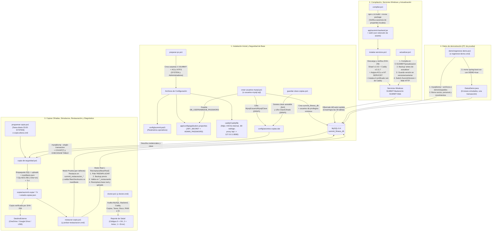

# 14B - Scripts de Instalación, Backups Cifrados y Base de Datos

---

## 1. Arquitectura de Despliegue, Seguridad Operativa, Copias de Seguridad y Base de Datos

El ecosistema de instalación, operación en producción, respaldo cifrado y persistencia de datos de **SUMMIT** está diseñado bajo los principios de **privilegios mínimos**, **defensa en profundidad**, **actualización sin tiempo de inactividad durante la compilación**, **inmutabilidad criptográfica de respaldos** y **verificación matemática de restauraciones**. Todos los artefactos de la carpeta [`instalacion/`](../../instalacion) interactúan con el esquema relacional documentado en [`docs/base-de-datos/`](../base-de-datos) y las guías operativas de la raíz ([`INSTALACION.md`](../../INSTALACION.md), [`FACTURACION.md`](../../FACTURACION.md) y [`README.md`](../../README.md)).

### 1.1. Interacción de Componentes y Flujo Conjunto

1. **Biblioteca Base Compartida ([`comun.ps1`](../../instalacion/comun.ps1))**:
   - Actúa como el núcleo de soporte para todos los scripts PowerShell (`.ps1`). Ningún script operativo implementa por su cuenta el parseo seguro de configuración, el manejo de ACLs de NTFS, el cifrado DPAPI (`ProtectedData` con alcance `LocalMachine` y entropía personalizada), la invocación de procesos sin filtración de contraseñas ni BOM en `stdin`, o la generación criptográfica de contraseñas sin sesgo de módulo (*rejection sampling*).
2. **Preparación del Entorno y Plantillas ([`preparar-pc.ps1`](../../instalacion/preparar-pc.ps1), [`summit.psd1`](../../instalacion/plantillas/summit.psd1), [`application.properties`](../../instalacion/plantillas/application.properties), [`Caddyfile`](../../instalacion/plantillas/Caddyfile))**:
   - [`preparar-pc.ps1`](../../instalacion/preparar-pc.ps1) construye el árbol de directorios en `C:\SUMMIT`, blinda las carpetas sensibles (`app\config`, `caddy\datos`, `config`, `datos`, `copias`, `logs`, `restauraciones`, `versiones`) cortando la herencia NTFS y otorgando control total exclusivamente a `SYSTEM` (`S-1-5-18`) y `Administradores` (`S-1-5-32-544`), copia los scripts e inicializa los tres archivos de configuración a partir de sus plantillas, inyectando un `JWT_SECRET` aleatorio de 512 bits (64 bytes en Base64) y un `ADMIN_PASSWORD` inicial aleatorio de 12 caracteres.
3. **Aislamiento de Base de Datos y Usuarios de Privilegios Mínimos ([`crear-usuarios-mysql.ps1`](../../instalacion/crear-usuarios-mysql.ps1), [`usuarios-mysql.sql`](../../instalacion/usuarios-mysql.sql), [`01-modelo-entidad-relacion.md`](../base-de-datos/01-modelo-entidad-relacion.md), [`02-modelo-logico.md`](../base-de-datos/02-modelo-logico.md), [`03-creacion-summit.sql`](../base-de-datos/03-creacion-summit.sql))**:
   - En producción jamás se utiliza `root`. [`crear-usuarios-mysql.ps1`](../../instalacion/crear-usuarios-mysql.ps1) solicita por única vez las credenciales de `root` (sin persistirlas), crea el esquema `summit_fitness_db` con `utf8mb4` / `utf8mb4_0900_ai_ci`, y provisiona dos cuentas locales restringidas a `@'localhost'`:
     - **`summit_app`**: Tiene `SELECT, INSERT, UPDATE, DELETE, CREATE, ALTER, INDEX, REFERENCES` sobre `summit_fitness_db.*` (permitiendo que Hibernate ejecute `ddl-auto=update` al iniciar y cree/actualice las 30 tablas del modelo lógico, pero **sin permiso `DROP`**, impidiendo el borrado de tablas o de la base ante cualquier eventual vulnerabilidad). Su clave de 32 caracteres se guarda en `C:\SUMMIT\app\config\application.properties`.
     - **`summit_copias`**: Tiene exclusivamente permisos de lectura (`SELECT, SHOW VIEW, TRIGGER, EVENT` sobre `summit_fitness_db.*` y `SHOW_ROUTINE` global) diseñados a medida para `mysqldump --single-transaction --skip-lock-tables --routines --events --triggers --no-tablespaces`. Su clave de 32 caracteres se cifra con DPAPI en `C:\SUMMIT\config\secretos-copias.dat`.
4. **Compilación, Servicios Windows y Proxy Inverso Caddy ([`compilar.ps1`](../../instalacion/compilar.ps1), [`instalar-servicios.ps1`](../../instalacion/instalar-servicios.ps1), [`actualizar.ps1`](../../instalacion/actualizar.ps1))**:
   - [`compilar.ps1`](../../instalacion/compilar.ps1) empaqueta el frontend React/Vite (`npm ci` + `npm run build`) y el backend Spring Boot (`mvnw clean package -DskipTests`), verificando mediante inspección del ZIP del `.jar` que no se haya filtrado ningún archivo `application-local.properties` dentro del artefacto, y despliega los archivos conservando los `/assets/*` de los últimos 30 días (`Copy-SummitWeb`) para no romper pestañas abiertas en navegadores de recepción.
   - [`instalar-servicios.ps1`](../../instalacion/instalar-servicios.ps1) descarga versiones fijas de **Shawl v1.9.0** y **Caddy v2.11.7**, valida criptográficamente su hash SHA-256 contra constantes fijadas en código, registra los servicios `SUMMIT-Backend` y `SUMMIT-Web` bajo cuentas virtuales aisladas (`NT SERVICE\SUMMIT-Backend` y `NT SERVICE\SUMMIT-Web`) y les otorga por `icacls.exe` únicamente los permisos estrictos que cada servicio necesita (`RX` o `M` en subcarpetas específicas; jamás acceso a `copias\` ni a `secretos-copias.dat`).
   - **Caddy (`SUMMIT-Web`)** expone un único punto de entrada en la red local, **siempre con HTTPS** (`tls internal`: Caddy crea su propia autoridad de certificados y los renueva solo; quien entra por `http://` pasa a `https://`), sirve los estáticos de `C:\SUMMIT\web` y actúa como proxy inverso de `/api/*` hacia `127.0.0.1:8080`, mientras que Spring Boot (`SUMMIT-Backend`) escucha exclusivamente en loopback (`server.address=127.0.0.1`). Así las contraseñas y las sesiones viajan cifradas por la red del gimnasio (un socio conectado al WiFi no puede leerlas) y el cobro con tarjeta, que exige HTTPS, funciona desde cualquier PC de recepción. `instalar-servicios.ps1` instala el certificado raíz de Caddy en la PC del servidor y lo deja en `C:\SUMMIT\certificado-summit.crt` para instalarlo en cada PC de recepción (INSTALACION.md, paso 8).
   - [`actualizar.ps1`](../../instalacion/actualizar.ps1) orquesta actualizaciones en caliente: compila en un directorio paralelo (`C:\SUMMIT\actualizacion`) mientras el gimnasio sigue operando, dispara una copia de seguridad etiquetada `antes-de-actualizar`, respalda los binarios previos en `C:\SUMMIT\versiones\anterior`, intercambia la versión deteniendo brevemente el servicio, verifica que el endpoint HTTP responda y ejecuta el diagnóstico general (`doctor.ps1`), permitiendo además rollback inmediato con `-VolverAtras`.
5. **Subsistema de Copias de Seguridad Cifradas, Restauración Verificada y Diagnóstico ([`guardar-clave-copias.ps1`](../../instalacion/guardar-clave-copias.ps1), [`copia-de-seguridad.ps1`](../../instalacion/copia-de-seguridad.ps1), [`copia-ahora.cmd`](../../instalacion/copia-ahora.cmd), [`programar-copia.ps1`](../../instalacion/programar-copia.ps1), [`restaurar-copia.ps1`](../../instalacion/restaurar-copia.ps1), [`probar-restauracion.cmd`](../../instalacion/probar-restauracion.cmd), [`doctor.ps1`](../../instalacion/doctor.ps1), [`doctor.cmd`](../../instalacion/doctor.cmd))**:
   - [`guardar-clave-copias.ps1`](../../instalacion/guardar-clave-copias.ps1) genera una clave anotable en papel de 6 grupos de 4 caracteres no ambiguos (`ABCDEFGHJKMNPQRSTUVWXYZ23456789`), exige confirmación interactiva para garantizar que fue escrita en papel fuera de la PC, y la almacena en `secretos-copias.dat` cifrada con DPAPI.
   - [`copia-de-seguridad.ps1`](../../instalacion/copia-de-seguridad.ps1) captura conteos exactos (`COUNT(*)`) y huellas (`CHECKSUM TABLE`) antes y después de ejecutar `mysqldump --single-transaction`, genera un `manifiesto.json` con el hash SHA-256 del SQL y metadatos de `uploads`, empaqueta y cifra todo con 7-Zip usando AES-256 y cifrado de encabezados (`-mhe=on`), verifica la integridad del `.7z` con `7z t`, replica el archivo a un destino externo (`DestinoExterno`: OneDrive, Google Drive o USB) validando su SHA-256, purga copias antiguas respetando `DiasRetencion` y `CopiasMinimas`, y deja telemetría en `estado-copias.json`.
   - [`restaurar-copia.ps1`](../../instalacion/restaurar-copia.ps1) trabaja por defecto en **modo simulacro no destructivo**: extrae el `.7z`, comprueba el SHA-256 del `.sql` y el conteo/tamaño de `uploads`, restaura en una base aislada `summit_restauracion_AAAAMMDD_HHMMSS` y contrasta tabla por tabla filas y `CHECKSUM TABLE` contra `manifiesto.json`. En modo real (`-ReemplazarBaseReal`), exige tipear `REEMPLAZAR`, frena el backend, toma un backup previo (`antes-de-restaurar`), valida primero en una base temporal `summit_fitness_db_restaurando` antes de tocar producción, y recién entonces reemplaza la base real y los `uploads` (conservando la carpeta anterior renombrada).
   - [`doctor.ps1`](../../instalacion/doctor.ps1) audita de punta a punta MySQL (servicio, puerto TCP y que no escuche en `0.0.0.0`), Backend, ruta de `java.exe`, Caddy y proxy `/api`, antigüedad y estado de copias locales y externas, legibilidad de `secretos-copias.dat`, tarea programada en Windows Task Scheduler, espacio libre en discos y disponibilidad de RAM/Ollama.
6. **Datos de Demostración ([`demo/regenerar-demo.ps1`](../../demo/regenerar-demo.ps1) y [`DatosDemo.java`](../../summit-backend/src/main/java/com/summit/backend/config/DatosDemo.java))**:
   - Para una PC de prueba (por ejemplo, la de la defensa): respalda la base y los archivos en `demo\respaldos`, borra socios, personal y movimientos, y arranca el backend con `DEMO=true`, que simula **6 meses de gimnasio que terminan hoy** (80 socios, 7 empleados, cobros, ingresos, gastos y cierres de caja) en una sola transacción y solo si la base no tiene socios.

### 1.2. Diagrama Mermaid del Flujo Integral



---

## 2. Análisis Detallado de Scripts y Plantillas de Instalación (`instalacion/`)

---

### 2.1. [`instalacion/comun.ps1`](../../instalacion/comun.ps1)

#### Propósito e Interacciones
Es la librería central de funciones compartidas de SUMMIT para Windows PowerShell 5.1. No se ejecuta de forma independiente, sino que es importada mediante *dot-sourcing* (`. (Join-Path $PSScriptRoot 'comun.ps1')`) al inicio de todos los demás scripts PowerShell del directorio: [`crear-usuarios-mysql.ps1`](../../instalacion/crear-usuarios-mysql.ps1), [`preparar-pc.ps1`](../../instalacion/preparar-pc.ps1), [`compilar.ps1`](../../instalacion/compilar.ps1), [`instalar-servicios.ps1`](../../instalacion/instalar-servicios.ps1), [`actualizar.ps1`](../../instalacion/actualizar.ps1), [`guardar-clave-copias.ps1`](../../instalacion/guardar-clave-copias.ps1), [`copia-de-seguridad.ps1`](../../instalacion/copia-de-seguridad.ps1), [`programar-copia.ps1`](../../instalacion/programar-copia.ps1), [`restaurar-copia.ps1`](../../instalacion/restaurar-copia.ps1) y [`doctor.ps1`](../../instalacion/doctor.ps1).

#### Variables Globales de Script y Configuración Inicial (Líneas 5–18)
- `$ErrorActionPreference = 'Stop'`: Fuerza a que cualquier error no terminante de PowerShell se convierta en una excepción terminante (`try/catch`), evitando que un script continúe ejecutándose en un estado inconsistente tras un fallo.
- `Add-Type -AssemblyName System.Security`: Carga en memoria el ensamblado `.NET` `System.Security`, necesario para utilizar `[Security.Cryptography.ProtectedData]` (DPAPI de Windows).
- `$script:SummitVersionScripts = '1.0'`: Constante de versión de la suite de scripts que se estampa en los registros (`copias.log`) y en el `manifiesto.json` de cada copia de seguridad para trazabilidad.
- `$script:SummitEntropia = [Text.Encoding]::UTF8.GetBytes('SUMMIT-secretos-copias-v1')`: Arreglo de bytes ("sal" / entropía adicional para DPAPI) que asegura que ningún otro programa ejecutándose en la misma máquina pueda descifrar `secretos-copias.dat` salvo que conozca exactamente esta cadena de entropía.
- `$script:SummitArchivoRegistro = $null`: Almacena la ruta absoluta del archivo de log activo (configurado por `Start-SummitRegistro`) donde `Write-SummitRegistro` volcará los mensajes.
- `$script:SummitUtf8SinBom = New-Object System.Text.UTF8Encoding($false)`: Instancia de codificación UTF-8 sin marca de orden de bytes (BOM). Se creó para escribir archivos `.properties`, `.cnf`, `.json`, logs y flujos `stdin` sin los bytes `0xEF 0xBB 0xBF` que romperían el parseo de la primera línea en Spring Boot, MySQL o la contraseña leída por 7-Zip.
- `$script:SidSistema = 'S-1-5-18'`: Identificador de seguridad (SID) universal de la cuenta local `NT AUTHORITY\SYSTEM`. Se usa en lugar del nombre textual porque los nombres de grupos cambian según el idioma de Windows.
- `$script:SidAdministradores = 'S-1-5-32-544'`: SID universal del grupo local `Administradores` (`BUILTIN\Administrators`).
- `$script:SidUsuarios = 'S-1-5-32-545'`: SID universal del grupo local `Usuarios` (`BUILTIN\Users`).

#### Análisis Función por Función

##### 1. [`Test-SummitAdministrador`](../../instalacion/comun.ps1#L23-L26)
- **Parámetros**: Ninguno.
- **Variables locales**:
  - `$identidad`: Objeto `WindowsIdentity` del proceso actual obtenido mediante `[Security.Principal.WindowsIdentity]::GetCurrent()`.
- **Propósito**: Devuelve `$true` si la sesión actual de PowerShell se está ejecutando con privilegios elevados de Administrador, o `$false` en caso contrario, evaluando `IsInRole([Security.Principal.WindowsBuiltInRole]::Administrator)`.

##### 2. [`Assert-SummitAdministrador`](../../instalacion/comun.ps1#L28-L33)
- **Parámetros**:
  - `[string]$Para = 'esto'`: Descripción de la acción que requiere privilegios elevados para incluirla en el mensaje de error.
- **Estructuras de control**:
  - `if (-not (Test-SummitAdministrador))` (línea 30): Evalúa si la consola actual no tiene permisos de administrador. Está ahí para abortar inmediatamente operaciones críticas de sistema (instalar servicios, detener servicios en actualización, programar tareas `SYSTEM`) con una instrucción clara al usuario de cómo abrir PowerShell como administrador.

##### 3. [`Start-SummitComoAdministrador`](../../instalacion/comun.ps1#L37-L48)
- **Parámetros**:
  - `[Parameter(Mandatory)][string]$Script`: Ruta del script `.ps1` que debe relanzarse con elevación UAC.
  - `[Collections.IDictionary]$Parametros = @{}`: Diccionario (`$PSBoundParameters`) con los parámetros recibidos originalmente por el script.
- **Variables locales**:
  - `$lista`: Arreglo de argumentos para `powershell.exe`, inicializado con `-NoProfile -ExecutionPolicy Bypass -File "<Script>"`.
  - `$clave`, `$valor`: Variables de iteración sobre el diccionario de parámetros.
- **Estructuras de control**:
  - `foreach ($clave in $Parametros.Keys)` (línea 40): Recorre cada parámetro pasado al script original para reenviarlo al nuevo proceso elevado.
    - `if (@('Elevar', 'Pausa') -contains $clave) { continue }` (línea 42): Filtra los switches `-Elevar` (para evitar un bucle infinito de re-elevación) y `-Pausa` (porque `-Pausa` se agrega siempre explícitamente al final en la línea 46).
    - `if ($valor -is [Management.Automation.SwitchParameter])` (línea 43): Evalúa si el parámetro es un `switch`. Adentro tiene `if ($valor.IsPresent) { $lista += "-$clave" }` para agregar el flag solo si estaba activo, y hace `continue`.
    - `if ($valor -is [string] -or $valor -is [int])` (línea 44): Evalúa si el parámetro es texto o entero para agregarlo como par `-$clave` y su valor escapado con `ConvertTo-SummitArgumento`.
- **Ejecución final**: Agrega `-Pausa` a `$lista` (para que la nueva ventana de consola que abre Windows con `-Verb RunAs` no se cierre sola al finalizar) e invoca `Start-Process -FilePath 'powershell.exe' -Verb RunAs`.

##### 4. [`New-SummitConfigBase`](../../instalacion/comun.ps1#L54-L83)
- **Parámetros**:
  - `[string]$Raiz = 'C:\SUMMIT'`: Carpeta raíz a partir de la cual se calculan todas las subrutas por defecto.
- **Propósito**: Devuelve un diccionario ordenado (`[ordered]@{...}`) con las 25 claves de configuración por defecto del sistema (`Raiz`, `MysqlBin`, `MysqlServidor`, `MysqlPuerto`, `MysqlServicio`, `Base`, `CarpetaUploads`, `CarpetaCopias`, `DiasRetencion`, `CopiasMinimas`, `DestinoExterno`, `DiasRetencionExterno`, `SieteZip`, `ArchivoSecretos`, `CarpetaRegistros`, `CarpetaRestauraciones`, `HorasAvisoCopia`, `EspacioMinimoGB`, `ServicioBackend`, `ServicioWeb`, `UrlBackend`, `UrlWeb`, `TareaCopia`, `UrlOllama`, `ModeloIa`). Sirve como base de valores predeterminados y como lista blanca de claves válidas al leer `summit.psd1`.

##### 5. [`Get-SummitRutaConfig`](../../instalacion/comun.ps1#L85-L93)
- **Parámetros**:
  - `[string]$Ruta`: Ruta explícita pasada por parámetro `-Config` a un script.
- **Variables locales**:
  - `$junto`: Ruta calculada subiendo un nivel desde `$PSScriptRoot` y entrando a `config\summit.psd1` (útil cuando el script corre desde `C:\SUMMIT\scripts\`).
- **Estructuras de control**:
  - `if ($Ruta) { return $Ruta }` (línea 87): Prioridad 1: si se especificó `-Config` por parámetro, usa esa ruta.
  - `if ($env:SUMMIT_CONFIG) { return $env:SUMMIT_CONFIG }` (línea 88): Prioridad 2: si existe la variable de entorno `SUMMIT_CONFIG` (útil en pruebas automatizadas), usa su valor.
  - `if (Test-Path -LiteralPath $junto) { return $junto }` (línea 91): Prioridad 3: si existe `..\config\summit.psd1` relativo a la carpeta del script, lo devuelve.
  - Si ninguna condición se cumple, retorna `'C:\SUMMIT\config\summit.psd1'`.

##### 6. [`Read-SummitConfig`](../../instalacion/comun.ps1#L97-L134)
- **Parámetros**:
  - `[string]$Ruta`: Ruta opcional al archivo `.psd1`.
  - `[switch]$Opcional`: Indica que si el archivo no existe no debe lanzar excepción sino devolver la configuración por defecto (usado por `doctor.ps1` y `restaurar-copia.ps1`).
- **Variables locales**:
  - `$cfg`: Diccionario de configuración resultante.
  - `$texto`: Contenido UTF-8 del archivo `summit.psd1`.
  - `$tokens`, `$errores`: Arreglos de salida del parser AST de PowerShell.
  - `$ast`: Árbol sintáctico abstracto generado por `[Management.Automation.Language.Parser]::ParseInput`.
  - `$tabla`: Nodo `HashtableAst` encontrado dentro del AST.
  - `$datos`: Hashtable evaluada de forma segura (`SafeGetValue()`).
  - `$raiz`: Valor de `Raiz` extraído de `$datos` (o `'C:\SUMMIT'` por defecto).
  - `$clave`: Variable de iteración sobre las claves definidas en el archivo.
- **Estructuras de control**:
  - `if (-not (Test-Path -LiteralPath $Ruta))` (línea 100): Verifica si el archivo de configuración no existe.
    - `if ($Opcional)` (línea 101): Si es opcional, crea una configuración por defecto con `New-SummitConfigBase`, asigna `$cfg.RutaConfig = $null` para que el llamador sepa que no había archivo en disco, y la retorna. Si no es opcional, lanza `throw` indicando ejecutar `preparar-pc.ps1`.
  - `if ($errores -and $errores.Count -gt 0)` (línea 112): Evalúa si el parser sintáctico encontró errores en `summit.psd1`. Está ahí para informar al usuario exactamente el número de línea (`StartLineNumber`) donde cometió un error al editar con el Bloc de notas.
  - `if (-not $tabla)` (línea 116): Verifica que el archivo contenga una estructura `@{ ... }`. Si no, lanza error de formato.
  - `try { $datos = $tabla.SafeGetValue() } catch { ... }` (líneas 117–121): Evalúa de forma estática la tabla AST mediante `SafeGetValue()`. Está ahí por seguridad: impide la ejecución de código arbitrario dentro de `summit.psd1` (solo acepta literales de texto y números), superando además la limitación de `Import-PowerShellDataFile` en PowerShell 5.1 cuando un archivo UTF-8 no tiene BOM.
  - `if ($datos.ContainsKey('Raiz') -and $datos['Raiz'])` (línea 123): Si el usuario personalizó `Raiz` en `summit.psd1`, la extrae primero para llamar a `New-SummitConfigBase -Raiz $raiz` y que todas las rutas derivadas (`CarpetaCopias`, `CarpetaRegistros`, etc.) se calculen sobre la nueva raíz.
  - `foreach ($clave in $datos.Keys)` (línea 125): Recorre cada clave escrita en `summit.psd1`.
    - `if (-not $cfg.Contains($clave))` (línea 126): Verifica si el usuario escribió una clave desconocida o con error de tipeo; emite un `Write-Warning` y hace `continue` para ignorarla sin romper la ejecución.

##### 7. [`Assert-SummitNombreBase`](../../instalacion/comun.ps1#L136-L144)
- **Parámetros**:
  - `[string]$Nombre`: Nombre de la base de datos MySQL a validar.
- **Estructuras de control**:
  - `if ($Nombre -notmatch '^[A-Za-z0-9_]{1,64}$')` (línea 138): Valida por expresión regular que el identificador solo contenga caracteres alfanuméricos ASCII y guiones bajos (1 a 64 caracteres). Sirve para prevenir inyección SQL en sentencias DDL (`CREATE DATABASE`, `DROP DATABASE`, `GRANT`) donde MySQL no admite parámetros preparados.
  - `if (@('mysql', 'sys', 'information_schema', 'performance_schema') -contains $Nombre.ToLowerInvariant())` (línea 141): Bloquea que por error se configure una base interna del motor MySQL como base de SUMMIT, evitando su destrucción durante una restauración.

##### 8. [`Get-SummitReglasPrivadas`](../../instalacion/comun.ps1#L153-L161)
- **Parámetros**:
  - `[switch]$UsuarioActual`: Fuerza a incluir el SID del usuario actual en la lista de control de acceso.
  - `[string[]]$Extra = @()`: Cuentas adicionales a las que se les otorgará permiso `Modify`.
- **Variables locales**:
  - `$reglas`: Arreglo de pares `@(SID/Cuenta, Permiso)`, inicializado con `FullControl` para `SYSTEM` y `Administradores`.
  - `$cuenta`: Variable de iteración sobre `$Extra`.
- **Estructuras de control**:
  - `if ($UsuarioActual -or -not (Test-SummitAdministrador))` (línea 156): Agrega `FullControl` para el usuario actual si el script corre sin privilegios de administrador (de lo contrario, el propio proceso perdería acceso al archivo que acaba de crear) o si se pidió explícitamente `-UsuarioActual` (necesario cuando un proceso hijo como `mysql.exe` o `mysqldump.exe`, corriendo bajo el usuario actual, debe leer un archivo temporal `.cnf`).
  - `foreach ($cuenta in $Extra)` (línea 159): Agrega cada cuenta extra con permiso `Modify`.

##### 9. [`Set-SummitAcl`](../../instalacion/comun.ps1#L166-L184)
- **Parámetros**:
  - `[Parameter(Mandatory)][string]$Ruta`: Ruta del archivo o directorio cuyos permisos NTFS se reemplazarán.
  - `[Parameter(Mandatory)][object[]]$Reglas`: Arreglo de tuplas `@(cuenta, permiso)`.
- **Variables locales**:
  - `$esCarpeta`: Booleano que indica si `$Ruta` es un directorio.
  - `$acl`: Objeto `DirectorySecurity` o `FileSecurity`.
  - `$herencia`: Flags de herencia (`None` para archivos, `ContainerInherit, ObjectInherit` para carpetas).
  - `$regla`, `$cuenta`, `$id`, `$permiso`: Variables para construir cada `FileSystemAccessRule`.
- **Estructuras de control**:
  - `if ($esCarpeta) { ... } else { ... }` (línea 169): Instancia `DirectorySecurity` o `FileSecurity` según el tipo de objeto en el sistema de archivos (usando las clases `.NET` `[IO.Directory]` / `[IO.File]` en lugar de `Set-Acl` de PowerShell 5.1, que falla con ciertos propietarios).
  - `$acl.SetAccessRuleProtection($true, $false)` (línea 170): Deshabilita la herencia de permisos de la carpeta padre (`$true`) y elimina cualquier permiso heredado previo (`$false`).
  - `if ($esCarpeta)` (línea 172): Activa `ContainerInherit, ObjectInherit` para que todo subdirectorio y archivo creado dentro herede automáticamente estos permisos privados.
  - `foreach ($regla in $Reglas)` (línea 173): Recorre cada regla solicitada.
    - `if ($cuenta -match '^S-1-') { ... } else { ... }` (líneas 175–179): Si la cuenta empieza con `S-1-`, crea directamente un `SecurityIdentifier`; si es un nombre (como `NT SERVICE\SUMMIT-Backend`), lo traduce a SID mediante `NTAccount.Translate`.
  - `if ($esCarpeta) { [IO.Directory]::SetAccessControl(...) } else { [IO.File]::SetAccessControl(...) }` (línea 183): Aplica la ACL al directorio o archivo en disco.

##### 10. [`New-SummitCarpetaPrivada`](../../instalacion/comun.ps1#L186-L190)
- **Parámetros**:
  - `[Parameter(Mandatory)][string]$Ruta`: Ruta de la carpeta a crear y blindar.
  - `[switch]$UsuarioActual`: Pasa el switch a `Get-SummitReglasPrivadas`.
- **Estructuras de control**:
  - `if (-not (Test-Path -LiteralPath $Ruta))` (línea 188): Crea el directorio si no existe antes de aplicarle la ACL privada con `Set-SummitAcl`.

##### 11. [`Read-SummitSecretos`](../../instalacion/comun.ps1#L198-L218)
- **Parámetros**:
  - `[Parameter(Mandatory)][string]$Ruta`: Ruta del archivo `secretos-copias.dat`.
- **Variables locales**:
  - `$lineas`: Líneas no vacías leídas del archivo.
  - `$cifrado`: Bytes decodificados desde Base64 (todas las líneas después del encabezado `SUMMIT-SECRETOS-1`).
  - `$claro`: Bytes en texto plano devueltos por DPAPI (`ProtectedData::Unprotect`).
  - `$json`: Cadena JSON UTF-8 reconstruida desde `$claro`.
  - `$secretos`: Hashtable con las claves y valores descifrados.
  - `$propiedad`: Propiedad iterada del objeto JSON.
- **Estructuras de control**:
  - `if (-not (Test-Path -LiteralPath $Ruta)) { return @{} }` (línea 200): Si el archivo aún no existe, devuelve una tabla vacía para permitir su inicialización incremental.
  - `try { $lineas = ... } catch [UnauthorizedAccessException] { throw ... }` (líneas 201–205): Captura específicamente la falta de permisos NTFS sobre `secretos-copias.dat` para indicar al usuario que debe abrir PowerShell como administrador.
  - `if ($lineas.Count -lt 2 -or $lineas[0].Trim() -ne 'SUMMIT-SECRETOS-1')` (línea 206): Verifica la firma de formato en la primera línea del archivo.
  - `try { $claro = [Security.Cryptography.ProtectedData]::Unprotect(...) } catch { throw ... }` (líneas 208–212): Descifra el payload usando DPAPI con `$script:SummitEntropia` y alcance `LocalMachine`. Si falla (por ejemplo, si el archivo fue copiado desde otra PC), lanza un error explicando que DPAPI ata el cifrado a la máquina original y qué scripts correr para regenerar las claves.
  - `[Array]::Clear($claro, 0, $claro.Length)` (línea 214): Borra de la memoria RAM el buffer de bytes descifrados inmediatamente después de convertirlo.
  - `foreach ($propiedad in ($json | ConvertFrom-Json).PSObject.Properties)` (línea 216): Convierte las propiedades del objeto JSON a un `[hashtable]` estándar de PowerShell.

##### 12. [`Save-SummitSecretos`](../../instalacion/comun.ps1#L220-L234)
- **Parámetros**:
  - `[Parameter(Mandatory)][string]$Ruta`: Ruta destino (`secretos-copias.dat`).
  - `[Parameter(Mandatory)][hashtable]$Secretos`: Hashtable con los secretos a persistir (`MysqlUsuario`, `MysqlClave`, `ClaveCifrado`).
- **Variables locales**:
  - `$carpeta`: Directorio padre de `$Ruta`.
  - `$claro`: Bytes UTF-8 del JSON comprimido.
  - `$cifrado`: Bytes cifrados por `[Security.Cryptography.ProtectedData]::Protect` con entropía y alcance `LocalMachine`.
  - `$texto`: Texto final con encabezado `SUMMIT-SECRETOS-1` y el Base64 con saltos de línea.
  - `$temporal`: Archivo intermedio `"$Ruta.nuevo"` para escritura atómica y segura.
- **Estructuras de control**:
  - `if (-not (Test-Path -LiteralPath $carpeta))` (línea 223): Si la carpeta `config\` no existe, la crea como carpeta privada (`New-SummitCarpetaPrivada`).
  - **Secuencia de escritura segura (líneas 229–233)**: Primero crea `$temporal` vacío, le aplica `Set-SummitAcl` con permisos privados **antes** de escribir el contenido, luego escribe `$texto`, lo mueve atómicamente sobre `$Ruta` con `Move-Item -Force` y vuelve a asegurar la ACL sobre `$Ruta`.

##### 13. [`ConvertFrom-SummitClaveSegura`](../../instalacion/comun.ps1#L236-L240)
- **Parámetros**:
  - `[Parameter(Mandatory)][Security.SecureString]$Clave`: Objeto `SecureString` leído con `Read-Host -AsSecureString`.
- **Variables locales**:
  - `$puntero`: Puntero `BSTR` en memoria no administrada (`Marshal::SecureStringToBSTR`).
- **Estructuras de control**:
  - `try { return [Runtime.InteropServices.Marshal]::PtrToStringBSTR($puntero) } finally { [Runtime.InteropServices.Marshal]::ZeroFreeBSTR($puntero) }` (línea 239): Extrae el string en texto claro y garantiza en el bloque `finally` que el buffer `BSTR` en memoria nativa sea sobrescrito con ceros y liberado (`ZeroFreeBSTR`), incluso si ocurre una excepción.

##### 14. [`New-SummitClaveAnotable`](../../instalacion/comun.ps1#L243-L260)
- **Parámetros**:
  - `[int]$Grupos = 6`: Cantidad de bloques de 4 caracteres separados por guion (por defecto 6 grupos = 24 caracteres alfanuméricos, ~118 bits de entropía).
- **Variables locales**:
  - `$alfabeto = 'ABCDEFGHJKMNPQRSTUVWXYZ23456789'`: 30 caracteres que excluyen deliberadamente `0`, `O`, `1`, `I`, `L` para evitar errores humanos al anotar en papel y volver a tipear.
  - `$generador`: Instancia CSPRNG (`[Security.Cryptography.RandomNumberGenerator]::Create()`).
  - `$byte`: Buffer de 1 byte.
  - `$lista`: Arreglo de grupos generados.
  - `$g`, `$grupo`: Contador de bucle y acumulador de 4 caracteres.
- **Estructuras de control**:
  - `for ($g = 0; $g -lt $Grupos; $g++)` (línea 250): Itera para construir cada uno de los `$Grupos` bloques.
    - `while ($grupo.Length -lt 4)` (línea 252): Extrae bytes aleatorios hasta completar 4 caracteres válidos por grupo.
      - `if ($byte[0] -lt (256 - (256 % $alfabeto.Length)))` (línea 255): Aplica *rejection sampling* (descarta bytes `>= 240`, ya que `256 % 30 = 16` y `256 - 16 = 240`) para eliminar el sesgo de módulo y garantizar que los 30 caracteres del alfabeto tengan exactamente la misma probabilidad matemática de salir.

##### 15. [`New-SummitClaveInterna`](../../instalacion/comun.ps1#L263-L274)
- **Parámetros**:
  - `[int]$Largo = 32`: Longitud de la contraseña generada.
- **Variables locales**:
  - `$alfabeto = 'ABCDEFGHIJKLMNOPQRSTUVWXYZabcdefghijklmnopqrstuvwxyz0123456789'`: 62 caracteres alfanuméricos sin símbolos especiales para evitar problemas de escapado en archivos `.properties` o sentencias SQL.
  - `$generador`, `$byte`, `$clave`: CSPRNG, buffer de 1 byte y acumulador del resultado.
- **Estructuras de control**:
  - `while ($clave.Length -lt $Largo)` (línea 269): Genera caracteres hasta alcanzar `$Largo`.
    - `if ($byte[0] -lt (256 - (256 % $alfabeto.Length)))` (línea 271): Aplica *rejection sampling* (descarta bytes `>= 248`, pues `256 % 62 = 8`) para distribución uniforme perfecta.

##### 16. [`Test-SummitClaveCifrado`](../../instalacion/comun.ps1#L276-L283)
- **Parámetros**:
  - `[string]$Clave`: Contraseña de cifrado de copias a validar.
- **Estructuras de control**:
  - `if ([string]::IsNullOrEmpty($Clave))` (línea 278): Retorna `'está vacía'` si es nula o vacía.
  - `if ($Clave.Length -lt 16)` (línea 279): Exige un mínimo de 16 caracteres para garantizar fortaleza ante ataques de fuerza bruta sobre archivos `.7z`.
  - `if ($Clave -match '[^\x20-\x7E]')` (línea 280): Restringe la clave a caracteres ASCII imprimibles (`0x20` a `0x7E`, sin `ñ` ni tildes) para asegurar que la clave funcione idénticamente al enviarse por `stdin` en cualquier configuración regional de Windows o al abrir el `.7z` en otra PC.
  - `if ($Clave -ne $Clave.Trim())` (línea 281): Rechaza espacios al inicio o al final para evitar errores invisibles al anotarla o copiarla.
  - Si pasa las 4 validaciones, retorna `$null`.

##### 17. [`Start-SummitRegistro`](../../instalacion/comun.ps1#L289-L296)
- **Parámetros**:
  - `[Parameter(Mandatory)][string]$Carpeta`: Directorio de logs (`C:\SUMMIT\logs`).
  - `[Parameter(Mandatory)][string]$Nombre`: Nombre del archivo (`copias.log`, `restauraciones.log`, `actualizaciones.log`).
- **Estructuras de control**:
  - `if (-not (Test-Path -LiteralPath $Carpeta))` (línea 291): Crea la carpeta de logs si no existe.
  - `if ((Test-Path -LiteralPath $script:SummitArchivoRegistro) -and (Get-Item -LiteralPath $script:SummitArchivoRegistro).Length -gt 5MB)` (línea 293): Rotación automática de logs; si el archivo supera los 5 MB, lo mueve a `<Nombre>.anterior` para evitar que los registros llenen el disco con el paso de los años.

##### 18. [`Write-SummitRegistro`](../../instalacion/comun.ps1#L298-L307)
- **Parámetros**:
  - `[Parameter(Mandatory)][AllowEmptyString()][string]$Mensaje`: Texto a registrar.
  - `[ValidateSet('INFO', 'OK', 'AVISO', 'ERROR')][string]$Nivel = 'INFO'`: Severidad del evento.
- **Variables locales**:
  - `$linea`: Cadena formateada `YYYY-MM-DD HH:mm:ss [NIVEL] Mensaje`.
  - `$color`: Color de consola (`Gray` por defecto).
- **Estructuras de control**:
  - `if ($script:SummitArchivoRegistro)` (línea 301): Si hay un archivo de log activo, agrega la línea en UTF-8 sin BOM dentro de un `try/catch` silencioso (para que un fallo circunstancial de disco o bloqueo del log no aborte una copia o restauración en curso).
  - `switch ($Nivel)` (línea 305): Asigna el color visual para `Write-Host`: `'OK'` -> `'Green'`, `'AVISO'` -> `'Yellow'`, `'ERROR'` -> `'Red'`.

##### 19. [`ConvertTo-SummitArgumento`](../../instalacion/comun.ps1#L314-L331)
- **Parámetros**:
  - `[AllowEmptyString()][string]$Texto`: Argumento individual a escapar según las reglas de `CommandLineToArgvW` de Windows (C runtime).
- **Variables locales**:
  - `$resultado`: `StringBuilder` donde se construye el argumento entrecomillado.
  - `$barras`: Contador de barras invertidas (`\`) consecutivas.
  - `$caracter`: Carácter actual en el recorrido.
- **Estructuras de control**:
  - `if ($Texto.Length -gt 0 -and $Texto -notmatch '[\s"]')` (línea 316): Si el argumento no es vacío y no contiene espacios ni comillas dobles, lo devuelve tal cual sin agregar comillas innecesarias.
  - `foreach ($caracter in $Texto.ToCharArray())` (línea 320): Recorre carácter por carácter aplicando la regla oficial de Windows: las barras invertidas solo se duplican si preceden inmediatamente a una comilla doble o al cierre del argumento.
    - `if ($caracter -eq '\') { $barras++; continue }` (línea 321): Acumula barras invertidas consecutivas.
    - `if ($caracter -eq '"') { ... } else { ... }` (líneas 322–326): Si aparece una comilla interna, emite `2 * $barras + 1` barras seguidas de `"`; si es cualquier otro carácter, emite las `$barras` literales acumuladas seguidas del carácter, y reinicia `$barras = 0`.
  - Al salir del bucle (línea 329), duplica las `$barras` finales (`$barras * 2`) para que no escapen la comilla de cierre.

##### 20. [`Set-SummitEntradaSinBom`](../../instalacion/comun.ps1#L336-L342)
- **Parámetros**: Ninguno.
- **Variables locales**:
  - `$anterior`: Codificación original de `[Console]::InputEncoding`.
- **Estructuras de control**:
  - `if ($anterior.GetPreamble().Length -eq 0) { return $null }` (línea 338): Si la codificación actual de entrada de consola no emite preámbulo (BOM), no hace falta cambiar nada y retorna `$null`.
  - `try { [Console]::InputEncoding = $script:SummitUtf8SinBom } catch { }` (línea 339): Intenta reemplazar la codificación de entrada por UTF-8 sin BOM (en Windows PowerShell 5.1, cuando `RedirectStandardInput = $true`, `.NET` inicializa `Process.StandardInput` con `[Console]::InputEncoding` y escribe el preámbulo BOM al abrir el stream; si 7-Zip recibe esos 3 bytes invisibles antes de la contraseña, cifra el archivo con una clave corrompida imposible de abrir manualmente).
  - `if ([Console]::InputEncoding.GetPreamble().Length -ne 0) { throw 'SUMMIT_ENTRADA_CON_BOM' }` (línea 340): Si el entorno no tiene consola adjunta y no permitió cambiar `InputEncoding`, lanza el código centinela `'SUMMIT_ENTRADA_CON_BOM'` para que `Invoke-Summit7Zip` active su fallback seguro.

##### 21. [`Invoke-SummitPrograma`](../../instalacion/comun.ps1#L346-L403)
- **Parámetros**:
  - `[Parameter(Mandatory)][string]$Programa`: Ruta del ejecutable externo.
  - `[string[]]$Argumentos = @()`: Lista de argumentos.
  - `[string]$Entrada`: Texto ASCII para enviar por `stdin`.
  - `[string]$ArchivoEntrada`: Ruta de un archivo cuyo contenido se enviará por `stdin` en streaming (p. ej., un dump `.sql`).
  - `[string]$Directorio`: Directorio de trabajo (`WorkingDirectory`).
  - `[int]$TiempoMaximoSegundos = 0`: Timeout máximo de ejecución (0 = sin límite).
- **Variables locales**:
  - `$usaEntrada`: Booleano que indica si se debe redirigir `StandardInput`.
  - `$info`: Objeto `System.Diagnostics.ProcessStartInfo`.
  - `$anterior`: Codificación previa devuelta por `Set-SummitEntradaSinBom`.
  - `$proceso`: Proceso iniciado.
  - `$salida`, `$errores`: Tareas asíncronas (`ReadToEndAsync()`) de lectura de `stdout` y `stderr` (evitan interbloqueos/deadlocks de buffer lleno).
  - `$destino`, `$origen`, `$bytes`: Streams y buffer para escritura en `stdin`.
- **Estructuras de control**:
  - `if ($PSBoundParameters.ContainsKey('Entrada') -and $Entrada -match '[^\x00-\x7F]')` (línea 356): Verifica que `$Entrada` contenga exclusivamente ASCII puro para evitar discrepancias de codificación en tuberías.
  - `if ($Directorio)` (línea 367): Configura `WorkingDirectory` si fue provisto.
  - `if ($usaEntrada) { $anterior = Set-SummitEntradaSinBom }` (línea 369) y `try { $proceso = ... } finally { if ($anterior) { ... } }` (líneas 370–374): Asegura que el proceso se inicie sin BOM en `stdin` y restaura inmediatamente la codificación de consola en el bloque `finally`.
  - `if ($usaEntrada)` (línea 377): Si hay entrada para enviar al proceso hijo:
    - `try { ... } catch [IO.IOException] { } finally { try { $proceso.StandardInput.Close() } catch { } }` (líneas 379–393): Envuelve el envío de datos a `StandardInput.BaseStream`. Captura `IOException` porque si el programa externo aborta prematuramente (p. ej. error de sintaxis o conexión en MySQL), la tubería se cierra antes de terminar de escribir y el motivo real debe leerse de `$errores`.
    - `if ($ArchivoEntrada) { ... } else { ... }` (líneas 380–387): Si se indicó un archivo, lo copia mediante `CopyTo($destino, 1MB)` en bloques de 1 MB sin cargarlo entero en RAM (clave para dumps SQL grandes), cerrando `$origen` en su propio `finally`. Si es texto en `$Entrada`, obtiene los bytes ASCII, los escribe en el stream y limpia el arreglo `$bytes` de la memoria con `[Array]::Clear`.
  - `if ($TiempoMaximoSegundos -gt 0)` (línea 395): Si se configuró timeout:
    - `if (-not $proceso.WaitForExit($TiempoMaximoSegundos * 1000))` (línea 396): Si el proceso no termina a tiempo, lo mata con `$proceso.Kill()` y lanza excepción.
  - Retorna `[pscustomobject]@{ Codigo = $proceso.ExitCode; Salida = $salida.Result; Errores = $errores.Result }`.

##### 22. [`New-SummitOpcionesMysql`](../../instalacion/comun.ps1#L407-L422)
- **Parámetros**:
  - `[Parameter(Mandatory)][string]$Carpeta`: Carpeta privada donde crear el archivo `.cnf`.
  - `[Parameter(Mandatory)][string]$Usuario`: Usuario de MySQL.
  - `[Parameter(Mandatory)][string]$Clave`: Contraseña de MySQL.
  - `[string]$Servidor = '127.0.0.1'`, `[int]$Puerto = 3306`: Host y puerto de conexión.
- **Variables locales**:
  - `$entreComillas`: Scriptblock que escapa `\` y `"` y envuelve el valor entre comillas dobles para la sintaxis de archivos de opciones de MySQL.
  - `$ruta`: Ruta del archivo temporal `mysql-<GUID>.cnf`.
  - `$texto`: Bloque `[client]` con `user`, `password`, `host` y `port`.
- **Propósito y seguridad**: Crea primero el archivo vacío, le aplica `Set-SummitAcl` con `Get-SummitReglasPrivadas -UsuarioActual` y recién después escribe la contraseña. De este modo, `mysql.exe` y `mysqldump.exe` reciben `--defaults-file=$ruta` y la contraseña jamás viaja en la línea de comandos del proceso (donde cualquier usuario local podría verla con `Get-CimInstance Win32_Process`).

##### 23. [`Remove-SummitArchivo`](../../instalacion/comun.ps1#L424-L434)
- **Parámetros**:
  - `[string]$Ruta`: Ruta del archivo sensible a eliminar (como el `.cnf` temporal).
- **Variables locales**:
  - `$largo`: Tamaño en bytes del archivo.
- **Estructuras de control**:
  - `if ($Ruta -and (Test-Path -LiteralPath $Ruta))` (línea 426): Si el archivo existe, dentro de un `try/catch` sobrescribe todo su contenido con un arreglo de bytes en cero (`New-Object byte[] $largo`) antes de invocar `Remove-Item -Force`, para que la contraseña no quede recuperable en los sectores del disco o en la MFT de NTFS.

##### 24. [`Invoke-SummitMysql`](../../instalacion/comun.ps1#L438-L460)
- **Parámetros**:
  - `[Parameter(Mandatory)][Collections.IDictionary]$Cfg`: Configuración de SUMMIT.
  - `[Parameter(Mandatory)][string]$Opciones`: Ruta del archivo `.cnf` creado con `New-SummitOpcionesMysql`.
  - `[string]$Sql`: Consulta SQL sin secretos para pasar con `--execute`.
  - `[string]$SqlPorEntrada`: Sentencias SQL con secretos (como `CREATE USER ... IDENTIFIED BY`) para enviar por `stdin`.
  - `[string]$Base`: Nombre de la base de datos sobre la cual ejecutar.
  - `[string]$ArchivoEntrada`: Ruta de un archivo `.sql` completo para importar por `stdin`.
  - `[int]$TiempoMaximoSegundos = 0`: Timeout máximo.
- **Variables locales**:
  - `$argumentos`: Lista de flags para `mysql.exe` (`--defaults-file`, `--default-character-set=utf8mb4`, `--batch`, `--skip-column-names`).
  - `$parametros`: Hashtable de splatting para `Invoke-SummitPrograma`.
  - `$r`: Resultado de la ejecución.
  - `$detalle`: Mensaje de error combinado de `Errores` y `Salida`.
- **Estructuras de control**:
  - `if ($Sql)`, `if ($Base)`, `if ($ArchivoEntrada)`, `if ($SqlPorEntrada)` (líneas 449–453): Agregan condicionalmente los argumentos o fuentes de entrada según el modo de invocación.
  - `if ($r.Codigo -ne 0)` (línea 455): Si `mysql.exe` devuelve un código distinto de 0, lanza una excepción con el detalle del error de MySQL.

##### 25. [`Get-SummitLineas`](../../instalacion/comun.ps1#L462-L465)
- **Parámetros**:
  - `[AllowEmptyString()][string]$Texto`: Salida de texto multilínea.
- **Propósito**: Divide el texto por saltos de línea (`\r?\n`) y filtra con `Where-Object { $_ -ne '' }` las líneas vacías, devolviendo siempre un arreglo `@(...)`.

##### 26. [`Get-SummitTablas`](../../instalacion/comun.ps1#L467-L472)
- **Parámetros**: `$Cfg`, `$Opciones`, `$Base`.
- **Variables locales**:
  - `$sql`: Consulta a `information_schema.tables` filtrando `table_schema = '$Base'` y `table_type = 'BASE TABLE'` (excluyendo vistas) ordenada por `table_name`.
- **Propósito**: Valida el nombre de la base con `Assert-SummitNombreBase` y devuelve el listado ordenado de todas las tablas físicas del esquema.

##### 27. [`Test-SummitBaseExiste`](../../instalacion/comun.ps1#L474-L479)
- **Parámetros**: `$Cfg`, `$Opciones`, `$Base`.
- **Variables locales**:
  - `$sql`: `SELECT COUNT(*) FROM information_schema.schemata WHERE schema_name = '$Base'`.
- **Propósito**: Devuelve `$true` si el esquema existe en el servidor MySQL o `$false` si no existe.

##### 28. [`Get-SummitConteos`](../../instalacion/comun.ps1#L482-L494)
- **Parámetros**: `$Cfg`, `$Opciones`, `[string]$Base`, `[string[]]$Tablas`.
- **Variables locales**:
  - `$resultado`: Diccionario ordenado `@{ nombreTabla = cantidadFilas }`.
  - `$partes`: Lista de subconsultas `SELECT 'tabla', COUNT(*) FROM base.tabla`.
  - `$tabla`, `$linea`, `$columnas`: Variables de iteración y parseo.
- **Estructuras de control**:
  - `if (-not $Tablas -or $Tablas.Count -eq 0) { return $resultado }` (línea 485): Si la base no tiene tablas, retorna inmediatamente el diccionario vacío sin ejecutar SQL inválido.
  - `foreach ($tabla in $Tablas)` (línea 486): Construye una consulta `SELECT 'tabla', COUNT(*)` por cada tabla, escapando comillas simples y backticks, para unirlas todas con `UNION ALL` en una única llamada a `mysql.exe` (obteniendo el conteo exacto de InnoDB y no la estimación aproximada de `information_schema.tables.table_rows`).
  - `foreach ($linea in ...)` (línea 489): Separa cada fila por tabulación (`\t`) y guarda el conteo convertido a `[long]`.

##### 29. [`Get-SummitChecksums`](../../instalacion/comun.ps1#L498-L510)
- **Parámetros**: `$Cfg`, `$Opciones`, `[string]$Base`, `[string[]]$Tablas`.
- **Variables locales**:
  - `$resultado`: Diccionario ordenado `@{ nombreTabla = checksum }`.
  - `$lista`: Lista de tablas formateadas como `` `base`.`tabla` `` separadas por coma.
  - `$linea`, `$columnas`, `$nombre`: Variables de parseo del resultado de `CHECKSUM TABLE`.
- **Estructuras de control**:
  - `if (-not $Tablas -or $Tablas.Count -eq 0) { return $resultado }` (línea 500): Cortocircuito si no hay tablas.
  - `foreach ($linea in ...)` (línea 502): Ejecuta una sola sentencia `CHECKSUM TABLE $lista` y recorre cada fila devuelta.
    - `if ($nombre.StartsWith("$Base."))` (línea 506): Quita el prefijo `<Base>.` que devuelve MySQL en la primera columna de `CHECKSUM TABLE` para que las claves del diccionario sean solo el nombre de la tabla y puedan compararse entre bases con distinto nombre (por ejemplo, `summit_fitness_db` contra `summit_restauracion_20261025_230000`).

##### 30. [`Get-Summit7Zip`](../../instalacion/comun.ps1#L516-L521)
- **Parámetros**: `[Collections.IDictionary]$Cfg`.
- **Variables locales**:
  - `$candidatos`: Rutas posibles de `7z.exe` (`$Cfg.SieteZip`, `C:\Program Files\7-Zip\7z.exe` y `C:\Program Files (x86)\7-Zip\7z.exe`).
  - `$ruta`: Variable de iteración.
- **Estructuras de control**:
  - `foreach ($ruta in $candidatos) { if (Test-Path -LiteralPath $ruta) { return $ruta } }` (línea 519): Devuelve la primera ruta existente; si ninguna existe, lanza una excepción con el comando exacto de `winget` para instalar 7-Zip.

##### 31. [`Invoke-Summit7Zip`](../../instalacion/comun.ps1#L526-L542)
- **Parámetros**:
  - `[Parameter(Mandatory)][string]$SieteZip`: Ruta de `7z.exe`.
  - `[Parameter(Mandatory)][string[]]$Argumentos`: Argumentos para 7-Zip (el primero es el comando `a`, `t` o `x`).
  - `[Parameter(Mandatory)][string]$Clave`: Clave de cifrado/descifrado.
  - `[string]$Directorio`: Carpeta de trabajo opcional.
- **Variables locales**:
  - `$completos`: Inserta `-sccUTF-8` (salida de consola en UTF-8), `-bd` (sin barra de porcentaje) y `-y` (asumir sí) después del comando principal.
  - `$conClave`: Lista de argumentos de respaldo si falla el envío sin BOM por `stdin`.
- **Estructuras de control**:
  - `try { return Invoke-SummitPrograma ... -Entrada ($Clave + "`n") ... } catch { ... }` (líneas 534–541): Intenta ejecutar 7-Zip enviando la contraseña por `stdin` (para que no aparezca en la línea de comandos del proceso).
    - `if ($_.Exception.Message -ne 'SUMMIT_ENTRADA_CON_BOM') { throw }` (línea 537): Si la excepción es cualquier otra distinta de la imposibilidad de quitar el BOM de consola, la relanza. Si es `'SUMMIT_ENTRADA_CON_BOM'`, registra un aviso y ejecuta 7-Zip pasando `-p$Clave` por argumento como último recurso.

##### 32. [`Get-SummitMensaje7Zip`](../../instalacion/comun.ps1#L544-L551)
- **Parámetros**: `$Resultado` (objeto devuelto por `Invoke-Summit7Zip`).
- **Variables locales**: `$texto`, `$lineas`.
- **Estructuras de control**:
  - `if ($texto -match 'Wrong password')` (línea 547): Traduce el mensaje técnico en inglés de 7-Zip a `'la clave de cifrado no es la correcta'`.
  - `if ($lineas.Count -gt 0)` (línea 549): Si hay líneas con palabras clave de error (`ERROR|WARNING|Cannot|Can not|No files`), devuelve las primeras 5 unidas por `' | '`; si no, devuelve el código numérico de salida.

##### 33. [`Format-SummitTamano`](../../instalacion/comun.ps1#L557-L563)
- **Parámetros**: `[double]$Bytes`.
- **Estructuras de control**:
  - Tres `if` sucesivos (`$Bytes -ge 1GB`, `$Bytes -ge 1MB`, `$Bytes -ge 1KB`) que formatean un número de bytes en `GB`, `MB`, `KB` o `bytes` legibles por humanos.

##### 34. [`Get-SummitEspacioLibre`](../../instalacion/comun.ps1#L565-L570)
- **Parámetros**: `[string]$Ruta`.
- **Variables locales**: `$raiz` (letra de unidad extraída con `GetPathRoot`).
- **Estructuras de control**:
  - `if (-not $raiz -or -not (Test-Path -LiteralPath $raiz)) { return $null }` (línea 568): Si la unidad no está montada, devuelve `$null`.
  - `try { return (New-Object IO.DriveInfo($raiz)).AvailableFreeSpace } catch { return $null }` (línea 569): Obtiene los bytes disponibles para el usuario actual en esa unidad.

##### 35. [`Get-SummitFechaCopia`](../../instalacion/comun.ps1#L574-L582)
- **Parámetros**: `[string]$Nombre` (nombre del archivo `.7z`).
- **Variables locales**: `$segundos`.
- **Estructuras de control**:
  - `if ($Nombre -match '^summit-copia-(\d{4})-(\d{2})-(\d{2})_(\d{2})(\d{2})(\d{2})?(?:-[a-z0-9-]+)?\.7z$')` (línea 576): Evalúa si el archivo sigue la nomenclatura oficial de copias de SUMMIT (con o sin segundos y con o sin etiqueta).
    - `if ($Matches[6]) { $segundos = [int]$Matches[6] }` (línea 578): Si el nombre incluye segundos, los toma; si no, usa 0.
    - `try { return [datetime]::new(...) } catch { return $null }` (línea 579): Construye el objeto `[datetime]`; si los números no forman una fecha válida en el calendario, devuelve `$null`.

##### 36. [`Get-SummitCopias`](../../instalacion/comun.ps1#L584-L592)
- **Parámetros**: `[string]$Carpeta`.
- **Variables locales**: `$copias`, `$archivo`, `$fecha`.
- **Estructuras de control**:
  - `if (-not $Carpeta -or -not (Test-Path -LiteralPath $Carpeta)) { return @() }` (línea 586): Si la carpeta no existe, retorna un arreglo vacío.
  - `foreach ($archivo in ...)` (línea 587): Recorre los archivos `summit-copia-*.7z` de la carpeta.
    - `if ($fecha)` (línea 589): Solo incluye los archivos cuyo nombre tenga una fecha válida según `Get-SummitFechaCopia`, y los devuelve ordenados de más nuevo a más viejo (`Sort-Object Fecha -Descending`).

##### 37. [`Get-SummitHash`](../../instalacion/comun.ps1#L594-L597)
- **Parámetros**: `[string]$Ruta`.
- **Propósito**: Calcula el hash SHA-256 del archivo en minúsculas usando `Get-FileHash -Algorithm SHA256`.

##### 38. [`Test-SummitVolcadoCompleto`](../../instalacion/comun.ps1#L600-L613)
- **Parámetros**: `[string]$Ruta` (ruta del archivo `.sql` generado por `mysqldump`).
- **Variables locales**: `$archivo` (`FileStream`), `$largo` (mínimo entre 400 bytes y el tamaño del archivo), `$bytes`.
- **Estructuras de control**:
  - `try { ... } finally { $archivo.Dispose() }` (líneas 603–612): Abre el archivo, verifica `if ($largo -le 0) { return $false }`, posiciona el puntero a 400 bytes del final (`Seek(-$largo, [IO.SeekOrigin]::End)`) y comprueba que contenga la firma `-- Dump completed` que `mysqldump` escribe únicamente cuando el volcado finalizó de punta a punta sin truncarse.

##### 39. [`Get-SummitPropiedad`](../../instalacion/comun.ps1#L619-L626)
- **Parámetros**: `[Parameter(Mandatory)][string]$Ruta`, `[Parameter(Mandatory)][string]$Nombre`.
- **Variables locales**: `$linea`.
- **Estructuras de control**:
  - `if (-not (Test-Path -LiteralPath $Ruta)) { return $null }` (línea 621): Si el archivo `.properties` no existe, devuelve `$null`.
  - `foreach ($linea in ...)` (línea 622): Recorre las líneas buscando con regex una clave no comentada (`^\s*<Nombre>\s*[=:]\s*(.*)$`) y devuelve su valor sin espacios alrededor.

##### 40. [`Set-SummitPropiedad`](../../instalacion/comun.ps1#L630-L641)
- **Parámetros**: `$Ruta`, `$Nombre`, `[AllowEmptyString()][string]$Valor`.
- **Variables locales**: `$lineas` (`List[string]`), `$patron`, `$cambiada`, `$i`.
- **Estructuras de control**:
  - `if (Test-Path -LiteralPath $Ruta)` (línea 633): Carga todas las líneas actuales si el archivo existe.
  - `for ($i = 0; $i -lt $lineas.Count; $i++)` (línea 636): Busca la línea que define la propiedad `$Nombre`; `if ($lineas[$i] -match $patron)` la reemplaza in-place preservando todos los comentarios y el orden del archivo, marca `$cambiada = $true` y hace `break`.
  - `if (-not $cambiada)` (línea 639): Si la propiedad no existía en el archivo, la agrega al final y guarda todo en UTF-8 sin BOM.

##### 41. [`Initialize-SummitConfigApp`](../../instalacion/comun.ps1#L645-L670)
- **Parámetros**: `[Parameter(Mandatory)][string]$Ruta`, `[Parameter(Mandatory)][string]$Raiz`.
- **Variables locales**: `$adminNueva`, `$carpeta`, `$plantilla`, `$texto`, `$raizBarras`, `$bytes`.
- **Estructuras de control**:
  - `if (-not (Test-Path -LiteralPath $carpeta))` (línea 649): Crea `app\config` como carpeta privada si no existe.
  - `if (-not (Test-Path -LiteralPath $Ruta))` (línea 650): Si `application.properties` no existe, verifica que exista la plantilla (`if (-not (Test-Path -LiteralPath $plantilla)) { throw ... }`), reemplaza `C:/SUMMIT` por la raíz real con barras `/`, crea el archivo vacío, le aplica `Set-SummitAcl` con permisos privados y escribe el texto en UTF-8 sin BOM.
  - `if (-not (Get-SummitPropiedad -Ruta $Ruta -Nombre 'JWT_SECRET'))` (línea 660): Si `JWT_SECRET` está vacío, genera 64 bytes criptográficamente aleatorios y los guarda codificados en Base64.
  - `if (-not (Get-SummitPropiedad -Ruta $Ruta -Nombre 'ADMIN_PASSWORD'))` (línea 665): Si `ADMIN_PASSWORD` está vacío, genera una contraseña aleatoria de 12 caracteres con `New-SummitClaveInterna`, la guarda en el archivo y la devuelve en `$adminNueva` para que el instalador la muestre una única vez en pantalla.

##### 42. [`Update-SummitEntorno`](../../instalacion/comun.ps1#L677-L684)
- **Parámetros**: Ninguno.
- **Variables locales**: `$javaHome`.
- **Estructuras de control**:
  - Actualiza `$env:Path` leyendo las variables de entorno de `Machine` y `User` desde el Registro de Windows (para que una ventana de PowerShell abierta antes de correr `winget install` encuentre los programas recién instalados).
  - `if (-not $env:JAVA_HOME)` (línea 679): Si el proceso actual no tiene `JAVA_HOME`, lo busca primero en el ámbito `Machine` y luego (`if (-not $javaHome)`) en `User`, y si existe (`if ($javaHome)`) lo asigna a `$env:JAVA_HOME`.

##### 43. [`Get-SummitJava`](../../instalacion/comun.ps1#L687-L703)
- **Parámetros**: `[string]$Ruta` (ruta opcional de `java.exe`).
- **Variables locales**: `$candidatos`, `$ambito`, `$javaHome`, `$comando`, `$candidato`, `$r`.
- **Estructuras de control**:
  - `if ($Ruta)` (línea 690): Agrega la ruta explícita como primera candidata.
  - `foreach ($ambito in 'Process', 'Machine', 'User')` (línea 691): Busca `JAVA_HOME` en los tres ámbitos y si existe (`if ($javaHome)`) agrega `JAVA_HOME\bin\java.exe`.
  - `if ($comando)` (línea 696): Si `java.exe` está en el `PATH`, lo agrega a `$candidatos`.
  - `foreach ($candidato in ($candidatos | Select-Object -Unique))` (línea 697): Recorre los candidatos únicos:
    - `if (-not (Test-Path -LiteralPath $candidato)) { continue }` (línea 698): Descarta rutas inexistentes.
    - `if (($r.Errores + $r.Salida) -match 'version "(\d+)' -and [int]$Matches[1] -ge 21)` (línea 700): Ejecuta `java -version` y verifica que la versión mayor sea 21 o superior; si cumple, devuelve su ruta absoluta resuelta. Si ninguno cumple, lanza excepción indicando instalar Temurin 21 con `winget`.

##### 44. [`Copy-SummitWeb`](../../instalacion/comun.ps1#L707-L724)
- **Parámetros**: `[Parameter(Mandatory)][string]$Origen`, `[Parameter(Mandatory)][string]$Destino`, `[int]$DiasAssetsViejos = 30`.
- **Variables locales**: `$r`, `$nuevos` (hashtable con rutas relativas del build nuevo), `$limite` (fecha actual menos 30 días), `$archivo`, `$relativo`.
- **Estructuras de control**:
  - `if (-not (Test-Path -LiteralPath (Join-Path $Origen 'index.html')))` (línea 710): Verifica que el origen tenga un frontend compilado válido.
  - `if (-not (Test-Path -LiteralPath $Destino))` (línea 711): Crea la carpeta destino si no existe.
  - `if ($r.Codigo -ge 8)` (línea 714): Verifica el código de salida de `robocopy.exe` (en robocopy los códigos `0` a `7` indican éxito; `8` o más indican error de copia).
  - `foreach ($archivo in (Get-ChildItem -LiteralPath $Origen -Recurse -File))` (línea 716): Registra en `$nuevos` todos los archivos que forman parte de la versión nueva.
  - `foreach ($archivo in (Get-ChildItem -LiteralPath $Destino -Recurse -File))` (línea 718): Recorre todos los archivos que quedaron en la carpeta `web\` de destino:
    - `if ($nuevos.ContainsKey($relativo)) { continue }` (línea 720): Si el archivo pertenece a la versión nueva, lo conserva.
    - `if ($relativo.StartsWith('assets\') -and $archivo.LastWriteTime -gt $limite) { continue }` (línea 721): Si es un bundle hasheado dentro de `assets\` y tiene menos de `$DiasAssetsViejos` (30 días), también lo conserva para que cualquier pestaña que haya quedado abierta en un navegador antes de actualizar pueda seguir cargando chunks diferidos sin dar error 404. Todo archivo viejo fuera de esa regla se elimina con `Remove-Item`.

##### 45. [`Get-SummitIps`](../../instalacion/comun.ps1#L728-L730)
- **Parámetros**: Ninguno.
- **Propósito**: Devuelve las direcciones IPv4 de la PC en la red (`[Net.Dns]::GetHostAddresses($env:COMPUTERNAME)`), sin la de loopback (`127.*`) ni la que Windows se asigna sola cuando no hay red (`169.254.*`). La usan `preparar-pc.ps1` (para poner en el `Caddyfile` una dirección HTTPS por cada IP) e `instalar-servicios.ps1` (para mostrar cómo entrar desde las otras PC).

##### 46. [`Get-SummitRespuestaHttp`](../../instalacion/comun.ps1#L732-L746)
- **Parámetros**: `[Parameter(Mandatory)][string]$Url`, `[int]$Segundos = 5`.
- **Variables locales**: `$r`, `$respuesta`.
- **Estructuras de control**:
  - Antes de pedir, agrega **TLS 1.2** a `[Net.ServicePointManager]::SecurityProtocol` (línea 735): Caddy exige TLS 1.2 o más nuevo y Windows PowerShell 5.1 puede no tenerlo habilitado por defecto.
  - `try { ... } catch [System.Net.WebException] { ... } catch { ... }` (líneas 736–745): Hace una petición HTTP con `Invoke-WebRequest -UseBasicParsing -MaximumRedirection 0`. En PowerShell 5.1, respuestas como `401 Unauthorized` o `403 Forbidden` lanzan `WebException`; el primer bloque `catch` verifica `if ($respuesta)` para extraer el `StatusCode` HTTP y devolver `Responde = $true` (ya que recibir un 401/403 confirma que el servidor HTTP está vivo y respondiendo). Si no hubo respuesta TCP/HTTP, devuelve `Responde = $false` y el mensaje de error.

##### 47. [`Write-SummitJson`](../../instalacion/comun.ps1#L748-L751) y [`Read-SummitJson`](../../instalacion/comun.ps1#L753-L756)
- **`Write-SummitJson`**: Recibe `$Ruta` y `$Objeto`, lo serializa con `ConvertTo-Json -Depth 8` y lo guarda en disco usando `$script:SummitUtf8SinBom`.
- **`Read-SummitJson`**: Recibe `$Ruta`, lee el archivo como UTF-8 y lo deserializa con `ConvertFrom-Json`.

---

### 2.2. [`instalacion/plantillas/summit.psd1`](../../instalacion/plantillas/summit.psd1)

#### Propósito e Interacciones
Es la plantilla del archivo de configuración general de los scripts de SUMMIT. [`preparar-pc.ps1`](../../instalacion/preparar-pc.ps1) la copia a `C:\SUMMIT\config\summit.psd1` reemplazando `C:\SUMMIT` por la carpeta raíz elegida, y [`comun.ps1`](../../instalacion/comun.ps1) la lee de forma segura mediante `Read-SummitConfig` en todos los scripts operativos. No almacena ninguna contraseña.

#### Claves de Configuración (`@{ ... }`)
1. `Raiz = 'C:\SUMMIT'`: Directorio raíz donde reside toda la instalación de SUMMIT.
2. `MysqlBin = 'C:\Program Files\MySQL\MySQL Server 8.4\bin'`: Ruta donde los scripts buscan `mysql.exe` y `mysqldump.exe`.
3. `MysqlServidor = '127.0.0.1'`: Dirección IP del servidor MySQL (conexión local por TCP loopback).
4. `MysqlPuerto = 3306`: Puerto TCP de MySQL.
5. `MysqlServicio = 'MySQL84'`: Nombre del servicio de Windows de MySQL (usado por `instalar-servicios.ps1` para configurar la dependencia de arranque y por `doctor.ps1` para auditar su estado).
6. `Base = 'summit_fitness_db'`: Nombre del esquema de base de datos de SUMMIT.
7. `CarpetaUploads = 'C:\SUMMIT\datos\uploads'`: Carpeta donde el backend guarda fotos de socios y certificados médicos, y que `copia-de-seguridad.ps1` y `restaurar-copia.ps1` respaldan y restauran.
8. `CarpetaCopias = 'C:\SUMMIT\copias'`: Carpeta local donde se almacenan los archivos `.7z` cifrados y `estado-copias.json`.
9. `DiasRetencion = 30`: Cantidad de días que se conservan las copias locales antes de ser purgadas por `Remove-SummitCopiasViejas`.
10. `CopiasMinimas = 7`: Cantidad mínima de copias recientes que **nunca** se borran aunque tengan más de `DiasRetencion` días (protección por si la PC estuvo apagada un mes).
11. `DestinoExterno = ''`: Ruta opcional de una segunda carpeta de respaldo (OneDrive, Google Drive o unidad USB como `E:\SUMMIT-copias`). Si está vacío, no se realiza copia externa.
12. `DiasRetencionExterno = 30`: Días de retención en el destino externo (`0` desactiva el borrado en el destino externo).
13. `SieteZip = 'C:\Program Files\7-Zip\7z.exe'`: Ruta del ejecutable de 7-Zip usado para comprimir y cifrar con AES-256.
14. `ArchivoSecretos = 'C:\SUMMIT\config\secretos-copias.dat'`: Ruta del archivo cifrado con DPAPI que guarda el usuario/contraseña de `summit_copias` y la clave de cifrado de los `.7z`.
15. `CarpetaRegistros = 'C:\SUMMIT\logs'`: Carpeta donde se escriben los logs de copias, restauraciones, actualizaciones y servicios (Shawl).
16. `CarpetaRestauraciones = 'C:\SUMMIT\restauraciones'`: Directorio de trabajo temporal donde `restaurar-copia.ps1` extrae las copias para verificarlas o restaurarlas.
17. `HorasAvisoCopia = 30`: Umbral en horas a partir del cual `doctor.ps1` reporta un `ERROR` si no hubo una copia de seguridad nueva (30 horas permite 1 copia cada 24 h más 6 horas de margen).
18. `EspacioMinimoGB = 5`: Umbral en GB libres de disco por debajo del cual `doctor.ps1` emite un `AVISO`.
19. `ServicioBackend = 'SUMMIT-Backend'`: Nombre del servicio de Windows para el backend Spring Boot.
20. `ServicioWeb = 'SUMMIT-Web'`: Nombre del servicio de Windows para el servidor web Caddy.
21. `UrlBackend = 'http://127.0.0.1:8080'`: URL interna donde escucha el backend y que consultan `instalar-servicios.ps1`, `actualizar.ps1`, `restaurar-copia.ps1` y `doctor.ps1`.
22. `UrlWeb = 'https://localhost'`: URL principal servida por Caddy, con HTTPS (el `Caddyfile` de siempre). Si se instaló sin HTTPS, va `'http://localhost'`: `instalar-servicios.ps1` mira el esquema para saber qué puertos controlar (443 y 80, o solo 80) y si tiene que instalar el certificado raíz.
23. `TareaCopia = 'SUMMIT - Copia de seguridad'`: Nombre de la tarea programada en Windows Task Scheduler dentro de la carpeta `\SUMMIT\`.
24. `UrlOllama = 'http://127.0.0.1:11434'`: URL local del servidor Ollama verificada por `doctor.ps1`.
25. `ModeloIa = 'gemma4:12b'`: Nombre del modelo LLM que `doctor.ps1` comprueba en `/api/tags` de Ollama.

---

### 2.3. [`instalacion/plantillas/application.properties`](../../instalacion/plantillas/application.properties)

#### Propósito e Interacciones
Es la plantilla de configuración privada de producción para Spring Boot. [`Initialize-SummitConfigApp`](../../instalacion/comun.ps1#L645-L670) (invocada desde [`preparar-pc.ps1`](../../instalacion/preparar-pc.ps1) y [`crear-usuarios-mysql.ps1`](../../instalacion/crear-usuarios-mysql.ps1)) la copia a `C:\SUMMIT\app\config\application.properties` con permisos NTFS exclusivos para `SYSTEM`, `Administradores` y `NT SERVICE\SUMMIT-Backend`. Como el servicio `SUMMIT-Backend` arranca con directorio de trabajo `C:\SUMMIT\app`, Spring Boot carga automáticamente `config/application.properties` con mayor prioridad que el `application.properties` empaquetado dentro del `.jar`.

#### Claves y Propiedades
- `DB_USERNAME=summit_app`: Usuario de MySQL con privilegios mínimos que utiliza el backend para conectarse a `summit_fitness_db`.
- `DB_PASSWORD=`: Contraseña del usuario `summit_app`, completada automáticamente con una clave aleatoria de 32 caracteres por [`crear-usuarios-mysql.ps1`](../../instalacion/crear-usuarios-mysql.ps1).
- `JWT_SECRET=`: Clave secreta con la que el backend firma y verifica los tokens JWT de sesión; [`Initialize-SummitConfigApp`](../../instalacion/comun.ps1#L660-L664) la rellena con 64 bytes aleatorios en Base64.
- `ADMIN_PASSWORD=`: Contraseña inicial para el usuario `admin@summit.com` cuando la base de datos se inicializa por primera vez (`DataSeeder.crearAdminInicial`); [`Initialize-SummitConfigApp`](../../instalacion/comun.ps1#L665-L668) la rellena con 12 caracteres aleatorios y el sistema obliga a cambiarla en el primer inicio de sesión.
- `server.address=127.0.0.1`: Hace que Tomcat escuche únicamente en la interfaz loopback local, impidiendo que otras PCs de la red se conecten directo al puerto 8080 salteándose a Caddy.
- `server.port=8080`: Puerto TCP local del backend.
- `summit.uploads.dir=C:/SUMMIT/datos/uploads`: Ruta donde el backend lee y guarda las fotos de socios y certificados médicos (debe coincidir con `CarpetaUploads` de `summit.psd1`).
- `spring.jpa.show-sql=false` y `spring.jpa.properties.hibernate.format_sql=false`: Desactivan la impresión de cada consulta SQL en los logs de producción por rendimiento y privacidad de datos personales.
- `server.shutdown=graceful` y `spring.lifecycle.timeout-per-shutdown-phase=20s`: Configuran el apagado ordenado de Spring Boot para que al detener el servicio Windows espere hasta 20 segundos a que terminen las peticiones HTTP y transacciones en vuelo antes de cerrar el proceso.
- **Propiedades opcionales comentadas (líneas 39–52)**:
  - `MAIL_HOST`, `MAIL_PORT`, `MAIL_USERNAME`, `MAIL_PASSWORD`, `APP_URL`: Para el envío de correos de "¿Olvidaste tu contraseña?" del personal.
  - `MP_ACCESS_TOKEN`: Token de Mercado Pago para el débito automático.
  - `MP_TARJETA=MERCADO_PAGO` y `MP_PUBLIC_KEY`: Cobro con tarjeta en recepción (con la clave pública de la misma cuenta; el panel tiene que abrirse con HTTPS).
  - `summit.ia.habilitada=false`: Permite desactivar el asistente de IA si la PC no tiene Ollama o cuenta con menos de 16 GB de RAM.
  - La factura electrónica (`ARCA_HABILITADA`, `ARCA_AMBIENTE`, `ARCA_CERTIFICADO`, `ARCA_CERTIFICADO_PASSWORD`) se configura como explica [`FACTURACION.md`](../../FACTURACION.md).

---

### 2.4. [`instalacion/plantillas/Caddyfile`](../../instalacion/plantillas/Caddyfile)

#### Propósito e Interacciones
Es la plantilla de configuración del servidor web y proxy inverso **Caddy** (servicio `SUMMIT-Web`). [`preparar-pc.ps1`](../../instalacion/preparar-pc.ps1) la copia a `C:\SUMMIT\caddy\Caddyfile` adaptando la ruta `C:/SUMMIT`, e [`instalar-servicios.ps1`](../../instalacion/instalar-servicios.ps1) valida su sintaxis con `caddy.exe validate` antes de crear el servicio.

#### Bloques, Directivas y Variables de Entorno
1. **Bloque de opciones globales `{ ... }` (líneas 9–21)**:
   - `admin off`: Desactiva la API de administración de Caddy (`localhost:2019`) para reducir superficie de ataque y asegurar que todo cambio provenga únicamente del archivo `Caddyfile`.
   - `persist_config off`: Evita que Caddy guarde copias internas del JSON de configuración.
   - `storage file_system {$SUMMIT_CADDY_DATOS:C:/SUMMIT/caddy/datos}`: Define dónde almacena Caddy su autoridad certificadora interna, la clave privada de esa autoridad y los certificados HTTPS (usa la variable de entorno `SUMMIT_CADDY_DATOS` si existe, o `C:/SUMMIT/caddy/datos` por defecto). Es una carpeta privada.
   - `skip_install_trust`: Impide que Caddy intente instalar por su cuenta el certificado raíz en el almacén de Windows al correr como cuenta virtual de servicio: lo instala `instalar-servicios.ps1` en esta PC y, a mano, cada PC de recepción (INSTALACION.md, paso 8).
   - `servers { trusted_proxies static 127.0.0.1/32 ::1/128 }`: Solo confía en encabezados `X-Forwarded-*` cuando provienen de un proceso local en la misma máquina.
2. **Snippet reutilizable `(summit)` (líneas 23–62)**:
   - `encode zstd gzip`: Comprime las respuestas HTTP con Zstandard o Gzip.
   - `header { ... }`: Aplica cabeceras de seguridad HTTP (`X-Content-Type-Options nosniff`, `Referrer-Policy strict-origin-when-cross-origin`, `X-Frame-Options DENY`) y elimina la cabecera identificatoria `Server` (`-Server`).
   - `root * {$SUMMIT_WEB:C:/SUMMIT/web}`: Define la carpeta raíz de los archivos estáticos compilados del frontend.
   - **Matcher `@inmutables` (líneas 35–39)**: Evalúa dos condiciones simultáneas: que la ruta coincida con `path /assets/*` y que el archivo exista físicamente en disco (`file`). Si ambas se cumplen, aplica `header @inmutables Cache-Control "public, max-age=31536000, immutable"` para que el navegador cachee durante 1 año los bundles con hash de Vite.
   - **Matcher `@revisar` (líneas 42–43)**: Evalúa `not path /assets/* /api/*` (todo lo que sea `index.html`, `sw.js`, `manifest.webmanifest`, íconos, excluyendo assets inmutables y excluyendo `/api/*`). Les aplica `Cache-Control "no-cache"` para que el navegador valide siempre con el servidor si hay una versión nueva desplegada.
   - **Bloque `handle /api/*` (líneas 46–52)**: Redirige todas las llamadas a `/api/*` mediante `reverse_proxy {$SUMMIT_BACKEND:127.0.0.1:8080}`, inyectando `header_up X-Forwarded-Port {http.request.port}` para que el filtro CORS de Spring Boot conozca el puerto real en que escuchó Caddy.
   - **Bloque `handle /assets/*` (líneas 54–56)**: Sirve los archivos de `/assets/*` directamente con `file_server` sin fallback a `index.html` (de modo que si un asset no existe devuelva `404 Not Found` real y no código HTML).
   - **Bloque `handle` por defecto (líneas 58–61)**: Ejecuta `try_files {path} /index.html` seguido de `file_server` para soportar el enrutamiento SPA (React Router) en rutas como `/login`, `/socios`, `/acceso`, etc.
3. **Bloques de sitio (líneas 65–78)**:
   - `{$SUMMIT_SITIO:https://localhost} { tls internal; import summit }` (líneas 70–73): La red del gimnasio **siempre con HTTPS**. `preparar-pc.ps1` reemplaza `{$SUMMIT_SITIO:https://localhost}` por la lista de direcciones de esta PC (`https://localhost`, `https://<nombre-de-la-pc>` y una por cada IP), así Caddy hace un certificado para cada una. Con `tls internal`, Caddy crea su propia autoridad de certificados y los renueva solo; quien entra por `http://` pasa a `https://` (Caddy escucha en el puerto 80 únicamente para eso). Si la IP de la PC cambia, se agrega a la lista separada por coma y se reinicia `SUMMIT-Web`.
   - Bloque comentado `#{$SUMMIT_SITIO::80} { import summit }` (líneas 75–78): Alternativa sin HTTPS, no recomendada (las contraseñas viajarían sin cifrar por la red).

---

### 2.5. [`instalacion/usuarios-mysql.sql`](../../instalacion/usuarios-mysql.sql)

#### Propósito e Interacciones
Es la versión en SQL puro del aprovisionamiento de base de datos y usuarios de privilegios mínimos, provista como alternativa manual (para ejecutar en MySQL Workbench como `root`) a lo que [`crear-usuarios-mysql.ps1`](../../instalacion/crear-usuarios-mysql.ps1) realiza de forma automatizada.

#### Comandos SQL (Uno por Uno)
1. **Línea 12**:
   ```sql
   CREATE DATABASE IF NOT EXISTS `summit_fitness_db` CHARACTER SET utf8mb4 COLLATE utf8mb4_0900_ai_ci;
   ```
   - Evalúa `IF NOT EXISTS` para crear la base `summit_fitness_db` solo si aún no fue creada, configurando codificación Unicode completa de 4 bytes (`utf8mb4`) e intercalación estándar de MySQL 8 (`utf8mb4_0900_ai_ci`).
2. **Líneas 17–19 (Usuario de la aplicación `summit_app`)**:
   ```sql
   CREATE USER IF NOT EXISTS 'summit_app'@'localhost' IDENTIFIED BY 'CLAVE_APP';
   ALTER USER 'summit_app'@'localhost' IDENTIFIED BY 'CLAVE_APP';
   GRANT SELECT, INSERT, UPDATE, DELETE, CREATE, ALTER, INDEX, REFERENCES ON `summit_fitness_db`.* TO 'summit_app'@'localhost';
   ```
   - `CREATE USER IF NOT EXISTS` asegura que el usuario exista restringido únicamente a conexiones desde `'localhost'`.
   - `ALTER USER` actualiza su contraseña incluso si el usuario ya existía de una ejecución previa.
   - `GRANT` le otorga permisos de manipulación de datos (`SELECT, INSERT, UPDATE, DELETE`) y de evolución de esquema para Hibernate (`CREATE, ALTER, INDEX, REFERENCES`) exclusivamente sobre `summit_fitness_db.*`, omitiendo `DROP`, `GRANT OPTION`, `SUPER` y cualquier acceso a otras bases.
3. **Líneas 24–27 (Usuario de copias de seguridad `summit_copias`)**:
   ```sql
   CREATE USER IF NOT EXISTS 'summit_copias'@'localhost' IDENTIFIED BY 'CLAVE_COPIAS';
   ALTER USER 'summit_copias'@'localhost' IDENTIFIED BY 'CLAVE_COPIAS';
   GRANT SELECT, SHOW VIEW, TRIGGER, EVENT ON `summit_fitness_db`.* TO 'summit_copias'@'localhost';
   GRANT SHOW_ROUTINE ON *.* TO 'summit_copias'@'localhost';
   ```
   - Crea/actualiza el usuario `'summit_copias'@'localhost'` y le asigna únicamente permisos de lectura (`SELECT, SHOW VIEW, TRIGGER, EVENT`) sobre `summit_fitness_db.*` más `SHOW_ROUTINE` a nivel global (`*.*`, ya que MySQL 8 no permite otorgar `SHOW_ROUTINE` por esquema individual), que es el conjunto mínimo exacto requerido por `mysqldump` para exportar tablas, vistas, triggers, eventos y definiciones de procedimientos almacenados sin poder modificar ningún dato.

---

### 2.6. [`instalacion/crear-usuarios-mysql.ps1`](../../instalacion/crear-usuarios-mysql.ps1)

#### Propósito e Interacciones
Automatiza la creación de la base `summit_fitness_db` y de los dos usuarios de privilegios mínimos (`summit_app` y `summit_copias`), genera contraseñas criptográficas aleatorias de 32 caracteres para cada uno y las guarda directamente en `C:\SUMMIT\app\config\application.properties` y en `C:\SUMMIT\config\secretos-copias.dat` (cifrado con DPAPI). Interactúa con [`comun.ps1`](../../instalacion/comun.ps1), [`application.properties`](../../instalacion/plantillas/application.properties) y `secretos-copias.dat`.

#### Parámetros (`param(...)`, Líneas 27–37)
- `[string]$Config`: Ruta opcional al archivo `summit.psd1`.
- `[ValidatePattern('^[A-Za-z0-9_]{1,32}$')][string]$UsuarioApp = 'summit_app'`: Nombre del usuario MySQL para el backend, validado por regex contra inyección SQL.
- `[ValidatePattern('^[A-Za-z0-9_]{1,32}$')][string]$UsuarioCopias = 'summit_copias'`: Nombre del usuario MySQL para `mysqldump`, validado por regex.
- `[ValidateSet('Ambos', 'App', 'Copias')][string]$Solo = 'Ambos'`: Permite regenerar la clave y permisos de ambos usuarios (`Ambos`) o de uno solo (`App` o `Copias`).
- `[string]$ArchivoConfigApp`: Ruta opcional al `application.properties` del backend (por defecto `<Raiz>\app\config\application.properties`).
- `[switch]$MostrarClaves`: Si se incluye, imprime las contraseñas generadas por pantalla además de guardarlas en sus archivos.
- `[Management.Automation.PSCredential]$CredencialAdmin`: Credencial del administrador de MySQL (`root`) para ejecuciones no interactivas; si se omite, el script la solicita por consola.

#### Variables del Script
- `$codigo = 1`: Código de salida del script (`0` éxito, `1` error).
- `$trabajo = $null`: Ruta de la carpeta temporal privada donde se aloja el archivo `.cnf`.
- `$opciones = $null`: Ruta del archivo `.cnf` temporal con las credenciales de `root`.
- `$cfg`: Configuración cargada con `Read-SummitConfig`.
- `$mysql`: Ruta absoluta a `mysql.exe`.
- `$usuario`, `$claveSegura`, `$claveAdmin`: Variables para solicitar y extraer temporalmente la contraseña de `root` (que luego se limpia con `$claveAdmin = $null` en la línea 67).
- `$quien`: Resultado de `SELECT CURRENT_USER(), VERSION()`.
- `$base`: Nombre de la base (`$cfg.Base`).
- `$sentencias`: Lista `List[string]` con las sentencias SQL a ejecutar.
- `$claveApp`, `$claveCopias`: Contraseñas aleatorias de 32 caracteres generadas con `New-SummitClaveInterna -Largo 32`.
- `$adminNueva`: Contraseña inicial del admin de SUMMIT devuelta por `Initialize-SummitConfigApp` si `application.properties` se acaba de crear.
- `$secretos`: Hashtable leído y guardado en `secretos-copias.dat`.

#### Estructuras de Control y Flujo de Ejecución (Líneas 44–124)
- `try { ... } catch { ... } finally { ... }` (líneas 44–123): Envuelve toda la operación para garantizar en el bloque `finally` que el archivo `.cnf` con la clave de `root` sea sobrescrito con ceros y eliminado (`Remove-SummitArchivo $opciones`) y que la carpeta temporal `$trabajo` sea borrada (`if ($trabajo -and (Test-Path -LiteralPath $trabajo))`), sin importar si la conexión a MySQL falló o tuvo éxito.
- `if (-not $ArchivoConfigApp)` (línea 47): Si no se pasó una ruta personalizada, la calcula como `Join-Path $cfg.Raiz 'app\config\application.properties'`.
- `if (-not (Test-SummitAdministrador))` (línea 48): Si no corre como administrador, muestra un aviso en amarillo explicando que los archivos con claves quedarán accesibles también para el usuario actual de Windows.
- `if (-not (Test-Path -LiteralPath $mysql))` (línea 52): Verifica que `mysql.exe` exista en `$cfg.MysqlBin`; si no, aborta indicando revisar `MysqlBin` en `summit.psd1`.
- `if (-not $CredencialAdmin)` (línea 54): Si no se recibió `-CredencialAdmin` por parámetro, pide por consola el nombre de usuario (`if (-not $usuario) { $usuario = 'root' }`) y la contraseña como `SecureString`.
- `if ($Solo -ne 'Copias')` (línea 77): Si se pidió configurar `Ambos` o `App`, genera `$claveApp` de 32 caracteres y agrega a `$sentencias` el `CREATE USER`, `ALTER USER` y `GRANT SELECT, INSERT, UPDATE, DELETE, CREATE, ALTER, INDEX, REFERENCES` para `$UsuarioApp`.
- `if ($Solo -ne 'App')` (línea 85): Si se pidió configurar `Ambos` o `Copias`, genera `$claveCopias` de 32 caracteres y agrega a `$sentencias` el `CREATE USER`, `ALTER USER`, `GRANT SELECT, SHOW VIEW, TRIGGER, EVENT` y `GRANT SHOW_ROUTINE` para `$UsuarioCopias`.
- **Ejecución SQL por `stdin` (línea 94)**: Invoca `Invoke-SummitMysql -SqlPorEntrada` enviando todas las sentencias por la entrada estándar para que las nuevas contraseñas no figuren jamás en la línea de comandos de `mysql.exe`.
- `if ($claveApp)` (línea 97): Si se creó/actualizó el usuario de la aplicación, inicializa `application.properties` (`Initialize-SummitConfigApp`), actualiza `DB_USERNAME` y `DB_PASSWORD`, y verifica `if ($adminNueva)` (línea 102) para mostrar la contraseña inicial de `admin@summit.com` si el archivo fue creado en ese instante.
- `if ($claveCopias)` (línea 105): Si se creó/actualizó el usuario de copias, lee `secretos-copias.dat`, actualiza `MysqlUsuario` y `MysqlClave`, y vuelve a cifrar el archivo con `Save-SummitSecretos`.
- `if ($MostrarClaves)` (línea 112): Si se pasó el switch `-MostrarClaves`, evalúa `if ($claveApp)` e `if ($claveCopias)` para imprimir las contraseñas en pantalla.

---

### 2.7. [`instalacion/preparar-pc.ps1`](../../instalacion/preparar-pc.ps1)

#### Propósito e Interacciones
Es el primer script que se ejecuta en la PC del gimnasio. Crea la estructura completa de 15 carpetas en `C:\SUMMIT`, establece las listas de control de acceso (ACLs) NTFS para proteger las carpetas privadas con datos personales o contraseñas, copia todos los scripts (`.ps1`, `.cmd`, `.sql`) y la subcarpeta `plantillas\` hacia `C:\SUMMIT\scripts`, los desbloquea con `Unblock-File`, y genera (sin sobrescribir si ya existían) los tres archivos de configuración: `config\summit.psd1`, `app\config\application.properties` y `caddy\Caddyfile`.

#### Parámetros (`param(...)`, Línea 35)
- `[string]$Raiz = 'C:\SUMMIT'`: Carpeta raíz donde se instalará SUMMIT.
- `[switch]$RehacerPermisos`: Fuerza a reaplicar las ACLs NTFS privadas sobre las carpetas aunque `config\summit.psd1` ya exista (advirtiendo que después deberá correrse `instalar-servicios.ps1` para devolver el acceso a las cuentas virtuales de los servicios).

#### Variables del Script
- `$codigo = 1`: Código de salida (`0` éxito, `1` error).
- `$esAdmin`: Booleano devuelto por `Test-SummitAdministrador`.
- `$primeraVez`: Booleano que vale `$true` únicamente cuando todavía no existe `<Raiz>\config\summit.psd1`. Sirve para saber si hay que aplicar las ACLs iniciales sin quitarle los permisos que `instalar-servicios.ps1` les haya otorgado a `NT SERVICE\SUMMIT-Backend` y `NT SERVICE\SUMMIT-Web`.
- `$carpetas`: Arreglo de las 15 subcarpetas a crear (`'app'`, `'app\config'`, `'app\tmp'`, `'web'`, `'caddy'`, `'caddy\datos'`, `'herramientas'`, `'scripts'`, `'config'`, `'datos'`, `'datos\uploads'`, `'copias'`, `'logs'`, `'restauraciones'`, `'versiones'`).
- `$carpeta`, `$ruta`: Variables de iteración para creación de directorios.
- `$reglasRaiz`: Reglas ACL para la carpeta raíz `C:\SUMMIT` (`SYSTEM` y `Administradores` con `FullControl`; `Usuarios` con `ReadAndExecute` para poder invocar scripts públicos).
- `$privada`: Variable de iteración sobre las 8 carpetas privadas (`'app\config'`, `'caddy\datos'`, `'config'`, `'datos'`, `'copias'`, `'logs'`, `'restauraciones'`, `'versiones'`).
- `$destinoScripts`: Ruta `<Raiz>\scripts`.
- `$plantillas`: Ruta `<Raiz>\scripts\plantillas`.
- `$rutaConfig`: Ruta `<Raiz>\config\summit.psd1`.
- `$texto`: Contenido leído de las plantillas `summit.psd1` y `Caddyfile`.
- `$rutaApp`: Ruta `<Raiz>\app\config\application.properties`.
- `$existia`: Booleano que registra si `$rutaApp` ya existía antes de llamar a `Initialize-SummitConfigApp`.
- `$adminNueva`: Contraseña inicial autogenerada para `admin@summit.com` si se acaba de crear o completar `ADMIN_PASSWORD`.
- `$rutaCaddyfile`: Ruta `<Raiz>\caddy\Caddyfile`.

#### Estructuras de Control y Flujo de Ejecución (Líneas 40–130)
- `try { ... } catch { ... }` (líneas 40–129): Captura cualquier error, lo imprime en rojo y termina con `exit 1`.
- `if (-not $esAdmin)` (línea 43): Advierte al usuario si está ejecutando el script sin permisos de administrador que su cuenta de usuario quedará incluida en las carpetas privadas.
- `foreach ($carpeta in $carpetas)` (línea 52) con `if (-not (Test-Path -LiteralPath $ruta))` (línea 54): Crea cada una de las 15 subcarpetas si aún no existen.
- `if ($primeraVez -or $RehacerPermisos)` (línea 57): Evalúa si es la primera instalación o si el usuario pidió explícitamente `-RehacerPermisos`.
  - `if (-not $esAdmin)` (línea 60): Si no corre como administrador, agrega al usuario actual con `FullControl` en `$reglasRaiz`.
  - `foreach ($privada in ...)` (línea 63): Aplica `Set-SummitAcl` con `Get-SummitReglasPrivadas` a cada una de las 8 carpetas sensibles para que ningún usuario estándar de la PC pueda ver copias, certificados médicos, logs ni claves.
  - `if ($RehacerPermisos -and -not $primeraVez)` (línea 67): Recuerda al administrador que debe volver a correr `instalar-servicios.ps1` porque `Set-SummitAcl` reemplazó las ACLs y quitó a las cuentas virtuales de los servicios.
  - `else` (línea 68): Informa que las carpetas están al día y los permisos no se tocaron.
- `if ([IO.Path]::GetFullPath($PSScriptRoot).TrimEnd('\') -ne $destinoScripts)` (línea 74): Evalúa si el script se está corriendo desde una carpeta distinta a `C:\SUMMIT\scripts` (por ejemplo, desde el repositorio clonado o un ZIP descargado). Si es así, copia todos los `.ps1`, `.cmd` y `.sql` a `$destinoScripts`, crea la subcarpeta `plantillas` (`if (-not (Test-Path -LiteralPath $plantillas))`), copia las plantillas y ejecuta `Unblock-File` sobre todos los archivos copiados para eliminar la marca `Zone.Identifier` de Windows (que bloquearía la ejecución de scripts descargados de internet).
- `if (-not (Test-Path -LiteralPath $rutaConfig)) { ... } else { ... }` (líneas 86–93): Si `config\summit.psd1` no existe, lo crea a partir de la plantilla reemplazando `C:\SUMMIT` por `$Raiz` y guardándolo en UTF-8 con BOM (para que el Bloc de notas de cualquier versión de Windows lo abra siempre como UTF-8); si ya existía, lo respeta sin tocarlo.
- `if ($existia) { ... } else { ... }` (línea 99) e `if ($adminNueva)` (línea 100): Informa si `app\config\application.properties` fue creado o completado y, si se generó una contraseña inicial para `admin@summit.com`, la destaca en pantalla para que el operador la anote.
- `if (-not (Test-Path -LiteralPath $rutaCaddyfile)) { ... } else { ... }` (líneas 110–120): Crea `caddy\Caddyfile` en UTF-8 sin BOM (Caddy exige UTF-8 sin BOM) reemplazando `C:/SUMMIT` por `$Raiz` con barras `/` y **las direcciones HTTPS de esta PC**: `$sitios` arma `https://localhost`, `https://<nombre-de-la-pc>` y una por cada IP de `Get-SummitIps`, y reemplaza `{$SUMMIT_SITIO:https://localhost}` por esa lista separada por coma (Caddy hace un certificado para cada dirección). Si ya existía, lo conserva.
- `$sitios` (variable agregada): lista de direcciones `https://...` del sitio.

---

### 2.8. [`instalacion/compilar.ps1`](../../instalacion/compilar.ps1)

#### Propósito e Interacciones
Compila desde el código fuente tanto el frontend React (`npm ci` + `npm run build`) como el backend Spring Boot (`mvnw.cmd clean package -DskipTests`), audita que el `.jar` generado no contenga por accidente un archivo `application-local.properties` con credenciales de desarrollo, copia los artefactos compilados a la carpeta de salida (`<Salida>\app\summit-backend.jar` y `<Salida>\web\`) conservando los assets recientes con `Copy-SummitWeb`, y registra la fecha, máquina y commit de Git en `<Salida>\app\version.txt`. Es utilizado directamente en la primera instalación y llamado internamente por [`actualizar.ps1`](../../instalacion/actualizar.ps1) apuntando `-Salida` a `C:\SUMMIT\actualizacion`.

#### Parámetros (`param(...)`, Líneas 24–29)
- `[string]$Codigo`: Carpeta donde está el código fuente (con `summit-backend` y `summit-frontend`). Si se omite, el script la autodetecta.
- `[string]$Salida = 'C:\SUMMIT'`: Carpeta destino donde dejar `app\summit-backend.jar`, `app\version.txt` y `web\`.
- `[switch]$SoloBackend`: Compila y copia únicamente el backend Java.
- `[switch]$SoloFrontend`: Compila y copia únicamente el frontend React.

#### Variables del Script
- `$codigoSalida = 1`: Código de salida del script.
- `$volver = $null`: Guarda el directorio de trabajo original (`Get-Location`) para restaurarlo en el bloque `finally`.
- `$arriba`: Carpeta padre de `$PSScriptRoot`, usada para autodetectar si `compilar.ps1` se está ejecutando directamente desde `summit\instalacion\`.
- `$carpetaApp`, `$carpetaWeb`, `$jarSalida`: Rutas destino `<Salida>\app`, `<Salida>\web` y `<Salida>\app\summit-backend.jar`.
- `$npm`: Objeto `CommandInfo` de `npm.cmd`.
- `$dist`: Ruta `<Codigo>\summit-frontend\dist` donde Vite deposita el build.
- `$java`: Ruta validada de `java.exe` (Java 21+) obtenida con `Get-SummitJava`.
- `$jar`: Archivo `.jar` más grande encontrado en `summit-backend\target` (el fat JAR ejecutable de Spring Boot, descartando el `.jar.original`).
- `$zip`, `$privado`: Archivo ZIP abierto por reflexión con `[IO.Compression.ZipFile]::OpenRead` y lista de entradas internas que coincidan con `*application-local.properties`.
- `$version`: Texto descriptivo de la compilación para `version.txt`.
- `$git`, `$commit`: Ejecutable `git.exe` y salida de `git log -1 --format='%h %ad %s'`.

#### Estructuras de Control y Flujo de Ejecución (Líneas 35–117)
- `try { ... } catch { ... } finally { if ($volver) { Set-Location -LiteralPath $volver } }` (líneas 35–116): Ejecuta la compilación y garantiza que el directorio actual de la consola vuelva a su posición original aunque falle Maven o npm.
- `if (-not $Codigo)` (línea 37): Si no se especificó `-Codigo`, verifica `if (Test-Path -LiteralPath (Join-Path $arriba 'summit-backend\pom.xml'))` (línea 39) para usar la raíz del repositorio actual o, en su defecto, `'C:\SUMMIT\codigo'`.
- `if (-not (Test-Path -LiteralPath (Join-Path $Codigo 'summit-backend\pom.xml')))` (línea 41): Valida que la carpeta de código realmente contenga el proyecto; si no, aborta.
- `if (-not $SoloFrontend -and (Test-Path -LiteralPath $jarSalida))` (línea 51): Antes de perder varios minutos compilando, si el `.jar` destino ya existe, intenta abrirlo en modo exclusivo (`[IO.File]::Open($jarSalida, 'Open', 'ReadWrite', 'None').Dispose()`). Si entra al `catch`, significa que el servicio `SUMMIT-Backend` está corriendo y tiene bloqueado el archivo, por lo que aborta de inmediato indicando usar `actualizar.ps1`.
- `if (-not $SoloBackend)` (línea 58): Bloque de compilación del frontend:
  - `if (-not $npm)` (línea 60): Verifica que Node.js esté instalado.
  - Ejecuta `npm.cmd ci --no-audit --no-fund` y comprueba `if ($LASTEXITCODE -ne 0)` (línea 64).
  - Ejecuta `npm.cmd run build` y comprueba `if ($LASTEXITCODE -ne 0)` (línea 67).
  - `if (-not (Test-Path -LiteralPath (Join-Path $dist 'index.html')))` (línea 69): Confirma que el bundle se haya generado en `dist\index.html`.
- `if (-not $SoloFrontend)` (línea 72): Bloque de compilación del backend:
  - Obtiene Java 21+ con `Get-SummitJava` y, `if (-not $env:JAVA_HOME)` (línea 74), define `$env:JAVA_HOME` subiendo dos niveles desde `bin\java.exe` para que `mvnw.cmd` use ese JDK exacto.
  - Ejecuta `mvnw.cmd -B -q clean package -DskipTests` y verifica `if ($LASTEXITCODE -ne 0)` (línea 78).
  - `if (-not $jar)` (línea 80): Verifica que exista el `.jar` en `target\`.
  - **Control de seguridad anti-fuga de credenciales (líneas 82–87)**: Abre el `.jar` como archivo ZIP dentro de un `try/finally` y busca entradas `application-local.properties`. `if ($privado.Count -gt 0)` (línea 85) aborta la compilación para impedir que las claves de desarrollo queden dentro del `.jar` de producción.
- **Copia de artefactos y `version.txt` (líneas 91–109)**:
  - `if (-not $SoloFrontend)` (línea 91): Crea `$carpetaApp` si no existe y copia el `.jar`.
  - `if (-not $SoloBackend)` (línea 96): Invoca `Copy-SummitWeb -Origen $dist -Destino $carpetaWeb`.
  - `if ($git)` (línea 103) e `if ($LASTEXITCODE -eq 0 -and $commit)` (línea 105): Si Git está disponible y `$Codigo` es un repositorio, agrega el hash corto, fecha y mensaje del último commit a `app\version.txt`.

---

### 2.9. [`instalacion/instalar-servicios.ps1`](../../instalacion/instalar-servicios.ps1)

#### Propósito e Interacciones
Descarga de forma segura (verificando SHA-256) las herramientas **Shawl** y **Caddy**, valida todos los prerrequisitos de configuración, verifica que los puertos web estén libres (443 y 80 con HTTPS), registra los dos servicios de Windows (`SUMMIT-Backend` y `SUMMIT-Web`) configurados con inicio automático, recuperación automática ante fallos y cuentas virtuales aisladas (`NT SERVICE\SUMMIT-Backend` y `NT SERVICE\SUMMIT-Web`), asigna a cada cuenta virtual permisos NTFS mínimos sobre sus carpetas de trabajo, arranca ambos servicios y verifica mediante peticiones HTTP que tanto el backend como Caddy estén respondiendo.

#### Parámetros (`param(...)`, Líneas 36–43)
- `[string]$Config`: Ruta opcional a `summit.psd1`.
- `[switch]$Quitar`: Detiene y elimina ambos servicios de Windows (`SUMMIT-Web` y `SUMMIT-Backend`) sin borrar archivos.
- `[string]$Java`: Ruta opcional a `java.exe`.
- `[ValidatePattern('^\d+[mg]$')][string]$MemoriaMaxima = '1g'`: Límite de memoria heap de la JVM (`-Xmx`) para el backend.
- `[ValidateSet('Virtual', 'LocalSystem')][string]$Cuenta = 'Virtual'`: Tipo de cuenta de Windows bajo la cual corren los servicios (`Virtual` usa cuentas `NT SERVICE\*` sin privilegios de sistema; `LocalSystem` queda solo como contingencia).
- `[switch]$Simular`: Ejecuta todas las validaciones y descargas de binarios pero muestra por pantalla los comandos `sc.exe`, `New-Service` e `icacls.exe` sin modificar los servicios de Windows.

#### Constantes y Variables de Script
- `$script:Herramientas` (líneas 48–65): Hashtable con las definiciones fijadas de herramientas externas:
  - `Shawl`: `Version = '1.9.0'`, `Url` oficial en GitHub Releases, `Sha256 = 'f883c5d09c9beae2efaeabd8513e7d3f57cd1d0864cec3df4f4a7b6ee904351c'`, `Exe = 'shawl.exe'`, `Prueba = @('--version')`, `Espera = 'shawl 1.9.0'`.
  - `Caddy`: `Version = '2.11.7'`, `Url` oficial en GitHub Releases, `Sha256 = '0a1edc0b799512051c57071ce0e798d3f2cf67dc98171366f1d2b326072e3b06'`, `Exe = 'caddy.exe'`, `Prueba = @('version')`, `Espera = 'v2.11.7'`.

#### Análisis de Funciones Internas

##### 1. [`Install-SummitHerramienta`](../../instalacion/instalar-servicios.ps1#L67-L96)
- **Parámetros**: `[string]$Nombre` (`'Shawl'` o `'Caddy'`), `[string]$Carpeta` (carpeta destino).
- **Variables locales**: `$datos`, `$exe`, `$actual`, `$temporal`, `$zip`, `$anterior`, `$huella`, `$encontrado`.
- **Estructuras de control**:
  - `if (Test-Path -LiteralPath $exe)` (línea 71): Si el ejecutable ya existe en disco, lo invoca con `$datos.Prueba` (`--version` / `version`) y evalúa `if ($actual -match [regex]::Escape($datos.Espera))` (línea 73) para reutilizarlo sin volver a descargar si ya es la versión exacta esperada.
  - `try { ... } finally { Remove-Item -LiteralPath $temporal -Recurse -Force -ErrorAction SilentlyContinue }` (líneas 79–95): Crea una carpeta temporal, fuerza TLS 1.2, descarga el `.zip` desactivando temporalmente `$ProgressPreference` (en otro `try/finally` interno en línea 83, porque la barra de progreso de `Invoke-WebRequest` en PowerShell 5.1 multiplica por 10x el tiempo de descarga), calcula el SHA-256 con `Get-SummitHash` y evalúa:
    - `if ($huella -ne $datos.Sha256)` (línea 85): Si el hash no coincide exactamente con la constante fijada, aborta por seguridad ante descarga corrupta o adulterada.
    - `if (-not $encontrado)` (línea 88): Verifica que el `.exe` esté dentro del `.zip` extraído.
    - `if (-not (Test-Path -LiteralPath $Carpeta))` (línea 89): Crea la carpeta destino si no existía y copia el ejecutable verificado.

##### 2. [`Remove-SummitServicio`](../../instalacion/instalar-servicios.ps1#L98-L111)
- **Parámetros**: `[string]$Nombre`.
- **Variables locales**: `$servicio`, `$r`, `$i`.
- **Estructuras de control**:
  - `if (-not $servicio) { return $false }` (línea 101): Si el servicio no existe, devuelve `$false`.
  - `if ($servicio.Status -ne 'Stopped')` (línea 102): Si está corriendo, lo detiene con `Stop-Service -Force` y espera hasta 60 segundos a que pase a estado `Stopped`.
  - `if ($r.Codigo -ne 0)` (línea 107): Ejecuta `sc.exe delete $Nombre` y verifica que haya devuelto 0.
  - `for ($i = 0; $i -lt 20 -and (Get-Service -Name $Nombre -ErrorAction SilentlyContinue); $i++) { Start-Sleep -Milliseconds 500 }` (línea 109): Espera hasta 10 segundos en intervalos de 500 ms a que el administrador de control de servicios (SCM) de Windows termine de eliminar el registro antes de intentar recrearlo con el mismo nombre.

##### 3. [`Invoke-SummitSc`](../../instalacion/instalar-servicios.ps1#L113-L118)
- **Parámetros**: `[string[]]$Argumentos`.
- **Estructuras de control**:
  - `if ($Simular)` (línea 115): En modo simulación solo imprime el comando `sc.exe` y retorna.
  - `if ($r.Codigo -ne 0)` (línea 117): Ejecuta `sc.exe` y lanza excepción si falla.

##### 4. [`Grant-SummitPermiso`](../../instalacion/instalar-servicios.ps1#L120-L129)
- **Parámetros**: `[string]$Ruta`, `[string]$Cuenta`, `[string]$Permiso` (`'RX'` lectura/ejecución o `'M'` modificación).
- **Variables locales**: `$herencia`, `$regla`, `$r`.
- **Estructuras de control**:
  - `if ($Cuenta -eq 'LocalSystem') { return }` (línea 122): Si se eligió `LocalSystem`, no hace falta agregar ACLs porque `SYSTEM` ya tiene `FullControl` en todas las carpetas.
  - `if (Test-Path -LiteralPath $Ruta -PathType Container) { $herencia = '(OI)(CI)' }` (línea 124): Si es una carpeta, antepone los flags de herencia de `icacls` (`Object Inherit` y `Container Inherit`).
  - `if ($Simular)` (línea 126): En modo simulación solo muestra el comando `icacls` que correría.
  - `if ($r.Codigo -ne 0)` (línea 128): Ejecuta `icacls.exe $Ruta /grant $regla /Q` y lanza error si falla.

##### 5. [`Wait-SummitUrl`](../../instalacion/instalar-servicios.ps1#L131-L140)
- **Parámetros**: `[string]$Url`, `[int]$Segundos`, `[int[]]$Estados`.
- **Variables locales**: `$limite`, `$r`.
- **Estructuras de control**:
  - `while ((Get-Date) -lt $limite)` (línea 134): Sondea cada 3 segundos la URL con `Get-SummitRespuestaHttp`; `if ($r.Responde -and $Estados -contains $r.Estado)` (línea 136) devuelve `$true` apenas responde con alguno de los códigos HTTP esperados.

#### Bloque Principal de Ejecución y Controles (Líneas 142–300)
- **Variables del bloque principal**: `$codigo`, `$cfg`, `$raiz`, `$carpetaApp`, `$carpetaWeb`, `$carpetaCaddy`, `$carpetaHerramientas`, `$carpetaLogs`, `$nombreBackend`, `$nombreWeb`, `$jar`, `$configApp`, `$caddyfile`, `$obligatoria`, `$java`, `$shawl`, `$caddy`, `$validacion`, `$conHttps`, `$puertoWeb`, `$puertos`, `$puerto`, `$ocupado`, `$servicioWebActual`, `$quien`, `$carpetaTmp`, `$comunShawl`, `$argumentosBackend`, `$binBackend`, `$argumentosWeb`, `$binWeb`, `$servicios`, `$s`, `$parametros`, `$cuentaBackend`, `$cuentaWeb`, `$backendBien`, `$certificadoRecepcion`, `$raizCaddy`, `$limite`, `$webBien`, `$esquema`, `$sufijo`, `$ip`.
- **Controles del bloque principal**:
  - `if (-not $Simular) { Assert-SummitAdministrador -Para 'instalar servicios de Windows' }` (línea 144): Exige privilegios de administrador salvo en modo `-Simular`.
  - `if ($Quitar)` (línea 155): Si se invocó con `-Quitar`, recorre `foreach ($nombre in $nombreWeb, $nombreBackend)` (deteniendo primero Caddy y luego el Backend), respeta `if ($Simular)`, elimina cada servicio con `Remove-SummitServicio` y termina con `exit 0`.
  - **Validaciones previas a crear los servicios (líneas 168–182)**:
    - `if (-not (Test-Path -LiteralPath $jar))` (línea 168): Verifica que `app\summit-backend.jar` exista.
    - `if (-not (Test-Path -LiteralPath (Join-Path $carpetaWeb 'index.html')))` (línea 169): Verifica que el frontend compilado exista en `web\`.
    - `if (-not (Test-Path -LiteralPath $configApp))` (línea 170): Verifica que exista `app\config\application.properties`.
    - `foreach ($obligatoria in 'DB_USERNAME', 'DB_PASSWORD', 'JWT_SECRET')` con `if (-not (Get-SummitPropiedad ...))` (líneas 171–173): Comprueba que las tres propiedades indispensables del backend estén configuradas y no vacías.
    - `if (-not (Test-Path -LiteralPath $caddyfile))` (línea 174): Verifica que exista `caddy\Caddyfile`.
    - `if (-not (Get-Service -Name $cfg.MysqlServicio ...))` (línea 175): Verifica que el servicio Windows de MySQL exista.
    - `if ($validacion.Codigo -ne 0)` (línea 181): Valida la sintaxis del `Caddyfile` ejecutando `caddy.exe validate --config $caddyfile --adapter caddyfile`.
  - **Verificación de disponibilidad de los puertos web (líneas 184–200)**:
    - `$conHttps = $cfg.UrlWeb -like 'https:*'` (línea 186): Si `UrlWeb` es HTTPS, el puerto principal es el **443** y además hace falta el **80** (Caddy lo usa para pasar a `https://` a quien entra por `http://`); si no, solo el 80.
    - `if ($cfg.UrlWeb -match ':(\d+)/?$')` (línea 188): Si `UrlWeb` indica un puerto explícito, usa ese.
    - `foreach ($puerto in $puertos)` (línea 192): Busca en `netstat -ano` procesos escuchando en cada puerto TCP, excluyendo el `ProcessId` del propio servicio `SUMMIT-Web` si ya estaba corriendo (`Where-Object { -not $servicioWebActual -or $_ -ne $servicioWebActual.ProcessId }`).
    - `if ($ocupado.Count -gt 0)` (línea 195): Si otro proceso ocupa un puerto (identificando especialmente `if ($ocupado[0] -eq 4)` como IIS/HTTP.sys de Windows), aborta: "SUMMIT necesita los puertos 443 y 80".
  - **Reinstalación limpia y creación de servicios con Shawl (líneas 197–235)**:
    - `foreach ($nombre in $nombreWeb, $nombreBackend)` (línea 197): Si alguno de los servicios ya existía (`if (Get-Service ...)`), lo elimina primero para actualizar su configuración.
    - `if (-not (Test-Path -LiteralPath $carpetaTmp))` y `if (-not (Test-Path -LiteralPath $carpetaLogs))` (líneas 203–204): Asegura la existencia de `app\tmp` (usada para `-Djava.io.tmpdir` y `-Dpdfbox.fontcache`) y `logs`.
    - `foreach ($s in $servicios)` (línea 222): Crea cada servicio con `New-Service` (o lo imprime `if ($Simular)`), agregando `if ($s.Depende.Count -gt 0)` la dependencia de `MySQL84` para `SUMMIT-Backend`.
    - `if ($Cuenta -eq 'Virtual')` (línea 232): Configura el servicio en SCM con `sc.exe config <Nombre> obj= "NT SERVICE\<Nombre>"`.
    - Configura recuperación ante fallos con `sc.exe failure <Nombre> reset= 86400 actions= restart/60000/restart/60000/restart/60000`.
  - **Asignación granular de permisos NTFS (líneas 240–251)**:
    - `if ($Cuenta -eq 'Virtual')` (línea 240): Asigna a `NT SERVICE\SUMMIT-Backend` permiso `RX` en `herramientas`, `app` y `app\config`, y permiso `M` (modificar) en `app\tmp`, `datos` (padre de `uploads`) y `logs`. Asigna a `NT SERVICE\SUMMIT-Web` permiso `RX` en `herramientas`, `caddy` y `web`, y permiso `M` en `caddy\datos` y `logs`. Ninguno de los dos servicios recibe acceso a `copias\`, `restauraciones\` ni `config\secretos-copias.dat`.
  - `if ($Simular)` (línea 253): Termina con `exit 0` si era simulación.
  - **Arranque, certificado y verificación HTTP (líneas 263–294)**:
    - Arranca ambos servicios (`Start-Service`) y espera hasta 180 segundos a que `/api/planes` del backend devuelva `200`, `401` o `403`.
    - **`if ($conHttps)` (líneas 271–283)**: Caddy crea su autoridad de certificados al arrancar. El script espera hasta 30 segundos a que aparezca `caddy\datos\pki\authorities\local\root.crt` (si no aparece, aborta indicando el log de `SUMMIT-Web`), lo instala en el almacén **`Cert:\LocalMachine\Root`** con `Import-Certificate` (para que el navegador y los chequeos de esta PC confíen en `https://localhost`) y lo copia a **`C:\SUMMIT\certificado-summit.crt`** para instalarlo en cada PC de recepción. Solo se copia el certificado público, nunca la clave de la autoridad.
    - Espera hasta 30 segundos a que `/` en Caddy devuelva `200` (`if (-not $backendBien)` / `if (-not $webBien)` lanzan la excepción con el log a revisar).
    - Muestra cómo entrar: `UrlWeb` en esta PC y, por cada IP de `Get-SummitIps`, `https://<ip>` (o `https://<nombre-de-la-pc>`), recordando la regla del firewall y, con HTTPS, que en cada PC de recepción hay que instalar `certificado-summit.crt` (INSTALACION.md, paso 8).

---

### 2.10. [`instalacion/actualizar.ps1`](../../instalacion/actualizar.ps1)

#### Propósito e Interacciones
Permite actualizar SUMMIT en producción reduciendo al mínimo el corte de servicio y garantizando vuelta atrás (*rollback*). Primero compila la nueva versión en `C:\SUMMIT\actualizacion` usando [`compilar.ps1`](../../instalacion/compilar.ps1) mientras el gimnasio sigue trabajando normalmente; segundo, ejecuta [`copia-de-seguridad.ps1`](../../instalacion/copia-de-seguridad.ps1) con la etiqueta `antes-de-actualizar` (abortando si la copia falla); tercero, guarda la versión en uso en `C:\SUMMIT\versiones\anterior`; cuarto, detiene el backend, reemplaza el `.jar` y la carpeta `web\`, vuelve a arrancar el servicio y espera a que responda por HTTP; quinto, ejecuta [`doctor.ps1`](../../instalacion/doctor.ps1). Si se invoca con `-VolverAtras`, restaura inmediatamente los binarios de `C:\SUMMIT\versiones\anterior`.

#### Parámetros (`param(...)`, Líneas 25–30)
- `[string]$Config`: Ruta opcional a `summit.psd1`.
- `[string]$Codigo`: Carpeta donde se encuentra el código fuente actualizado (por defecto `<Raiz>\codigo`).
- `[switch]$VolverAtras`: Deshace la última actualización restaurando el `.jar` y la carpeta `web\` desde `C:\SUMMIT\versiones\anterior`.
- `[switch]$Simular`: Compila la versión nueva y ejecuta la copia de seguridad real, pero se detiene antes de tocar el servicio o reemplazar los binarios en uso.

#### Funciones Internas

##### 1. [`Wait-SummitBackend`](../../instalacion/actualizar.ps1#L34-L43)
- **Parámetros**: `[Collections.IDictionary]$Cfg`, `[int]$Segundos = 180`.
- **Variables locales**: `$limite`, `$r`.
- **Estructuras de control**:
  - `while ((Get-Date) -lt $limite)` (línea 37): Consulta cada 3 segundos `UrlBackend/api/planes`; `if ($r.Responde -and @(200, 401, 403) -contains $r.Estado)` devuelve `$true` cuando Spring Boot terminó de arrancar y migrar esquemas con Hibernate.

##### 2. [`Switch-SummitVersion`](../../instalacion/actualizar.ps1#L45-L58)
- **Parámetros**: `[Collections.IDictionary]$Cfg`, `[string]$Origen` (`C:\SUMMIT\actualizacion` o `C:\SUMMIT\versiones\anterior`), `[string]$Titulo`.
- **Variables locales**: `$servicio`, `$carpetaApp`.
- **Estructuras de control**:
  - `if (-not (Get-Service -Name $servicio -ErrorAction SilentlyContinue))` (línea 48): Verifica que el servicio `SUMMIT-Backend` esté instalado.
  - Detiene el servicio con `Stop-Service -Force` y espera hasta 90 segundos a que pase a `Stopped`.
  - Copia `summit-backend.jar`, verifica `if (Test-Path -LiteralPath (Join-Path $Origen 'app\version.txt'))` (línea 54) para copiar también `version.txt`, actualiza el frontend con `Copy-SummitWeb` y arranca nuevamente el servicio con `Start-Service`.

#### Variables y Controles del Bloque Principal (Líneas 60–122)
- **Variables**: `$codigoSalida = 1`, `$cfg`, `$raiz`, `$anterior` (`<Raiz>\versiones\anterior`), `$nueva` (`<Raiz>\actualizacion`), `$parametros`, `$version`.
- **Estructuras de control**:
  - `try { ... } catch { ... }` (líneas 61–121): Registra cualquier fallo en `logs\actualizaciones.log` y retorna código `1`.
  - `if (-not $Simular) { Assert-SummitAdministrador -Para 'actualizar SUMMIT' }` (línea 63): Exige administrador salvo en simulación.
  - `if ($VolverAtras) { ... } else { ... }` (líneas 68–115):
    - **Rama `if ($VolverAtras)` (Rollback, líneas 68–75)**:
      - `if (-not (Test-Path -LiteralPath (Join-Path $anterior 'app\summit-backend.jar')))` (línea 70): Verifica que exista una versión previa guardada.
      - `if ($Simular)` (línea 71): Muestra qué haría y sale con `0`.
      - Llama a `Switch-SummitVersion -Origen $anterior` y comprueba `if (-not (Wait-SummitBackend -Cfg $cfg))` (línea 73).
    - **Rama `else` (Actualización normal, líneas 75–115)**:
      - `if (-not $Codigo) { $Codigo = Join-Path $raiz 'codigo' }` (línea 77).
      - `if (Test-Path -LiteralPath $nueva)` (línea 79): Limpia cualquier carpeta `actualizacion` residual de un intento previo.
      - **Paso 1/4**: Invoca `compilar.ps1 -Codigo $Codigo -Salida $nueva` y verifica `if ($LASTEXITCODE -ne 0)` (línea 83) para abortar sin haber interrumpido el servicio si el código no compila. Luego reactiva el archivo de log `actualizaciones.log` con `Start-SummitRegistro`.
      - **Paso 2/4**: Invoca `copia-de-seguridad.ps1 -Etiqueta 'antes-de-actualizar'` y verifica `if ($LASTEXITCODE -eq 1)` (línea 90): si la copia falló (código `1`), aborta antes de tocar nada; si salió `0` (ok) o `2` (copia local ok con aviso de destino externo desconectado), continúa y reactiva `actualizaciones.log`.
      - `if ($Simular)` (línea 93): Si es simulación, informa que la compilación y el backup funcionaron y termina con `exit 0`.
      - **Paso 3/4**: Borra `$anterior` si existía (`if (Test-Path -LiteralPath $anterior)`), y guarda en `versiones\anterior` el `summit-backend.jar` actual, `version.txt` (`if (Test-Path ...)`) y la carpeta `web\`.
      - **Paso 4/4**: Llama a `Switch-SummitVersion -Origen $nueva` y evalúa `if (-not (Wait-SummitBackend -Cfg $cfg))` (línea 108) indicando en el mensaje de error el comando exacto `actualizar.ps1 -VolverAtras` si la nueva versión no responde en 3 minutos.
      - Limpia la carpeta temporal `$nueva` e imprime el contenido de `app\version.txt` (`if (Test-Path -LiteralPath $version)`).
  - Al finalizar cualquiera de las dos ramas, ejecuta `doctor.ps1` (línea 116).

---

### 2.11. [`instalacion/guardar-clave-copias.ps1`](../../instalacion/guardar-clave-copias.ps1)

#### Propósito e Interacciones
Genera o recibe la contraseña maestra con la que 7-Zip cifra (AES-256) todas las copias de seguridad de SUMMIT, obliga al usuario a confirmarla escribiéndola de nuevo para garantizar que la anotó en papel fuera de la PC, y la almacena cifrada con DPAPI dentro de `C:\SUMMIT\config\secretos-copias.dat` bajo la clave `ClaveCifrado`. Interactúa con [`comun.ps1`](../../instalacion/comun.ps1), [`copia-de-seguridad.ps1`](../../instalacion/copia-de-seguridad.ps1), [`restaurar-copia.ps1`](../../instalacion/restaurar-copia.ps1) y [`doctor.ps1`](../../instalacion/doctor.ps1).

#### Parámetros (`param(...)`, Líneas 27–34)
- `[string]$Config`: Ruta opcional a `summit.psd1`.
- `[switch]$Escribir`: Permite al usuario elegir manualmente una contraseña propia (validada por `Test-SummitClaveCifrado`: mínimo 16 caracteres ASCII sin `ñ` ni acentos) en lugar de usar la clave autogenerada de 6 grupos de 4 caracteres.
- `[switch]$Cambiar`: Autoriza a reemplazar una clave que ya estaba guardada en `secretos-copias.dat`.
- `[switch]$Mostrar`: Descifra y muestra en pantalla la clave actual guardada en `secretos-copias.dat` (para poder volver a anotarla en papel).
- `[Security.SecureString]$ClaveSegura`: Permite inyectar la clave sin prompts interactivos en pruebas automatizadas.

#### Variables del Script
- `$codigo = 1`: Código de salida.
- `$cfg`: Configuración leída con `Read-SummitConfig`.
- `$secretos`: Hashtable leído desde `$cfg.ArchivoSecretos` (`Read-SummitSecretos`).
- `$anterior`: Valor actual de `$secretos['ClaveCifrado']` (si existía).
- `$clave`: Nueva clave en texto plano que se validará y guardará.
- `$problema`: Mensaje de error devuelto por `Test-SummitClaveCifrado` (o `$null` si es válida).
- `$repetida`: Segunda lectura de confirmación ingresada por el usuario.

#### Estructuras de Control y Flujo de Ejecución (Líneas 39–106)
- `try { ... } catch { ... }` (líneas 39–105): Captura cualquier excepción (como falta de permisos de administrador al leer `secretos-copias.dat`) y sale con código `1`.
- `if (-not (Test-SummitAdministrador))` (línea 41): Advierte si PowerShell no está corriendo como administrador que el archivo `secretos-copias.dat` quedará accesible también para el usuario actual.
- `if ($Mostrar)` (línea 47): Si se invocó con `-Mostrar`, verifica `if (-not $anterior) { throw 'Todavía no hay una clave guardada.' }` (línea 48), imprime la clave en pantalla y termina con `exit 0`.
- `if ($anterior -and -not $Cambiar)` (línea 57): Si ya había una clave guardada y no se especificó `-Cambiar`, no la sobrescribe por accidente: informa cómo verla (`-Mostrar`) o cómo reemplazarla (`-Cambiar`) y termina con `exit 0`.
- `if ($anterior)` (línea 61): Si había una clave previa y sí se pasó `-Cambiar`, advierte al usuario que no tire el papel con la clave anterior hasta que caduquen todas las copias viejas hechas con ella.
- **Cadena `if ($ClaveSegura) ... elseif ($Escribir) ... else ...` (líneas 66–95)**:
  - **Rama `if ($ClaveSegura)` (líneas 66–69)**: Convierte `$ClaveSegura` a texto y verifica `if ($problema) { throw "La clave $problema." }`.
  - **Rama `elseif ($Escribir)` (líneas 70–79)**: Ejecuta un bucle `while ($true)` que solicita la clave con `-AsSecureString`, valida `if ($problema)` (si falla, explica el motivo y hace `continue`), solicita repetirla y compara `if ($repetida -cne $clave)` (comparación sensible a mayúsculas/minúsculas; si no coinciden, hace `continue`; si coinciden, hace `break`).
  - **Rama `else` (Modo por defecto, líneas 79–95)**: Genera una clave anotable de 6 grupos (`K7QF-M2XR-...`) con `New-SummitClaveAnotable`, la muestra en pantalla y entra en un bucle `while ($true)` (línea 88) que exige tipearla para confirmar que fue anotada:
    - `if ($repetida -ceq $clave) { break }` (línea 90): Si coincide exactamente en mayúsculas, sale del bucle y limpia la pantalla con `Clear-Host` (línea 94) para que la clave no quede visible en el monitor.
    - `if ($repetida -ieq $clave)` (línea 91): Si escribió las letras bien pero en minúsculas, le avisa que debe ir toda en mayúsculas y hace `continue`.
- Guarda `$secretos['ClaveCifrado'] = $clave` con `Save-SummitSecretos` y sale con código `0`.

---

### 2.12. [`instalacion/copia-de-seguridad.ps1`](../../instalacion/copia-de-seguridad.ps1)

#### Propósito e Interacciones
Hace la copia de seguridad completa de SUMMIT en **un solo archivo 7z cifrado con AES-256** (`summit-copia-AAAA-MM-DD_HHMM[-etiqueta].7z`): el volcado de la base, la carpeta de archivos subidos (certificados médicos, fotos y logo), un `manifiesto.json` para verificar una restauración y un `LEEME.txt`. Lo corren la tarea programada (`programar-copia.ps1`), el acceso directo `copia-ahora.cmd`, `actualizar.ps1` (copia `antes-de-actualizar`) y `restaurar-copia.ps1` (copia `antes-de-restaurar`). Las claves salen de `config\secretos-copias.dat` (DPAPI) y no se escriben en ningún otro lado. Registro: `logs\copias.log`; estado de la última copia: `copias\estado-copias.json` (lo lee `doctor.ps1`).

#### Parámetros (`param(...)`, Líneas 31–39)
- `[string]$Config`: Ruta opcional a `summit.psd1`.
- `[ValidatePattern('^[a-z0-9-]{0,40}$')][string]$Etiqueta`: Texto que se agrega al nombre del archivo (por ejemplo, `antes-de-actualizar`).
- `[switch]$SinDestinoExterno`: No copia al destino externo (la usan `restaurar-copia.ps1` y `actualizar.ps1` para su copia de resguardo).
- `[switch]$Elevar`, `[switch]$Pausa`: Para los accesos directos `.cmd`: pide permiso de administrador (`Start-SummitComoAdministrador`) y espera Enter al terminar.

#### Funciones Internas
1. **[`Copy-SummitAlDestinoExterno`](../../instalacion/copia-de-seguridad.ps1#L48-L64)**: Verifica que la unidad del destino exista (`throw "la unidad ... no está disponible (¿está conectado el disco?)"`), crea la carpeta, copia a un archivo parcial, compara su **SHA-256** con el del original (`throw 'el archivo copiado quedó distinto del original'`) y recién entonces lo renombra al nombre final.
2. **[`Remove-SummitCopiasViejas`](../../instalacion/copia-de-seguridad.ps1#L68-L80)**: Borra las copias con más de `$Dias` días, pero **deja siempre las `$Minimas` más nuevas** (protección por si la PC estuvo apagada un mes). Solo toca archivos con el nombre de una copia de SUMMIT y restos de copias que se cortaron.

#### Flujo de Ejecución (Líneas 106–322)
1. **Preparación**: abre el registro, lee el estado anterior, verifica `mysqldump.exe`, que estén el usuario de MySQL para copias (`crear-usuarios-mysql.ps1`) y la clave de cifrado (`guardar-clave-copias.ps1`) y que la clave sea válida (`Test-SummitClaveCifrado`). Arma el nombre (con segundos si ya hubo otra copia en ese minuto) y una **carpeta de trabajo privada** que se borra al terminar, salga bien o mal (el volcado tiene datos personales).
2. **Controles previos**: que MySQL muestre la base (si no, el usuario no tiene permiso o la base no existe), el tamaño de `uploads` (si la carpeta no existe, queda como aviso) y el **espacio libre** en el disco de las copias (`Get-SummitEspacioLibre`).
3. **Volcado**: toma los conteos (`COUNT(*)`) y huellas (`CHECKSUM TABLE`) de cada tabla **antes y después** y corre `mysqldump` con `--single-transaction` (foto coherente sin frenar a SUMMIT), `--skip-lock-tables`, `--routines --events --triggers`, `--hex-blob`, `--default-character-set=utf8mb4`, `--set-gtid-purged=OFF` (se puede restaurar en cualquier servidor), `--no-tablespaces` (no necesita el permiso `PROCESS`) y `--result-file` (escribe el archivo directo, sin pasar por PowerShell, que cambiaría la codificación). Verifica que el volcado termine con "Dump completed" (`Test-SummitVolcadoCompleto`). Si una tabla cambió mientras tanto (alguien estaba usando SUMMIT), lo anota para que la restauración no lo tome como error.
4. **Manifiesto y LEEME**: `manifiesto.json` (`formato: summit-copia-1`) con la fecha, la PC, la base, su juego de caracteres e intercalación, las versiones de MySQL y de `mysqldump`, la ruta, el tamaño y el **SHA-256 del SQL**, el detalle de cada tabla (filas, huella y si cambió durante la copia), la carpeta de archivos (incluida, cantidad y bytes) y la versión de los scripts; `LEEME.txt` explica qué tiene la copia y cómo restaurarla.
5. **Compresión y cifrado**: `7z a -t7z -mx=5 -mhe=on -mmt=on -ssw -p` (AES-256 y **nombres de archivo cifrados**: sin la clave no se ve ni qué tiene). La clave se pasa por la entrada estándar (`Invoke-Summit7Zip`), nunca en la línea de comandos. Después **prueba la copia** con `7z t`.
6. **Destino externo**: si `DestinoExterno` está configurado y no se pidió `-SinDestinoExterno`, la copia ahí verificando el SHA-256; si falla (por ejemplo, el USB no está conectado), queda como aviso y la copia local vale igual.
7. **Limpieza y estado**: borra las copias viejas de las dos carpetas (`DiasRetencion` / `DiasRetencionExterno`, `CopiasMinimas`) y escribe `estado-copias.json` (fecha, resultado, archivo, tamaño, SHA-256, duración y avisos).
- **Códigos de salida**: `0` copia hecha; `2` copia hecha con avisos; `1` no se pudo hacer (y el error queda en el registro y en el estado).

---

### 2.13. Accesos directos [`copia-ahora.cmd`](../../instalacion/copia-ahora.cmd), [`probar-restauracion.cmd`](../../instalacion/probar-restauracion.cmd) y [`doctor.cmd`](../../instalacion/doctor.cmd)

Archivos de doble clic para el personal del gimnasio: llaman a PowerShell con `-NoProfile -ExecutionPolicy Bypass` y los switches `-Elevar -Pausa` (pide permiso de administrador y espera Enter al terminar, así se lee el resultado).

| Acceso directo | Ejecuta |
| :--- | :--- |
| `copia-ahora.cmd` | `copia-de-seguridad.ps1`: una copia en este momento. |
| `probar-restauracion.cmd` | `restaurar-copia.ps1 -BorrarAlTerminar`: **simulacro** (elegir una copia, restaurarla en una base de prueba, verificarla y borrar lo de prueba). No toca la base ni los archivos en uso. |
| `doctor.cmd` | `doctor.ps1`: chequeo rápido. |

---

### 2.14. [`instalacion/programar-copia.ps1`](../../instalacion/programar-copia.ps1)

#### Propósito e Interacciones
Programa (o quita) la copia diaria en el Programador de tareas de Windows: la tarea `\SUMMIT\SUMMIT - Copia de seguridad` corre `copia-de-seguridad.ps1` todos los días a la hora indicada **como SYSTEM** (no hace falta que haya alguien con la sesión iniciada).

#### Parámetros
- `[ValidatePattern('^([01]\d|2[0-3]):[0-5]\d$')][string]$Hora = '23:00'`.
- `[switch]$Quitar`: borra la tarea (las copias ya hechas no se tocan) y, si la carpeta `\SUMMIT` del Programador quedó vacía, también la borra (objeto COM `Schedule.Service`).
- `[switch]$ProbarAhora`: corre la tarea en este momento y muestra el resultado; si ya existe y no se indica `-Hora`, no la cambia.
- `[switch]$ComoUsuarioActual`: la tarea corre con el usuario actual (para pruebas; solo funciona con la sesión iniciada).

#### Configuración de la Tarea
- **Acción**: `powershell.exe -NoProfile -ExecutionPolicy Bypass -File copia-de-seguridad.ps1`, con la carpeta de los scripts como directorio de trabajo.
- **Disparador**: `New-ScheduledTaskTrigger -Daily -At $Hora`.
- **Ajustes**: `-StartWhenAvailable` (si la PC estaba apagada, la copia se hace apenas se prende), `-WakeToRun` (si estaba suspendida, la despierta), corre con batería, límite de 3 horas e `IgnoreNew` (nunca dos copias a la vez).
- **Principal**: `SYSTEM` con `-RunLevel Highest` (exige administrador), o el usuario actual con `-RunLevel Limited`.

---

### 2.15. [`instalacion/restaurar-copia.ps1`](../../instalacion/restaurar-copia.ps1)

#### Propósito e Interacciones
Restaura una copia. **Por defecto es una prueba** (el simulacro mensual) que no toca la base ni los archivos en uso; con `-ReemplazarBaseReal` vuelve atrás o pasa SUMMIT a otra PC. Pide la contraseña de un administrador de MySQL (`root`) que **no se guarda**. La clave de cifrado sale del archivo de secretos de esta PC; en otra PC (o con `-PedirClave`) se pide la anotada en papel.

#### Parámetros
- `$Archivo` (si no se indica, se abre una ventana para elegir la copia), `$BaseDestino` (`summit_restauracion_...`), `-ReemplazarBaseReal`, `$Confirmacion` (para usar sin preguntas: tiene que decir `REEMPLAZAR`), `-BorrarAlTerminar`, `$BorrarPrueba` (borra una base de prueba anterior y sus archivos, y termina), `-PedirClave`, `-SinCopiaPrevia` (solo si la base actual está dañada y no se puede copiar), `$CredencialMysql`, `-Elevar`, `-Pausa`.

#### Funciones Internas
1. **`Get-SummitCredencialMysql`**: pide usuario y contraseña de `root` si no vinieron.
2. **`Select-SummitCopia`**: con una sesión interactiva abre una ventana (`OpenFileDialog`, filtro `summit-copia-*.7z`, empezando en la carpeta de copias); si se cancela, no hace nada. Sin sesión interactiva usa la copia más nueva.
3. **`Import-SummitVolcado`**: `CREATE DATABASE` con el juego de caracteres y la intercalación del manifiesto (validados con una expresión regular; si no, `utf8mb4` / `utf8mb4_0900_ai_ci`) e importa el `.sql` con `mysql` (hasta 2 horas).
4. **`Test-SummitContraManifiesto`**: cada tabla tiene que estar, con la **misma cantidad de filas** y, si el MySQL es de la misma versión, la **misma huella** (`CHECKSUM TABLE`); las tablas que cambiaron mientras se hacía la copia pueden diferir sin que sea un error.

#### Flujo de Ejecución
1. **La copia y su clave**: elige el archivo y la clave (del archivo de secretos o la anotada).
2. **Descifrar** en una carpeta privada de `restauraciones\` (`7z x`).
3. **Revisar lo descifrado**: el SHA-256 del `.sql` contra el manifiesto, la cantidad y el tamaño de los archivos y que el volcado esté completo.
4. **Modo prueba**: restaura en `summit_restauracion_AAAAMMDD_HHMMSS`, deja los archivos en `restauraciones\<esa base>\uploads` y compara contra el manifiesto. Con `-BorrarAlTerminar` borra la base y los archivos de prueba.
5. **Modo real** (`-ReemplazarBaseReal`):
   - Muestra la advertencia y pide escribir **`REEMPLAZAR`** (cualquier otra cosa cancela sin tocar nada).
   - Detiene `SUMMIT-Backend` si está funcionando.
   - Hace una copia de resguardo de lo actual (`antes-de-restaurar`, sin destino externo), salvo `-SinCopiaPrevia`.
   - Restaura en la base temporal **`summit_fitness_db_restaurando`** y la verifica: si algo no coincide, se detiene **sin tocar la base real**.
   - Reemplaza la base real: la borra, la vuelve a cargar desde el volcado y **la verifica de nuevo**; la base temporal se borra recién entonces (si algo fallara en el medio, los datos verificados siguen en ella). Reemplaza la carpeta de archivos: la anterior queda renombrada (`uploads-antes-de-restaurar-<fecha>`), no se borra.
   - Vuelve a arrancar el backend; si algo falló, borra la base que había creado y también intenta arrancarlo (o explica cómo hacerlo a mano).

---

### 2.16. [`instalacion/doctor.ps1`](../../instalacion/doctor.ps1)

#### Propósito e Interacciones
Chequeo rápido que **no cambia nada**: mira el estado de SUMMIT y explica qué hacer si algo está mal. Conviene correrlo como administrador (`doctor.cmd` lo pide solo), porque sin eso no puede leer la carpeta de copias ni el archivo de claves. Lo llama también `actualizar.ps1` al terminar.

#### Funciones Internas
- **`Add-Resultado(Nivel, Tema, Texto, QueHacer)`**: guarda y muestra cada resultado con su color (`OK`, `AVISO`, `ERROR`, `INFO`) y la acción sugerida ("-> ...").
- **`Test-SummitPuerto`**: conexión TCP con tiempo límite.
- **`Get-SummitEdad`**: "hace 3 horas", "hace 2 días".

#### Chequeos (en orden)
| Tema | Qué revisa |
| :--- | :--- |
| Configuración y permisos | Que exista `config\summit.psd1` y si corre como administrador. |
| MySQL | Que exista y corra el servicio, que atienda en el puerto y que **no acepte conexiones desde la red** (`bind-address=127.0.0.1`). |
| Backend | El servicio y la respuesta de `/api/planes`; que el `java.exe` configurado en el servicio siga existiendo (por si se actualizó Java). |
| App (Caddy) | Que responda en `UrlWeb` y que `/api` llegue al backend. |
| Copias | Que haya copias, la antigüedad de la última (error si supera `HorasAvisoCopia`), el resultado de la última corrida (`estado-copias.json`) y el destino externo (conectado y con copias recientes, o el aviso de que no hay uno: "si la PC se rompe o se la roban, se pierden también las copias"). |
| Claves | Que `secretos-copias.dat` tenga el usuario de MySQL y la clave de cifrado. |
| Tarea | Que la copia automática esté programada, habilitada, su última ejecución y la próxima. |
| Disco | Espacio libre de los discos usados (error o aviso según `EspacioMinimoGB`). |
| IA y memoria | Si Ollama funciona y tiene el modelo `ModeloIa`; aviso si la PC tiene menos de 16 GB de RAM (el modelo usa unos 10 GB). La IA es opcional: SUMMIT anda igual sin ella. |

- **Resumen y códigos de salida**: `0` todo bien; `2` hay avisos; `1` hay problemas.

---

## 3. Datos de Demostración (`demo/` y `DatosDemo.java`)

### 3.1. [`demo/regenerar-demo.ps1`](../../demo/regenerar-demo.ps1) y [`regenerar-demo.cmd`](../../demo/regenerar-demo.cmd)

#### Propósito e Interacciones
Regenera los datos de demostración: **6 meses simulados de gimnasio que terminan hoy** (80 socios, 7 empleados, cobros, ingresos, gastos y cierres de caja), para mostrar las métricas con fechas actuales (por ejemplo, el día de la defensa). Es para una PC de prueba: **borra a todos los socios**. Se usa desde la carpeta del proyecto (o con doble clic en `regenerar-demo.cmd`). Hace falta `DEMO_PASSWORD` en `application-local.properties`: es la contraseña de todos los usuarios de la demo.

#### Parámetros
- `[int]$Semilla = 2026`: otros datos al azar (la misma semilla da siempre los mismos).
- `[int]$Puerto = 8080`: puerto del backend.
- `[switch]$SinConfirmar`: no pregunta antes de borrar.

#### Funciones Internas
- **`Get-Propiedad`**: un valor de `application-local.properties` (o de la variable de entorno con el mismo nombre, que tiene prioridad).
- **`Find-MysqlBin`**: busca `mysql.exe` en el `PATH` o en `C:\Program Files\MySQL\*\bin`.
- **`Invoke-Mysql`**: ejecuta SQL con `-N -B`. La contraseña de MySQL va por la variable de entorno `MYSQL_PWD` (no en la línea de comandos, donde la vería cualquier programa) y se borra al terminar (`finally`).

#### Flujo de Ejecución
1. **Copia de seguridad**: `mysqldump --single-transaction --routines` de `summit_fitness_db` a `demo\respaldos\<fecha>\summit_fitness_db.sql` y **mueve** ahí las carpetas `certificados` y `fotos` de los socios.
2. **Borrado**: con `FOREIGN_KEY_CHECKS = 0`, `TRUNCATE` de las tablas de movimiento (cobros, comprobantes fiscales, caja, gastos, débitos, congelamientos, membresías, certificados, turnos y correcciones del personal, asistencias, tareas, reservas, rutinas, perfiles...) **solo si existen en esa base** (la lista incluye tablas de versiones anteriores, para poder limpiar también una base vieja); borra de las demás tablas con `usuario_id` lo de los usuarios que se van; desasigna los profesores de las clases; y borra los usuarios que no son administradores, más la encargada que crea la demo (`valeria.paredes@summit.com`). Quedan los administradores, los planes, los ejercicios, los descuentos, las reglas y los datos del gimnasio (con su horario: la demo lo respeta).
3. **Arranque**: define `DEMO=true` y `DEMO_SEMILLA` y corre `mvnw.cmd spring-boot:run` en el puerto pedido. El backend carga la demo al iniciar y sigue funcionando como siempre (se cierra con Ctrl + C).

### 3.2. [`DatosDemo.java`](../../summit-backend/src/main/java/com/summit/backend/config/DatosDemo.java)

#### Propósito e Interacciones
Simula que el gimnasio abrió hace 6 meses para ver funcionando con datos creíbles las métricas, la caja, los cobros, el seguimiento y el control de acceso. Es un `@Component` con **`@ConditionalOnProperty(name = "summit.demo.habilitada", havingValue = "true")`**: solo existe con `DEMO=true` (`summit.demo.habilitada`, `summit.demo.password` y `summit.demo.semilla` en `application.properties`).

#### Constantes
| Nombre | Valor | Propósito |
| :--- | :--- | :--- |
| `SOCIOS_INICIALES`, `SOCIOS_TOTALES` | 30, 80 | Arranca con 30 socios la primera semana y llega a 80. |
| `MESES_ABIERTO`, `MESES_CRECIMIENTO` | 6, 5 | Seis meses de historia; el último mes no entran socios nuevos. |
| `FONDO_DE_CAJA` | $20.000 | Fondo de cada turno de caja. |
| `VERIFICABLES` | Transferencia y Mercado Pago | Medios que pueden quedar a verificar. |
| `FERIADOS`, receso invernal | | Días sin movimiento o con menos gente. |
| Catálogos | `NOMBRES_MUJER`, `NOMBRES_HOMBRE`, `APELLIDOS`, `CALLES`, `OBJETIVOS`, `OBSERVACIONES`, `MEDICOS`, `PATOLOGIAS` | Datos realistas de la zona; las patologías traen la indicación que el asistente de IA resumiría para el profesor y su probabilidad según la edad. |

#### Método `cargar()` (`@EventListener(ApplicationReadyEvent.class)`)
- Corre **después** de `DataSeeder` (ya están el admin, los planes y las reglas).
- No hace nada si falta `DEMO_PASSWORD` o si **la base ya tiene socios**: nunca toca una base con datos.
- Ejecuta la simulación **en una sola transacción** (`TransactionTemplate`): si algo falla, la base queda como estaba. Al terminar registra el resumen ("abrió el ..., 80 socios (N con la cuota al día), 7 empleados, N cobros, N ingresos...").

#### Clase interna `Simulacion`
- `Random` con la semilla (los mismos datos para la misma semilla), el **horario del gimnasio** (`DatosGimnasioService.horarioSemanal()`: los días que no abre no hay movimiento), la fecha de apertura y un **aumento de precios** a los 3 meses (antes, un 10 % más baratos).
- **`ejecutar()`** en ocho pasos:
  1. `prepararCatalogos()`: planes, descuentos (familiar, estudiante, jubilado) y reglas.
  2. `crearEmpleados()`: 7 empleados con su puesto, ingreso y sueldo, y la encargada (administradora).
  3. `generarTurnos()`: los turnos del personal según el horario.
  4. `crearSocios()`: datos personales, perfil, plan, medio de pago, horarios habituales y certificado médico, elegidos al azar **con pesos realistas** (no en partes iguales).
  5. `simular()`: día por día, los ingresos por molinete, los cobros (algunos pagan tarde, otros se van y algunos vuelven), los congelamientos, los débitos automáticos y los cobros a verificar o rechazados.
  6. `generarGastos()`: el equipamiento y los gastos de antes de abrir, y después alquiler, servicios, impuestos, limpieza, insumos, mantenimiento y sueldos, con montos que acompañan los precios de los planes (algunos pagados por el dueño, fuera de caja).
  7. `cerrarCajas()`: los cierres de caja de recepción con sus diferencias.
  8. `guardar()`: guarda todo en lote (`saveAll`) y `guardarCertificados()` escribe un PDF por certificado en la carpeta de archivos (los vigentes que ya pasaron su fecha quedan `VENCIDO`, como lo haría la revisión de medianoche).
- **Auxiliares**: `nombreMes`, `redondear`, `sinTildes` y `pdf(lineas)`, que arma a mano un PDF mínimo de una página (objetos, tabla `xref` y fuente Helvetica con tildes WinAnsi) sin usar ninguna librería.

---

## 4. Documentación de la Base de Datos ([`docs/base-de-datos/`](../base-de-datos))

| Archivo | Contenido |
| :--- | :--- |
| [`01-modelo-entidad-relacion.md`](../base-de-datos/01-modelo-entidad-relacion.md) | Diagrama entidad-relación general y por módulo (9 módulos) en Mermaid, con la notación usada y la tabla de cardinalidades. Las imágenes están en [`diagramas/`](../base-de-datos/diagramas) (`.mmd`, `.svg` y `.png`). |
| [`02-modelo-logico.md`](../base-de-datos/02-modelo-logico.md) | Modelo lógico de las **30 tablas** (28 entidades y 2 colecciones de elementos): esquema compacto, matriz de claves foráneas, diccionario de datos con tipos y restricciones, análisis de la tercera forma normal, desnormalizaciones justificadas y reglas que aplica el motor. |
| [`03-creacion-summit.sql`](../base-de-datos/03-creacion-summit.sql) | Script de creación con restricciones nombradas (`pk_`, `uq_`, `fk_`, `ck_`), comentarios por tabla y columna y **44 claves foráneas y 54 restricciones `CHECK`**, validado contra un MySQL 8.4 y contra el esquema que genera Hibernate. |

- **Relación con la instalación**: en producción el esquema lo crea y lo actualiza Hibernate (`ddl-auto=update`) con el usuario `summit_app`, que no tiene permiso `DROP`. El script `03` sirve para crear la base a mano o para revisar el modelo; como `ddl-auto=update` nunca borra, una base que viene de versiones anteriores puede conservar tablas y columnas de funciones que ya no existen (se detallan en el `02`).
